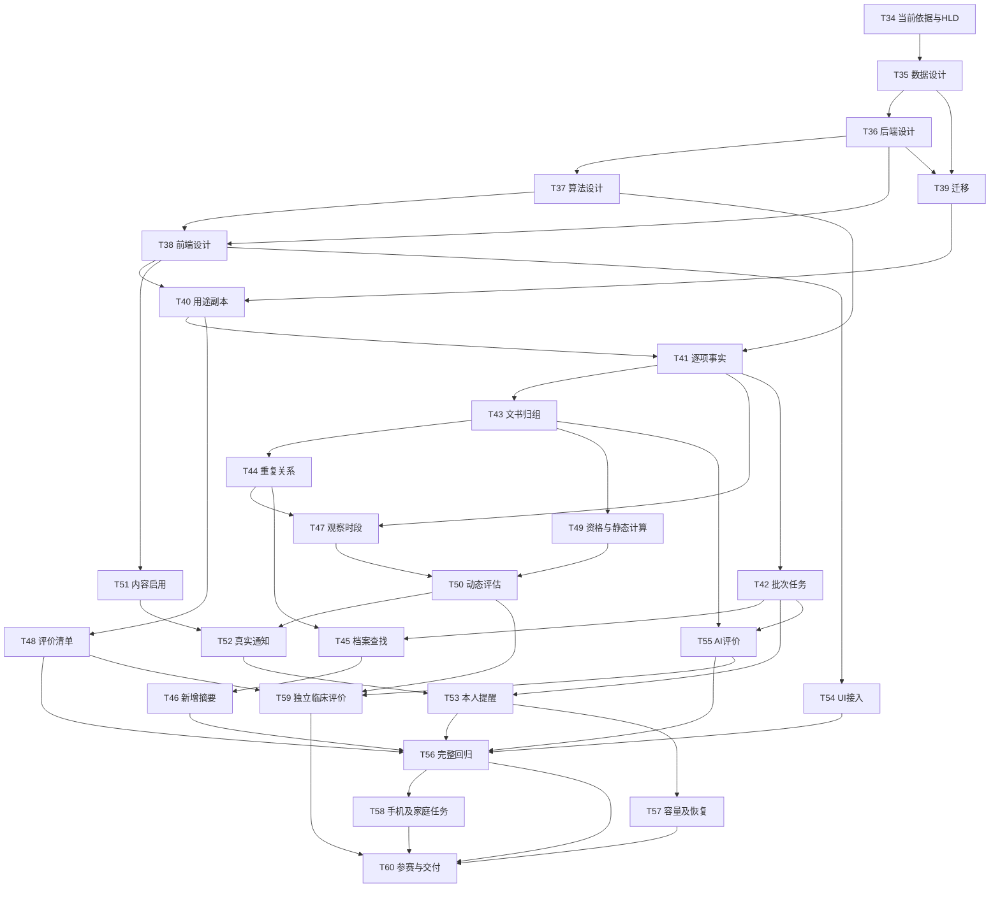

# sJIA 守护者联盟 2.0 迭代计划

日期：2026-10-07。执行模式：AUTHORIZED_BACKLOG。当前请求范围为全部功能实施、参赛优化与完整业务验收。产品依据为 PRD V2.0.0，界面依据为 UI 2.0。完整工单位于 [implementation-tasks.md](implementation-tasks.md)，任务状态唯一来源为 [planning/delivery-ledger.json](planning/delivery-ledger.json)。

2026-10-09 执行要求：全部开发与联调使用模拟数据，截止北京时间2026-10-10上午9:00。模拟数据库、文件、账号、批准及消息环境独立保存，使用实际接口、权限、任务与持久结果检验业务。当前集中实施 T46；T44、T45、T49、T50、T51、T52、T53 独立开发已经登记 IMPLEMENTED，开发剩余22项，验收剩余54项。完整功能实施及必要运行检查完成后登记 IMPLEMENTED，真实业务验收通过后登记 ACCEPTED；模拟验收与真实验收分别记录。辅助模块、文档和单项检查不能计为完整任务完成。每完成一个完整任务，报告编号、完成内容、开发剩余、验收剩余及下一项。缺少外部条件时登记具体缺口并继续其他开发，不重复查询或持续等待；没有改动、条件变化或新问题时不重复检查和生成证据。UI 2.0全部39个页面、328项状态、内容及交互保留完整要求，视觉操作限制继续有效；未验证业务及未执行视觉比对的部分保留待验收。

## 1. 范围与交付结果

保留 F01—F12、G01—G06、FR-01—FR-12 及全部未完成验收，纳入 FR-13—FR-22、GR-01—GR-10、OPT-01—OPT-10。共 60 项任务：T01—T33 延续已有职责，T34—T60 为 27 项新增工单；实施与验收按真实结果更新。

2.0 的完整用户流程为：提供获准原件 → 按文书与就诊整理 → 确认逐项事实及时间 → 核对重复关系 → 专业核对 → 静态及动态评估 → 当前有效提示 → 实际通知与阅读 → 查询原件和准备就医摘要。本人资料提醒具有独立设置与状态。受控核对、规则启用、评价资料和用途副本不进入家庭主导航。

## 2. 按分数从低到高确定投入重点

分数沿用参赛优化方案中的产品判断；目标分为取得证据后的复评目标，当前规划不提高评分，也不表示官方评分或获奖概率。

| 顺序 | 评价项目 | 当前分 → 目标分 | 2.0 责任任务 | 必须展示的结果 |
| --- | --- | --- | --- | --- |
| 1 | 动态预警 | 2 → 8 | T41、T44、T47、T49、T50 | 同一病例的连续资料、实际计算、依据及失效过程可追溯 |
| 2 | 临床效果证据 | 2 → 6 | T48、T59 | 独立答案、固定版本、完整分母、未覆盖范围和静态动态对照 |
| 3 | 通知与后续处理 | 3 → 8 | T51、T52、T53、T58 | 真实受理、送达、阅读及当前有效联系分别可查 |
| 4 | 原始需求完成度 | 5 → 9 | T54、T56、T60 | 原始承诺及本期需求逐项有结果、证据和未完成状态 |
| 5 | 创新与差异 | 5 → 8 | T46、T50、T58—T60 | 资料整理、连续变化与家庭操作的实际增益 |
| 6 | 静态分类与 MS | 6 → 9 | T49、T59 | 合格输入、固定规则、逐项结果与独立答案一致 |
| 7 | AI 应用价值 | 7 → 8 | T40—T44、T55 | 原件／录音、模型候选、本人采用及保存回读之间可以逐字段查验 |
| 8 | 工程可靠性 | 7 → 9 | T34—T39、T56—T58 | 真实数据迁移、隔离、恢复、容量、设备及运行证据 |
| 9 | 监护人体验 | 8 → 9 | T45、T46、T53、T54、T58 | 家庭能够完成登记、查询、理解提示和准备摘要 |
| 10 | 问题与选题价值 | 9 → 9 | T58—T60 | 获准访谈、任务观察及结果支持参赛陈述 |

低分决定资源投入，数据与接口依赖决定编码顺序。T48 的实际资料收集、独立答案准备和 T60 的赛事原文收集应尽早安排；其最终验收仍等待相应实现和验证完成。

## 3. 验收节点与执行顺序

| 节点 | 任务范围与建议顺序 | 可检查产物 | 完成条件 |
| --- | --- | --- | --- |
| I0 设计与证据输入明确 | T34 → T35 → T36 → T37 → T38 | 2.0 HLD、四类 LLD、Schema、接口／页面映射、环境及输入清单 | FR-01—FR-22、FD-01—FD-71、39 页及全部新增状态有维护责任；数据、接口与算法语义明确；未知条件有影响范围 |
| I1 评估可以追溯 | T39 → T40 → T41 → T43 → T44 → T47 → T49 → T50；依赖满足时推进 T48 | 迁移核对、用途副本、逐项时间、文书归属、采样关系、评估输入与结果 | GRAC-01／03／04／07、AC-04／05／06／10、AC-DYN-01—05 的实际输入与结果可复查；未覆盖场景保留未验收 |
| I2 提示可以采用 | T51 → T52；依赖不足时完成已知内部接口，发送等待必要条件 | 批准内容、有效事件、接收计划、真实回执、详情和阅读 | AC-07／12、AC-NOTIFY-01／02；读取和发送均检查当前权限及事件版本 |
| I3 档案与界面完整 | T42 → T45 → T46 → T53；T54 在 T38 完成后可执行；T55 在资料流程齐备后执行 | 批次恢复、查找、新增摘要、本人提醒、39 页正式接入、AI 字段评价 | GRAC-02／05／06／10、AC-AI-01；原件、事实、页面、草稿及重新读取一致 |
| I4 证据与参赛交付完整 | T56 → T57 → T58 → T59 → T60，按实际依赖调整 | 完整验收矩阵、真实设备／容量／恢复、独立评价、演示及提交材料 | 原始和新增必需验收通过；官方要求逐项有证据；指定环境可复现；临床启用条件单独核查 |

I0—I4 是本计划的交付节点，与 PRD 的 M01—M06 及优化方案 M1—M4 关联，不建立第二套任务状态。节点按验收结果完成，不按文件数量完成。I1、I2 对应参赛重点；I3 的全部要求保留，未经用户改变范围不删除。

T59 的固定版本回放与临床统计在 T48、T49、T50、T55 完成后即可执行，无需等待全部手机观察结束；其中 EVAL-05 的家庭理解部分接收 T58 结果。资料准备和官方要求收集从 I0 开始，最终交付保持完整验收条件。

图示为主要关系；准确 `depends_on` 集合由唯一交付记录维护。存在独立输入不代表已经授权并行代理；共享文件、数据库及进程按单一执行者顺序管理。

## 4. 必要输入与责任

| 决策／条件 | 已有依据 | 尚需的准确输入 | 影响动作与责任 |
| --- | --- | --- | --- |
| D01 运行、设备和期限 | 本地服务记录存在，实际状态在执行前检查 | 官方截止时间、提交形式、可用人员与工时、目标实例、设备、容量、预算、RTO／RPO | 项目负责人；T34、T57、T58、T60 的目标验收与日历排期 |
| D02 身份与关系 | 已有自建账号体系的用户决定 | 真实账号、患儿关系证明、核对及评价岗位分配 | 项目负责人；所有真实病例操作；不重新选择认证方案 |
| D03／D04／D07 专业资格与规则 | 原件确认、保留原值和确定性算法已有要求 | 准确核对责任、时间窗口、可比较单位／方法、批准版本及独立边界答案 | 临床与资料负责人；T41、T44、T47、T49、T50、T59 的对应正向验收 |
| D05／D06 通知与家庭内容 | 已有站内消息方向，家庭文字与内部结果分别控制 | 本次需要验收的真实渠道、接收人、触发和重发策略、当前文字、联系信息及发送授权 | 项目与临床负责人；T51、T52；T53 的外部渠道另按本人设置 |
| D08 实际资料与评价 | 本地资料和 QA04 已有用途记录 | 每份资料的实际用途、身份、独立标签、观察窗口、家庭参与依据、测量目标 | 资料与临床负责人；T40、T48、T55、T58、T59；原始资料数量不能推定独立患儿数量 |
| D09 保存和删除 | 平台维护策略方向已登记 | 实际期限、供应商副本处理结果、备份处理与责任身份 | 项目与运行负责人；T40、T52、T57、T60 |
| D10 识别与语音 | 已有 Ark 和本地语音接入；秘密不进入文档 | 模型准确版本、获准用途、预算、超时、保留条件及真实资料评价 | 技术负责人；T37、T41、T42、T55 |
| UI2-D05 受控入口 | 六个页面为设计推导；UI2-D01—08 记录来源 | 正式岗位入口、路由和操作范围 | T38 在设计中决定并核查；不得为家庭增加专业权限 |

现有用户技术选择继续有效。临床批准、真实资料用途和生产运行条件需要具体证据。未提供输入只限制对应动作；工单仍保留完整实施和验收要求。

## 5. 任务完成与计划续接

- 每项任务具有稳定 ID、唯一 `development_record`、上下文、实现依赖、验证前置、修改边界、风险及恢复方法。全部字段和五类实施节点见完整工单。
- 每个业务用例在编码前定义 Given／When／Then 和独立预期。获准原件、真实账号、真实模型或渠道执行；保存后重新读取，并检查后续页面或服务采用。
- 编码、文档、索引、受影响知识和接口更新共同进入 DoD。原始 T 任务与新增任务分别保留验收责任，新增通过不能自动关闭原始 V／AC。
- UI 2.0 已有 39 页、328 状态、195 次宽度和 39 次文字尺寸检查，证据限设计预览。正式界面仍需 T54、T56、T58；视觉比较维持 NOT_RUN。
- 模拟病例、身份、批准和输入按2026-10-09用户授权用于独立开发；运行证明来自实际接口、任务、保存和读取，明确标记 SIMULATION。真实临床阈值、批准、独立答案及业务验收按获准资料核验，未覆盖部分继续待验收。
- 续接入口由交付记录的 next_task_id 维护；依赖已满足的任务连续推进。当前用户已授权全部功能实施；临床启用、具体外部发送和指定环境发布分别核查准确依据与目标。

日历排期等待 D01 的赛事日期与可用资源；本计划提供完整依赖和验收顺序。工时估算由 T34 结合真实代码差异、可用资料与服务条件记录，不能将等待外部输入的时间写成开发完成承诺。

计划检查结果见 [validation-report.json](planning/validation-report.json)。
