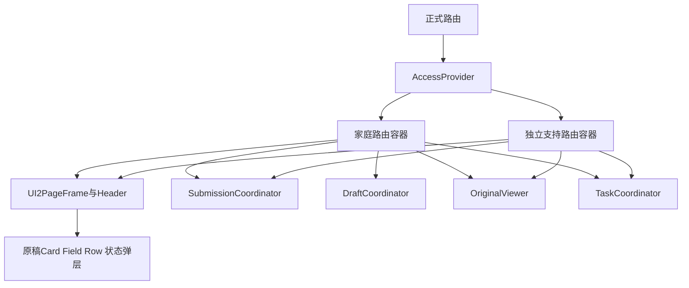

# FRONT V2.0 页面、状态与实际业务采用

日期：2026-10-07。能力：DESIGN。准确需求为 PRD 2.0，系统、数据、接口及编排分别引用 HLD／DATA／BACK／ALERT V2.0。正式产品位于 `guardian-h5`，全部状态唯一来源为交付记录。

## 1. 上游页面与业务映射

[v2-routes.csv](v2-routes.csv)登记全部 39 个页面、准确路由、容器、受众、权限、父页面、读取与写入 operation_id、实施任务和布局。[设计页面清单](../ui-delivery/v2/screen-design-map.csv)维护需求及全部 328 个适用页面状态；该分母没有减少。旧 S 标识保留为既有接口与记录的引用，UI2-01—39 为当前页面验收身份。

家庭只访问有效 Relation／AccessGrant 的患儿、动作及字段；支持入口同时需要 ServiceRoleGrant、患儿授权、CaseReadScope、环境与用途。内部评估、证明、集合和用途处理内容不得通过家庭接口取得。UI2-34—39 使用独立 `/support` 导航和包边界，家庭包不包含其组件；共同视觉组件不包含专业数据请求。深链仍由 API 当前授权，页面按钮不产生权限。

UI2-27／28／29／30／33 使用不透明 `page_id`、`document_id`、`relation_id`、`delta_id` 或 `source` identifier 参数。原件与事实的版本、候选集合和批次分别读取；标识未提供时呈现准确选择空态。刷新可恢复 URL 内准确对象，病例正文、日期筛选、原文、来源机构和患儿称呼不进入 URL。记录详情与 Fact 的映射来自服务端准确引用。

## 2. 身份与状态维护

React 18.3.1、React Router 7.18.4、Vite 8.3.1、TypeScript 7.0.2 和现有 Context／领域协调器继续使用。读取、表单、草稿、提交、原图和任务分别具有所有者；当前 `Routes`、`AccessProvider`、`useResource` 及 SubmissionCoordinator 已存在，新设计需要实际功能验收后确认采用。

`RequestIdentityV2`固定主体、audience、患儿、scopeGeneration、operationId、objectId、objectVersion 和 requestSequence。每项请求发出时保存该身份；响应与全部当前身份一致才能更新页面。相同查询的新请求也递增 sequence。Task 使用 task_id/status_version，页处理使用 page_id/version/status_version，候选使用 page_id/page_version/candidate_set_id，采用动作再次核验当前来源版本。

患儿切换处理未保存输入后取消旧读取、释放原图、清除候选及分页，表单不能转移到其他患儿。账号退出、会话失效、关系撤销和支持范围变化清除受限内容，旧响应即使返回成功也拒绝采用。页面隐藏停止轮询、语音和原图显示，保留同一有效表单的隔离内存；前台、pageshow 与 BFCache 恢复先遮蔽内容，重新取得 Session、关系、用途、配置及资源。验证失败清除内容，验证成功后才恢复同一上下文。

服务端草稿是刷新恢复来源。localStorage、sessionStorage、IndexedDB、Cache Storage、history.state 不保存病例、原图、转写、草稿或凭证。公开资产可以使用内容摘要缓存，服务端资料响应使用 no-store/private。同源 Fetch 保持 Cookie 与 CSRF，正文及敏感路径不写 console 或遥测。用户和模型文字由 React 纯文本渲染。

## 3. UI2 Token、组件数值与资产

[当前 Token 映射](v2-token-map.json)引用 [tokens.json](../ui-delivery/v2/tokens.json)、[tokens.css](../ui-delivery/v2/src/tokens.css)与 [styles.css](../ui-delivery/v2/src/styles.css)。颜色、字体、字号、间距、圆角、阴影、渐变、比例、图标及状态依次继承源文件中的选择器、顺序和媒体条件。JSON Token 与专用组件 CSS 同时接收，组件最终值以设计源码的级联结果为准，不能用统一 Token 覆盖专用数值。

| 对象 | 准确来源与要求 |
| --- | --- |
| 字体与正文 | 系统字体，页面标题 23px、通用正文 16px；`.page-content p` 最终 16px/1.75，Note 13px/1.8，特定组件另有字号 |
| 页面 | 普通边距 18px，手机独立页面左右 20px，紧凑宽度手机独立页面 14px；最大阅读宽度 580px |
| 卡片及表单 | 通用 card 20px 圆角；form-card 19px 内边距和 15px 间隔；紧凑宽度 15px；专用卡片保留准确 12／17／18／21／22px 等数值 |
| 标题与导航 | 深蓝渐变 app-header；家庭底部只有首页、记录、我的，仅 UI2-01／05／15 显示；原稿导航最小 74px，safe-area 保留 |
| 儿童 | `child-neutral-front@2x.png`，原稿 138×184px；紧凑宽度 124×169px；object-fit=contain，完整宽高比例及位置继承源码 |
| 图标与品牌 | 三张原始图标表与原始格位、裁切、阴影，尺寸按页面；登录与我的品牌使用 logo-embrace@2x.png，首页资产位置按原稿 |
| 弹层 | 页面说明、当前操作、离开编辑、原件查看分别有准确标题、关闭、焦点限制及恢复；保留当前动作输入，不叠加多个对象弹层 |
| 状态 | status-panel 按当前设计背景、字体、标题、图标和操作；三级临床颜色须有实际批准 level |
| 设备 | 320／360／390／430／580px、低高度横屏、200% 字号、键盘、safe-area、后台与微信均单独验收 |

公共布局接收手机内容区域和交互。设计工作台目录、检查面板与预览机框属于评审界面；正式业务页面中的内容、导航、状态、说明及所有控件完整保留。登录原稿的配置说明区域在真实认证可用时承接实际账号表单和恢复操作，来源为现有自建身份服务；不制造认证成功。版面和控件位置按原稿区域维护。

[资产清单](../ui-delivery/v2/asset-manifest.csv)的文件摘要和 [页面资产映射](../ui-delivery/v2/page-asset-map.csv)逐项核查。使用图片路径与字节摘要不执行图像读取。视觉比对全部 NOT_RUN，一比一还原须另行逐页视觉验收；构建、DOM 和 Token 通过各自记录。

## 4. 类型、序列化与状态来源

[v2-types.ts](v2-types.ts)维护新增 DTO、上下文和提交状态，V1 类型继续由 [types.ts](types.ts)维护。BACK JSON Schema 是字段、枚举、空值、额外字段与条件规则的维护依据；TypeScript 编译仅检查类型，实际请求与响应继续使用成熟 JSON Schema 2020-12 校验。

Version、epoch、generation、Decimal 保留字符串；版本比较使用 BigInt，原值显示保持精度。客户端不使用 Number／parseFloat 改写临床数值，不解析医学原文，不分配专业 concept_code、医学 instant 或资格。序列化明确列出字段，不展开整份 FormState、Session 或 reducer。unknown、invalid、null、零值和缺少属性分别保留。

[状态采用表](v2-state-adoption.csv)维护全部 13 个状态的真实条件、内容、恢复和验证任务。适用关系完整继承每页 required_states，访问、服务与缺失页面只有 default。读取失败与 empty 分别由真实响应事实决定，partial 保存逐项原因，stale 只允许当前授权历史显示，success 需要实际保存及重读，pending 只查询原意图或任务。临床等级必须来自当前有效家庭投影；旧等级、计算完成或页面选择不能产生当前等级。

Home 的服务、处理、当前资料、评估、事件有效性和阅读分别呈现。仍有效提示与更新处理可以共同出现；全部有效提示可以查询，首页按批准优先级和稳定 rule_key 选主提示。本人阅读只记录首次实际显示详情，预加载无阅读写入；送达依真实渠道回执，阅读不关闭临床周期。

## 5. 组件与全部业务动作

| 组件及页面 | 数据、动作、恢复与完成依据 |
| --- | --- |
| 首页／记录／我的 | 当前家庭 Session、Relation、Home、Record、Draft 和 Reminder；三项导航、患儿入口、全部原稿任务入口保留 |
| 三类登记与更正 | 医学时间八种精度、原值、限定符、方法、症状三值、原药名、实际状态；字段配置与准确权限；必要更正原因；提交及重读新版本 |
| 语音 | 用户采集真实声音→同源本地转写→Ark 结构化→原文字段候选→本人逐项决定；未确认语音不自动进入草稿或正式字段 |
| 批次 | 原件真实 SHA／size／类型、逐页接收、顺序、识别尝试、计数和预算；成功页保留，只有允许失败页重试；外部受理未知查询原请求 |
| 逐项确认 | 原项目、原值单位、各自时间精度、raw_time_text、语境否定、episode 与 source_anchor；accepted／modified／unknown／excluded 完整决定；不能共用推测日期 |
| 文书归组 | 准确 DocumentVersion、页面顺序、形成时间、医院与多个 episode 引用；新版本及历史；不覆盖事实时间 |
| 重复关系 | 五种关系、准确两端来源版本、证据和 disputed／released；未知保持未决；解除保留历史并使准确依赖失效 |
| 档案与检索 | 医院、就诊、文书类型、已确认原文和未知归属；签名分页与 snapshot_version；来源片段可回到准确页 |
| 新增内容 | 准确基准 batch／document versions 与当前批次；new／corrected／repeated／unresolved，每条来源可追溯；来源变化返回 invalid |
| 观察时段与历次值 | 自报标签、准确范围和时区；实际间隔、unknown_time_fact_ids、可比较依据；获准目标频率与实际间隔分别显示，不插值 |
| 详情与历史 | 当前和历史 RecordVersion、FactVersion、原值、时间、作者、确认、专业状态及源页；历史只读且始终执行当前权限 |
| 原件查看 | 每页独立授权 Blob，当前用途及准确副本版本；contain、缩放、旋转、翻页、区域框保留；关闭或撤权释放 URL |
| 摘要 | 范围与当前可见资料，Task completed 后重读 Summary；原值时间来源和 needs_regeneration；平台内当面阅读 |
| 账号与关联 | 当前真实认证、本人申请与关系身份、访问动作和有效期；申请成功不授予访问；退出清除病例及凭证 |
| 资料使用与提醒 | 准确用途、保存处置、本人草稿；提醒自主启用、暂停、延后和关闭，真实目标版本及安静时间；完成与送达分别读取 |
| 专业核对与评估 | 指定患儿、字段、版本、用途和专业授权；一致／需补正／无法确定；静态、MS、动态各自资格及结果；replay 无发布操作 |
| 内容与启用 | 保存、批准、独立验证、文字、联系、渠道与 release 分别有依据；缺少条件禁用实际启用，不能由页面补齐配置 |
| 资料集合与用途副本 | 真实来源、独立分组答案及完整分母；副本字节、处理证据和人工逐范围复核；家庭无读取入口 |
| 通知记录 | 实际 authorized／started／accepted／delivered／failed／uncertain／cancelled，准确各次时间与 receipt_refs；当前撤权停止新发送 |

所有 Container 负责请求、状态与领域动作；展示组件只接收当前 props 并发出明确事件。共享组件变化覆盖全部实际使用页面、长文本、空内容、未知、结果出现、弹层、键盘、权限和导航，不能只测单页。

## 6. 提交、任务、草稿与生命周期

写入继续持久 WriteIntent。固定准确载荷、operation、对象版本、request_id 和 Idempotency-Key；意图受理后使用 intent_id/generation 提交，响应未知查询原意图。同键不同正文拒绝，committed 后重新授权读取准确 resource_id/version。资源当前不可读时保留提交事实并显示访问状态，不能重新创建业务动作。冲突读取当前版本并由本人核对，不自动合并。

草稿失焦、10 秒变更检查和离开使用同一串行队列，inputRevision 和 savedInputRevision 分别保存，旧保存回执不能覆盖新输入。saved_at 只有服务端确认才显示。未知草稿写入明确后才能正式提交；本人恢复核查患儿、配置、来源、原记录及草稿版本。已提交、到期、放弃不可恢复，权限失效清除当前内容。

任务使用完整 JSON、有界轮询和 status_version，无 SSE、逐 Token Markdown 或内部推理。一次读取完成后依据实际 poll_after_ms 安排下一次；没有合法间隔停止并报告协议错误。只读网络失败最多三次额外查询，429 依真实 Retry-After 和预算；前台自动查询上限五分钟只停止客户端查询。cancel_requested 直到实际确认不能显示 cancelled。取消 Fetch 不证明服务端未提交或 Provider 停止。

原件接收和 Provider 结果独立；batch/page/fact 的部分完成分别读取。模型失败只呈现实际原因及当前允许的重试，保留原件和已保存人工输入；不换模型、补值或创建成功候选。候选采用后可重新读取正式事实及准确未核对状态。

中文 compositionstart—compositionend 期间 Enter 不提交，字典查询停止；compositionend 后防抖 300ms 读取当前 query。语音采集、转写和候选上下文绑定当前主体／患儿／attempt，取消与后台释放真实轨道、监听和计时器。每次请求必须符合当前实际运行预算，界面不能采用推测超时和配额。

原图缩放、拖动和滚动使用 requestAnimationFrame 节流；分页 limit 来自实际服务；列表 key 使用稳定对象 ID，原图仅本人主动查看读取。AbortController、Blob URL、ImageBitmap、监听、计时器在关闭、对象切换、隐藏和卸载释放。权限失效即时处理，不等待节流。

## 7. 验证及开发记录

T38 采用成熟 CSV、JSON Schema、Markdown、TypeScript AST 与 CSS 工具校验全部 39 路由、328 状态、接口和类型、准确 Token 及全部资产摘要。不调用 Provider，不生成病例，不提交业务，不读取图像，不宣称 DOM 或构建证明视觉还原。

T40—T53 逐接口实施、保存及重读；T54 正式接入所有设计组件；T55 实际模型字段评价；T56 全业务权限和追溯；T57 真实容量、费用与恢复；T58 实际手机、微信、键盘、文字放大和后台；T59 独立临床评价。每项记录当前代码、角色、输入用途、准确动作、实际断言及原始输出。官方比赛依据由 T60 接收。

浏览器操作依据当前 DOM 的 role、accessible name 与精确容器，动作前监听对应 operation、请求、对象、intent 或 task，完成必须包括真实持久结果和重新读取。访问拒绝检查响应及 DOM 受限内容为零；资料变化、较早迟到、后台和撤权分别检查旧结果拒绝采用。固定等待、HTTP 200、Toast、页面数量均不能独立表示业务通过。

视觉比对仍为 NOT_RUN，独立临床与实际设备未运行部分分别保留。唯一主记录为 [T38](../docs/development/T38.md)，任务状态来源为 [交付记录](../planning/delivery-ledger.json)。
