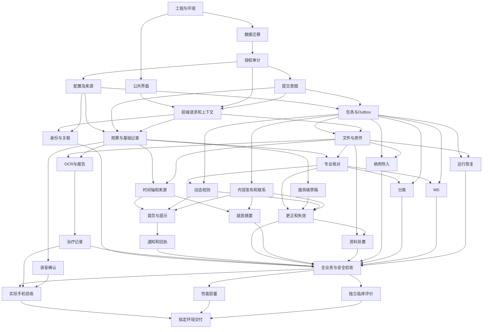

# sJIA 合并 MAS 预警平台实施计划

日期：2026-10-07。版本：PLAN V2.0。执行范围：AUTHORIZED_BACKLOG。当前用户授权完成 PRD 2.0 全部功能、参赛优化与完整验收。任务状态由 [delivery-ledger.json](planning/delivery-ledger.json) 唯一维护；本文负责工单内容、依赖解释与验收责任。保留 T01—T60 全部 60 项任务与原始验收；各项状态按实际实施及证据更新。迭代顺序和验收节点见 [2.0 迭代计划](2.0迭代计划.md)，新增完整工单见第 10 节。

## 1. 项目依据与当前状态

| 依据 | 当前版本及用途 |
| --- | --- |
| [需求输入](sJIA合并MAS预警平台需求输入.md)、[产品目标](sJIA合并MAS预警平台产品目标.md) | F01—F12、G01—G06、治疗背景及家庭使用结果 |
| [PRD](sJIA合并MAS预警平台PRD.md) | V2.0.0；FR-01—FR-22、FD-01—FD-71、原始 AC、GRAC-01—GRAC-10、动态及参赛验收、NFR-01—NFR-18 |
| [HLD](sJIA合并MAS预警平台HLD.md) | V1.0；C01—C10、ADR-001—ADR-006、部署与信任边界 |
| [数据 LLD](sJIA合并MAS预警平台数据LLD.md) | DATA V1.3；82 张数据表、Q01—Q27、TX01—TX08、病例领域结构 |
| [后端 LLD](sJIA合并MAS预警平台后端LLD.md) | BACK V1.1；六张补充表、106 项操作、任务、授权、事务与运行配置 |
| [预警编排 LLD](sJIA合并MAS预警平台预警编排LLD.md) | ALERT V1.1；N00—N11、确定性分类、MS、动态信号及持续触发周期 |
| [前端 LLD](sJIA合并MAS预警平台前端LLD.md) | FRONT V1.1；24 项路由登记、56 项家庭调用、FRONT-Q01—Q20 |
| [接口接收规范](backend-design/handshake.md)、[握手审查报告](sJIA合并MAS预警平台握手审查报告.md) | HANDSHAKE V1.0；设计 CONDITIONALLY_APPROVED；真实业务 INSUFFICIENT_EVIDENCE |
| [页面流程](sJIA合并MAS预警平台页面流程.md)、[UI 2.0 规格](ui-delivery/v2/screens/page-specifications.md) | 39 个页面、328 个状态组合；三项主导航、二级返回；六个受控页面不进入家庭导航；T38 更新正式页面与接口映射 |
| [当前 Token](ui-delivery/v2/tokens.json)、[Token 映射](frontend-design/token-map.json) | UI 2.0 继承既有风格；T38 接收当前 Token 并维护框架映射 |
| [病例状态](data-design/clinical-dataset-status.json)、[病例说明](demo-data/README.md) | 本地病例已提供；clinical_rule_eligible=false；Golden Dataset BLOCKED |

当前目录没有 Git 元数据；以文件 SHA-256 记录版本。用户提供的 AGENTS.md 规则持续有效。开发记录已存在于 docs/development/，索引、T13、T20、T23、QA04 及相关知识文件已检索；已有 BACK-*、FRONT-*、ALERT-* 交接条目继续按第 8 节维护。

当前已有 Django 服务、家庭 H5、Ark 识别和本地语音处理；QA04 记录的本地输入与页面证据有其原始资料范围。动态计算入口、完整发送及 PRD 2.0 业务仍需按当前要求实施和验证。四份既有收据的输入文件与当前文件不一致，V01、V02、V07、V08 登记 STALE；T01、T02、T07 保留 IMPLEMENTED，进入复验集合。V27 的收据文件校验一致，仅支持其原有检查范围。当前 HLD／LLD 的 2.0 更新由 T34—T38 接收。

### 1.1 共同约束

- 实施技术依据 HLD：React、TypeScript、Vite、React Router、antd-mobile、Tailwind；Python 3.13、Django 5.2、DRF、psycopg、PostgreSQL 17、Celery 5.6、Redis、boto3、Pillow、Nginx、Gunicorn、OpenTelemetry。准确依赖由 T01 按实施时官方资料和现有 lockfile 核验；本计划不修改依赖。
- 预警为确定性执行。工单中的 Algo 指规则算法和固定 Worker 流程；自主 Agent、Prompt Cache、向量检索、SSE 的实施节点为 NOT_APPLICABLE，依据 PRD 第 9 节及 HLD 第 2.3 节。
- 业务错误在发生位置终止；不补造医学值、不使用替代 Provider、不隐藏失败。实际服务、真实账号及获准资料用于验证；缺少样本的用例保持未覆盖。
- 本地病例用途限已有项目授权。外部处理、临床核对、临床验收及公开使用分别核验相应依据。专业核对不得由测试脚本或软件检查生成。
- 前端只使用当前家庭投影；服务器执行权限、版本及临床规则。已有 UI 情景和浏览器保存方式不成为正式病例输入与存储依据。
- 所有中间结果位于项目 `.planning-work/` 或对应已忽略工作目录，执行进程的临时目录也指向项目目录。文件编辑使用文件编辑工具；不使用 Git 恢复文件。
- 用户禁止主动视觉操作。引用 `ui-delivery/screens/png/` 的真实文件路径，但不读取像素、不截图、不执行图像比较。DOM、样式数值、键盘及业务行为可以检查；视觉验收保持 NOT_RUN，不能以结构检查宣称视觉通过。
- 本计划不启动编码、部署或外部发送。后续获得实施授权后，S008 按依赖连续执行可执行项；仅必要未知阻止相关动作。当前不委派子任务。

### 1.2 五类节点与当前资格

| 节点 | 设计输入 | 实现状态 | 适用要求 |
| --- | --- | --- | --- |
| Data | 既有 DATA/BACK 可引用；2.0 增量 PENDING，由 T35 接收 | 既有模型可复用；T39 负责新增迁移与回读 | 旧原件、证明及未知时间保持；准确新增结构由数据设计维护 |
| Backend | 既有 API、事务与握手可引用；2.0 增量 PENDING，由 T36 接收 | 既有服务可复用；功能工单负责当前语义和验证 | 数据结构、授权和接口语义满足后实现依赖动作 |
| Algo | ALERT V2.0 的全部节点、十项动态规则与逐事实提取范围由 T37 完成设计检查 | T41、T49、T50 负责实际调用和采用；临床批准另列 | 固定字段及规则版本，不以本人确认授予专业资格 |
| Frontend | FRONT V2.0 全部 39 路由、328 状态、DTO、接口和准确资产由 T38 完成设计检查 | T54 与对应功能工单负责正式接入；视觉 NOT_RUN | 全部页面与服务状态逐项接收，设计预览不作为业务服务 |
| Integration | PRD 2.0 验收输入 SATISFIED；具体真实资料与环境按用例核验 | T01—T60 的未完成验收 PENDING，准确状态读取交付记录 | 保存后重新读取、后续使用、允许和拒绝分别具备实际证据 |

## 2. 原始需求与验收覆盖

### 2.1 功能和用户结果

| 原始承诺与目标 | 功能 | 用户结果与验收 | 责任工单 |
| --- | --- | --- | --- |
| F01；G01 | FR-01 | 真实登录、本人申请、核验、独立多人权限、撤销；AC-01 | T03、T08、T09、T29 |
| F02—F04、治疗背景；G02 | FR-02 | 保存观察、报告、治疗及原件，回读原值、单位、时间和来源；AC-02 | T04、T05、T10—T15、T27、T30 |
| F05；G03 | FR-03 | 时间轴、历史时间目录、关注指标和可比较方向；AC-03 | T16、T22、T29 |
| F06、F10；G06 | FR-04 | 内部分类与逐条件依据，资料不足明确；AC-04 | T17、T18、T32 |
| F12、F10；G06 | FR-05 | 七项贡献及完整 MS 可复现；AC-05 | T17、T19、T32 |
| F07、F10；G05 | FR-06 | 有效规则触发，缺批准无临床事件及通知；AC-06 | T20、T21、T22、T32 |
| F08；G05 | FR-07 | 提示来源、有效联系、独立送达与阅读；AC-07 | T21、T22、T23、T29 |
| F11；G02、G03、G06 | FR-08 | 更正、专业更正申请、撤销与历史；AC-08 | T17、T24、T29 |
| F01、F11、资料保护；G01、G06 | FR-09 | 授权、用途、审计、处置与恢复；AC-09 | T02、T03、T04、T09、T26、T27、T28、T29 |
| F02、F03、F06、F12；G06 | FR-10 | 准确版本及字段的专业核对和资格；AC-10 | T13、T17、T29、T32 |
| F09；G04 | FR-11 | 当前范围的就医摘要和准确联系；AC-11 | T21、T25、T30 |
| F06—F08、F12；G05 | FR-12 | 按当前批准展示，停用立即限制全部家庭出口；AC-12 | T03、T21—T25、T29、T32 |
| E08；G01—G05 | 手机 H5 | 真实手机输入、恢复、隐私与浏览器兼容；AC-H5-01—AC-H5-06 | T07—T16、T22—T26、T30 |
| UI A22；HLD C01 | 症状语音 | 普通话转写供本人核对，仅确认文字写入说明 | T15、T30；FRONT-Q16 |
| UI A01/A11/A13—A19/A23/A25/A26 | UI 与首页 | 儿童公共形象、三项症状、原图、品牌、三维素材及历史时间查看 | T07、T12、T16、T22、T30 |
| DATA 第 6 节；BACK 第 3.2 节 | 病例领域 | 18 张扩展表、真实来源与完整子项回读 | T02、T27、T29 |
| HLD 第 7—8 节；ALERT 第 7 节 | 运行与临床评价 | 真实故障恢复、容量及独立病例和家庭观察 | T01、T28—T33 |

### 2.2 字段、规则与运行要求

| 字段或规则 | 必需传播和检查 | 责任工单 |
| --- | --- | --- |
| FD-01—FD-07 | 身份、关联、授权证明、自报与专业状态分别保存 | T03、T09、T10、T17 |
| FD-08—FD-14 | 家庭观察与专业变量分别处理；未知保留 | T10、T15、T17 |
| FD-15—FD-20 | 原件、来源、项目、原值、比较符、三类时间、方法 | T10、T12、T13、T16、T27 |
| FD-21—FD-28 | 关键与扩展检验、字典、独立单位映射及标准值 | T04、T13、T16、T17、T18、T19、T20 |
| FD-29—FD-32 | 质量与核对状态、作者、版本、更正原因 | T10、T17、T24 |
| FD-33—FD-34 | 原药名、治疗类别、起止和持续状态及完整附件 | T14、T17、T20、T27 |
| FD-35—FD-39 | 核对证明、撤销、评估输入、时间及策略 | T17、T18、T19、T20、T24 |
| FD-40—FD-46 | 规则、结果、家庭批准及字段可见范围 | T04、T18—T22 |
| FD-47—FD-49 | 事件、准确评估、接收、发送、回执和阅读 | T20—T23 |
| FD-50—FD-52 | 摘要引用、准确联系、维护人和有效期 | T21、T25 |
| FD-53—FD-55 | 使用依据、审计、逐对象保存删除政策 | T03、T04、T26—T28 |
| FD-56—FD-57 | 请求标识、预期版本、服务端草稿和终态 | T05、T08、T11、T24 |
| BR-V01、BR-T01—BR-T02、BR-P01—BR-P02 | 资格、时间、固定输入、当前投影和依赖失效 | T03、T16—T20、T24 |
| BR-C00—BR-C07、BR-M01 | PRD 唯一维护公式、比较符及三值规则 | T18、T19、T32 |
| BR-A01—BR-A04、UM-01—UM-12 | 准确批准、映射、持续触发、验证及启用 | T04、T17、T20、T21、T23、T32 |
| NFR-01、NFR-07、NFR-13 | 数据隔离、加密、秘密、审计、页面清理 | T03、T08、T09、T12、T28—T30 |
| NFR-02、NFR-03 | 原始事实和确定性计算精度 | T02、T10、T13、T14、T16—T20、T27、T32 |
| NFR-04、NFR-10 | 当前有效性、在途采用、批准与停用 | T03、T06、T17、T20—T25、T29 |
| NFR-05、NFR-11 | 320/360/390/430/580px、200% 字号、实际手机与微信环境 | T07、T08、T15、T30 |
| NFR-06 | 真实容量、网络、首次和再次访问、API/Worker 耗时 | T28、T31 |
| NFR-08、NFR-12 | 草稿、提交未知、幂等、租约与恢复 | T05、T06、T08、T11、T28—T30 |
| NFR-09 | 数据、文件、Provider 副本、备份及审计的处置 | T04、T26、T28、T29 |
| EV-01—EV-07 | 关联、登记、查询、摘要、通知、评估、家庭观察的实际事件口径 | T09—T25、T28、T30、T32 |

全部字段经 DATA 字段传播表 → BACK 序列化 → FRONT 类型及页面 → 实际保存和重新读取核查。仅检查字段名称不能完成对应验收。机器追溯见 [coverage.csv](planning/coverage.csv)。

## 3. 决策与外部输入

决策继续使用原 ID，权威位置为 PRD 第 7.2、13.2 节。以下为规划引用，来源类型 UNKNOWN 表示尚缺准确批准内容；已有明确用户决定继续有效。外部条件齐备时必须核验版本、环境、执行人及证据，不能凭文件存在判定已经批准。

| decision_id | 来源类型／状态 | 责任、所需输入与解除条件 | 影响动作 |
| --- | --- | --- | --- |
| D01 | UNKNOWN / NEEDS_INPUT | 项目负责人提供环境、运行责任、容量、预算、RTO/RPO、性能目标和设备清单 | T01 环境参数；T28、T31、T33 的目标环境验收 |
| D02 | EXPLICIT / CONFIRMED；运行资格 NEEDS_INPUT | 自建账号选择沿用已登记用户决定；真实账号、患儿关系证明及专业岗位授权需准确记录 | T03、T09 的真实授权；T49／T56 的核对及拒绝路径 |
| D03 | EXPLICIT+UNKNOWN / NEEDS_INPUT | 拍照和本人确认已明确；字段、文件限制、OCR、核对人员及专业定义需准确配置 | T04、T10、T12—T14、T17—T20 |
| D04 | UNKNOWN / NEEDS_INPUT | 临床负责人批准时间窗口、重复选值、限定值和缺项规则、治疗适用解释 | T17—T20、T32 患者级计算与评价 |
| D05 | EXPLICIT+UNKNOWN / NEEDS_INPUT | 站内消息方向已有用户决定；准确触发、等级、周期、接收人与本次真实渠道及联系路径仍需相应依据 | T20—T23、T50—T53、T59 的适用启用和发送 |
| D06 | EXPLICIT+UNKNOWN / NEEDS_INPUT | 平台维护家庭文字方向已明确；准确逐字段范围、内容与批准版本仍需记录 | T21—T25、T51 的内容生效 |
| D07 | EXPLICIT+UNKNOWN / NEEDS_INPUT | 平台维护来源及单位映射方向已明确；具体字段、方法、版本及适用批准仍需核查 | T04、T13、T16—T20、T27、T41、T49、T50 |
| D08 | EXPLICIT+UNKNOWN / NEEDS_INPUT | 本地病例使用已登记；新增用途、专业核对、独立 Gold、临床和家庭评价方案仍需证据 | T12/T13 外部处理；T18—T20、T30、T32 临床或家庭验收 |
| D09 | EXPLICIT+UNKNOWN / NEEDS_INPUT | 平台维护处置政策方向已明确；具体期限、供应商副本、联系维护人及恢复条件仍需准确记录 | T04、T26、T28、T33、T40、T57、T60 |
| D10 | EXPLICIT / CONFIRMED；用途与运行条件 NEEDS_INPUT | Ark 选择沿用用户决定；准确模型版本、额度、外部处理用途和真实资料评价由执行任务核查 | T13—T15、T37、T41、T42、T55 |
| ADR-001—ADR-006、BACK-001—BACK-005、FRONT-001—FRONT-005、ALERT-002—ALERT-004 | INFERRED / PROPOSED | T01 接收现有设计，记录实施适用版本；必要语义不足交对应 S004/S005 维护者 | 对应模块的实现接收；不据此改变医学规则 |
| VOICE-PROCESSING | EXPLICIT+UNKNOWN / NEEDS_INPUT | 已有 MediaRecorder、同源接口、本地 faster-whisper 和内存音频处理；实际家庭声音用途与目标设备仍需核验 | T15、T55、T58 的真实输入和设备验收 |
| CR-00、CR-10；UI 已明确用户要求 | EXPLICIT / CONFIRMED | 首期监护人 H5、受控支持操作、既有风格与交互 | T07—T30 继承，不重复询问 |

重新评估条件：需求、岗位、来源用途、Provider、部署地区、配置内容、设备范围或运行制品改变。执行者更新权威文档及受影响任务，把不再适用的证据标为 STALE。当前无需为完成计划等待以上输入；业务和发布操作按对应条件执行。

## 4. 任务依赖与执行顺序

`depends_on` 只记录实现所需产物。验证前置包括实际账号、原件、Gold、Provider、手机及运行环境；发布前置包括 D01—D09 的适用批准和完整运行证据，两者分别登记。后端定义已满足时，前端静态组件可以独立实现；功能完成必须经过真实集成。

当前下一项为 T34，读取现有实现与证据，完成 2.0 设计接收及复验安排。以下图示保留 T01—T33 的基础依赖；新增依赖由第 10 节和交付记录维护。没有委派授权，当前执行者按拓扑顺序处理共享目录、数据库和进程。



准确依赖集合以 JSON 为准。T20 独立实现动态求值；当获准规则引用分类或 MS 时，T18/T19 是该用例的验证前置。T24 实现通用依赖失效，摘要组合验证还需要 T25。T21 的发布服务可以完成结构与拒绝路径实现，实际临床发布需要 T18—T20 的相应证据及 D08 批准。不得以静态配置检查替代该条件。

正向功能验收在 D08 明确批准的验证环境和用途内执行，使用真实批准配置、获准资料及独立答案。T32 负责平台临床效能与家庭理解评价，T33 据此判断指定使用环境的启用条件；验证环境内的事件与渠道测试不自动取得真实家庭开放权限。缺少验证用途批准时，受影响正向用例保持未验收。

T01—T33 按现有内容接续与复验，避免重新创建已存在的能力。2.0 的建议顺序见独立迭代计划；必要输入不足时保留受影响验收并继续依赖已经满足的工作，原始验收不因新增任务而关闭。

## 5. 工单共同字段与验收纪律

每张工单继承本节，个别条件在对应工单中补充。`Tnn` 为稳定 task_id，唯一开发记录为 `docs/development/Tnn.md`；已有正文持续更新，尚无正文的任务在开始时创建，索引见 [开发记录索引](docs/development/index.md)。本文 `Vnn` 为工单级验收 ID，对应 `CHECK-Tnn`；原始 AC 与各 LLD 检查 ID 继续通过第 2、7、10 节和 coverage.csv 保留。工单中的 PENDING 表示相应实施或验证责任尚待完成，实际状态读取唯一交付记录。

**必需上下文：**所有工单实际读取 `@implementation-tasks.md`、`@planning/delivery-ledger.json`、`@docs/development/index.md`、`@sJIA合并MAS预警平台PRD.md`、`@sJIA合并MAS预警平台HLD.md`、`@backend-design/handshake.md`；再读取工单指明的 LLD、Schema、前置任务开发记录和实际产物。不得只依据本文转述编码。

**开发记录与知识：**记录检索命中、采用依据、当前实现、identifier、角色及调用方、输入和配置摘要、环境、实际命令、断言、原始证据、未完成项及下一任务。每项完成时更新唯一记录和索引；相关知识集中维护 `docs/knowledge/implementation.md` 与其索引，内容产生时建立。受影响设计由对应 S002/S004/S005 维护位置更新，记录引用准确版本。不存在文件时登记待创建，不制造空的验收记录。

**修改边界：**下列 backend、deploy、tests 目录为计划位置，T01 核实后建立；现有原型继续使用 guardian-h5。T02 独立维护 migrations；T03 维护授权和审计公共模块；T04 维护配置登记；T05/T06 维护公共协议与任务；T07 维护共享 UI；T08 维护请求和上下文。功能工单涉及共享文件时由当前执行者核对这些主记录及全部调用方。`demo-data/` 原件、原文、权威设计参数不可随实施任意改写；禁止添加无关产品页面或框架升级。

**风险与恢复：**全部写入保持同一患儿、预期版本、准确用途、稳定业务键与固定锁顺序。数据库迁移前核验实例、备份及恢复演练；失败立即停止受影响写入，使用隔离恢复和经授权的数据处理。代码恢复使用文件编辑工具。Provider 已发生的副作用通过真实查询及回执核对；历史事实、原件与审计不覆盖。具体风险同时列入每张工单。

**五类步骤：**每张功能工单的 Data → Backend → Algo → Frontend → Integration 按实际依赖执行。正文的 PENDING 表示尚未实现；SATISFIED 仅用于已经接收的设计；NOT_APPLICABLE 后必须有原因。实现前编写对应 Given/When/Then 及真实资料需求，随后实施并运行可用检查。不得以缺少真实输入为理由生成替代数据。

**完成条件：**代码、数据库/服务响应、页面动作与后续使用全部达到本工单断言；允许与拒绝分别验证；必需开发记录及索引完整。JSON 中每个 Vnn 的检查、消费方和证据更新后才可登记 ACCEPTED。原始 AC 的通过还需第 7 节的完整组合用例，工单局部通过不能自动关闭原始 AC。

**验证命令约定：**已有命令见第 9 节。后端用例由对应工单建立 `backend/tests/test_Tnn.py`，在核验的隔离数据库运行 `backend/.venv/bin/python backend/manage.py test tests.test_Tnn --settings=config.settings.qa --keepdb --noinput`。真实浏览器沿用项目 Playwright 脚本方式，由工单建立 `guardian-h5/scripts/acceptance-Tnn.mjs`，执行 `node guardian-h5/scripts/acceptance-Tnn.mjs`。这些未来入口均为 NOT_RUN，不预写运行成功。每个入口需从获准清单取得实际账号、资料和独立预期，不自动建立合成输入。每项工单使用 B（后端）、E（真实浏览器）、S（设计检查）、O（运行检查）标识命令类别；实际参数和服务身份保存在唯一开发记录。不得对未知数据库执行测试或清理。

## 6. 完整实施工单

### T01 工程、设计接收与环境身份

- `development_record`: `docs/development/T01.md`；`acceptance_ids`: V01；`depends_on`: 无；责任：S008/S011，S006 接收设计。
- 需求与结果：HLD C01—C10、NFR-07/08；形成可以辨认实例、版本、配置和能力状态的实际开发环境。
- 上下文：HLD 第 3、7 节；BACK 第 6—8 节；`@guardian-h5/package.json`、`@backend-design/runtime.schema.json`、审查报告。
- 步骤：接收 ADR/BACK/FRONT/ALERT 当前语义；建立 backend、deploy、真实测试入口及项目临时目录；核验官方依赖用法并锁定版本；建立 Python 3.13、PostgreSQL 17、Redis 和私有对象存储的开发配置；记录主机、端口、数据库、对象区和进程归属；启用项缺配置立即报错。
- 五类节点：Data/Backend/Integration PENDING；Algo NOT_APPLICABLE（基础环境）；Frontend PENDING（现有工程构建）。
- 修改范围：`backend/` 工程配置、`deploy/`、`.gitignore`、测试入口及环境说明；前端仅构建配置。
- 决策与验证：D01 目标环境、D02 真实初始化主体、D09 审计政策；未知条件只阻止相关环境开放。O/S：实际版本、依赖健康、禁用能力、无秘密输出及现有前端构建均有记录。初始化不生成病例或临床批准。
- 风险与恢复：登记已有进程和持久化目录；不占用或终止其他任务资源。交接 T02、T07；V01 完成只代表工程就绪。

### T02 数据模型与目标数据库迁移

- `development_record`: `docs/development/T02.md`；`acceptance_ids`: V02；`depends_on`: T01；责任：S008，S005-1/2 接收，S009 验证。
- 需求与结果：FD-01—FD-57、NFR-02/04/09；88 张业务及运行表和独立 Session 迁移保持正式约束。
- 上下文：`@sJIA合并MAS预警平台数据LLD.md` 第 3—7 节；BACK 第 3 节；`@data-design/schema.sql`、`@data-design/case-schema.sql`、`@backend-design/schema.sql`、queries.sql、case-queries.sql。
- 步骤：建立 ORM 和 migrations，保留 finite_decimal、复合引用、部分唯一索引及全部病例实体；迁移空库并核验查询；定义已存在数据环境的检查、兼容迁移、逐值核对和隔离恢复流程；处理 alert_evaluation 六项结构与事件必需引用。
- 五类节点：Data/Integration PENDING；Backend PENDING（ORM）；Algo/Frontend NOT_APPLICABLE（公共持久结构）。
- 修改范围：`backend/*/models`、`backend/*/migrations`、数据库检查；共享迁移由本任务维护。
- 验证：B/S；PostgreSQL 17 实际建表、约束及查询通过；真实获准资料导入回读由 T27 完成。有数据环境验证无可用实例时保留 NOT_RUN，禁止以空库通过替代。D01/D08/D09 限制相应数据使用。
- 风险与恢复：未知数据库拒绝迁移；不为缺少来源的历史事件生成评估依据。交接 T03 和所有持久化任务。

### T03 服务端授权、家庭投影与审计公共能力

- `development_record`: `docs/development/T03.md`；`acceptance_ids`: V03；`depends_on`: T02；责任：S008/S010。
- 需求与结果：FR-09/12、AC-09/12、NFR-01/04/07/10；逐主体、患儿、动作、字段、用途、环境限制真实资源。
- 上下文：DATA TX01—TX08；BACK 第 2、3.3、4 节；FRONT 第 2 节；`@backend-design/protocol.schema.json`。
- 步骤：实现 Policy Gate、获准 QuerySet、REPEATABLE READ 读取和固定锁顺序；显式 Serializer 拒绝保护字段；家庭投影拒绝未批准临床字段；写审计与业务同事务，读取/拒绝审计持久化后才响应；建立环境资格与 epoch 检查。
- 五类节点：Data/Backend/Integration PENDING；Algo/Frontend NOT_APPLICABLE（调用方分别接入）。
- 修改范围：`backend/identity/`、`backend/authorization/`、`backend/audit/`、`backend/family_content/` 公共投影。
- 验证：B；D02/D08 有效主体与获准资源分别验证允许、跨患儿、普通管理员拒绝和审计回读。真实身份接入组合由 T09/T29 完成；公共能力可使用获准初始化的实际岗位主体验证，不创建测试替代身份。无授权输入时保持未验收。
- 风险与恢复：审计不可写即拒绝受保护动作；停用受影响入口并保留历史事实。交接 T04、T05、T08。

### T04 来源、用途、运行配置、字段字典与单位映射

- `development_record`: `docs/development/T04.md`；`acceptance_ids`: V04；`depends_on`: T03；责任：S008，S005-1/2 维护定义。
- 需求与结果：FR-02/09/12、FD-17/28/40/45/46/53/55、UM-01—UM-12；配置能够保存且实际消费方读取指定生效版本。
- 上下文：BACK 第 4.2、6.1 节；DATA 第 2、4.5 节；handshake 第 2 节；runtime/protocol Schema 与 API 目录。
- 步骤：实现 source/source_revision、用途及 retention 前置支持操作；注册准确 kind/schema_version；字段配置、字典、映射只按有效批准开放；配置不可变、验证和批准分开；运行进程报告 loaded_config_version，修改配置提升环境版本。
- 五类节点：Data/Backend/Integration PENDING；Algo PENDING（Decimal 归一化）；Frontend PENDING（支持表单及家庭配置读取，不新增家庭配置管理页）。
- 修改范围：`backend/configurations/`、`backend/sources/`、`backend/dictionaries/`、受控支持表单。
- 验证：B；D03/D07/D09 提供真实配置。保存后重新读取并实际执行字段许可、单位转换及停用；未知映射不换算，保存不自动启用。T10/T16 验证表单和查询采用。
- 风险与恢复：不填写未知医学参数；停用准确配置并更新依赖资格。交接 T06、T09、T10。

### T05 提交意图、幂等与结果恢复

- `development_record`: `docs/development/T05.md`；`acceptance_ids`: V05；`depends_on`: T03；责任：S008/S009。
- 需求与结果：FD-56、AC-H5-04、NFR-08/12；同一业务提交只产生一次效果，结果未知可查询。
- 上下文：BACK 第 2.3—2.4、4.3 节；handshake 第 4 节；IntentInput、RequestView。
- 步骤：实现 prepare/query/retry、准确 target_key、固定 payload 摘要和 generation；无患儿的本人申请使用 request_recent_account；意图、业务、请求结果、Outbox、审计共同提交；Reconciler 仅在证明未提交后开放原键重试。
- 五类节点：Data/Backend/Integration PENDING；Algo/Frontend NOT_APPLICABLE（T08 负责客户端协调）。
- 修改范围：`backend/requests/`、公共事务接入点及并发测试。
- 验证：B；通过获准实际写入运行中断、同键重放、异内容拒绝、过期代次及迟到请求竞争；unknown/not_found 不能导致新业务键。当前尚无业务写入时，组合用例保留给 T09/T10/T29。
- 风险与恢复：不删除幂等身份掩盖未知效果；按原意图查询事实。交接 T06、T08。

### T06 Task、Outbox、Worker 与结果采用

- `development_record`: `docs/development/T06.md`；`acceptance_ids`: V06；`depends_on`: T04、T05；责任：S008/S011。
- 需求与结果：BACK 第 5 节、BQA17/18、NFR-04/08；数据库维护权威任务和真实副作用状态。
- 上下文：BACK runtime、TaskView；DATA 任务/Outbox；ALERT 第 4—5 节；handshake 第 6 节。
- 步骤：注册 runtime 定义的 file_validation、ocr、assessment、alert_evaluation、summary、notification、disposition、reconcile；实现 Dispatcher、消费去重、租约/心跳/代次、取消、超时、未知受理查询及有界预算；accepted 先消费时不得被 queued 覆盖；家庭评估进度不含内部结果或控制动作。
- 五类节点：Data/Backend/Algo/Integration PENDING；Frontend NOT_APPLICABLE（T08 轮询）。
- 修改范围：`backend/tasks/`、各 Worker 入口、`deploy/` 队列配置。
- 验证：B/O；真实 Redis 和 Worker 中断、重复投递、旧租约提交、取消与资源释放；真实 Provider 未提供的未知受理场景等待 T13/T23。检查消息无病例正文，外部调用不持有业务事务。
- 风险与恢复：只重放已确认没有副作用的允许任务；配置预算缺少时拒绝启用。交接文件、规则、摘要、通知与运行任务。

### T07 UI Token、公共组件、品牌及导航

- `development_record`: `docs/development/T07.md`；`acceptance_ids`: V07；`depends_on`: T01；责任：S008/S005-4。
- 需求与结果：UI 已确认要求、NFR-05/11；保留完整公共界面和全部页面入口。
- 上下文：FRONT 第 3、5 节；`@ui-delivery/tokens.json`、`@frontend-design/token-map.json`、`@ui-delivery/route-design-map.csv`、page-specifications、state-specifications；参考路径 `ui-delivery/screens/png/S03.png`、`S03-dark.png`、`S01.png`、`S13-A.png`。
- 步骤：语义 CSS、antd-mobile 映射、TaskHeader、BrandLockup、三维图标、公共角色、状态组件和焦点管理；仅三项主页面显示导航；保留原型目录的评审环境限制；登记全部共享调用方。
- 五类节点：Frontend/Integration PENDING；Data/Backend/Algo NOT_APPLICABLE（公开资产与公共布局）。
- 修改范围：`guardian-h5/src/components/`、`src/styles/`、`src/app/Layout.tsx`、公共资产引用。
- 验证：S/E 的 DOM 和 computed style；44px 触控、320/360/390/430/580px、200% 字号、深色、减少动态、弹层滚动与焦点。真实业务长内容由 T30 复验；视觉保持 NOT_RUN，不影响准确报告可完成的行为检查。
- 风险与恢复：共享组件影响全部页面，修改后逐调用方核验。交接 T08 及全部页面工单。

### T08 前端协议、Data Router、上下文与轮询

- `development_record`: `docs/development/T08.md`；`acceptance_ids`: V08；`depends_on`: T03、T05、T07；责任：S008/S005-4。
- 需求与结果：FRONT-ACCESS/FORM、NFR-08/13；页面只采用当前身份、患儿和资源的准确响应。
- 上下文：FRONT 第 2、4—6 节；`@frontend-design/types.ts`、routes.csv、api-bindings.csv；现有 App/Layout/SaveActions/ContextLink。
- 步骤：接入 Data Router、Ajv、同源 Fetch、CSRF、AccessProvider、FormProvider、SubmissionCoordinator、TaskCoordinator、NavigationMemory；检查 scopeGeneration/sequence/status_version；处理 pageshow、后台、换账号、未保存离开、AbortController 和 Blob URL；注册真实 E2E 命令。
- 五类节点：Backend PENDING（协议接收）；Frontend/Integration PENDING；Data/Algo NOT_APPLICABLE（使用既有服务）。
- 修改范围：`guardian-h5/src/api/`、`src/state/`、路由入口、共享状态组件、测试配置及必要依赖锁文件。
- 验证：S/E；类型和全部 Schema 接收，当前 UI 路由及共享状态真实行为检查；无病例浏览器持久保存。真实 Session 和业务响应迟到检查由 T09/T29/T30 完成，禁止用替代响应登记通过。
- 风险与恢复：客户端取消等待不宣称服务端取消；未知提交保留原意图。交接全部家庭功能。

### T09 身份登录、关联申请、核验与撤销

- `development_record`: `docs/development/T09.md`；`acceptance_ids`: V09；`depends_on`: T04、T08；责任：S008/S009。
- 需求与结果：FR-01/09、AC-01/09；实际监护人仅管理获准患儿。
- 上下文：PRD 第 8.1、11 节；BACK identity/relations；FRONT S01/S02/S13；handshake 第 4—5 节；PNG S01、S02-A/B/C、S13-A（仅路径）。
- 步骤：Data 保存真实主体、独立关系及版本；Backend 接入指定 IdentityProvider、Session/CSRF 轮换、申请核验和岗位范围；Algo NOT_APPLICABLE；Frontend 接入登录、申请详情/撤回、患儿选择与退出；Integration 验证实际身份及撤权传播。五类适用节点 PENDING。
- 修改范围：`backend/identity/`、`backend/relations/`、支持核验表单、家庭 account/association 页面。
- 验证：B/E/EXTERNAL；D02 提供真实协议、账号和关联证明。本人允许，pending、撤销、跨患儿与普通管理员拒绝；申请 version 冲突和返回路径限制；退出后旧链接、草稿和页面均重新鉴权。
- 风险与恢复：身份成功不扩大患儿权限；撤销关系保留历史依据。交接家庭用例的真实主体。

### T10 体温、症状与基础记录保存

- `development_record`: `docs/development/T10.md`；`acceptance_ids`: V10；`depends_on`: T04、T05、T08；责任：S008/S009。
- 需求与结果：FR-02、AC-02、FD-06/08/09/15—20/29—32；家庭准确保存原始事实。
- 上下文：DATA 记录/医学时间；BACK RecordInput/FamilyRecord；FRONT 第 4.2、4.4 节；ObservationsPage、DictionaryField；PNG S04、S08。
- 步骤：Data 保存不可变版本、原始文字、Decimal 字符串、八种时间精度及来源；Backend field_config_read、record_create/read 和 protected-field 校验；Algo NOT_APPLICABLE（不推断专业变量）；Frontend 单页体温症状、IME、未知值与错误定位；Integration 保存后按服务器资源重新读取。适用节点 PENDING。
- 修改范围：`backend/records/`、`backend/medical_time/`、ObservationsPage、字段组件和详情基本显示。
- 验证：B/E；D03 字段配置、D02 账号和获准观察资料。零值/缺项、比较符、未知单位及时间分别保留；不使用录入时间补齐医学时间；配置变更拒绝旧写入并要求重新确认。
- 风险与恢复：不静默截断、不自动赋值专业发热或关节炎。交接 T11、T13—T17。

### T11 服务端草稿、恢复与正式提交衔接

- `development_record`: `docs/development/T11.md`；`acceptance_ids`: V11；`depends_on`: T10；责任：S008/S009。
- 需求与结果：FD-57、AC-H5-03/04/05、NFR-12；本人草稿和正式记录独立且可恢复。
- 上下文：PRD 第 8.18.2 节；BACK DraftInput/DraftView；FRONT 第 4.3—4.4 节；PNG S14、S04、S05、S06、S10-A。
- 步骤：Data 独立本人/患儿/表单草稿及版本；Backend create/read/update/abandon 与提交事务；Algo NOT_APPLICABLE；Frontend 失焦、离页和每 10 秒检查变化，串行保存、显示实际 saved_at、选择恢复及配置冲突；Integration 刷新、断网和已提交草稿重读。适用节点 PENDING。
- 修改范围：`backend/drafts/`、DraftCoordinator、DraftsPage、全部四类表单接入点。
- 验证：B/E；D09 保留政策。旧响应不覆盖新输入，未确认保存不显示成功，草稿不进入时间轴/摘要/临床计算；T13/T14/T24 完成后对其表单重新核验。
- 风险与恢复：浏览器不保存病例草稿；过期和他人草稿拒绝，未知提交查询原意图。交接登记及更正流程。

### T12 文件上传、多页组、授权原件和来源坐标

- `development_record`: `docs/development/T12.md`；`acceptance_ids`: V12；`depends_on`: T06、T08；责任：S008/S010。
- 需求与结果：FR-02/09、AC-02/09、NFR-07；准确原件、页序和每次读取权限可验证。
- 上下文：DATA 文件/附件表、Q09/Q27；BACK 第 3.2、4.3 节；FRONT 第 6.2 节；PhotoReview；PNG S05-camera、S06-camera、S08。
- 步骤：Data upload_part、对象版本、file_group、page 和 record_attachment；Backend 固定对象键、字节摘要、Pillow 验证、完整页组、200/206/416 原件代理；Algo NOT_APPLICABLE；Frontend 真实选图、多页整理、原图查看与区域变换；Integration 重排、替换、移除和权限撤销。适用节点 PENDING。
- 修改范围：`backend/files/`、对象存储适配、PhotoReview/PhotoIntake 和附件组件。
- 验证：B/E/EXTERNAL；D03 限制、D08 用途、D09 保存政策和真实对象存储。逐页 SHA-256 相同，Range 独立鉴权，未知 PUT 查询原对象；原件不可用准确失败，URL 释放；不完整 original_files 禁止替换整组。
- 风险与恢复：删除引用与物理处置分别处理；保留不可变原件和旧组。交接 T13、T16、T17、T27。

### T13 OCR、本人确认与报告登记

- `development_record`: `docs/development/T13.md`；`acceptance_ids`: V13；`depends_on`: T10、T12；责任：S008/S009。
- 需求与结果：FR-02/10、AC-02/10；候选逐项关联真实原文，保存后仍未专业核对。
- 上下文：BACK recognition；handshake 第 2 节；FRONT CandidateField/FieldInput；ReportsPage、PNG S05、S05-confirm；D03/D07/D08/D09。
- 步骤：Data 固定文件组和候选版本；Backend 接入真实 OCR 并校验 Provider Schema/来源；Algo 只产生识别候选，不产生临床判断；Frontend 使用 proposed_field，逐项 accepted/modified/unknown/excluded，展示原文及位置；Integration 确认后创建正式报告和 record_attachment。全部节点 PENDING。
- 修改范围：`backend/recognition/`、登记服务、ReportsPage 和确认组件。
- 验证：B/E/EXTERNAL；真实多页、部分识别和格式问题资料，准确比较项目、比较符、值、单位、三类时间和位置；换组后旧候选拒绝，取消和未知受理按真实任务记录；本人确认不授予计算资格。
- 风险与恢复：不从 raw_text 在前端再次解析医学数值；缺少可靠结果保留 unknown。交接 T14、T17 和 OCR 质量证据。

### T14 治疗资料与照片登记

- `development_record`: `docs/development/T14.md`；`acceptance_ids`: V14；`depends_on`: T13；责任：S008/S009。
- 需求与结果：FR-02、FD-33/34、AC-02；保存原药名、实际使用状态、时间及完整原件。
- 上下文：DATA medication_event/item；BACK 治疗及附件定义；FRONT S06；TherapiesPage；PNG S06、S06-confirm。
- 步骤：Data 药物事件、分项及来源；Backend 共用文件/OCR/正式提交并保持治疗域语义；Algo NOT_APPLICABLE（分类由 T17 专业核对）；Frontend 照片确认、无照片家庭记录和 ongoing/ended/unknown；Integration 重读完整附件与子项。适用节点 PENDING。
- 修改范围：`backend/records/` 治疗服务、TherapiesPage；引用 T11/T12/T13 公共能力。
- 验证：B/E；真实治疗资料、D03/D07 配置。结束时间 null 不推断持续，既往剂量不成为当前剂量，IL-1/IL-6 专业分类不接受家庭赋值；草稿和并发提交沿用相同规则。
- 风险与恢复：不改变来源量表和药物原文，不产生治疗建议。交接治疗背景及摘要。

### T15 症状语音采集与文字确认

- `development_record`: `docs/development/T15.md`；`acceptance_ids`: V15；`depends_on`: T10；责任：S008/S009。
- 需求与结果：UI A22、FRONT-Q16；本人确认的口述文字进入自报说明。
- 上下文：HLD 语音边界；FRONT 第 4.4、6.5 节；`@ui-delivery/preview/voice-entry.jsx`；PNG S04-voice-permission、S04-voice-review。
- 步骤：Data 保存本人采用内容及来源；Backend 同源录音接口鉴权与内存处理；Algo 使用本地 faster-whisper 转写，确认文字经 Ark 提取候选；Frontend 使用 MediaRecorder、权限、普通话、60秒采集、取消、后台停止及逐项确认；Integration 核对原始文字、候选和实际保存内容。适用节点 PENDING。
- 修改范围：症状语音组件、ObservationsPage、能力状态接入。
- 验证：E/EXTERNAL；VOICE-PROCESSING 依据和实际手机。实际口述、拒绝、取消、超时、IME composition Enter；未确认文字不保存，音频在项目服务内存处理且不持久保存，语音数字未经本人确认不写入数值字段。
- 风险与恢复：服务不可用明确说明，已经确认文字仍遵循普通表单规则。交接 T30。

### T16 时间轴、历次值、历史时间目录与来源

- `development_record`: `docs/development/T16.md`；`acceptance_ids`: V16；`depends_on`: T10、T12；责任：S008/S009。
- 需求与结果：FR-03、AC-03、FD-18—20/28/31/32；找到准确时点与来源，明确可比较方向和不足原因。
- 上下文：DATA Q02/Q03/Q10/Q24—Q27；BACK 查询及游标；handshake 第 3 节；FRONT S07/S08/S09/TW；PNG S07、S08、S09、TW-PANEL。
- 步骤：Data 索引和当前版本查询；Backend record/history/analyte search、source_resolve、record_version_read、完整父项分页及获准比较；Algo 仅客观方向；Frontend 时间轴、关注项目/全部项目、筛选返回和准确历史目录；Integration 来源跳转重新授权。全部节点 PENDING。
- 修改范围：`backend/records/` 查询、`backend/family_content/` 来源服务、records 页面及历史面板。
- 验证：B/E；真实同时间冲突、未知单位/方法、不同精度及迟到资料。HomeQuery.at 只读同秒，年月走 medical_time_id；游标失效重读相同条件第一页，不用 UUID 推断先后；异常标记来自报告。
- 风险与恢复：来源包含准确 record_version_id；旧版本和文件分别授权。交接 T22、T25。

### T17 受控专业记录、逐字段核对和资格

- `development_record`: `docs/development/T17.md`；`acceptance_ids`: V17；`depends_on`: T10、T12；责任：S008/S009，临床负责人提供核对依据。
- 需求与结果：FR-10、AC-10、BR-V01、FD-35—37；仅指定版本、用途和字段获得有效核对证明。
- 上下文：PRD 第 8.10、11 节；DATA Q04/TX03；BACK professional_record/verification；ALERT N00—N03。
- 步骤：Data professional_record、verification_field/current 状态；Backend 分配、原件读取、逐项核对、撤销与专业更正申请处理；Algo 检查已核对时间/映射/前提；Frontend 受控 Django 表单，不进入家庭包；Integration 核对与更正并发验证。全部节点 PENDING。
- 修改范围：`backend/verification/`、专业记录服务和支持视图。
- 验证：B；D03 授权人员和政策、D07 来源/映射、D08 用途。指定字段取得资格，其余不变；家庭/普通管理员拒绝；来源类型不改变，旧证明不能附加新字段。
- 风险与恢复：撤销增加 verification_epoch，立即阻止旧资格；保留准确理由和证据。交接 T18—T20、T24。

### T18 2016 分类确定性执行

- `development_record`: `docs/development/T18.md`；`acceptance_ids`: V18；`depends_on`: T06、T17；责任：S008/S009。
- 需求与结果：FR-04、AC-04、BR-C00—BR-C07；内部结果与独立参考答案逐条件一致。
- 上下文：PRD 第 8.14.2 节；DATA assessment/input；BACK assessment_create/read；ALERT 第 2、3.2 节及 node.schema.json。
- 步骤：Data 固定输入、核对、时间、规则和 epoch；Backend 受控任务与结果；Algo Decimal 和完整三值表；Frontend 仅受控核查结果，家庭由 T21 投影；Integration 输入回查、撤销和重现。全部节点 PENDING。
- 修改范围：`backend/assessment/` 分类、支持核查与对应测试。
- 验证：B/EVAL；D03/D04/D07/D08 有效配置、真实边界资料和独立 Gold。覆盖五项比较符、边界两侧、前提未知/不适用、限定值及缺项；缺少真实边界样本逐项记未覆盖，当前病例不拼接生成可用输入。
- 风险与恢复：未核对值不进入比较，失效后禁止作为当前结论。交接 T20 可选引用和 T32。

### T19 MS 七项贡献与完整评分

- `development_record`: `docs/development/T19.md`；`acceptance_ids`: V19；`depends_on`: T06、T17；责任：S008/S009。
- 需求与结果：FR-05、AC-05、BR-M01；贡献、总分与未舍入比较可复现。
- 上下文：PRD 第 8.14.3 节；DATA assessment；BACK AssessmentView；ALERT 第 3.2 节。
- 步骤：Data 七项固定引用和贡献；Backend 输入资格/任务/当前结果；Algo 按 PRD 唯一公式运行 Decimal 并检查精度，先比较后展示；Frontend 受控核查及缺项；Integration 治疗背景与来源回读。全部节点 PENDING。
- 修改范围：`backend/assessment/` MS、支持核查及测试。
- 验证：B/EVAL；D03/D04/D07/D08。真实七项及独立答案，任意缺项或撤销不产生完整总分，专业变量未知不补零；SJADAS/SMS 原样保留；家庭未批准字段不存在。
- 风险与恢复：评分与分类分别保存，不推导概率或用药建议。交接 T20 可选引用和 T32。

### T20 动态预警、评估上下文与持续周期

- `development_record`: `docs/development/T20.md`；`acceptance_ids`: V20；`depends_on`: T06、T17；责任：S008/S009，S005-3 维护编排。
- 需求与结果：FR-06、AC-06、ALERT N00—N09；每次 met/not_met/unknown、持续周期及采用决定可追溯。
- 上下文：完整 ALERT 第 2—6 节；policy.schema.json、node.schema.json；DATA alert_evaluation 六项结构；handshake 第 6—7 节。
- 步骤：Data 有序多时点输入、PairResult、episode/decision；Backend 注册 alert_evaluation 和 config Schema；Algo current/replay、known_at、治疗适用、独立采样、all/any/at_least、上下文序号和 reset；Frontend 受控查看输入及阻止原因；Integration 重复/乱序任务和 N07 采用复核。全部节点 PENDING。
- 修改范围：`backend/alerting/`、固定规则包、受控评估入口。
- 验证：B/EVAL；D04/D05/D07/D08/D09；规则引用量表时需要 T18/T19。相同采样副本不增加连续次数，unknown 不关闭周期，较早评估不更新较新周期，replay 无事件和发送；全部 pair_results 可重现。
- 风险与恢复：不给时间窗、幅度或等级填默认医学参数；只允许准确批准规则执行。交接 T22/T24/T32。

### T21 家庭内容批准、联系信息及发布控制

- `development_record`: `docs/development/T21.md`；`acceptance_ids`: V21；`depends_on`: T06；责任：S008/S009/S010。
- 需求与结果：FR-12、AC-12、FD-40/44—46/51/52；保存、批准、验证、启用、停用各自有准确证据。
- 上下文：PRD 第 8.12、11 节；BACK configurations/release/contact；ALERT N08/N09；handshake 发布事务。
- 步骤：Data 不可变配置、批准、config_validation、release_bundle/contact；Backend 按岗位与 checksum 校验完整依赖及 expected_gate_version；Algo 只执行模板和准入检查；Frontend 受控表单与家庭获准投影；Integration 真实 consumer 读取准确版本并验证停用。全部节点 PENDING。
- 修改范围：`backend/family_content/`、`backend/configurations/`、`backend/contacts/`、支持发布表单。
- 验证：B；D05/D06/D08/D09，实际临床结果需相关 T18—T20 证据。缺少任一依赖拒绝启用；普通管理员不得代签；隐藏字段在首页/详情/历史/摘要/通知响应中不存在；联系到期使依赖发布不可用。
- 风险与恢复：环境与 publication_epoch 同事务改变，后台传播未完也阻止当前采用。交接 T22、T25。

### T22 首页、提示详情、来源与真实阅读

- `development_record`: `docs/development/T22.md`；`acceptance_ids`: V22；`depends_on`: T16、T20、T21；责任：S008/S009。
- 需求与结果：FR-06/07/12、AC-06/07/12；家庭看到准确当前状态和批准提示，阅读只改变本人 read_at。
- 上下文：handshake 第 1、3、6 节；FRONT 第 6.4 节；ui-delivery/alerts/specifications.md；HomePage/AlertsPage；PNG S03、S11-A/B。
- 步骤：Data 事件接收与首次阅读；Backend HomeView/AlertView 分别投影服务、数据、处理、评估、提示、阅读状态；Algo 沿用 T20/T21，不在浏览器计算；Frontend 预警→儿童症状→快捷记录，准确 current_alert_id、来源和联系；Integration 当前有效事件与新资料不足并存。全部节点 PENDING。
- 修改范围：家庭查询服务、home/alerts 页面、共享状态呈现。
- 验证：B/E；D02/D05/D06/D08/D09。只有 assessment_state=current 且无有效事件可显示 clear；GET、预加载和历史查看不创建临床事件或阅读记录；真实打开后首次 read_at 稳定；失败不显示空资料。
- 风险与恢复：深链依当前资源归属建立上下文；旧事件与失效联系不继续显示为有效。交接 T23/T29。

### T23 通知许可、真实渠道与回执

- `development_record`: `docs/development/T23.md`；`acceptance_ids`: V23；`depends_on`: T22；责任：S008/S009/S011。
- 需求与结果：FR-07、AC-07、FD-49；实际受理、送达、失败、未知与本人阅读分别记录。
- 上下文：DATA TX07；BACK 第 4.5、5.4 节；ALERT N10；D05/D06/D09 渠道与锁屏内容批准。
- 步骤：Data 唯一许可/attempt/receipt；Backend 发送前当前资格、回调官方签名、去重及查询；Algo 固定预算和状态流转；Frontend 显示获准渠道事实；Integration 真实批准接收对象完成发送/回执。全部节点 PENDING。
- 修改范围：`backend/notifications/`、渠道 Adapter、通知 Worker 和状态接收。
- 验证：B/EXTERNAL；需明确测试发送授权、真实渠道和获准接收人。重复投递不重复发送，uncertain 先查询，撤销提交后不得开始新发送，已经开始的调用保存真实结果；accepted 不记为 delivered。
- 风险与恢复：不自动更换渠道或扩大接收范围；未知结果保留待处理。交接 T29/T32。

### T24 更正、专业更正申请、撤销与依赖失效

- `development_record`: `docs/development/T24.md`；`acceptance_ids`: V24；`depends_on`: T11、T17、T20、T21；责任：S008/S009。
- 需求与结果：FR-08、AC-08、NFR-04；新版本和旧依据失效同事务生效，历史可追溯。
- 上下文：DATA TX02/TX03、Q11/Q26/Q27；BACK CorrectionInput/CorrectionRequest；FRONT S10；PNG S10-A/B。
- 步骤：Data 新不可变字段/报告/完整附件集合；Backend own/assigned 范围、expected_version、原因、专业申请处理及递归依赖；Algo 旧结果 superseded、取消采用、重评估资格；Frontend 冲突后重新读取、获准历史和作者；Integration 两真实会话与在途 Worker 竞争。全部节点 PENDING。
- 修改范围：records/verification 事务、dependency 服务、更正/历史页面。
- 验证：B/E；D02/D03/D06 与真实操作；新字段 unverified、旧证明不继承、同版本只接受一次修改。T25 完成后组合验证旧摘要、T23 完成后验证在途发送；原始 AC-08 由 T29 完成组合验收。
- 风险与恢复：不自动合并医学字段、不覆盖原值；依赖遍历中断时当前 epoch 仍阻止采用。交接 T26/T29。

### T25 结构化就医摘要、准确范围与重新生成

- `development_record`: `docs/development/T25.md`；`acceptance_ids`: V25；`depends_on`: T16、T21；责任：S008/S009。
- 需求与结果：FR-11、AC-11、FD-50；平台内查看准确原始事实、来源、状态和有效联系。
- 上下文：DATA Q07、summary_item；BACK SummaryInput/View；FRONT S12、TaskCoordinator；PNG S12-A/B。
- 步骤：Data 固定范围、时区、字段版本及依赖；Backend 实际摘要任务和当前读取；Algo 确定性模板；Frontend 范围、生成状态、来源跳转及 needs_regeneration；Integration 新增、更正、撤权和联系失效重读。全部节点 PENDING。
- 修改范围：`backend/summaries/`、SummariesPage、来源组件。
- 验证：B/E；真实获准记录及 D06/D09。范围无资料与失败分别表达，缺项不补齐，隐藏 MS 不进入摘要，历史准确版本可回查；更正组合需要 T24。
- 风险与恢复：摘要失效后不得作为当前内容；不增加导出、分享或自动发送。交接 T29/T30。

### T26 保存、删除申请及逐对象处置

- `development_record`: `docs/development/T26.md`；`acceptance_ids`: V26；`depends_on`: T12、T24；责任：S008/S011/S009。
- 需求与结果：FR-09、AC-09、NFR-09；本人申请与批准执行分开，全部副本状态准确可查。
- 上下文：DATA 第 4.9 节；BACK retention/disposition；FRONT S13-B、FRONT-Q17；PNG S13-B。
- 步骤：Data disposition/item/receipt；Backend 本人申请、岗位批准、范围与政策；Algo 固定逐对象处置 Worker；Frontend 资料使用说明内查看申请和状态；Integration 数据库、原件、候选、Provider、副本、审计和备份逐项核验。全部节点 PENDING。
- 修改范围：`backend/retention/`、支持处置入口、DataUsePage。
- 验证：B/E/EXTERNAL；D09 实际政策与隔离环境，处置目标须另有准确授权。retained 有依据及复查时间，awaiting_provider 未结束，关联撤销不宣称删除完成；依赖结果不可继续采用。
- 风险与恢复：未取得回执不标 completed；真实数据销毁只在指定范围执行。交接 T28/T29。

### T27 真实病例领域导入、权限查询与回读

- `development_record`: `docs/development/T27.md`；`acceptance_ids`: V27；`depends_on`: T06、T12；责任：S008/S005-1/S009。
- 需求与结果：DATA 第 6 节、BACK case_details；完整保存获准来源的全部领域及关联。
- 上下文：case.schema.json、case-extension.schema.json、case-schema.sql、case-queries.sql、病例覆盖核查；demo-data 当前病例、来源清单及 clinical-dataset-status。
- 步骤：Data 18 张扩展表与来源映射；Backend source/use_basis/Schema/整条记录权限、完整事务和按父实体分页；Algo NOT_APPLICABLE（不运行临床规则）；Frontend 仅获准家庭字段投影及受控病例查询；Integration 逐值、逐时间、逐关联与原件摘要重读。适用节点 PENDING。
- 修改范围：`backend/case_details/`、受控导入命令和查询；原始病例及原件只读。
- 验证：B；本地用途中核验已有真实病例全部结构、33 项医学时间及来源差异；准确数量从运行结果取得；clinical_rule_eligible 保持 false，风险和 MS 不生成。病例不能承担全部临床边界。
- 风险与恢复：相同来源版本异内容拒绝，导入失败事务终止；生产使用依 D01/D08/D09。交接 T29。

### T28 运行隔离、观测、备份与恢复

- `development_record`: `docs/development/T28.md`；`acceptance_ids`: V28；`depends_on`: T06、T12；责任：S011/S008/S009。
- 需求与结果：HLD 第 7—8 节、NFR-07/08/09；真实进程、持久数据、配置及故障责任可核查。
- 上下文：BACK 第 6—7 节、runtime.schema.json；DATA 恢复规则；T01 环境身份。
- 步骤：Data 备份与对象版本清单；Backend liveness/readiness/capabilities/metrics、OpenTelemetry、日志白名单及真实告警；Algo Worker/队列/数据库角色和资源预算隔离；Frontend 静态资源及同源 HTTPS；Integration 真实 Broker、Worker、数据库和对象服务中断、隔离恢复及状态重放。全部节点 PENDING。
- 修改范围：`deploy/`、`backend/observability/`、运行手册和恢复检查。
- 验证：O/B；D01/D09 环境、联系人、预算和 RTO/RPO；loaded_config_version 和实际行为一致，日志无病例/秘密；恢复后逐项重读并重放删除、撤权、停用。告警外发需指定测试授权和接收人。
- 风险与恢复：恢复环境禁止外部发送；不终止其他任务进程。交接 T29/T31/T33。

### T29 全部业务、字段传播、安全及并发验收

- `development_record`: `docs/development/T29.md`；`acceptance_ids`: V29；`depends_on`: T09、T14、T18、T19、T23、T24、T25、T26、T27、T28；责任：S009/S010，S008 处理发现的问题，S006 核对范围。
- 需求与结果：AC-01—AC-12、全部 FD、NFR-01—04/07—10/12/13；完整家庭与支持流程有实际证据。
- 上下文：全部 LLD 验收表、API/Schema/类型、对应开发记录、当前数据和配置摘要。
- 步骤：Data 核对保存与当前/历史回读；Backend 实际账号逐接口允许/拒绝；Algo 固定输入和失效采用；Frontend 实际操作及网络请求绑定；Integration 跨功能更正/撤权/停用、未知提交、任务竞争和后续使用。全部节点 PENDING。
- 修改范围：`backend/tests/`、`guardian-h5/tests/`、`tests/integration/`、证据；问题修复回到对应功能范围和主记录。
- 验证：B/E/SECURITY；真实服务、D02 账号、获准资料和对应配置。覆盖全部 106 操作职责、56 家庭绑定、父项分页、保护字段、直接附件/Range、任务/request/来源/历史/摘要及配置竞态。没有临床批准时，拒绝路径可通过，正向临床用例继续等待，不能登记整项通过。
- 风险与恢复：不以按钮、HTTP 200 或构建通过代替业务事实；每项原始 AC 单独登记证据。交接 T30—T32。

### T30 实际手机、可访问性与家庭操作

- `development_record`: `docs/development/T30.md`；`acceptance_ids`: V30；`depends_on`: T15、T29；责任：S009/S005-4，S008 修复。
- 需求与结果：AC-H5-01—AC-H5-06、FRONT-Q01—Q20 的手机部分、NFR-05/11/12/13；核心任务在实际目标设备完成。
- 上下文：PRD 第 8.18、12.3 节；FRONT 第 7 节；所有页面主记录和 UI Token。
- 步骤：Data/Backend/Algo 采用真实当前服务；Frontend 执行320/360/390/430/580px、横屏、200% 字号、IME、键盘、深色和减少动态；Integration 实际 Safari、Chrome、iOS/Android 微信、返回/深链/后台/断网/重复触控/语音/联系操作。适用节点 PENDING。
- 修改范围：真实设备测试、家庭使用记录、页面必要修复与关联记录。
- 验证：E/EXTERNAL；D01 精确设备版本和网络，D02/D08 真实家庭账号与获准资料；记录所有 ENV-H5-01—05。视觉未授权时只检查 DOM、样式、真实操作和文本证据，视觉比较仍未验收。
- 风险与恢复：桌面窄屏不关闭真实手机验收；用户观察与埋点分别记录。交接 T33。

### T31 性能、容量、查询计划及预算

- `development_record`: `docs/development/T31.md`；`acceptance_ids`: V31；`depends_on`: T29；责任：S009/S011。
- 需求与结果：NFR-06、BQA16、FRONT-Q19；在批准真实工作量下测量并满足准确目标。
- 上下文：HLD 第 7.1 节；BACK 第 6.3、7.2 节；真实环境和配置。
- 步骤：Data EXPLAIN ANALYZE BUFFERS；Backend 读取/写入/授权和连接预算；Algo OCR/规则/摘要排队及执行；Frontend 首次/再次访问、资源字节、主线程与内存；Integration 实际 Wi-Fi、移动网络、中断、获准峰值与费用回执。全部节点 PENDING。
- 修改范围：`tests/performance/`、运行参数及有证据的查询优化；保持全部字段和权限。
- 验证：O/E；D01 容量、p95/p99、费用及设备目标，获准真实资料。没有目标或足够真实工作量时保留 BLOCKED，不复制病例制造样本；测试实际负载范围明确写出。
- 风险与恢复：准确配额内执行，运行参数改变后复验相应业务。交接 T33。

### T32 独立临床答案、历史回放及家庭理解评价

- `development_record`: `docs/development/T32.md`；`acceptance_ids`: V32；`depends_on`: T29；责任：S009，临床及项目负责人提供批准和独立判断。
- 需求与结果：G05/G06、EVAL-01—EVAL-05、AQA12；临床规则和家庭内容具有规定范围的独立证据。
- 上下文：ALERT 第 7 节、DATA Golden Dataset、PRD D03—D08、固定执行制品和配置。
- 步骤：Data 核对逐例用途和患儿分组；Backend/Algo 按 known_at 重建获准历史，无未来信息；Frontend 目标家庭理解来源、不足、行动和联系；Integration 逐条件答案、事件分母、首次提示时间、PPV、重复提示、治疗/年龄/感染/缺项分组及不确定范围。全部节点 PENDING。
- 修改范围：`tests/clinical/`、受控评估报告及验证记录；病例和独立答案按获准目录保管。
- 验证：EVAL；D03/D04/D05/D06/D07/D08；参数在评价前固定，独立 Gold 不由平台输出生成。缺少边界/分组样本保持未覆盖，记录无法评估比例与置信区间；阅读不作为就医结局。
- 风险与恢复：replay 不发布和发送；效果未成立不能启用对应临床能力。交接 T33 的验证依据。

### T33 指定环境交付与完整交接

- `development_record`: `docs/development/T33.md`；`acceptance_ids`: V33；`depends_on`: T30、T31、T32；责任：S011/S009/S012，S006 核对完成范围。
- 需求与结果：PRD M05/M06、全部适用 NFR；指定目标的服务、数据、Web 与临床能力分别有准确状态。
- 上下文：完整开发记录和交付记录、D01—D09、真实验证收据、运行及恢复说明。
- 步骤：Data 核验备份和迁移；Backend 核验制品、配置、环境、权限及秘密版本；Algo 核验获准规则和启用资格；Frontend 核验同源 HTTPS、制品和实际入口；Integration 指定环境 smoke、恢复条件、运行联系人和知识索引。全部节点 PENDING。
- 修改范围：发布清单、部署配置、交接与知识文档；生产操作需要明确目标及授权。
- 验证：O/E/EXTERNAL；分别登记源码、服务、数据、Web、临床提示和外部渠道状态。目标为有限演示时，未验收临床任务继续保留，不关闭完整 backlog；部分交付只能引用明确范围决定。
- 风险与恢复：没有发布目标和授权不执行部署；保留隔离恢复能力。全部必需验收和主记录完成后，才能使用交付校验器的 `--require-complete`。

## 7. 原始验收与独立责任

| 验收来源 | 必需执行与责任工单 |
| --- | --- |
| AC-01—AC-12 | 对应第 2.1 节功能工单；T29 逐项完成组合验收；临床正向与独立结果继续由 T32 负责 |
| AC-H5-01 | T07/T30；真实键盘、旋转、字号、患儿归属和主要操作 |
| AC-H5-02 | T10/T12/T13/T14/T15/T30；真实输入、原件、比较符、时间和回读 |
| AC-H5-03 | T08/T11/T24/T30；草稿、刷新、后台、会话与权限恢复 |
| AC-H5-04 | T05/T08/T29/T30；原意图、generation、未知状态和唯一效果 |
| AC-H5-05 | T03/T08/T09/T29/T30；退出、撤权、历史及账号隔离 |
| AC-H5-06 | T09/T22/T25/T30；全部 ENV-H5 环境与当前有效操作 |
| QA01—QA12 | DATA 第 7.2 节逐项继承；T29 主持，文件 T12/T13、规则 T18—T20、处置 T26/T28、手机 T30 |
| BQA01—BQA18 | BACK 第 8.1 节逐项继承；T29 主持，BQA16→T31，BQA17/18→T06/T28，BQA13/15→T30 |
| AQA01 | 设计文件复核由计划检查和相应设计 validate 执行；通过范围仅 DESIGN |
| AQA02—AQA12 | T18—T23/T24/T29/T32；保留治疗背景、持续触发、并发、家庭投影和真实渠道用例 |
| FRONT-Q01—Q13、Q17—Q18 | T29 逐入口核查，代码归属对应功能工单；使用实际请求与服务端回读 |
| FRONT-Q14—Q16、Q20 | T07/T15/T30；实际 DOM、IME、设备及语音；视觉 NOT_RUN |
| FRONT-Q19 | T31；批准容量与真实网络测量 |
| DQ01—DQ10 | T02/T03/T05/T12/T13/T17/T21/T24/T26/T27/T29；真实来源、资格、重复效果、处置和读取一致性 |
| EVAL-01—EVAL-05 | T32；完整分母、独立答案、回放时点、提示负担和家庭理解 |

实际证据至少包含入口、角色、前置条件、获准输入版本、动作、预期、实际断言、准确命令、代码/配置/数据摘要、设备或服务环境和原始结果路径。业务包含 BUSINESS/INTEGRATION，外部服务包含 EXTERNAL，临床评价包含 EVAL。采用结果的页面、Worker 或支持人员必须在 consumer 检查中出现。原始结果可进入受限证据目录，普通日志不保存病例正文或凭据。

## 8. 已有任务接收与文档维护

| 既有交接 ID | 本计划实现责任 |
| --- | --- |
| BACK-IDENTITY | T03、T09 |
| BACK-RECORDS | T02、T04、T05、T10、T11、T16、T24、T27 |
| BACK-FILES | T12、T13、T14 |
| BACK-CLINICAL | T17、T18、T19、T20、T21 |
| BACK-ASYNC | T06 |
| BACK-SUMMARY-NOTIFY | T22、T23、T25 |
| BACK-OPS | T01、T28、T31、T33 |
| BACK-INTEGRATION | T29、T30、T32 |
| FRONT-ACCESS-01、FRONT-FORM-01 | T08、T09、T10、T11、T24 |
| FRONT-UI-01 | T07 |
| FRONT-FILE-01 | T12、T13、T14 |
| FRONT-READ-01 | T16、T22 |
| FRONT-ALERT-01 | T22 |
| FRONT-SUMMARY-01 | T25、T26 |
| FRONT-VOICE-01 | T15 |
| FRONT-INTEGRATION-01 | T29、T30、T31 |
| ALERT-DATA-01、ALERT-BACK-01 | 设计已接收；实现由 T02、T06、T17—T21 负责 |
| ALERT-FRONT-01 | 设计已接收；实现由 T22 负责 |
| ALERT-CLINICAL-01、ALERT-VERIFY-01 | D03—D09 负责人提供输入；T18—T23、T29、T32 验证 |

实施状态只更新 delivery-ledger.json。本文工单内容变更时同步对应 JSON 映射、coverage.csv 和开发记录索引；既有 LLD 的交接表作为设计来源，不另行维护独立完成状态。需求变化由 S002、架构由 S004、数据/后端/算法/前端分别由 S005-1/2/3/4 维护；S012 检查索引和引用，当前执行者承担这些维护动作，无需新增会话。

## 9. 计划检查与续接

本次检查只验证计划、覆盖与当前静态依据。结果见 [计划检查报告](planning/validation-report.json)；环境及输入摘要由报告绑定。业务、视觉、目标数据库、Provider、实际手机及临床评价维持 NOT_RUN 或原始设计材料所列阻塞。

已有静态命令：

```bash
PYTHONPATH=.data-work/deps python3 planning/validate.py
PYTHONPATH=.data-work/deps python3 /Users/liuhaoxian/.agents/skills/haonan-s000-pmp/scripts/validate_delivery.py planning/delivery-ledger.json
node guardian-h5/node_modules/typescript/bin/tsc -p frontend-design/tsconfig.json
node frontend-design/check-types.mjs
```

计划检查要求：ID 唯一，60 项工单全部有主记录路径与验收；依赖存在且无循环；F/FR/FD/AC/NFR、OPT、GR、各 LLD 检查、既有接口／路由及 UI 2.0 页面均有责任；本地引用可解析；新增任务不声明业务完成或临床启用。自动检查验证显式映射，需求内容仍需按本文和原始文档进行业务审查。

接续时读取本计划、交付记录、当前 PRD、UI 2.0 与最新代码，按照 next_task_id 持续执行。T34—T38 按对应设计责任执行，编码任务由 S008 接收；既有未完成验收保留在 remaining_task_ids。人员、可用工时与正式赛事期限尚未提供，以验收节点安排顺序，不填写推测完成日期。

## 10. PRD 2.0 完整新增工单

### 10.1 共同接收要求

本节继承第 5 节全部字段与 DoD。每项工单的 `task_id` 为标题编号，状态为 TODO，工单验收 `Vnn` 与 `CHECK-Tnn` 一一对应。业务原始验收 ID 同时列在工单和 coverage.csv，必须分别保存实际断言。所有任务的主记录路径已预登记；开始时创建，完成时更新索引及相关知识，不创建空白通过记录。

共同上下文必须实际读取 `@sJIA合并MAS预警平台PRD.md`、`@2.0迭代计划.md`、`@implementation-tasks.md`、`@planning/delivery-ledger.json`、`@docs/development/index.md`。下列标识是这些实际文件的阅读索引，逐项工单引用后仍须读取原文：

| 标识 | 必须读取的实际路径 |
| --- | --- |
| H | `@sJIA合并MAS预警平台HLD.md` |
| D | `@sJIA合并MAS预警平台数据LLD.md`；`@data-design/schema.sql`；`@data-design/case-schema.sql` |
| B | `@sJIA合并MAS预警平台后端LLD.md`；`@backend-design/handshake.md`；`@backend-design/api-catalog.csv`；`@backend-design/protocol.schema.json`；`@backend-design/runtime.schema.json` |
| A | `@sJIA合并MAS预警平台预警编排LLD.md`；`@alert-design/policy.schema.json`；`@alert-design/node.schema.json` |
| F | `@sJIA合并MAS预警平台前端LLD.md`；`@frontend-design/types.ts`；`@frontend-design/routes.csv`；`@frontend-design/api-bindings.csv`；`@frontend-design/token-map.json` |
| U | `@ui-delivery/v2/index.html`；`@ui-delivery/v2/src/catalog.js`；`@ui-delivery/v2/tokens.json`；`@ui-delivery/v2/screens/page-specifications.md`；`@ui-delivery/v2/states/state-specifications.md`；`@ui-delivery/v2/screen-design-map.csv`；`@ui-delivery/v2/ui-audit.md` |
| Q | `@docs/testing/acceptance-matrix.md`；`@docs/testing/QA04-report.md`；`@docs/development/QA04-input-feedback.md`；`@data-design/clinical-dataset-status.json`；`@demo-data/README.md` |

新增功能按 Data → Backend → Algo／AI → Frontend → Integration 的实际依赖组织，逐项注明 PENDING 或 NOT_APPLICABLE。已有设计和代码只能作为 SATISFIED 的输入证据，功能是否完成继续看实际验收。五类步骤分别要求持久结构及回读、授权 API、模型或确定性计算、界面状态与 Token、从真实入口到后续使用的业务结果。

前端参考使用 U 的可编辑页面及状态稿，既有 `ui-delivery/screens/png/S03.png` 等路径仅为风格来源。当前没有 2.0 页面 PNG，用户禁止主动视觉操作；图像比较保留 NOT_RUN。前端使用 320／360／390／430／580 px、200% 字号、键盘和减少动态检查，真实手机由 T58 接收。UI 预览状态切换不得接入正式业务响应。

共同修改范围为各工单列明模块、对应测试、唯一主记录、`docs/development/index.md`、`docs/knowledge/` 和任务所负责的设计引用。数据库迁移仅 T39 统一编号；共享 API、权限、任务、路由、类型由当前执行者顺序修改并复核所有调用方。原件及独立答案禁止改写。数据迁移前验证隔离备份，失败停止受影响写入；需要恢复时使用经验证的数据恢复方法，代码通过文件编辑工具恢复。所有命令的临时目录指向项目已忽略目录。

既有 D02 自建账号、D10 Ark、本地语音和站内消息方向继续有效；准确临床规则、用途、接收人、设备与运行条件按 PRD 及迭代计划第 4 节判断。每项 `depends_on` 只表示实现接收依赖；标为“验证前置”的输入不限制已有语义充分的内部实现。当前不运行任何真实发送。

### T34 当前依据、HLD 与迭代接收

- `development_record`: `docs/development/T34.md`；`acceptance_ids`: V34；`depends_on`: 无；责任：S004／S006／S007，S012 维护引用。
- 需求与结果：FR-01—FR-22、NFR-01—18、OPT-01—10；形成当前工程、系统边界、版本、资料用途与全部未完成责任的准确接收清单。
- 上下文：H、D、B、A、F、U、Q；`@docs/development/T01.md`、`@docs/development/T02.md`、`@docs/development/T07.md`、`@docs/development/T08.md`、`@docs/development/T20.md`、`@docs/development/T23.md`、`@planning/environment.json`。
- 步骤：核实当前依赖与实际运行身份；更新 HLD 的档案、批次、逐事实、用途副本、评价和提醒边界；为四份待复验收据分配原任务检查；确认预算、官方期限及资源输入状态。Data／Backend／Algo／Frontend 的设计接收 PENDING；Integration 的证据核查 PENDING。无业务编码。
- 修改范围：HLD、planning、实施计划、对应记录；不改变医学规则、运行配置或患者资料。
- 验证：S；读取每项 FR 与当前代码入口，逐项登记维护文件、产出方、使用方、必要版本与验收责任；D01—D10 的已确认与待确认分别有出处；所有遗漏继续分配任务。V34 通过后 T35—T38 使用同一 HLD 版本。
- 风险与恢复：局部实现不能作为完整业务证据；文件校验和不足以证明运行服务当前可用。验证前置为准确环境和输入负责人，未知如实登记。交接 T35、T36、T37、T38。

### T35 2.0 数据设计与迁移规范

- `development_record`: `docs/development/T35.md`；`acceptance_ids`: V35；`depends_on`: T34；责任：S005-1，S006 复核。
- 需求与结果：FD-58—FD-71、BR-D01—D10、BR-G01—G10、NFR-02／04／14／16／17；定义事实、就诊、来源、关系及时间的准确身份和版本。
- 上下文：H、D；PRD 第 8.19、9.2、13.1.2 节；`@backend/records/models.py`、`@backend/alerting/models.py`、`@docs/development/T02.md`、`@docs/development/T27.md`。
- 步骤：Data PENDING，定义批次／页／文书／事实／就诊／关系／用途副本／观察期／评价／提醒及约束、索引、数量守恒和事务；给出旧记录迁移及未知时间映射；Backend／Algo／Frontend 的字段传播设计 PENDING；Integration 的迁移用例设计 PENDING，不执行迁移。
- 修改范围：数据 LLD、data-design、相关设计引用和记录；Django migrations 由 T39 创建。
- 验证：S；FD-01—71 均有生产方、持久位置和消费方；旧值、来源、核对范围保持；上传时间不转成医学时间；多事实和多就诊一一可追溯；迁移前后核查查询和恢复步骤明确。D03／04／07 的未知语义保留明确条件。
- 风险与恢复：不得给旧共同时间或用途标识追加未取得的证明。交接 T36、T39；临床时间规则仍由 PRD 维护。

### T36 2.0 后端接口与任务设计

- `development_record`: `docs/development/T36.md`；`acceptance_ids`: V36；`depends_on`: T35；责任：S005-2，S006 复核。
- 需求与结果：FR-13—FR-22、FR-06／07／09、NFR-04／08／12—18；定义家庭与受控接口、权限、任务、版本及恢复行为。
- 上下文：H、D、B；`@backend/api/urls.py`、`@backend/tasks/models.py`、`@backend/notifications/service.py`、T03—T06、T12、T23 的主记录。
- 步骤：Data 接收 T35；Backend PENDING，更新接口目录、请求／响应 Schema、逐页任务、预算、取消、重试、结果未知查询、幂等及发送许可；Algo 工具输入、Frontend 投影和 Integration BDD 设计 PENDING。沿用实际 Policy Gate，具体拦截位置可检查。
- 修改范围：后端 LLD、backend-design、握手文档及任务记录；不调用 Provider。
- 验证：S；每个新增写入有唯一逻辑请求、当前权限、版本和读取入口；候选、本人采用、专业资格分别表达；任务完成由实际产物决定；家庭不读取受控全文或内部评估。D05／09／10 的 Provider 未知只限制相应协议接收。
- 风险与恢复：接口兼容和旧调用方都有迁移安排，版本冲突明确返回。交接 T37、T38、T39—T53。

### T37 识别与评估编排设计

- `development_record`: `docs/development/T37.md`；`acceptance_ids`: V37；`depends_on`: T36；责任：S005-3，S006 复核。
- 需求与结果：FR-02／06／13／15／16／19／20、AC-DYN-01—05、AC-AI-01；模型候选与确定性评估各自具备明确输入及采用条件。
- 上下文：H、D、B、A；`@backend/recognition/ark.py`、`@backend/recognition/schemas.py`、`@backend/api/views_support2.py`、`@docs/development/T20.md`。
- 步骤：Data／Backend 接收 T35／T36；Algo PENDING，更新逐事实 Schema、出处、原文时间、语境、否定和未知；明确 N00—N11 的任务触发、输入集合、嵌套规则、持续周期、执行顺序及 replay；Frontend 状态映射、Integration 独立答案用例 PENDING。自主 Agent、向量检索、SSE 不适用，沿用项目确定性规则与固定识别任务。
- 修改范围：预警编排 LLD、alert-design、识别输出设计与记录；不新增医学阈值。
- 验证：S；每个节点的合法与拒绝结果、工具权限、失败预算和后续使用可查；current 与 replay 不共享家庭副作用；缺少规则或事实不能输出完成结果。D04／05／07／08／10 形成准确输入清单。
- 风险与恢复：模型输出不能授予专业资格；引用来源内容不能改变系统指令。交接 T38、T41、T49、T50、T55、T59。

### T38 UI 2.0 前端详细设计接收

- `development_record`: `docs/development/T38.md`；`acceptance_ids`: V38；`depends_on`: T36、T37；责任：S005-4，S003-2／S006 接收。
- 需求与结果：FR-01—FR-22、AC-H5-01—06、NFR-05／11／13；39 页和适用状态映射到正式类型、接口、路由及角色。
- 上下文：D、B、A、F、U；`@guardian-h5/src/app/App.tsx`、`@guardian-h5/src/api/client.ts`、`@guardian-h5/src/state/navigation.ts`、`@docs/development/T08.md`。
- 步骤：Data／Backend／Algo 接收当前语义；Frontend PENDING，维护 types、api-bindings、routes、Token 映射、请求恢复、上下文取消、服务端草稿与受控岗位入口；Integration PENDING，定义 39 页逐入口操作和状态断言。六个推导页面须明确权限与独立导航。
- 修改范围：前端 LLD、frontend-design、页面流程及记录；UI 原稿保持独立。
- 验证：S；39 个 UI2 编号逐项有正式归属、读写接口、角色和状态转换，328 状态组合逐项评估适用性；不把设计反馈当作服务成功。真实设备与视觉检查未执行时分别保留 NOT_RUN。
- 风险与恢复：旧路由、深层链接和返回来源保持可用；接口变化同步全部类型消费方。交接 T40—T54、T58。

### T39 新增实体迁移与已有资料保护

- `development_record`: `docs/development/T39.md`；`acceptance_ids`: V39；`depends_on`: T35、T36；责任：S008／S009／S011。
- 需求与结果：FD-58—71、NFR-02／04／14／16、PRD 第 13.1.2 节；已有资料与新增结构能够准确回读。
- 上下文：D、B、Q；`@docs/development/T02.md`、`@docs/development/T27.md`；T35／T36 的已接收结构及迁移用例。
- 步骤：Data PENDING，创建成熟 Migration、约束及索引并运行于获准隔离实例；Backend PENDING，读取新旧结构；Algo／Frontend NOT_APPLICABLE（此任务不产生评估或页面）；Integration PENDING，核查真实旧记录、原件、核对、数量和引用。
- 修改范围：backend 各实体模型及 migrations、data-design、backend/tests、deploy/Dockerfile 的 SQL 发布路径；迁移序号由本任务统一维护。
- 验证：B／O；迁移前后数量与原值逐项可比，孤立引用为零；重复执行不新增事实；未知时间与用途保持未知；实际备份在隔离环境恢复后可读取。验证前置 D01／08／09 及获准旧资料。
- 风险与恢复：失败停止受影响写入，保留迁移日志与备份，按已验证方法恢复数据，不删除原始版本。交接 T40—T50。

### T40 原始资料、用途副本与外发检查

- `development_record`: `docs/development/T40.md`；`acceptance_ids`: V40；`depends_on`: T39、T36、T38；责任：S008／S009／S010。
- 需求与结果：FR-21、GRAC-09、NFR-16；获准处理人员生成、复核并使用准确用途的副本。
- 上下文：D、B、F、U、Q；T12／T26／T27 主记录；PRD 第 8.19.9 节；原始资料、用途与副本页面。
- 步骤：Data 保留原件、副本和处理／复核版本；Backend 校验每次读取、导出及模型外发；Algo／AI 执行批准的资料处理并验证临床字段；Frontend 展示用途及复核依据；Integration 检查外发、撤销、删除和后续读取，五类节点 PENDING。
- 修改范围：backend/files、retention、authorization、api、受控用途模块，guardian-h5 对应页面及测试。
- 验证：B／E／EXTERNAL；GRAC-09 使用获准真实原件，副本处理后数值、时间及来源仍可追溯；无复核、用途撤销和版本失效时外发为零；删除结果按实际回执登记。验证前置 D08／09／10；外部运行需要准确用途及目标。
- 风险与恢复：身份处理不可逆，原件保持原有保护；人工复核证明不能由程序生成。停用用途后限制新外发并按依赖处理副本。交接 T41、T48、T55。

### T41 多事实提取与逐项医学时间确认

- `development_record`: `docs/development/T41.md`；`acceptance_ids`: V41；`depends_on`: T39、T37、T40、T38；责任：S008／S009。
- 需求与结果：FR-13、GRAC-01、AC-AI-01、FD-61／62；监护人逐项确认事实、比较符、数值、单位、医学时间、精度、语境和出处。
- 上下文：D、B、A、F、U；T10／T13／T14／T15 主记录；`@backend/recognition/ark.py`、`@backend/recognition/schemas.py`；逐项确认页面。
- 步骤：Data 绑定每项事实及原页版本；Backend 保存候选、本人修订、采用与回读；AI 调用真实 Ark，验证结构和来源；Frontend 逐项编辑且未知时间不预填；Integration 追踪到时间轴、摘要和评估集合，五类节点 PENDING。
- 修改范围：backend/recognition、records、files、api、guardian-h5 登记与确认组件、对应测试；沿用当前语音采集。
- 验证：B／E／EXTERNAL；GRAC-01 逐字段核对原件、候选、确认和重新读取；同份文书多时间独立；跨患儿拒绝；后来形成内容不进入早期 replay。D03／07／08／10 为对应验证前置。
- 风险与恢复：更正形成新版本并使依赖失效；不可读、未知和调用失败保持准确状态。交接 T42—T50、T55。

### T42 长期档案批次与逐页任务恢复

- `development_record`: `docs/development/T42.md`；`acceptance_ids`: V42；`depends_on`: T41、T36；责任：S008／S009。
- 需求与结果：FR-14、GRAC-02、FD-58／59／63／71、NFR-14／15；监护人能够恢复真实批次，分别处理完成页、失败页及未开始页。
- 上下文：D、B、A、F、U；T05／T06／T12／T13 主记录；PRD 第 8.19.2 节；批次进度页面。
- 步骤：Data 保存批次、页和尝试；Backend 维护执行权、Outbox、预算、取消与原请求查询；AI 逐页调用 T41 并保留耗时费用；Frontend 读取真实进度及选择失败页重试；Integration 检查刷新、网络中断、重复提交、取消与撤权，五类节点 PENDING。
- 修改范围：backend/files、tasks、recognition、requests、api、guardian-h5 档案及批次页面，相关测试。
- 验证：B／E／O；GRAC-02 实际已完成结果可恢复，页数和费用来自真实任务；只重试合法失败页，重复提交不增加档案；取消后无新执行。D01／08／10 的实际规模、额度和输入是验证前置，未运行规模不登记通过。
- 风险与恢复：中断后按持久状态恢复，执行权过期不能提交结果；共享队列不得影响当前临床任务。交接 T45、T53、T55、T57。

### T43 文书分类与多次就诊归组

- `development_record`: `docs/development/T43.md`；`acceptance_ids`: V43；`depends_on`: T41、T38；责任：S008／S009。
- 需求与结果：FR-15、GRAC-03、FD-59—62；原件、文书、就诊和事实保持准确关系，监护人可以修订候选归组。
- 上下文：D、B、A、F、U；T13／T14／T27 主记录；文书与就诊归组页面及 PRD 第 8.19.3 节。
- 步骤：Data 保存文书和多就诊引用；Backend 创建、确认和更正归组版本；AI 产生带出处的分类候选；Frontend 呈现待分类、未知和多就诊修订；Integration 回读页面、文书、事实和依赖内容，五类节点 PENDING。
- 修改范围：backend/case_details、recognition、records、dependencies、api，guardian-h5 归组页面及测试。
- 验证：B／E；GRAC-03 对收到的真实文书类别逐类检查，无法识别及不支持格式明确失败；更正保留版本并使下游重新评价；跨患儿操作拒绝。验证前置为 D03／08／10 的真实形态清单。
- 风险与恢复：不能以一份文书假定一次就诊，未确定关系保持可查询。交接 T44、T45、T49、T55。

### T44 重复资料与独立采样关系

- `development_record`: `docs/development/T44.md`；`acceptance_ids`: V44；`depends_on`: T43；责任：S008／S009。
- 需求与结果：FR-16、GRAC-04、AC-DYN-02、FD-64；同次采样引用不增加连续次数，独立检查保留。
- 上下文：D、B、A、F、U；T13／T20／T24 主记录；重复资料核对页面。
- 步骤：Data 保存关系类别、版本和依据；Backend 在当前患儿范围发现候选并允许确认／解除；Algo 区分文件内容相同、文书副本、采样引用和更正；Frontend 呈现待定与核对依据；Integration 验证连续次数及失效传播，五类节点 PENDING。
- 修改范围：backend/records、recognition、dependencies、alerting、api，guardian-h5 重复核对及来源组件。
- 验证：B／E；GRAC-04 使用真实重复、引用和独立采样，解除错误关联后重新取得资格；其他患儿账号无法得知文件存在；原件仍可追溯。验证前置 D03／04／07／08。
- 风险与恢复：未决关系不自动合并；确认和解除均保存新关系版本。交接 T45—T50。

### T45 就诊目录、检索与原件定位

- `development_record`: `docs/development/T45.md`；`acceptance_ids`: V45；`depends_on`: T42、T43、T44；责任：S008／S009。
- 需求与结果：FR-17、GRAC-05；家庭按照医院、就诊、文书、时间和确认文本找到指定资料与原件。
- 上下文：D、B、F、U；T16／T27 主记录；长期档案、记录及原始资料页面。
- 步骤：Data 查询索引与确认文本引用；Backend 权限过滤、稳定分页和版本检查；Algo NOT_APPLICABLE（按批准查询规则检索，不增加生成式搜索）；Frontend 提供目录、筛选、匹配片段和原件入口；Integration 指定资料查找及撤权复查，其他节点 PENDING。
- 修改范围：backend/records、case_details、files、api，guardian-h5 档案／记录／原件模块及测试。
- 验证：B／E／O；GRAC-05 目标原件与片段一致，分页无重复遗漏；更正不返回旧片段，撤权拒绝原链接；记录实际资料量及耗时。D08 输入及 D01 性能目标作为验证前置。
- 风险与恢复：检索索引更新必须同步版本有效性，重建期间明确状态，不透露其他患儿信息。交接 T46、T57、T58。

### T46 新增内容与变化摘要

- `development_record`: `docs/development/T46.md`；`acceptance_ids`: V46；`depends_on`: T45、T44；责任：S008／S009。
- 需求与结果：FR-18、GRAC-06、FD-65；家庭能够查看这次新增内容、重复资料、变化和待核对项目，并返回来源。
- 上下文：D、B、A、F、U；T24／T25 主记录；这次新增了什么、就医摘要页面。
- 步骤：Data 保存明确基准和逐条引用；Backend 按当前权限生成并检查有效性；Algo 对可比较事实进行确定性变化整理；Frontend 分类显示新增／重复／变化／待确认及限制；Integration 更正、重分组、撤权后检查失效，五类节点 PENDING。
- 修改范围：backend/summaries、dependencies、records、api，guardian-h5 摘要和新增内容模块。
- 验证：B／E；GRAC-06 两次真实提交指定比较基准，逐条有来源，重复不形成病情变化；无基准或不可比较值明确说明；重新读取不会显示失效结论。验证前置 D08 的真实两次资料。
- 风险与恢复：不推断缺失变化或治疗建议，重新生成使用新依赖版本。交接 T56、T58、T60。

### T47 观察时段与资料时效

- `development_record`: `docs/development/T47.md`；`acceptance_ids`: V47；`depends_on`: T41、T44；责任：S008／S009。
- 需求与结果：FR-19、GRAC-07、FD-66／69；家庭能查看实际采样间隔，评估服务只采用合格时段资料。
- 上下文：D、B、A、F、U；T16／T20 主记录；观察时段、历次检验、评估依据页面。
- 步骤：Data 保存时段及精度；Backend 提供独立采样与时间间隔；Algo 按批准窗口与可得时间筛选；Frontend 呈现稀疏、高频及不足原因；Integration 检查时段到评估集合的实际使用，五类节点 PENDING。
- 修改范围：backend/records、assessment、alerting、api，guardian-h5 记录与评估页面。
- 验证：B／E；GRAC-07 同日多次采样独立，高频与稀疏资料正确排序；未知、精度不足或过期保存准确原因；无新增资料不显示安全结论。D04／05／07／08 为相应验证前置。
- 风险与恢复：时段标签不证明临床恶化，修改范围形成版本并使旧集合失效。交接 T50、T58、T59。

### T48 真实资料清单与评价集合

- `development_record`: `docs/development/T48.md`；`acceptance_ids`: V48；`depends_on`: T39、T40；责任：S008／S009，资料及临床负责人提供用途与独立答案。
- 需求与结果：FR-20、GRAC-08、FD-67／69；格式、流程和临床评价资料各自有实际清单、统计单位及使用范围。
- 上下文：D、B、F、U、Q；T27／T32 记录；PRD 第 8.19.8、9.3 节；资料与评价集合页面。
- 步骤：Data 保存患儿划分、文书／页／事实／事件／观察区间；Backend 限制用途及集合读取；Algo 按规则核查跨集合患儿和未来资料；Frontend 显示真实数量与缺口；Integration 复算清单并向 T59 提供冻结版本，五类节点 PENDING。
- 修改范围：data-design、backend/case_details、support、api，受控集合页面与 tests/clinical。
- 验证：B／E；GRAC-08 每种统计单位可重现，未知标签不参加对应评价，开发和验证患儿无交叉，观察范围与独立答案有来源；不从页数推定样本量。验证前置 D08、真实连续资料及临床独立标注。
- 风险与恢复：清单更新形成新版本，评价集不用于参数调整。统计方案和阈值在测量前确定。交接 T55、T59、T60。

### T49 专业资格与静态计算完整接入

- `development_record`: `docs/development/T49.md`；`acceptance_ids`: V49；`depends_on`: T41、T43、T37；责任：S008／S009，临床负责人核对独立预期。
- 需求与结果：FR-04／05／10、AC-04／05／10、OPT-06；分类和 MS 从已核对的准确字段版本计算，并保留逐项依据。
- 上下文：D、B、A、F、U；T17／T18／T19 主记录；`@backend/api/views_support2.py`、`@backend/assessment/classification.py`、`@backend/assessment/ms.py`；专业核对与评估依据页面。
- 步骤：Data 固定输入、证明和配置版本；Backend 从实际合格事实建立任务并在提交时复核资格；Algo 执行现有确定性规则并记录缺项与贡献；Frontend 受控查看及补正；Integration 从核对到计算及更正失效，五类节点 PENDING。
- 修改范围：backend/verification、assessment、tasks、dependencies、api，受控核对及评估页面。
- 验证：B／E／EVAL；实际合格输入与独立答案一致；无资格、窗口不足、限定值与不可比较单位按批准规则处理；撤销后旧结果不可作为当前结果；家庭默认不读取内部字段。D03／04／07／08 的准确批准及真实边界资料是正向验证前置。
- 风险与恢复：计算不能使用请求随带的无资格数值，公式唯一来源保持 PRD；异常终止并记录准确失败。交接 T50、T59；原 V17—V19 分别复验。

### T50 连续变化、周期与 current／replay 评估

- `development_record`: `docs/development/T50.md`；`acceptance_ids`: V50；`depends_on`: T44、T47、T49、T37；责任：S008／S009。
- 需求与结果：FR-06、AC-DYN-01—05、OPT-01、NFR-17；动态提示由完整连续事实与批准规则产生，历史回放与当前业务隔离。
- 上下文：D、B、A、F、U；T06／T20／T24 主记录；`@backend/api/views_support2.py`、`@backend/alerting/signals.py`、`@backend/alerting/episodes.py`。
- 步骤：Data 固定 baseline／current／series／context 和已知时间；Backend 真实调度、租约、epoch、sequence 及幂等提交；Algo 完成 N00—N11 的适用求值、嵌套组合、恢复与再次提示；Frontend 展示当前依据、不足及有效性；Integration 覆盖 current 与 replay，五类节点 PENDING。
- 修改范围：backend/alerting、assessment、tasks、dependencies、api，guardian-h5 首页、提示及受控评估组件。
- 验证：B／E／EVAL；AC-DYN-01 静态／动态四种组合独立；02 重复、零基准及精度正确；03 过期执行权和较早结果不可覆盖当前内容；04 unknown／已读不关闭周期且重复消费不增事件；05 无未来资料，replay 的家庭事件、发送和当前周期修改为零。D04／05／07／08 为正向验证前置。
- 风险与恢复：配置不足和运行失败不能形成有效完成结果；撤销立即限制读取与发送，再独立重算。交接 T52、T57、T59；原 V20 保留责任。

### T51 家庭内容、联系信息与启用控制

- `development_record`: `docs/development/T51.md`；`acceptance_ids`: V51；`depends_on`: T36、T37、T38；责任：S008／S009。
- 需求与结果：FR-12、AC-12、NFR-10；当前批准版本一致用于首页、详情、历史、摘要和通知。
- 上下文：D、B、A、F、U；T21／T22／T25 主记录；内容与启用、提示详情、就医摘要页面。
- 步骤：Data 保存批准、验证、联系与 release 版本；Backend 分别实现保存、批准、验证、启用和停用；Algo 验证所依赖规则资格，模型生成不适用；Frontend 依据当前生效版本展示；Integration 检查全部出口及在途停用，适用节点 PENDING。
- 修改范围：backend/family_content、configurations、contacts、summaries、api、requests，backend-design/protocol.schema.json、api-catalog.csv、frontend-design/types.ts，guardian-h5 提示与摘要、受控内容入口。
- 验证：B／E；保存不会自动生效，未批准或失效配置拒绝启用，停用后全部当前出口不再采用旧内容；联系方式过期准确显示；使用者可回查版本。D05／06／09 与独立验证为实际启用前置，不阻止已定义内部实现。
- 风险与恢复：停用保留审计与历史，不授予真实家庭开放许可。交接 T52、T53、T56。

### T52 获准通知渠道与真实回执

- `development_record`: `docs/development/T52.md`；`acceptance_ids`: V52；`depends_on`: T50、T51；责任：S008／S009／S011。
- 需求与结果：FR-07、AC-NOTIFY-01／02、OPT-03；获准接收人实际收到当前有效通知，受理、送达及阅读分别有证据。
- 上下文：D、B、A、F、U；T23 主记录；`@backend/notifications/service.py`；通知记录及提示详情页面。
- 步骤：Data 维护许可、尝试、Provider 请求与回执；Backend 发送前校验当前资格，处理真实查询、签名、重复及乱序回执；Algo NOT_APPLICABLE（仅消费有效事件）；Frontend 查看实际状态和深层链接；Integration 获准账号实际接收、打开与撤权检查，其他节点 PENDING。
- 修改范围：backend/notifications、tasks、api、deploy 渠道配置、guardian-h5 通知与提示组件。
- 验证：B／E／EXTERNAL；AC-NOTIFY-01 受理不等同送达，重复不增通知，阅读有本人记录；02 结果未知查询原请求，过期和撤权不开始发送且深层链接拒绝访问。D05／06／09、准确渠道、接收人及明确发送授权是运行前置。
- 风险与恢复：外部副作用不能撤消，未知结果不得直接重发；未实际触发的 Provider 异常保持未覆盖。交接 T53、T57、T58。

### T53 本人资料补充提醒

- `development_record`: `docs/development/T53.md`；`acceptance_ids`: V53；`depends_on`: T42、T52；责任：S008／S009。
- 需求与结果：FR-22、GRAC-10、FD-70、EV-11；监护人自主设置、暂停、延后或关闭资料提醒。
- 上下文：D、B、F、U；T11／T22／T23 主记录；资料补充提醒页面。
- 步骤：Data 保存本人目标、时区、安静时段及计划版本；Backend 独立调度并在发送时检查目标和权限；Algo NOT_APPLICABLE（不形成临床判断）；Frontend 默认关闭并支持全部本人操作；Integration 到期、取消、完成和撤权后核对真实任务，其他节点 PENDING。
- 修改范围：backend/notifications、tasks、drafts、api、提醒实体模块，guardian-h5 我的及提醒页面。
- 验证：B／E／EXTERNAL；GRAC-10 实际到期只产生本人提醒，重复不增通知；暂停／关闭／完成／撤权停止新发送；未处理提醒不修改任何临床状态。真实账号、本人设置和获准渠道为运行前置。
- 风险与恢复：与临床事件使用独立语义及统计，计划修改后旧任务不得采用。交接 T56—T58。

### T54 UI 2.0 公共界面与既有流程接入

- `development_record`: `docs/development/T54.md`；`acceptance_ids`: V54；`depends_on`: T38；责任：S008／S009，S003-2 接收设计。
- 需求与结果：FR-01—FR-12、UI2-01—UI2-39、AC-H5-01—06；现有家庭流程采用 UI 2.0，并保留输入、原件、草稿、历史和权限行为。
- 上下文：D、B、A、F、U、Q；T07—T16、T22、T24—T26 与 QA04 主记录；`@guardian-h5/src/app/App.tsx`、`@guardian-h5/src/components/SaveActions.tsx`。
- 步骤：Data／Backend 接收实际已有 API；Algo NOT_APPLICABLE（共享界面不计算临床规则）；Frontend PENDING，更新 Token、公共组件、主导航、返回、表单、原图、语音、草稿和已定义受控路由；Integration PENDING，真实旧功能全程回读。新增业务逻辑由 T40—T53 负责，T56 验收组合结果。
- 修改范围：guardian-h5/src 的共享组件、styles、app、api 和现有功能页面，frontend-design 及浏览器脚本。
- 验证：E／S；39 页都有正式入口与状态归属，新增未接入能力显示准确状态；三项导航、原件缩略图、语音确认、历史和摘要继续可用；五种宽度及 200% 字号通过 DOM／行为检查；未执行视觉比较不得声明通过。
- 风险与恢复：先审查共享组件的全部调用方，服务端草稿不转为浏览器持久病例；代码恢复使用文件编辑。交接 T56、T58；病例和真实账号为业务运行前置。

### T55 真实报告与语音字段质量评价

- `development_record`: `docs/development/T55.md`；`acceptance_ids`: V55；`depends_on`: T41、T42、T43、T40；责任：S009，S008 修复，资料负责人提供独立原文答案。
- 需求与结果：FR-02／13／15／21、AC-AI-01、OPT-07；分别量化候选、本人采用与保存回读的字段正确性及实际耗时成本。
- 上下文：D、B、A、F、U、Q；T13／T14／T15 和 QA04 主记录；当前模型与转写版本。
- 步骤：Data 固定真实原件、授权录音和答案清单；Backend 保存请求及采用证据；AI 实际执行并逐字段比较；Frontend 检查修订、拒绝候选和确认流程；Integration 检查保存与下游读取，五类节点 PENDING。
- 修改范围：backend/tests、guardian-h5/scripts、tests/integration、docs/testing 和模型质量报告；发现缺陷交回相应功能任务。
- 验证：B／E／EXTERNAL；名称、比较符、数值、单位、否定、时间、语境、来源逐项记录正确／错误／未覆盖，分母来自清单；未知不补齐；本人确认不增加专业资格；阈值由 D08 在测量前确认。D08／10、真实模型及准确用途为验证前置。
- 风险与恢复：禁止同一提取器生成独立答案，模型版本变更重新评价。交接 T56、T59、T60。

### T56 全需求组合回归与权限验证

- `development_record`: `docs/development/T56.md`；`acceptance_ids`: V56；`depends_on`: T39、T40、T41、T42、T43、T44、T45、T46、T47、T48、T49、T50、T51、T52、T53、T54、T55；责任：S009／S010，S008 修复。
- 需求与结果：F01—F12、FR-01—FR-22、AC-01—12、GRAC-01—10、全部适用 NFR；业务从真实入口到后续使用均有责任和结果。
- 上下文：H、D、B、A、F、U、Q；T29 及全部新增主记录；准确代码、配置与输入版本。
- 步骤：Data 核查持久化和来源；Backend 验证允许／拒绝、跨患儿、撤权、提交未知、幂等和并发；Algo 验证实际调用及结果采用；Frontend 操作全部家庭与受控入口；Integration 核查更正／撤销／停用对当前及历史出口影响，五类节点 PENDING。
- 修改范围：backend/tests、guardian-h5/scripts、tests/integration、docs/testing；业务缺陷由所属功能工单修复。
- 验证：B／E／SECURITY；逐项记录入口、角色、真实输入、动作、独立预期、实际断言、版本和原始证据；获准拒绝路径不能替代合法成功路径；保存后 API 与页面回读一致；日志和浏览器存储没有不应保存的病例。D02／08及各临床正向条件为验证前置。
- 风险与恢复：原 V01—V33 的未完成验收继续逐项收集，不以新总报告代替；任何必需项失败或缺证据保持未验收。交接 T58、T60。

### T57 真实容量、任务恢复与运行预算

- `development_record`: `docs/development/T57.md`；`acceptance_ids`: V57；`depends_on`: T42、T45、T50、T52、T53；责任：S009／S011，S008 修复。
- 需求与结果：NFR-06／07／08／09／14—18、OPT-08；指定负载内的数据、任务、费用和恢复符合已确认目标。
- 上下文：H、D、B、A、Q；T28／T31 主记录；实际配置、获准真实资料与部署说明。
- 步骤：Data 核查备份和引用；Backend 实际中断、重启、执行权竞争与限额；Algo 测量队列等待、评估、模型耗时及成本；Frontend 测量档案和长列表读取；Integration 隔离恢复后核查权限、原件、核对、配置、依赖和发送限制，五类节点 PENDING。
- 修改范围：tests/performance、tests/operations、deploy、backend/observability 和对应测试报告。
- 验证：O／E；固定真实量、文件形态、账号、并发、设备网络与目标，记录 P95／P99、失败率、费用及恢复时限；完成页无丢失和重复，过期执行权不得提交；恢复环境外发为零。D01／08／09／10 与隔离运行授权为前置。
- 风险与恢复：不扩充合成样本证明规模，群聊页数不作为已通过容量；性能调整后复验受影响业务。交接 T60，并保留原 V28／V31。

### T58 真实手机、家庭任务与可访问性

- `development_record`: `docs/development/T58.md`；`acceptance_ids`: V58；`depends_on`: T54、T56；责任：S009／S005-4，S008 修复。
- 需求与结果：AC-H5-01—06、AC-UX-01、ENV-H5-01—05、OPT-09；家庭在实际目标设备完成记录、查询、理解提示、联系及摘要。
- 上下文：F、U、Q；T15／T30 主记录；D01 设备清单、D08 家庭参与和任务观察方案。
- 步骤：Data／Backend／Algo 采用当前真实服务；Frontend 检查 IME、键盘、旋转、字号、触控、麦克风、后台与微信；Integration 实际家庭任务观察并记录完成、耗时、协助、误解和中断，适用节点 PENDING。
- 修改范围：tests/devices、guardian-h5/scripts、docs/testing；必要页面修复由功能任务维护。
- 验证：E／EXTERNAL；逐设备、系统、浏览器、网络和实际行为保存证据；刷新、重复触控、切换患儿、退出、恢复均检查当前归属；家庭区分未启用、资料不足、处理中与已保存。D01／02／08 为前置；目标完成率在测量前确定。
- 风险与恢复：桌面宽度检查不关闭手机验收，视觉仍为 NOT_RUN；使用观察不推定临床结局。交接 T59 的家庭理解输入、T60；原 V30 保留责任。

### T59 固定版本的独立临床评价

- `development_record`: `docs/development/T59.md`；`acceptance_ids`: V59；`depends_on`: T48、T49、T50、T55；责任：S009，临床负责人维护独立答案与解释。
- 需求与结果：FR-20、GRAC-08、AC-EVAL-01、EVAL-01—05、OPT-02／05／06；参赛材料能准确说明表现、适用范围与局限。
- 上下文：D、B、A、Q；T32 主记录；T48 冻结资料、T49／T50 实现、T55 字段误差报告；家庭理解采用 T58 的实际证据。
- 步骤：Data 固定用途、患儿划分与独立答案；Backend 限定受控 replay；Algo 按 known_at 比较静态与完整动态；Frontend 受控查看依据；Integration 报告敏感度、漏报、PPV、每患儿观察时间内提示负担、首次提示时间差、无法评估比例及不确定范围，五类节点 PENDING。
- 修改范围：tests/clinical、data-design 评价清单及 docs/testing；不修改独立验证答案以匹配输出。
- 验证：EVAL／INTEGRATION；每条指标可追溯真实分母、资料、规则和结果；无未来信息与跨集合患儿；参数在评价前固定；所有未覆盖和不理想结果完整登记。D03—D08、真实稳定及事件时段、独立 Gold 为运行前置；EVAL-05 完成还需 T58 结果。
- 风险与恢复：回顾性时间差不直接证明患儿结局改善；评价后调整规则需新版本与重新验证。交接 T60；原 V32 继续核对。

### T60 官方赛事映射、真实演示与指定交付

- `development_record`: `docs/development/T60.md`；`acceptance_ids`: V60；`depends_on`: T56、T57、T58、T59；责任：S011／S012／S006，项目负责人确定赛事目标。
- 需求与结果：AC-COMP-01、OPT-04／05／10、G01—G06；评审能够按官方要求复查产品流程、真实证据及能力边界。
- 上下文：H、Q、完整任务记录；T33 主记录；官方规则全文、提交表、演示期限、获准展示资料及本期评价结果。
- 步骤：Data 核对展示用途与版本；Backend／Algo／Frontend 固定实际制品和配置；Integration 运行原件→核对→评估→提示→摘要及档案流程，准备来源可查的演示说明、证据索引和运行交接，适用节点 PENDING。官方要求和访谈输入可以尽早收集。
- 修改范围：参赛材料、deploy、docs/testing、docs/knowledge、planning 和唯一主记录；不自动公开资料或发送外部消息。
- 验证：E／O／EXTERNAL；官方每项要求均有责任和证据；价值陈述引用获准访谈或实际结果；指定环境 smoke 与恢复条件通过；T01—T60 全部必需验收逐项核对。D01、官方规则、展示用途及目标环境授权是最终交付前置。
- 风险与恢复：演示运行与真实家庭临床启用分别检查，未完成的临床或原始验收不能关闭；代码、服务、资料、Web、临床及通知状态分别记录。交接完整使用与维护文档。
