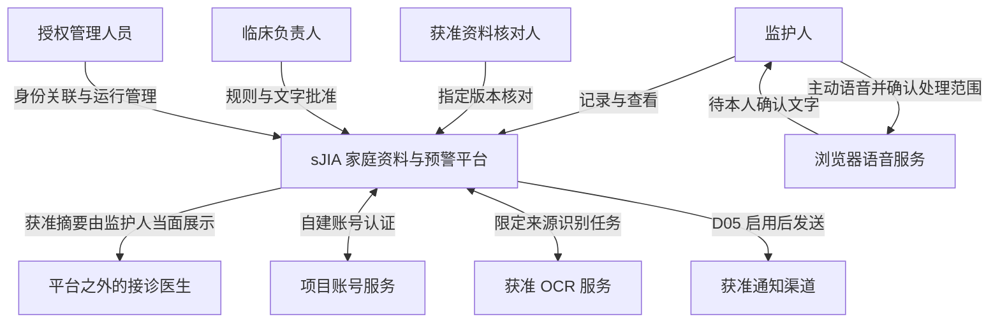
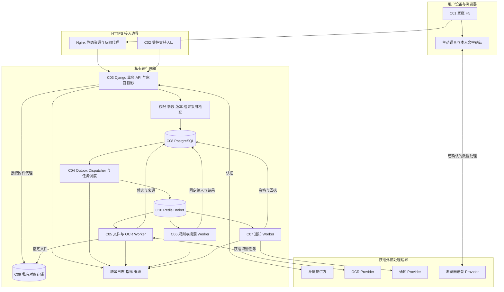
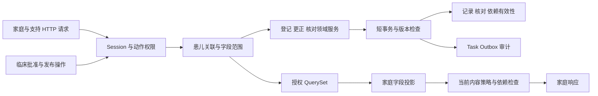
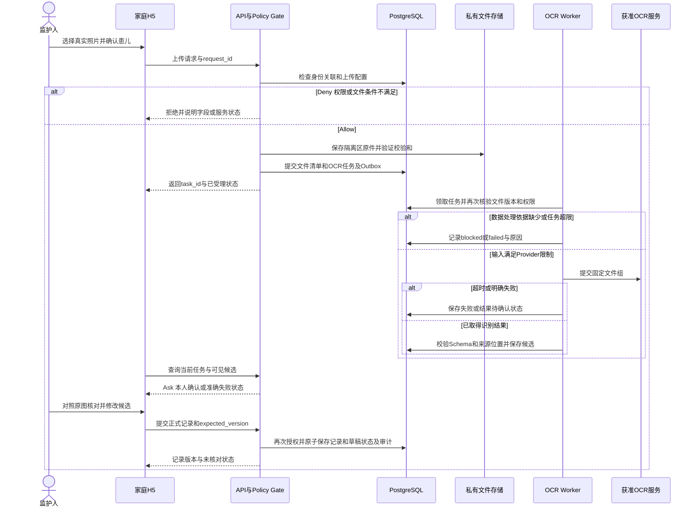
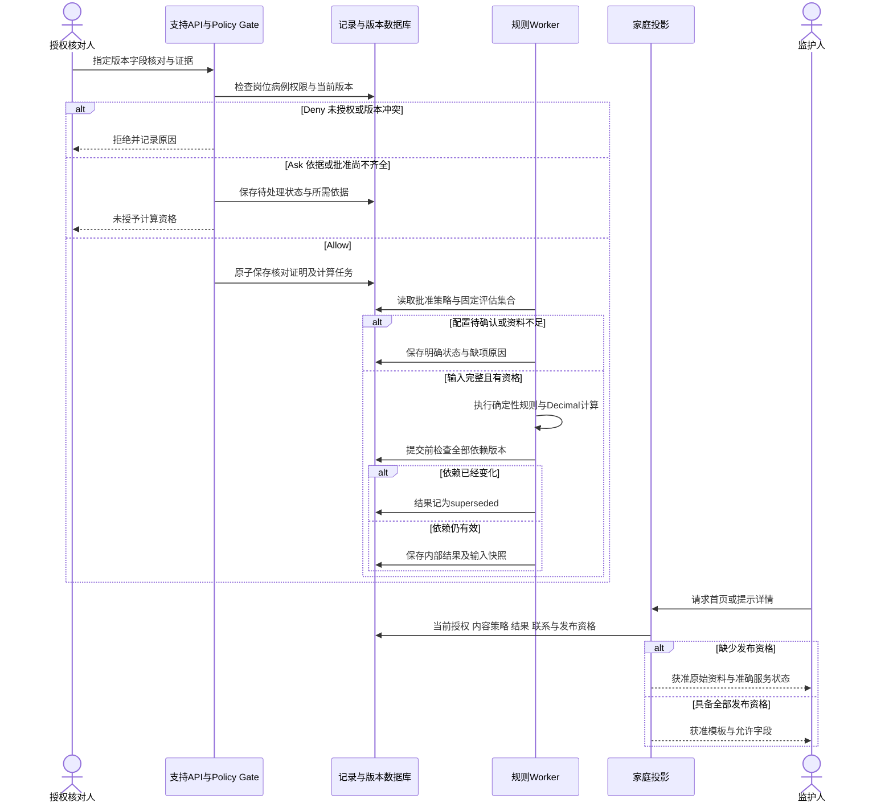
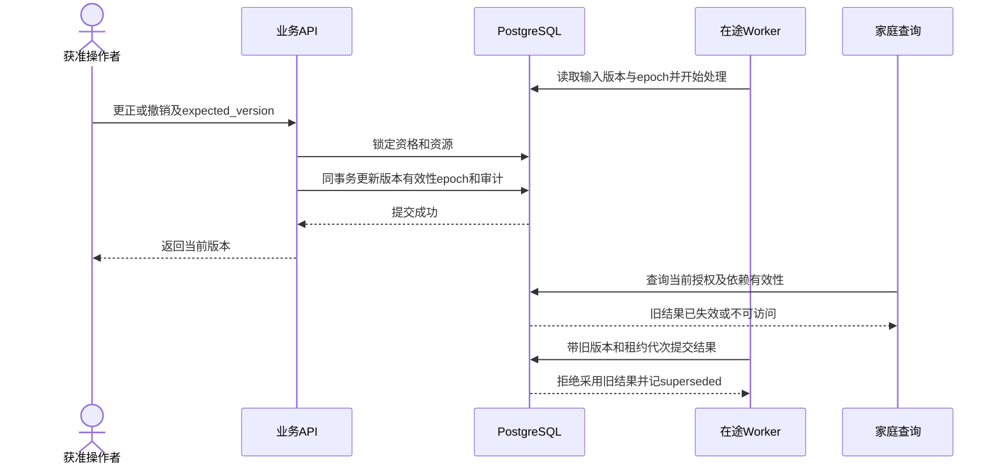
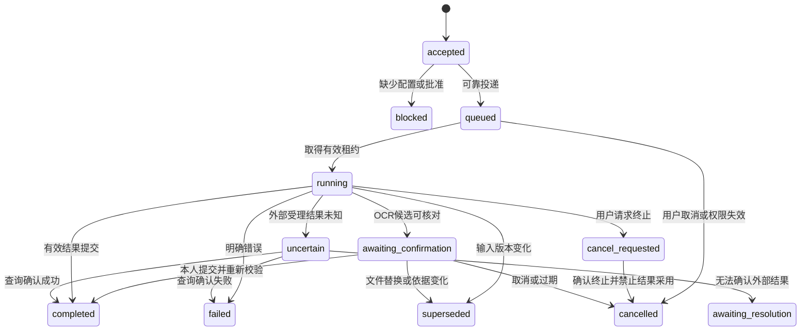
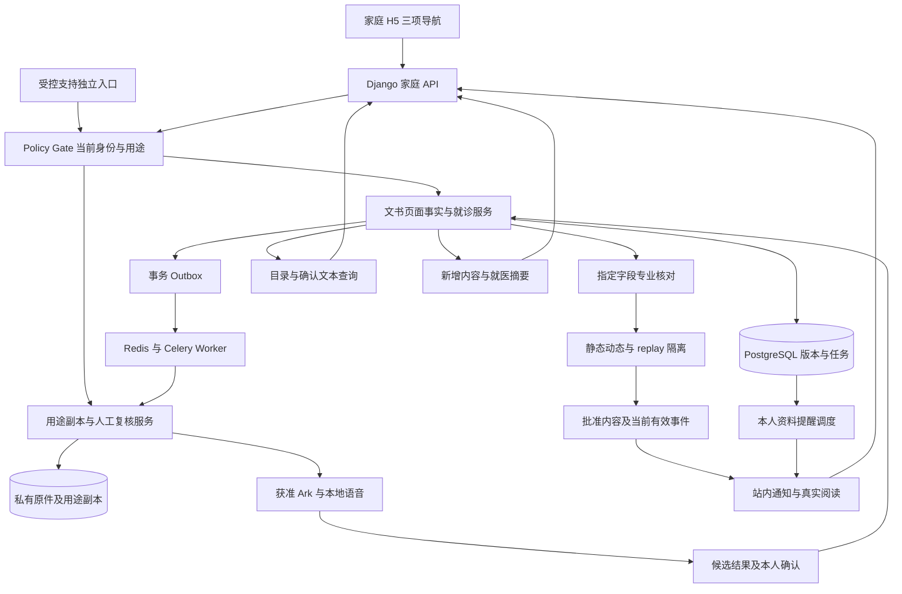
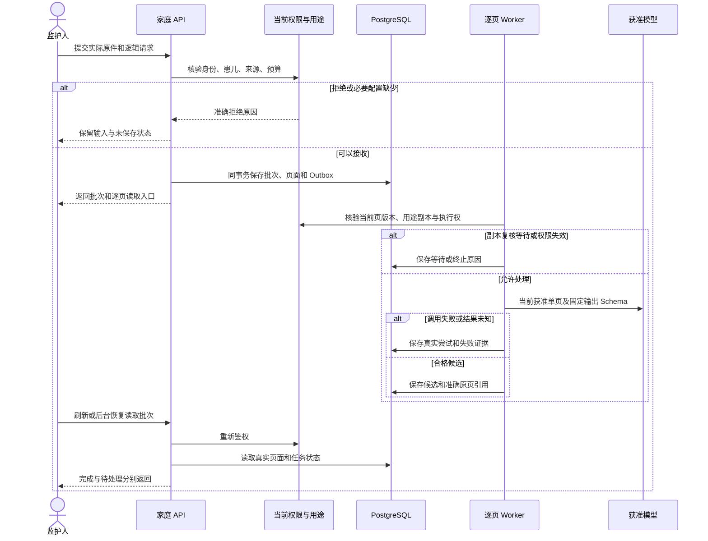

# sJIA 合并 MAS 预警平台 AI 系统概要设计与架构决策文档 (HLD & ADR)

日期：2026-10-20。版本：HLD V2.0。执行模式：`UPDATE / CONTINUOUS_DELIVERY`。能力类型：`DESIGN`。本文件负责 PRD 2.0 全部系统边界、组件责任、技术决策及运行要求；详细设计由 T35—T38 维护，功能、临床及设备验收分别保存真实运行证据。当前设计核验在独立分支codex/current-design-reception执行，候选应用代码0e6c79c保持固定，运行采用仍由QA44维护。

## 1. 架构目标与系统约束

### 1.1 需求交接与可行性评估

| 评估项 | 设计依据与当前判断 | 架构处理 |
| --- | --- | --- |
| 家庭业务流程 | 监护人登录、获得患儿关联、登记症状或报告、查看时间轴、准备就医摘要；首页优先显示获准预警 | 手机 H5 完成家庭操作；后台承担授权、持久化、核对资格与发布控制 |
| 使用触点 | 已有 guardian-h5 页面工程及独立 UI 设计；首期没有医生端工作界面 | 家庭 H5 与受控支持入口分别授权；支持入口只提供身份核验、资料核对、规则和内容管理 |
| AI 使用路径 | PRD E09、FR-02、第 9 节明确照片 OCR；UI A22 明确症状语音输入 | OCR 只提取带来源位置的候选字段；语音只产生本人待确认文字；专业核对、评分与发布分别执行 |
| 高影响操作 | 授予患儿关联、核对字段、发布规则、撤销依据、发送提示、删除资料 | 服务端校验岗位和对象权限；动作绑定准确版本与依据；记录审计；默认没有全病例访问权 |
| 技术风险 | OCR 数字或比较符错误、单位和时间混用、撤权与在途任务并发、文件或声音进入未批准外部服务 | 固定输入版本、十进制计算、发布前再次检查、隔离识别进程、限定数据处理位置 |
| 当前可行性 | 已有 Django 后端、自建账号、正式 H5、Ark 及本地语音服务；当前真实资料用途、专业批准与设备条件仍需核查 | 继承已有技术选择，接收长期档案、完整评估与发送；临床启用及真实环境验收保持独立条件 |

### 1.2 依据及维护位置

| 来源 ID | 文件与使用位置 | 使用方式 |
| --- | --- | --- |
| H-E01 | [PRD](./sJIA合并MAS预警平台PRD.md) V2.0.0，第 7—13 节 | FR-01—FR-22、FD-01—FD-71、BR、NFR、AC、OPT 与 D01—D10 的业务依据 |
| H-E02 | [产品目标](./sJIA合并MAS预警平台产品目标.md)、[需求输入](./sJIA合并MAS预警平台需求输入.md) | G01—G06、来源与临床解释范围 |
| H-E03 | [页面流程](./sJIA合并MAS预警平台页面流程.md) 第 4—9 节 | S01—S15、草稿与提交恢复、受控支持操作 |
| H-E04 | [UI 2.0 设计说明](./ui-delivery/v2/README.md)、[设计来源](./ui-delivery/v2/assumptions-and-open-questions.md)、[需求覆盖](./ui-delivery/v2/requirements-review.md) | 39 页、适用状态、三项导航、原图、三维资产、儿童形象及全部交互 |
| H-E05 | [预警规格](./ui-delivery/alerts/specifications.md)、[AI 辅助评估](./ui-delivery/ai-assistance-review.md) | 展示状态映射、语音确认行为；建议能力与已要求能力分别记录 |
| H-E06 | guardian-h5/package.json、src/app/App.tsx、src/components/SaveActions.tsx、src/features/registration/ReportsPage.tsx；backend/api、records、tasks、recognition | React 页面与实际 Django 接口；当前实现及待实现边界见第 9 节 |
| H-E07 | guardian-h5/src/components/VoiceEntry.tsx、backend/recognition/speech.py；files/storage.py | MediaRecorder 与本地 faster-whisper；病例持久资料由服务端保存，浏览器不缓存病例 |
| H-E08 | [项目评估与研发路线](./项目评估与研发路线.md) 第 4—6 节 | 项目决定及 S005、S006、S007、S009 交接职责 |

本文件使用 H-E01 的 D01—D10 定义，并继承交付记录中已明确的用户技术决定。临床条件、资料用途和保存要求由 PRD 管理。识别和长期档案属于当前完整实施范围。文献公式和医学阈值仅引用 PRD 第 8.14—8.15 节。

本次检查使用当前文档、Python AST及成熟TypeScript／JSX解析器核验符号与字段，未调用视觉功能。源码由Git提交和输入文件SHA256共同标识；候选代码、实际运行源码和数据库分别记录，旧环境结果保留其准确版本与范围。

### 1.3 系统范围与设计目标

家庭操作终态为服务器确认保存的原始资料、当前获准的时间轴与摘要、当前获准的提示。专业支持终态为可追溯的核对证据、可重现的内部计算、经过批准并满足启用条件的内容版本。阅读提示只更新本人阅读状态。

本次完整覆盖身份与关联、三类登记、原件与用途副本、批次和逐页任务、OCR 候选、逐事实时间和语境、文书和就诊归组、重复关系、档案检索、新增摘要、观察时段、独立评价、语音确认、服务端草稿、记录版本、专业核对、静态及动态计算、家庭内容、真实站内通知、自愿资料提醒、审计、资料处置及运行治理。保留治疗背景、扩展检验、原图定位、检测限、时间精度和多人独立权限。

自由问答、RAG、自主 Agent、诊疗生成、医院接口及公开分享按 PRD 2.0 范围管理。语音结构化使用已有 Ark 调用，采用仍需本人确认；全文查找采用成熟数据库查询，新增摘要采用可追溯结构化比较。导出或分发必须具有独立用途许可和相应功能授权。

### 1.4 待确认条件及阻塞范围

| 决定或参数 | 已有依据 | 当前状态 | 仅阻塞的动作 |
| --- | --- | --- | --- |
| D01 交付环境、网络、运行负责人 | 本地运行沿用现有工程；准确目标实例和负责人未提供 | NEEDS_INPUT | 指定环境、真实家庭开放、持续运行承诺 |
| D02 认证来源与关联证明 | 自建账号已由用户确认；多人权限独立 | 技术 CONFIRMED；证明 NEEDS_INPUT | 授予实际患儿关联需真实依据 |
| D03 核对责任与识别服务 | 指定63份原件的隐私复核、现有Ark处理及本地确认保存已经获准 | 软件范围 CONFIRMED；专业资格 NEEDS_INPUT | 缺少专业依据的字段核对及临床结果采用 |
| D04 评估集合策略 | 前提、窗口、重复选值、缺项判定需临床确认 | NEEDS_INPUT | 患者级分类、MS 与历史重算启用 |
| D05、D06 提示及可见内容 | 站内消息及平台维护文字方向已有用户决定；准确临床内容版本待确认 | 技术 CONFIRMED；临床 NEEDS_INPUT | 临床启用、具体发送及等级映射 |
| D07 来源与单位映射 | 保留原值、原单位、方法和比较符 | NEEDS_INPUT | 数据源接入、单位转换配置启用 |
| D08 获准资料及预期结果 | 指定63份原件和五个资料分组已有准确软件验证依据；独立临床单位和答案未提供 | 软件资料 CONFIRMED；临床评价 NEEDS_INPUT | 缺少独立标签的临床评价与质量结论 |
| D09 保存删除与联系信息 | 各类资料期限及有效联系方式未知 | NEEDS_INPUT | 真实资料留存策略启用、清理执行及联系发布 |
| 容量、预算、服务时段、RTO/RPO | 文档没有人数、记录量或金额 | NEEDS_INPUT | 容量定额、生产可用性和成本验收 |
| D10 语音与模型处理 | 本地 faster-whisper 转写、现有Ark处理指定原件已经明确；两笔外部结果按用户要求暂时跳过 | 软件范围 CONFIRMED；用量核对和独立质量答案 NEEDS_INPUT | 重复未知请求、释放未知预留及缺少真实录音的质量结论 |

部署环境未确认时，第 4、7 节描述部署组成及环境准入条件，不把演示建议记为已批准环境。技术选型为架构建议，业务决定仍引用现有 D 编号。

### 1.5 NFR 与验证方法

| NFR | 系统要求 | SLI／检查口径 | 数值状态 |
| --- | --- | --- | --- |
| NFR-01、NFR-10 | 未授权资料及未批准临床字段不返回 | 按实际账号记录允许、拒绝和字段投影结果；泄露次数要求为零 | PRD 已明确，NOT_RUN |
| NFR-02、NFR-03 | 原始事实不被覆盖；规则使用 Decimal 与固定版本 | 原值、比较符、单位、时间重新读取；按获准病例重现结果 | 逐项一致，NOT_RUN |
| NFR-04 | 变更提交后，旧依据不能继续通过当前有效性校验 | 撤权、更正、核对撤销和发布停用与读写、任务提交的并发检查 | 不允许失效内容被新请求采用，NOT_RUN |
| NFR-05、NFR-11 | 手机核心流程可用 | PRD 指定宽度、触控、200% 文字及真实 Safari、Chrome、微信验收 | 尺寸沿用 PRD，设备版本待确定 |
| NFR-06 | 登录、首页、保存、查询、OCR 和摘要分别度量 | 客户端全程与服务端 p50/p95/p99、失败率、队列等待和照片页数 | 目标值待 D01，未测量 |
| NFR-07、NFR-09、NFR-13 | 加密、审计、资料处置、禁止浏览器持久病例缓存 | 私有对象访问、删除回执、备份恢复、退出及历史返回检查 | 参数待 D01、D08、D09 |
| NFR-08、NFR-12 | 请求结果可查询；同一提交无重复业务效果 | request_id、预期版本、草稿状态、在途结果与恢复记录 | 重复生成数要求为零，NOT_RUN |

本系统不采用生成式流式回答，TTFT 不适用；OCR 使用任务受理时间、排队时间、完整可确认结果时间。Prompt Cache 命中率不适用。技术缓存命中率仅用于成本观测，不作为临床正确性指标。对抗性验证覆盖全部授权、来源、内容发布和任务副作用边界，执行主体为测试与安全流程。

## 2. 业务上下文与专职化智能体边界

### 2.1 C4 Context 视图

身份提供方、OCR 与通知均为接入边界，图示不代表已经采购或连通。语音可能直接从浏览器进入其识别服务，服务器脱敏无法覆盖该段；启用条件见第 8 节。

### 2.2 组件职责、权限及运行位置

| 组件 ID／角色 | 职责、产出与使用方 | 操作权限与接口边界 | 执行环境与生命周期 |
| --- | --- | --- | --- |
| C01 家庭 H5 | 输入、原图查看、筛选、本人确认、状态反馈；消费家庭投影 | HTTPS JSON、受控附件请求；无规则批准或专业核对权限 | 现有 guardian-h5；页面内状态；退出即清除 |
| C02 受控支持入口 | 关联核验、分配资料核对、规则批准、发布、联系和删除申请管理 | 独立岗位权限与对象授权；每个操作调用 C03 领域服务 | Django 受控表单与管理视图；独立受限入口；无医生诊疗工作界面 |
| C03 业务 API | 身份、关联、登记、核对、家庭投影、摘要和发布；生成记录、证据与任务 | DRF 权限类、Serializer、领域服务及事务；禁止任意表编辑 | Django 模块化单体 API；常驻进程 |
| C04 后台任务管理 | 调度 OCR、计算、摘要、通知与清理；持久任务、尝试、取消和租约 | 仅登记的 task_type；消息只传 task_id、事件 ID 与 schema_version | Celery 调度与 Worker；任务状态权威来源为 PostgreSQL |
| C05 文件与识别 Worker | 验证文件、调用 OCR、保存原文与位置候选；使用方为本人确认页面 | 只读指定附件；只写对应任务候选；不能修改核对、规则或临床发布 | 独立容器、凭据和队列；无公开入站；限制 CPU、内存和处理时间 |
| C06 规则及摘要 Worker | 固定资格检查、Decimal 计算、结构化摘要；输出版本化结果 | 只读获准评估集合；受控提交结果；家庭输出继续经过 C03 | 与 API 共用领域代码的独立进程；不拥有身份授予权限 |
| C07 通知 Worker | 消费有效提示与接收计划；保存受理与回执 | 发送前校验当前资格；只使用已批准渠道与最少字段 | 独立队列及渠道密钥；D05 未配置时不运行发送 |
| C08 PostgreSQL | 身份会话、关联、记录、核对、任务、依赖、批准、审计等权威状态 | API 与 Worker 使用不同数据库角色；迁移角色不用于业务 | 私有网络持久服务；备份与恢复独立管理 |
| C09 私有对象存储 | 原始照片、派生缩略图和获准识别附件；供授权查看与核对 | 浏览器经 C03 授权读取；禁止公开 Bucket 与长期直接链接 | 与临时容器独立的持久服务 |
| C10 Redis Broker | 传输待执行任务消息；由 Worker 消费 | 私网、TLS、认证、独立凭据；消息不含病例正文 | 消息基础设施；不存业务结果与权限权威状态 |

C03 按 identity、relations、records、files、verification、assessment、family_content、summaries、notifications、audit、retention 划分模块。模块内写入统一通过领域服务；跨模块修改由明确的业务事务协调。内部领域边界不要求独立网络服务。

### 2.3 Agent、BFF、Hook 与缓存的适用性

| 职责 | 本项目承载方式 | 采用依据及权限 |
| --- | --- | --- |
| BFF 聚合 | C03 内部家庭查询与投影模块，聚合首页、时间轴和提示状态 | 单个家庭 H5；统一授权与家庭响应，无需独立 BFF 进程 |
| Explore | 获准 QuerySet、记录检索与来源读取；无 Explore Agent | 读取指定患儿及版本；禁止调用写入接口 |
| Plan | 固定处理流程及已批准配置；无 Plan Agent | 任务种类、触发和条件由代码与配置明确，不由模型规划 |
| Execute | C03 领域服务与登记的 Celery 任务 | 操作白名单、对象范围、事务和幂等检查 |
| Verification | 格式与资格校验、本人确认、专业核对、独立验收各自承载 | 软件校验不能授予临床核对；验收服务不进入生产修改病例 |
| Hook 治理 | API 权限及参数校验、任务启动检查、结果提交检查、家庭投影和发送检查 | 指向可实现的服务端函数边界，不依赖 Agent SDK Hook |
| Prompt Registry／Prompt Cache | 当前不适用；识别服务配置和 schema_version 由受控版本表管理 | OCR 供应商若使用模型，记录 provider、model_version；没有项目级聊天历史 |
| Fork 与上下文继承 | 当前不适用；子任务引用不可变输入版本 | 不复制跨患儿上下文；无自主工具循环 |

## 3. 技术选型与架构决策记录

### 3.1 核心组件选型

| 领域 | 选择与版本策略 | 依据、代价与验证 |
| --- | --- | --- |
| 家庭前端 | 保留 React 18、TypeScript、Vite、React Router、antd-mobile、Tailwind；准确版本以现有 package-lock.json 为准 | 复用现有页面、表单和依赖；UI 资产按引用集成，临床状态通过真实 API 提供 |
| API 与支持表单 | Django 5.2.17、Django REST framework；原服务使用Python3.12.7，独立目标使用Python3.13.13，完整依赖由requirements.lock.txt维护 | 关系数据、事务、认证及受控表单需求集中；两种实际Python身份由接收报告分别记录。Django 5.2 的 LTS 与 Python 支持见[官方说明](https://docs.djangoproject.com/en/5.2/releases/5.2/) |
| 数据访问 | Django ORM、psycopg；原服务PostgreSQL18.4，独立升级目标PostgreSQL17.11 | 单库事务与版本约束支撑即时失效；准确目标版本和迁移状态分别核验 |
| 异步任务 | Celery 5.6 系列、Redis Broker、PostgreSQL 中的任务及 Outbox | 使用成熟调度框架；承担 Broker 运维、幂等、重投及任务状态核查成本 |
| 文件存储 | 明确选择Local或私有S3，S3使用boto3；正式供应商及地区依D01、D09确定 | 原环境使用Local；候选S3的真实读取、准确删除及隔离恢复由QA30—QA43维护，正式采用另行验收 |
| 文件与数值处理 | Pillow 读取获准图像格式；Python Decimal 与 PostgreSQL numeric | 不手写成熟格式解析；不依靠二进制浮点执行评分；不直接解析未经批准的任意文件 |
| 入口与运行 | 正式目标使用Nginx HTTPS、Gunicorn WSGI和Linux容器；本地验收进程使用明确配置，Compose完整流程继续QA38验收 | API短请求，任务独立运行；生产实例数与恢复目标按D01决定 |
| 可观测性 | 结构化日志、OpenTelemetry 请求与任务追踪、运行指标 | 不包含病例正文和密钥；监控后端按部署环境提供，验收前完成告警联系测试 |
| OCR、认证、通知 | 现有Ark、自建账号、站内通知及本地faster-whisper；未满足能力配置即拒绝对应操作 | 本地处理依据已明确；正式地区、保留、独立质量答案及生产发送条件继续按各自责任提供 |

当前组件已经按用户授权用于软件实施；实际运行采用和完整业务验收分别记录。支持入口采用定制Django视图承接业务操作，普通管理账号不能通过默认ModelAdmin、批量动作或数据库管理界面修改临床状态。

ADR-001—ADR-006的架构维护责任为S004，实施接收责任见各条交接要求，当前软件设计由执行者维护，正式运行负责人待项目指定。六项架构选择为ACCEPTED，依据为用户持续软件实施授权及现有代码；完整行为验收和D01—D10必要输入分别保留，设计接收不授予临床或生产运行资格。

### 3.2 ADR-001：资料、上下文与缓存边界

- **状态与来源：** `ACCEPTED`；来源类型 `INFERRED`；H-E01 NFR-04、NFR-10、NFR-13，D06、D09。软件维护责任为系统架构与后端执行者，正式运行负责人待指定。
- **上下文：** 家庭资料包含敏感事实，关联和内容批准可以撤销；OCR 多页输入需要有界处理。
- **成立方案：** 无病例响应缓存；或者在每次重新鉴权后使用绑定资料与策略版本的服务端缓存。两者均需通过当前有效性检查。
- **当前决定：** 病例 HTTP 响应 `Cache-Control: no-store, private`；只使用页面内存与服务端草稿。C03 直接读取 PostgreSQL 权威状态。静态资源按内容摘要缓存；字典定义按不可变版本缓存，生效资格每次从数据库确认。OCR 只读取当前任务文件组，按文件页数和 Provider 容量限制处理，不拼接全患儿病史。
- **不可执行事项：** 禁止以缓存成功值替代授权查询失败；禁止共享患儿结果缓存；禁止客户端保存病例正文至 localStorage、sessionStorage 或 IndexedDB；禁止静默截断长文本或丢弃超限页。
- **权衡：** 增加数据库查询与恢复时的网络读取，换取可检查的权限语义；图片读取带宽需要计入容量。Prompt Cache 当前不适用，不能预估其成本收益。
- **重新评估：** 真实容量测试发现数据库读取成为瓶颈，且可证明缓存失效和撤权一致性时评估版本缓存。
- **验证及交接：** S005 数据/后端/前端定义有效性版本；S009 验证退出、返回、撤权、停用和跨账号恢复。影响 AC-08、AC-09、AC-12、AC-H5-05。

### 3.3 ADR-002：同步事务与异步任务生命周期

- **状态与来源：** `ACCEPTED / INFERRED`；H-E01 FR-02、FR-08、NFR-04、NFR-08、NFR-12；D03—D05；软件实施沿用现有Task、Outbox及Celery。
- **上下文：** 手机页面可能关闭，OCR、重算和通知必须由服务器记录进度；排队消息可能重复投递。
- **成立方案：** Celery 与 Redis 加事务 Outbox；或者专门的持久工作流平台。当前采用前者，任务流程有明确边界且没有已确认的复杂跨日人工编排规模。
- **当前决定：** 保存业务变更、Task、Outbox 和审计采用同一数据库事务。Dispatcher 投递任务 ID，Worker 领取数据库租约，结果提交核查输入版本与租约代次。`on_commit` 仅能用于及时唤醒，可靠任务来源仍为 Outbox。Django 的提交后回调与事务行为见[事务文档](https://docs.djangoproject.com/en/5.2/topics/db/transactions/)；Outbox 是本项目的可靠投递设计。
- **生命周期：** 前台请求受理后返回 request_id／task_id；后台任务由数据库管理，不依赖页面计时器。离开页面不自动取消已授权 OCR；用户取消、撤权或过期使后续结果不能被采用。参见第 5.4 节。
- **不可执行事项：** 不承诺消息系统 exactly-once；不把 Broker 结果当成业务事实；不使用无限重试；不复制聊天上下文；不以恢复进程为理由重新发送已受理通知。
- **权衡：** 多维护 Broker、Dispatcher、租约与 Outbox 清理；换取进程终止后可确认业务提交和恢复已登记任务。
- **重新评估：** 出现已批准的多系统、跨日补偿流程，且当前任务模型不能表达时评估专门工作流平台。
- **验证及交接：** S005-2 明确事务、租约和重放接口；S009 执行真实 Broker 中断、Worker 终止、重复投递与迟到结果测试。影响 AC-02、AC-06—AC-08、AC-H5-03—AC-H5-04。

### 3.4 ADR-003：运行时权限与结果采用控制

- **状态与来源：** `ACCEPTED / INFERRED`；H-E01 FR-09、FR-10、FR-12、NFR-01、NFR-10；D02、D03、D06；软件实施沿用当前权限、资格及投影服务。
- **上下文：** 角色、患儿关系、字段范围与内容批准共同决定操作；后台服务不能因持有系统凭据扩大用户授权。
- **当前决定：** C03 在认证后、对象查询、输入校验、事务提交和家庭投影分别执行 Policy Gate；Worker 在开始、Provider 调用及结果提交处执行对应检查。`Allow` 执行准确动作；`Ask` 产生绑定内容与版本的待确认请求；`Deny` 即时拒绝并审计。Ask 由既有本人确认或受控批准流程完成，不增加无业务依据的家庭确认页面。
- **实现要求：** 对象权限、列表 QuerySet 过滤和创建权限分别实现。DRF 官方说明列表和创建路径需要相应限制，单独配置对象权限不足以覆盖全部路径。[权限文档](https://www.django-rest-framework.org/api-guide/permissions/)
- **不可执行事项：** 不接受客户端 supplied verifier_id 或已核对状态；不执行模型返回的指令、URL 或 SQL；不以管理员身份批量读取病例；不暗中修改参数重试。
- **权衡：** 每条入口与任务都需传递来源主体和用途，维护明确的允许字段与拒绝原因；权限逻辑集中实现以减少分歧。
- **重新评估：** 新增机构边界、角色或外部调用方时更新策略及全部入口验收。
- **验证及交接：** S005-2 维护动作与响应字段，S010/S009 核对成功及拒绝路径。影响 AC-01、AC-09、AC-10、AC-12。

### 3.5 ADR-004：模块化后端与物理隔离

- **状态与来源：** `ACCEPTED / INFERRED`；H-E01全部FR；当前沿用模块化Django及独立Worker，D01正式容量与运行责任继续NEEDS_INPUT。
- **上下文与方案：** 模块化单体可将更正和结果失效置于同库事务；领域独立服务可提供独立运维边界，但需分布式一致性与跨服务授权。当前选用模块化单体，识别、规则、通知 Worker 按权限和外部网络访问要求分进程。
- **决定及权衡：** API 与 Worker 共享领域代码和发布版本；单库减少跨服务协调，但数据库构成共享故障域，迁移与连接预算必须共同管理。文件处理使用独立容器和受限数据库角色，隔离不依赖 Python 模块命名。
- **不可执行事项：** 不能由未知人数推导 Kubernetes、多数据库或独立微服务；不能令识别进程直接写入记录核对或家庭发布表。
- **重新评估与验证：** 独立团队、数据驻留要求或容量实测出现明确隔离需求时复议；S005-2/S011 核查数据库角色、网络出口和迁移。影响 NFR-04、NFR-06、NFR-07。

### 3.6 ADR-005：确定性临床处理与识别证据

- **状态与来源：** `ACCEPTED`；确定性规则来源`EXPLICIT`，任务实现来源`INFERRED`；H-E01第8、9节，H-E05；D03—D08；临床启用继续依赖准确专业依据。
- **当前决定：** OCR 输出只进入候选区，保存原件、页序、文字与位置、Provider 版本、本人修改及确认。症状语音只追加本人确认文字。资料提交后仍为自报或报告转录；专业核对绑定明确字段与记录版本。规则引擎使用 PRD 的公式与获准配置；摘要使用结构化模板逐项引用。
- **方案与权衡：** 当前OCR采用用户获准的现有Ark，保留实际字段依据、请求标识与处理版本；外部处理承担网络及用量核对成本。本地语音使用faster-whisper，需要维护实际模型目录和运行依赖；准确率与临床质量分别使用独立答案评价。
- **不可执行事项：** 禁止用 OCR 置信度授予计算资格；禁止模型补充未知临床事实；禁止自动把 MS 转成风险等级；禁止静默替换 Provider 或模型。
- **重新评估及验证：** 新增生成式任务需新增批准需求与 S005-3 设计；OCR 使用获准中文报告逐字段、逐位置验证，临床计算采用独立参考答案。影响 AC-02、AC-04—AC-06、AC-10—AC-12。

### 3.7 ADR-006：家庭通信与受控原图访问

- **状态与来源：** `ACCEPTED / INFERRED`；H-E01 NFR-12、NFR-13，H-E04 A18、A22、A23；D02、D03、D09；当前实现使用同源请求及受控Range读取。
- **当前决定：** HTTPS 短请求、服务器草稿和有界任务轮询；前台恢复重新鉴权，授权成功前不展示病例内存副本。附件通过同源授权代理获取，Range 请求同样鉴权；页面只保留短期 Blob URL，退出与换患儿时释放。正式业务读取服务器文件，图片原始字节保持不变，缩略图单独派生。
- **方案与权衡：** 任务轮询或 SSE 都可表达进度；当前选择轮询，减少手机后台连接维护。代理原图访问增加 API 出口带宽，能够在每个新请求核验当前权限。长连接和对象直传可在容量与撤销语义得到验证后重新评估。
- **不可执行事项：** 不把 UI 预览的设备保存机制作为正式病例持久化；不向浏览器返回供应商密钥、对象地址或长期可用访问凭证；不承诺撤回已经合法读取的字节。
- **验证及交接：** S005-4 保留照片、语音、三项导航、全部二级页返回及正文布局；S009 检查任务恢复、文件权限、后台恢复与字节一致性。影响 AC-H5-01—AC-H5-06。

## 4. 整体 AI 物理与逻辑架构图

### 4.1 C4 Container 与部署边界

C02 与 C03 可共享同一后端构建，使用独立受限域名或入口、Cookie 范围和岗位认证策略；C02 不进入家庭导航。网络限制之外仍执行应用层权限。用户并发与服务时段未知，本图不声明实例数或可用性等级。外部服务不可用时，仅相应任务失败或保持未配置，其他独立家庭能力按其依赖继续执行。

### 4.2 C4 Component：业务 API 内部责任

### 4.3 接口类别与写入责任

路径是 S004 的接口分组建议；准确 Schema、分页、状态码与字段长度由 S005-2 维护。所有对象标识均为不透明标识，不承担授权证明。

| API 分组 | 调用者／主要输入 | 持久产出与使用方 | 禁止扩大权限的要求 |
| --- | --- | --- | --- |
| `/api/v1/session`、`/relations` | 当前主体、认证结果、关联申请依据 | Session、RelationApplication、Relation；家庭与授权服务使用 | 请求主体来自认证上下文；不能由 patient_id 自行授予关系 |
| `/patients/{id}/drafts` | 本人、表单类型、draft_version、字段输入 | 独立 Draft；本人恢复及正式提交消费 | 草稿不进入时间轴、评估、摘要；正式提交与草稿状态更新同事务 |
| `/patients/{id}/uploads`、`/files/{id}/content` | 当前写入权限、获准格式与真实文件 | 文件清单、私有原件、页序、处理状态；OCR 与授权查看消费 | 上传、完成校验、预览、原图与 Range 请求全部鉴权 |
| `/recognition-jobs`、`/tasks/{id}` | 已验证文件组版本、task_type、request_id | OCR Task 与 CandidateSet；确认页消费 | 无任意 URL、文件路径、命令或模型工具参数 |
| `/patients/{id}/records`、`/records/{id}/corrections` | 来源、值、比较符、时间、本人确认、expected_version | 原始 RecordVersion、来源引用与审计；核对、时间轴消费 | 服务端设置作者、患儿和核对初态；同标识不同载荷拒绝 |
| `/records`、`/analytes/{id}`、`/home` | 当前权限、过滤条件、分页游标 | 当前可见列表与状态；家庭页面消费 | 查询计数、筛选项与子资源同样过滤；不泄露内部总分 |
| `/support/verifications`、`/revocations` | 岗位身份、分配资料、字段范围、依据和指定版本 | Verification、撤销记录、依赖失效；评估任务消费 | 临床负责人也需指定病例授权；旧版本核对提交拒绝 |
| `/support/assessments` | 获准策略与病例范围 | Assessment、输入与结果快照；核对人和家庭投影消费 | 服务端选取资料；家庭不能自由组合专业变量 |
| `/support/releases`、`/contacts` | 精确内容、批准证据、环境、版本和验证证据 | ReleaseBundle、ContactVersion；发布及读取检查消费 | 配置保存、批准、启用分为明确状态；权限不自动连带 |
| `/patients/{id}/alerts`、`/alerts/{id}/read` | 当前接收关系、准确提示 ID、实际阅读动作 | 家庭投影、ReadReceipt；提示页面消费 | 预加载不计阅读；阅读不能改变临床等级和有效性 |
| `/patients/{id}/summaries` | 当前患儿、时间范围、request_id | 固定输入版本摘要；平台内查看消费 | 无公开分享或自动导出；读取时重新检查可见策略 |
| `/requests/{id}`、`/support/dispositions` | 原提交主体或获准资料管理岗位 | 请求结果、资料处置任务及证据 | 未知结果不当作失败；查询不得泄露其他主体的提交 |

### 4.4 事务、版本与并发控制

1. 每次业务写入使用 `request_id`，唯一作用域为主体、动作与目标资源；保存经规范化输入的摘要。重复且输入一致时重新鉴权后返回同一资源状态；输入不同则拒绝。审计包含拒绝原因，不回传其他主体资料。
2. 更正、核对和批准使用 `expected_version`。事务按照固定顺序锁定环境／发布资格、患儿一致性记录、关联或岗位授权、业务对象。使用数据库行锁与条件更新，锁等待到达配置上限即失败；不自动合并医学字段。PostgreSQL 的行锁机制见[官方说明](https://www.postgresql.org/docs/17/explicit-locking.html)。
3. 更正事务创建新版本、更新当前版本、使指定依赖结果失效、更新患儿 `data_epoch`、写入 Task／Outbox 与审计；核对状态从未核对开始。核对撤销与对应 `verification_epoch` 更新同事务完成。事务提交失败时不形成部分成功。
4. 关联撤销更新 `auth_epoch`；发布或联系停用更新其生效状态及 `publication_epoch`。结果有效性是“对象未失效且全部依赖版本当前有效”的联合判定。读取、发布及发送必须查询权威状态，不等待后台逐项标记。全局停用只需原子更新发布资格，历史标记可异步补全。
5. 重算任务固定 record_version、verification_id、window_policy_version、mapping_version、rule_version 及 epoch。提交结果时锁定相关资格并比较当前版本；任何变化均记为 `superseded`，不能发布。新资料进入摘要范围时，也通过患儿 data_epoch 使原摘要显示需要重新生成。
6. 家庭读取在一致性读取范围内取得关联、版本、策略与内容；以获得有效资格的读取时点作为操作顺序依据。撤销提交后的新请求必需拒绝。已经发出的网络字节无法撤回；长附件每个新范围请求重新授权。应用恢复前台必须遮蔽旧内容直至完成新校验。
7. 请求结果未知时查询原 request_id。只有服务器确认没有提交或事务已失败，才允许同一逻辑输入按同一请求标识重试；仍不确定时保留待确认。请求登记与草稿需服务端关联，刷新后能够查询最近未完成提交。

## 5. 核心流式调度与运行时校验时序

### 5.1 照片、OCR、本人确认与正式保存

原件先进入不可见的隔离状态；类型、文件字节、页数、尺寸、图像解码与安全检查成功后才标为可用。文件写入完成但数据库登记失败时产生待清理孤立对象，不能作为已上传成功资料返回；清理由 D09 配置的任务执行。数据库指向文件时必须确认对象及校验和存在，原件读取失败即说明证据不可用。图片替换创建新版本，使对应 OCR 候选失效；不得把不同文件的定位坐标继续用于新图。

### 5.2 专业核对、计算与发布

内部计算与提示事件创建分别设有执行资格。事件创建还需 D05 的触发及再次触发策略，不把一次重算直接映射为一次新提示。受控支持表单显示完整核对依据；家庭只读取对应允许字段。

### 5.3 更正、撤销与在途任务

通知发送需要可审计的发送授权时点：Sender 在数据库事务中锁定提示、关系、发布和联系资格，创建唯一 `send_permit` 及 `attempt_id` 后提交；随后向已批准渠道提交。撤销若先取得该事务顺序，发送被拒绝；若授权已提交且外部请求开始，登记为在途操作，依 Provider 能力查询或撤销，不宣称可以撤回已受理消息。D05 必须接受并定义这一外部边界，无法满足其要求的渠道不得启用。

### 5.4 任务状态、超时与预算

OCR 执行完成可先生成不可变 CandidateSet，任务等待本人确认时不占用 Worker。每次尝试独立记录开始、截止、Provider request_id、费用依据、错误码与结果。人工重新识别或重新评估创建新 attempt，保留原尝试；终态不会被静默改写。

| 处理对象 | 超时与资源配置 | 重试及终止规则 |
| --- | --- | --- |
| API | 请求体、文件大小、数据库等待、整体请求截止值 | 参数未配置的能力不可用；错误直接返回；写入超时进入请求查询 |
| OCR | 最大页数／字节／像素、连接与读取超时、任务截止、每主体并发和金额额度 | 不自动切换 Provider；明确失败后由用户发起获准重试；结果未知先查询Provider，无法查询交由指定人员处理 |
| 队列与 Worker | queue_wait_limit、lease_duration、heartbeat_interval、attempt_limit、visibility_timeout | 任务可重复投递但结果提交幂等；租约过期仅可恢复已确认无外部未知副作用的任务；超预算终止并告警 |
| 内部计算与摘要 | 获准窗口、记录上限、查询时间、任务截止 | 输入错误就地失败；不扩大窗口、不补值；技术重试需配置且固定输入版本 |
| 通知 | Provider 连接／读取超时、发送许可有效期、最大尝试、查询期限 | D05 未批准则不发送；未知受理不重复发送；超预算后通知运行负责人，禁止转交未知接收人 |
| 语音 | 继承 UI 的单次 60 秒与 15 秒连接等待设计；实际平台兼容待验证 | 主动开始、结束、取消；离页或后台停止；原始文本与确认状态分离 |

各参数由 S005-2 定义配置类型及合法范围，S011 与责任方根据实际服务限制确认数值；缺少必要参数时部署检查失败，相应处理入口保持未启用。Redis 消息可能因可见时间到期再次投递，Celery 的 Broker 配置与注意事项见[官方说明](https://docs.celeryq.dev/en/stable/getting-started/backends-and-brokers/redis.html)。调度长时间计划采用数据库中的到期任务，不依赖消息长期延迟存放。

Broker 使用独立 Redis 实例与 `noeviction` 策略，达到内存上限时投递明确失败，Outbox 保留未完成状态；不通过驱逐消息释放容量。Dispatcher 的成功投递标志仅表示消息已交付，任务完成以数据库业务终态为准。定期核查未完成任务的租约、Provider 状态和投递记录，恢复操作受相同预算与副作用检查约束。

连续 Provider 故障达到获准阈值后停止受理对应新任务并提示服务不可用；恢复需健康检查与指定运维操作。长文本、文件组或服务容量超限时提供准确的限制原因，由用户选择有效输入；不自动丢弃字段，不自动改用其他服务。技术缓存未命中时读取权威版本，读取失败即失败，不能采用历史内容。

## 6. 数据流向、记忆与缓存生命周期

### 6.1 通信、事件身份及页面恢复

家庭请求采用 HTTPS JSON，Cookie Session 使用 Secure、HttpOnly 及适当 SameSite；变更请求检查 CSRF 和 Origin。认证采用已确认的自建账号，Session 身份与患儿关联分别验证。内部服务使用私网连接和独立凭据；Provider 请求使用受控出口、TLS 及限定 endpoint。

任务受理返回 `task_id`、当前状态及建议查询间隔；查询按当前主体及患儿权限返回单调递增的 `status_version`。旧页面请求通过会话和患儿上下文代次识别，过时代次响应不更新页面。应用回到前台、历史返回或重新登录后先核验身份，再读取当前任务与资源；轮询到终态、超出查询期限或页面不可见即停止。家庭页面定时器不运行临床判断。

列表游标由服务端绑定排序、过滤条件与资料版本，未知事件时间独立分类；用户返回列表恢复筛选条件和位置，内容仍重新鉴权。首页状态分别表达服务启用、数据资格、处理进度、当前提示有效性及本人阅读，不把任一状态折合为健康等级。UI 的 attention、warning、urgent 只使用批准映射；clear 只表示没有当前有效事件。

内部事件具有 `event_id`、`event_type`、`schema_version`、`aggregate_id`、`aggregate_version`、`occurred_at`、`causation_id`、`correlation_id` 和 `task_id`。事件保存资源引用及必要元数据，消息不包含完整病历；消费者按 event_id 和操作唯一键幂等。Outbox 负责可靠投递，临床再次触发策略由 D05 独立定义。

### 6.2 关键对象的所有权与终态

| 对象 | 产出方与存储 | 使用方与读取时机 | 版本、失效及业务终态 |
| --- | --- | --- | --- |
| Relation／Session | 身份与关系模块，PostgreSQL | 每次 API、Worker 调用与发送 | 独立主体和有效期；撤销后拒绝后续采用 |
| Draft | 本人获准编辑，PostgreSQL 独立表 | 本人恢复及正式提交 | draft_version；已提交、放弃、到期分别终止；无临床资格 |
| FileGroup／FileObject | 文件服务，数据库清单与对象存储 | OCR、原图查看、专业核对 | 页序、原件摘要、格式、处理版本；替换失效旧候选；未关联对象按 D09 清理 |
| CandidateSet／SourceAnchor | OCR Worker，PostgreSQL 与受控原始响应存储 | 本人确认页及核对追溯 | Provider／Schema／文件版本、页内坐标；未知字段原样保留；确认后关联 RecordVersion |
| VoiceTranscript | 浏览器页面内待确认文字；确认提交后成为记录来源 | 本人核对、症状保存与来源查看 | 保留确认文字与修订来源标识；不存录音；取消的候选不进入记录 |
| RecordVersion | 登记／更正服务，PostgreSQL | 时间轴、核对、摘要、评估 | 来源、quality_status、verification_status 独立；原版本历史只读 |
| Verification | 指定核对人，PostgreSQL | 形成评估集合与结果再校验 | 字段、版本、依据、权限、执行时间；撤销或更正使资格失效 |
| AssessmentSet／Result | 规则服务，PostgreSQL | 内部核查、提示判定及家庭投影 | 固定输入、策略、单位、规则版本；完成、不足、失败与有效性分别记录 |
| ReleaseBundle | 获准批准与发布操作，PostgreSQL | 新任务、内容生成、响应及发送 | 包含规则、可见字段、文字、联系、验证证据与环境；停用即不再具有发布资格 |
| AlertEvent／Recipient／Receipt | 提示与通知服务，PostgreSQL | 家庭读取、发送和回执 | 事件、接收、阅读、受理与送达分别记录；失效不删除已经发生的接收事实 |
| Summary | 确定性摘要任务，PostgreSQL | 平台内家庭查看 | 引用固定记录和当前策略；新增／更正、核对变化后显示需重新生成 |
| Dictionary／Mapping | 获准数据管理流程，PostgreSQL | 项目匹配、单位与方法比较 | 原名称和单位保留；映射版本有效后才采用；不覆盖原始数值 |
| Audit／Disposition | 领域操作与资料管理流程，受限数据库及审计存储 | 运行调查、授权核对和删除核验 | 操作、结果、来源及版本不可被普通角色修改；期限与处置依据 D09 |

原始值、归一化值、报告限定符、方法、原参考区间分别保存。医学时间记录原文、时区及精度；系统 recorded_at 独立产生。仅日期、未知时间、同时间冲突和方法不可比较不强行加入趋势。家庭报告异常标志来自原报告，不由 UI 颜色推断；重点项目清单由获准字典维护。

### 6.3 草稿与文件生命周期

已登录且拥有写入权时沿用 PRD：字段失焦、页面内离开及每 10 秒检查变化后保存服务端草稿；同一草稿串行写入，服务端以 expected_version 检查并发。草稿确认保存时间只来自服务器。文件组、草稿与患儿归属保持一致，切换患儿不能搬移输入。

正式提交同时写入记录、request_id 结果与草稿已提交状态；部分缺项可保存需补正资料，但身份、项目及版本识别要求不满足时拒绝。断网仅保留页面内未保存内容，不创建离线自动提交队列。刷新恢复服务器已有草稿；不能保证恢复断网期间尚未确认的输入。

文件组经历 `initiated → uploaded → validating → available`，失败分别记录上传或检查原因；未通过的文件不进入 OCR、缩略图或报告引用。图像派生过程限制尺寸、像素和资源使用，使用成熟图像库；临时解码文件位于受控工作目录并按任务清理。原件保留原始字节，缩略图移除不需要的元信息；原件的元信息仍按敏感资料授权。

### 6.4 记忆、摘要与缓存清理

平台没有 LLM 长期记忆。患儿事实保存在版本记录和来源文件；摘要不替代原始资料，每条摘要内容能够定位原记录与时间。支持流程交接包含尚未完成的核对、任务、项目决定、有效证据引用及当前授权，不能只交接自然语言摘要。

| 数据类别 | 清理触发与执行 | 保留及恢复要求 |
| --- | --- | --- |
| 浏览器内存与 Blob URL | 退出、账号或患儿切换、关联撤销、任务取消、组件卸载 | 清除受限数据与临时地址；公共静态资产可继续缓存 |
| 未提交草稿、隔离文件与孤立对象 | 已批准期限到达或获准删除请求 | 清理前查询全部引用；保存处理回执；未配置期限时不接收真实资料进入未定义保留流程 |
| 记录、核对、计算、提示与摘要 | D09 按资料类别执行批准处置 | 法定或机构保留义务由责任方确认；保留要求存在时记录限制原因 |
| 原始 OCR 响应与候选 | 使用目的完成或 D09 期限到达 | 保留必要来源依据与版本；供应商副本需取得删除或到期处理依据 |
| 审计与请求幂等记录 | D09 指定期限及有效请求窗口 | 幂等记录不得早于可重试窗口被删除；审计期限独立，不写病例全文 |
| 备份 | 备份生命周期与删除请求关联 | 备份恢复后先重放处置登记与撤权状态，完成检查后才开放读取 |

删除业务对象时同步禁止依赖内容继续展示，记录对象存储版本、缩略图、OCR 副本、搜索索引（如将来获准使用）、备份与已发送消息各自处理状态。已发通知无法即时删除时保留准确限制；不能将一次数据库删除记为全部资料处置完成。

## 7. 算力调度、容灾与发布基建

### 7.1 容量与成本模型

所有变量来自 D01 实际预估或获准运行测量；当前不填写生产规模及金额。临床输入不使用合成病例进行容量验收。

| 维度 | 测量或计算方式 | 采用方式 |
| --- | --- | --- |
| API 负载 | 同时活跃人数 × 每人请求频率；另计草稿失焦、每 10 秒保存和任务轮询 | 配置连接数、API 进程及限流；以真实目标手机测量 p95/p99 |
| OCR 并发 | 峰值任务到达率 λ × 实测服务时间 W；结合 Provider 配额与目标利用率 | 限制每主体及总并发；分别计排队与处理时间，不以总 Worker 数替代 Provider 配额 |
| 文件容量 | 日新增页数 × 实测每页字节 × 获准保留天数，加派生文件、对象版本与备份 | 确认上传上限、容量告警及删除策略 |
| 数据库容量 | 每类记录日增量 × 保留期 × 实测平均存储，加索引、审计、Task 与 Outbox | 依据查询计划和实际数据量验证索引、批处理及连接预算 |
| 通知量 | 获准事件数 × 有效接收关系数 × 批准渠道数 | 重复业务事件按 D05 处理；独立统计发送、受理、送达与阅读 |
| 月成本 | API／数据库／Broker／存储／备份／监控固定费用，加 OCR 页数、请求、网络流量与通知费用 | Provider 正式报价和数据地区确定后测算；Token 成本仅在获准服务实际按 Token 计费时加入 |

OCR 与通知队列分别限流，规则与摘要任务按执行耗时和优先级隔离，防止文件处理占用家庭 API。GPU 仅在明确选择自部署识别服务并取得模型资源要求后配置。进程预热依据真实冷启动测量决定，不声明 Agent Fork 或缓存复用收益。

### 7.2 故障处理与恢复

| 故障或瓶颈 | 可见行为与隔离 | 恢复和验证要求 |
| --- | --- | --- |
| API 进程不可用 | 网关返回服务失败，客户端保留明确提交状态 | 重启获准构建后先查询原 request_id；不重建同一业务提交 |
| PostgreSQL 不可用 | 涉及权限、资料或结果的请求失败；禁止采用缓存病例和过期权限 | 连接、迁移版本及数据完整性检查通过后恢复；不得在内存继续写入 |
| Redis 或 Dispatcher 不可用 | 已提交任务仍在数据库，显示待处理或调度失败；符合依赖的普通记录仍可保存 | 从 Outbox 恢复投递；数据库唯一效果与租约防止重复执行副作用 |
| Worker 被终止 | 当前任务的租约和尝试保留；外部调用结果未知时进入待确认 | 核查Provider受理情况及租约代次后恢复；不得直接再付费或再发送 |
| 对象存储故障或文件丢失 | 原图明确无法读取；依赖原件的核对与识别停止 | 通过校验和、对象版本及备份恢复验证；数据库记录存在不能证明原件可用 |
| OCR Rate Limit、格式错误、处理失败 | 准确错误状态，不产生替代候选；已保存原件按权限可查看 | 配额或输入修复后按批准预算重试，目标 Provider 和输入版本保持可追溯 |
| 通知无回执 | 仅显示已受理或结果未知，禁止记送达 | 使用Provider查询及幂等标识核实；无可证明的幂等机制时交由人员处理 |
| 临床规则或内容异常 | 停用对应 ReleaseBundle，停止新提示与发送；基本家庭记录按权限继续 | 修复准确版本并完成对应病例验收和批准后启用 |
| 单机或可用区故障 | 按选定环境的实例和存储故障域影响服务 | 真实家庭环境必须确定冗余及备份恢复安排，并实测 RTO/RPO |

RPO 为允许的数据损失时间上限，RTO 为恢复服务时间上限，当前均 `NEEDS_INPUT`。PostgreSQL 计划采用基础备份与 WAL 归档进行时间点恢复；对象文件采用独立备份和版本清单。恢复点必须核查数据库引用的每个文件是否存在，不能独立恢复数据库后直接开放业务。任务从 PostgreSQL 状态重建，Redis 仅恢复消息传输能力。

灾备演练使用获准数据复制至隔离环境，校验身份与撤权、记录版本、文件摘要、核对证据、发布资格、待处理任务及删除登记。OCR 与通知出口默认关闭，避免恢复演练触发真实副作用。记录恢复开始、完成及最后可恢复业务时间，按实际结果计算 RTO/RPO；当前演练 `NOT_RUN`。

### 7.3 环境、秘密与发布

| 环境 | 源码、配置与数据流向 | 出口和准入 |
| --- | --- | --- |
| 本地开发及验收 | guardian-h5与backend分别维护依赖；明确PostgreSQL、Broker及私有对象身份；源码无病例及密钥 | 指定63份原件按用户批准范围用于本地软件测试；真实患者资格与专业答案分别维护 |
| 集成验收 | 固定构建摘要、迁移版本与配置版本；实际账号、获准原图及病例 | 指定测试Provider与通知对象；禁止把模拟响应记为通过 |
| 获准演示 | 与演示范围绑定的构建和数据使用依据；服务能力与现场网络一致 | 没有外网时不能展示远程OCR成功；临床发布仍需相应批准 |
| 受控试点／真实家庭 | 环境、地区、实例数、备份、服务时段、值守、SLO与资料政策逐项确认 | 真实身份关联、Provider处理范围、D02—D09及适用验收通过后开放 |

构建只包含代码与公共 UI 资产，排除 ui-delivery 的情景数据、检查产物、临床文件、密钥和本地工作目录。现有设计资产按许可和 manifest 引用；H5 不内置样本患儿、默认临床结果或未经批准的行动文案。支持入口与家庭入口的构建和访问范围分别核查。

CI 顺序为依赖锁定与审查、类型和静态检查、真实依赖集成测试、获准病例验证、数据库迁移检查、镜像与资产检查。缺少实际病例时，相应测试记 `BLOCKED`，构建通过不能替代业务验收。后端与前端通过版本化 API 兼容窗口发布；数据库变更采用先扩展可兼容结构、迁移数据、验证后移除旧结构的流程，执行中保留明确失败状态。

配置分为技术参数、临床参数、秘密三类。技术参数由部署版本记录；临床参数、文字和单位映射通过批准记录与 ReleaseBundle 生效；秘密由环境秘密服务或受限挂载提供，禁止进入前端与运行日志。启动检查验证配置齐全、范围合法及依赖可访问；临床能力缺少批准时明确保持未启用。

发布失败时停止受影响实例或功能，由获准操作切换到已验证且数据库兼容的构建；涉及数据恢复时执行独立恢复流程。本次不执行部署、数据库迁移、临床发布或代码恢复操作。

### 7.4 运行观测与责任

request_id、task_id、event_id 和 attempt_id 关联同一处理过程；普通日志只保留必要标识、状态、耗时与错误类型。采集 API 错误率、保存结果未知、Outbox 最老等待时间、任务租约过期、Provider拒绝、取消后结果采用、无效结果访问拒绝、通知重复及文件引用失败等指标。访问与拒绝审计和产品 EV-01—EV-07 分别授权。

告警必须关联运行责任人、确认时限与可执行处置步骤，具体值待 D01、D05。安全越权、未核对资料被采用、未经批准内容返回等事件立即停止受影响路径并保留证据。监控本身无法写入数据库时进入运行故障状态；敏感读取和变更不能在没有必要审计的条件下显示成功。

## 8. 安全控制与合规防线

### 8.1 信任边界与威胁处理

| 风险 | 执行控制 | 必需验证 |
| --- | --- | --- |
| 跨患儿或跨主体访问 | 资源归属、关联、动作、字段和用途共同检查；列表、计数、附件、任务与请求查询同样过滤 | 实际授权账号与实际无权账号访问同一获准资源，分别检查响应及审计 |
| 身份核验、临床核对与管理权限混用 | 分离岗位权限；支持视图调用领域服务；应用账号不使用迁移或超级用户凭据 | 普通管理员读取病例、修改核对、扩大关联均被拒绝 |
| 浏览器脚本或跨站请求 | 输出转义、CSP、CSRF、受限 Origin、HttpOnly Session；不直接渲染 OCR HTML | 使用获准测试环境检查跨站变更及文件文本显示；不录入合成病例 |
| 文件处理导致资源耗尽或越权网络请求 | 格式与解码检查、资源上限、独立容器、只读运行目录、任务工作目录、外部域名白名单 | 实际获准文件验证上限与错误路径；没有相关真实输入时保持未验证 |
| OCR 文本包含指令或外部地址 | 作为不可信字段文本处理；Schema与原文位置校验；不执行工具、SQL、代码或任意URL | 来源追溯、非法字段拒绝、超范围字段不被采用 |
| 队列消息伪造或序列化执行 | 仅允许 JSON 消息与登记task_type，消费者从数据库查询任务身份和准确输入 | 非法task_type、失效租约、过期版本均拒绝执行 |
| 内容或联系批准失效 | 当前策略与依赖动态检查；发布状态和epoch原子更新 | 首页、历史、摘要及在途通知都执行失效处理 |
| 备份恢复重现已删除或已撤权资料 | 恢复环境隔离，先重放处置及撤权登记 | 开放前逐项核对删除、关联与发布资格 |

当前设计以单个使用单位为部署条件，具体单位仍待 D01 确认。若 D01 确认多机构共享部署，须在 S005-1 设计机构身份、归属、跨机构授权及所有唯一键和查询范围；在此之前不开放多机构共享资料。

### 8.2 数据分类与外部处理

| 分类 | 内容 | 传输、存储及可见范围 |
| --- | --- | --- |
| 身份与关联证明 | 认证标识、关系证明、联系方式 | 与临床内容分权限管理；HTTPS及存储加密；不发送给OCR |
| 医疗原件与事实 | 原图、症状、检验、治疗、候选与来源 | 私有存储与授权读取；不进入普通日志、公共链接和浏览器持久缓存 |
| 临床与发布依据 | 核对证据、评估集合、分类、评分、批准文字 | 内部岗位及指定病例授权；家庭仅取得当前允许投影 |
| 运行与审计元数据 | 请求、任务、拒绝、耗时和处置记录 | 去除病例正文与秘密；独立访问权限及保留期限 |
| 公共产品资产 | Logo、通用儿童形象、图标与样式 | 可静态缓存；通用形象不能推断患儿外貌、病变部位或风险 |

照片可能直接包含姓名、条码和机构信息，匿名 patient_id 不等于原图已去标识化。OCR 开放前需取得适用处理范围、地区、供应商保存与删除条件；发送原图的处理依据应明确包含其内容。需要脱敏副本时由获准流程生成并保存与原件的对应依据，核验影响范围后发送；无法证明符合允许范围时停止外部传输。

语音入口使用 MediaRecorder 采集音频，经同源会话和患儿写入权限校验后，在本项目服务中使用 faster-whisper 本地模型转写。音频仅在请求内存中处理，不保存音频文件、不发送给 Ark；本人核对后的文字发送给 Ark 提取候选。模型由管理员预先下载并配置 SJIA_SPEECH_MODEL_DIR，运行期间不自动下载。页面提供主动开始、停止、取消、失败重试与文字核对；每段60秒、5MB，解码允许1秒的录音停止延迟。目标手机录音权限和格式仍需逐环境验证；真实家庭使用范围由部署责任人核查。

认证、授权、传输、存储、秘密、备份与删除要求由部署单位责任人核查适用法规及机构制度。本文件不判定医疗器械分类，不声称已取得合规认证或真实家庭使用许可。

### 8.3 需求、业务终态与验收映射

| 需求 | 责任组件与产出 | 业务终态及关键验收 |
| --- | --- | --- |
| FR-01 | C01/C02/C03/C08：身份与独立关联 | 有效关联可访问，待核验或撤销不可访问；AC-01 |
| FR-02 | C01/C03/C05/C08/C09：三类记录、候选、原件、草稿 | 重新读取与本人确认内容一致且未核对；拍照、语音与手动登记来源明确；AC-02 |
| FR-03 | C03/C08：时间轴与可比较关系 | 时间、方法、单位与来源可追溯，冲突不任意排序；AC-03 |
| FR-04 | C03/C06/C08：分类条件与快照 | 按批准前提和策略计算，缺项与不适用可解释；AC-04 |
| FR-05 | C03/C06/C08：七项贡献与MS结果 | 七项完整才输出总分，精度与参考结果一致；AC-05 |
| FR-06 | C02/C03/C06/C08：发布资格与提示事件 | 无完整批准不生成事件；成立时按D05触发；AC-06 |
| FR-07 | C01/C03/C07/C08：详情、接收与阅读 | 当前获准内容可读，阅读与送达及诊疗分别记录；AC-07 |
| FR-08 | C03/C08：新版本与依赖失效 | 更正及撤销即时影响当前内容，原始历史可追溯；AC-08 |
| FR-09 | 全部组件：授权、审计、资料使用依据 | 允许与拒绝均有真实服务端证据；AC-09 |
| FR-10 | C02/C03/C08：字段核对证明 | 只有指定版本获得资格；旧版本及越权核对拒绝；AC-10 |
| FR-11 | C01/C03/C06/C08：固定来源摘要、联系版本 | 平台内摘要与记录一致，过期联系不可操作；AC-11 |
| FR-12 | C02/C03/C08：字段策略与准确文字 | 全部家庭入口一致过滤临床字段；AC-12 |
| H5连续性 | C01/C03/C08：任务与请求状态、服务端草稿 | 真实手机完成全部流程、中断恢复、幂等、撤权和后台恢复；AC-H5-01—AC-H5-06 |

### 8.4 详细设计交接与验证计划

| 交接任务 | 输入及唯一维护责任 | 当前依赖 | 验证出口 |
| --- | --- | --- | --- |
| HLD-DATA → S005-1 | T35及数据LLD维护实体、键、字段、索引、依赖和保留，完整逐字段责任归属FD-01—FD-71 | 当前HLD输入变更后复验；D02—D04、D07、D09的必要专业依据继续等待 | 更正、核对、有效性与请求结果的事务模型可证明一致 |
| HLD-BACK → S005-2 | T36及后端LLD维护组件、API、Schema、错误、权限、超时与Provider接口 | 当前接口、资格及字段传递按准确输入复验 | 允许／拒绝、幂等、并发、任务中断及结果采用均有可执行接口定义 |
| HLD-AGENT → S005-3 | T37及预警编排LLD维护候选处理、确定性规则、current／replay、预算与版本 | 当前采用固定任务编排；专业规则、独立答案及实际模型用量保持必要输入 | 固定输入、明确节点权限、准确请求身份及副作用隔离可以核验 |
| HLD-FRONT → S005-4 | T38及前端LLD维护39页组件、328项状态、请求、类型和来源显示 | 当前字段传递和业务状态按准确输入复验，视觉及真实设备单独验收 | H5全部页面、语音、原图、草稿和后台恢复可追溯至API及验收 |
| HLD-REVIEW → S006/S007 | 本文件、PRD、四类LLD及60项稳定任务身份 | 每项改动按实际影响复验，未知输入责任见reception-decisions.json | 检查需求完整性，保持任务、范围及实际证据 |
| HLD-TEST → S009/S010 | AC与本节映射、已获准63份原件及本地账号 | 本地软件验证继续；真实设备、独立答案及临床批准按依赖等待 | 真实集成、权限、OCR、规则、发布及恢复证据 |
| HLD-OPS → S011 | D01、容量、服务限制、预算、SLO与RTO/RPO | PENDING：环境决定及运行负责人 | 依赖、秘密、网络、备份、恢复、告警和发布验证 |

| 验证 ID | 入口、动作与预期结果 | 需要的真实依据 | 当前状态 |
| --- | --- | --- | --- |
| H-V01 | 家庭／支持／附件／任务接口检查允许与拒绝；没有跨患儿或管理员越权内容 | 实际账号、岗位及关联证明 | NOT_RUN |
| H-V02 | 拍照、上传、OCR、本人确认、提交、重新读取；原件字节、位置、比较符和时间一致 | 获准中文报告、实际OCR及目标手机 | NOT_RUN |
| H-V03 | 两个真实会话并发更正及核对；仅当前版本获得有效核对 | 获准记录、实际数据库与核对人 | NOT_RUN |
| H-V04 | 撤销关联／核对／规则／联系，与在途计算及发送并发；按授权时点拒绝或记录在途结果 | 批准规则、实际渠道、测试接收对象 | NOT_RUN |
| H-V05 | 计算并按原输入与规则重现分类及MS；缺项与限定值不产生无依据结果 | D04、D07、D08批准资料及独立答案 | NOT_RUN |
| H-V06 | 草稿与正式提交响应中断、页面恢复和重复请求；结果可查且无重复记录 | 实际账号、网络与服务端记录 | NOT_RUN |
| H-V07 | 停用临床发布后读取首页、历史、摘要与详情；未批准字段返回数为零 | 实际发布记录与可见字段表 | NOT_RUN |
| H-V08 | Broker、Worker、数据库及对象存储分别中断并恢复；失败可见且不重复外部副作用 | 独立获准集成环境与运行记录 | NOT_RUN |
| H-V09 | 备份恢复及删除处置演练；原件、引用、撤权和处置状态一致 | D09政策、备份与隔离恢复环境 | NOT_RUN |
| H-V10 | 目标手机执行语音开始、停止、取消、否定与数字核对；页面后台停止采集 | 获准口述、浏览器处理依据与实际设备 | NOT_RUN |

每项验证记录代码／配置／数据版本、角色、输入、操作、预期、实际结果、时间与原始输出。无真实资料的路径保持 `NOT_RUN` 或 `BLOCKED`；不得使用 mock、合成临床样本或替代Provider响应登记通过。

### 8.5 本次设计交付记录

设计任务 HLD-01：根据项目已有文档完成八节 HLD、C4、ADR、任务时序、缓存生命周期、容灾及 S005 交接。当前状态 `IMPLEMENTED`，能力 `DESIGN`，业务验收 `NOT_RUN`。HLD 的临床阈值、权限与产品范围继续引用 PRD 的唯一维护位置。

文档验证证据保存在 `.hld-work/validation.json`，记录本文件与实际检查输入的 SHA-256、Markdown 结构、源文件引用、需求映射及图表代码块检查。该检查不等同 Mermaid 渲染、系统实现、负载测试、手机或病例验收。视觉检查未运行。

当前接收检查由 `planning/check_reception.py` 执行，证据为 `docs/evidence/CHECK-T34/receipt.json`。检查覆盖当前源码、运行身份、FR-01—FR-22、NFR-01—NFR-18、OPT-01—OPT-10、39 页及适用状态。图形渲染、视觉比较和真实业务验收分别维持未完成状态，设计检查不更新这些验收结果。

## 9. PRD 2.0 完整接收与执行边界

### 9.1 需求、版本与维护责任

[reception-v2.csv](planning/reception-v2.csv)逐项维护FR-01—FR-22的当前产出入口、持久位置、使用方、必要版本、实施任务及验收编号。[符号与字段责任](planning/reception-ownership.json)给出实际函数、模型字段、消费组件和流程，[输入与决定责任](planning/reception-decisions.json)逐项维护D01—D10的已知范围、必要未知、受影响动作与责任。`current_scope`描述接收范围，业务状态继续引用交付记录。FD-01—FD-71由数据LLD维护，接口与序列化由后端LLD维护，规则节点由编排LLD维护，39页及328项状态由前端LLD接收；医学参数继续引用PRD。

| 设计接收 | 维护任务与文件 | 实施和使用方 | 验证责任 |
| --- | --- | --- | --- |
| Data | T35；数据 LLD、data-design；实体、来源、版本、时间与约束 | T39 迁移；T40—T53 保存和读取 | V35；V39；T56 |
| Backend | T36；后端 LLD、backend-design；实际动作、用途、幂等与任务 | API、Worker、受控支持；T40—T53 | V36；各项 GRAC；T56 |
| Algo | T37；预警编排 LLD、alert-design；候选与确定性规则 | T41、T49、T50、T55、T59 | V37；AC-DYN；AC-AI；AC-EVAL |
| Frontend | T38；前端 LLD、frontend-design；类型、接口与状态映射 | T40—T54；真实家庭与获准岗位 | V38；V54；V58；视觉 NOT_RUN |
| Integration | T56；全部原始和新增验收 | T57—T60，完整交付 | 获准资料、账号、独立答案与实际环境 |

### 9.2 C4 增量组件与对象生命周期

这些组件位于现有模块化 Django 服务及 Worker，数据库和对象存储分别保存结构及字节。没有新增微服务、RAG、自主 Agent、SSE 或框架升级。外部识别只取得当前允许的来源版本；模型没有数据库访问或临床发布权限。

| 对象 | 生产与持久位置 | 消费和读取时机 | 版本、失效与终态 |
| --- | --- | --- | --- |
| ArchiveBatch／ArchiveDocument／ArchivePage | archives批次及文书服务；archives.models保存清单，files保存准确字节 | 逐页Worker、确认、目录、摘要 | 批次、文书和页面分别版本化；完成页保留，失败页显式重试，未开始页可以取消 |
| ArchiveFact／ArchiveFactVersion | archives.fact_writes保存事实与语境；records保存原值，medical_time保存独立时间 | 专业核对、时间轴、评估及来源定位 | 逐事实时间、原文、精度、时区、语境和实际可得时间；更正新增版本 |
| ArchiveDocumentEpisode | archives归组服务；archives.models保存引用，case_details保存ClinicalEpisode | 就诊目录与评估选值 | 多对多引用；未知进入待归组；历史与此次、计划与实际分别表达 |
| ArchiveRelationVersion | archives.relations保存关系与后续版本 | 去重、趋势、目录及摘要 | 相同字节、同文书、同采样、独立采样、正式更正分别判断；解除保存新版本 |
| PurposeCopy／PurposeCopyReview | files用途服务；archives.models保存副本和复核，files保存字节，sources保存用途依据 | 外部识别、测试、展示、导出前 | 原件独立保留；准确用途、环境、处理及人工证明；标识本身没有批准效力 |
| ObservationPeriodVersion | records.periods保存范围；archives.models保存版本，medical_time保存边界 | 目录、历次检验及current／replay | 明确范围、自报标签与创建人；不产生专业资格或健康判断 |
| DeltaSummary／DeltaSummaryItem | summaries.delta生成；archives.models保存结果，dependencies保存逐项依赖 | 批次反馈和记录入口 | 基准refs、来源refs、可比较性；无基准只显示新增，更正后失效 |
| EvaluationDatasetVersion／EvaluationLabel／EvaluationRun | case_details评价服务；archives.models保存集合、分组、标签与执行 | 固定版本replay及参赛证据 | 患儿隔离集合、独立标签、观察区间、完整分母；无答案保持未知 |
| MaterialReminder／MaterialReminderNotice | notifications提醒服务；archives.models保存设置和消息，notifications保存发送回执 | 到期调度和本人任务入口 | 默认关闭，owner、目标、时间、时区、安静时段、暂停、延后及关闭；完成或撤权阻止新发送 |

### 9.3 事务、执行顺序与失败边界

批次受理、实际页数及逻辑请求在同一事务保存，页级 attempt 使用不可变输入摘要、模型版本、原件版本、lease_generation、请求标识和实际费用依据。预算预留与消费按页和批次分别核算，受理不得静默截断；重复消费返回原业务结果。成功上传、识别完成、本人采用、正式归档、专业核对分别具有持久状态。

医学时间不从上传或登记时间生成；旧共同时间保留其原有证据范围。共同时间仅应用本人明确选取且原文支持的项目，已有明确不同时间不被覆盖。一份文书可以引用多个就诊；事实逐项关联来源页和原文位置，归组修订使依赖失效。未知归属继续可查。

current 评估固定输入集合、核对、规则、窗口、用途和授权，分配 assessment_at 与 context_sequence。采用事务同时核查患者 data_epoch、verification_epoch、publication_epoch、授权及执行权，较早完成不能覆盖当前内容。静态和动态分别获得资格，嵌套三值组合不重复计数。周期 unknown 不表示恢复；再次事件、升级、关闭及再触发完全使用批准规则。

replay 固定 known_at 和当时已取得且有效的资格证明，使用独立运行记录；没有家庭事件、通知或当前周期写入路径。无法重建历史资格时保存不足原因。标签未知不能生成阴性答案；同患儿及其所有文书和就诊必须属于同一评价集合。

发送事务校验当前事件、批准内容、联系、接收人关系和用途后创建准确发送许可，真正执行前再次核验。站内通知的持久受理、可访问送达、本人阅读分别记录；外部渠道只有确切配置、接收人和发送依据齐全后调用。未知受理须查询，不能重复发送；回执失效不改写已经发生的受理事实。资料提醒独立绑定本人任务，不更新任何临床状态。

### 9.4 ADR-007—ADR-010

| ADR | context／decision | tradeoffs／consequences | status、来源及重新评估 | 验证与接收 |
| --- | --- | --- | --- | --- |
| ADR-007 逐事实与多就诊 | PRD FR-13／15 要求每项独立医学和可得时间；保留文书页、事实、就诊及原文定位，复用现有记录和病例实体 | 增加版本和关联维护；取得准确选值和历史回放依据；共同时间不能授予新资格 | ACCEPTED，INFERRED，当前实施授权；格式或时间语义变化时复核 | T35／T39／T41／T43；GRAC-01／03；架构维护责任为当前执行者 |
| ADR-008 页级持久任务 | PRD FR-14 要求长期恢复；数据库为批次与页级状态权威来源，Outbox 驱动固定单页调用 | 增加数量、预算及租约核对；减少重复处理影响；不能把一次上传作为一个模型上下文 | ACCEPTED，INFERRED；容量与实际 Provider 限额变化时复核 | T36／T42／T57；GRAC-02，NFR-14／15／18 |
| ADR-009 current 与 replay | PRD BR-D09／10 要求顺序与副作用隔离；current 固定 epoch 和顺序采用，replay 独立存储且没有发布出口 | 增加历史资格重建及快照维护；保证后得信息不参与早期评价 | ACCEPTED，EXPLICIT；规则、窗口及历史授权变化时复核 | T37／T49／T50／T59；AC-DYN-03／05，NFR-17 |
| ADR-010 用途与任务提醒 | FR-21／22 要求分别核验副本和本人设置；外发入口校验准确来源用途及复核，资料提醒复用发送能力并使用独立对象 | 增加证明、处置及目标状态依赖；取得可追溯处理；提醒不能安排检查或改变健康状态 | ACCEPTED，EXPLICIT；用途、接收渠道或保留条件变化时复核 | T40／T52／T53；GRAC-09／10，NFR-16 |

架构选择 ACCEPTED 只授权按现有需求实施，专业批准与业务验收分别管理。技术负责人执行设计接收，项目负责人提供运行与赛事依据，临床负责人提供专业答案和批准版本；准确身份未提供时保持 NEEDS_INPUT。

### 9.5 NFR、运行与参赛验收责任

| 非功能要求 | 实际承载与检查 | 责任及验收 |
| --- | --- | --- |
| NFR-01、NFR-10、NFR-13 | Policy Gate、家庭投影、会话代次、no-store、退出与前台重新鉴权 | T03／T08／T51／T56／T58；跨患儿内容为零 |
| NFR-02、NFR-03、NFR-04 | 不可变记录版本、Decimal、时间精度、依赖及同事务 epoch 校验 | T39／T41／T44／T49／T50／T56 |
| NFR-05、NFR-11、NFR-12 | UI 2.0 全部页面、服务端草稿、结果未知查询、键盘及后台恢复 | T38／T54／T56／T58；视觉单独 NOT_RUN |
| NFR-06、NFR-15 | 真正资料量、目标实例、网络、分页、按需原件、P95／P99 和模型成本 | T31／T45／T57；准确容量与预算等待 D01／D10 |
| NFR-07、NFR-09、NFR-16 | 私有字节、来源与副本独立授权、TLS、用途证明及实际处置回执 | T26／T40／T57；资料及备份期限等待 D09 |
| NFR-08、NFR-14、NFR-18 | Outbox、页级 attempt、数量守恒、租约与真实备份隔离恢复 | T28／T39／T42／T57；RTO／RPO 与运行身份等待真实责任方 |
| NFR-17 | replay 独立运行、不发布、不发送、不修改当前周期 | T50／T56／T59；副作用数量为零 |

优化责任沿用 PRD 第 3.1、13.4 节和交付记录：OPT-01 动态 T50；OPT-02 独立评价 T48／T59；OPT-03 通知 T52／T53；OPT-04 全部原始要求 T56／T60；OPT-05 差异证据 T46／T58／T59／T60；OPT-06 静态资格 T49；OPT-07 AI T41／T55；OPT-08 工程 T39／T42／T57；OPT-09 家庭 T45／T54／T58；OPT-10 服务价值 T58／T60。现有评分只用于资源安排，运行证据取得后才复评。

模型与接口失败保存准确状态，恢复不切换未经批准的模型、不丢弃字段、不产生替代结果。备份同时记录数据库、对象摘要、配置与依赖；在获准隔离实例恢复并重新应用撤权、停用及删除记录，确认一致后才恢复业务。临床规则、当前发布与通知恢复分别核验。

### 9.6 运行接收、输入与复验

当前Node、Python、Django、PostgreSQL、Redis、数据库身份及HTTP均由CHECK-T34当次输出确认。现有真实资料验收入口为`http://127.0.0.1:5177/`，API为`http://127.0.0.1:8003/`；原演示入口为`http://127.0.0.1:5176/`，API为`http://127.0.0.1:8002/`。当前运行源码仍为main提交f05dbcf及f406制品、102项迁移；候选提交0e6c79c的c65制品已在独立环境完成105项迁移及真实数据验证，QA44切换尚待明确批准。目标Python3.13／PostgreSQL17、真实设备与正式部署继续保留各自验收条件。

| 输入 | 当前依据 | 仅影响动作与责任 |
| --- | --- | --- |
| D01 | 已有本地实例；真实容量、期限、预算、设备、负责人和 RTO／RPO 未齐全 | T57／T58／T60；项目负责人提供正式赛事原文与运行责任 |
| D02 | 自建账号选择已明确；真实关系与岗位分配按证明管理 | 真实患儿及受控支持操作；项目负责人 |
| D03／D04／D07 | 原值与逐字段核对、确定性规则已明确 | 核对、时间窗口、可比较单位和方法、准确规则版本；临床和资料负责人 |
| D05／D06 | 站内消息及平台内容方向已明确 | 当前批准文字、真实接收人、再次提醒与联系路径；临床及项目负责人 |
| D08 | 指定63份原件及五个资料分组已获准本地软件验证；独立患者单位和临床答案仍需提供 | T40／T48／T55／T58／T59；资料及临床负责人；不从文件数推定患儿数 |
| D09 | 保留处置策略由平台维护的方向已明确 | 实际期限、备份、供应商副本和删除证据；运行负责人 |
| D10 | Ark及本地语音已明确；两笔未知请求按用户要求暂时跳过，保留2 CNY及两个并发位置 | 提供方最终结果、实际用量与费用、真实录音及独立评价；技术与资料负责人 |

V01、V02、V07、V08 的四份 STALE 收据由 T01、T02、T07、T08 分别复验；当前服务启动不改变这些状态。V27 仅引用其原有检查范围。T34 接收全部当前边界，T35—T38 完成详细设计后持续实施。没有真实资料或批准只限制对应实际动作，不减少功能范围。

四类详细设计由T35—T38维护，当前软件与真实验证由QA14及关联专项维护。D01—D10的必要未知、H-V01—H-V10及各项业务验收仍需对应实际证据；本地软件资料获准不赋予专业资格或独立临床答案。D01运行切换没有答复时继续等待明确批准，其他已授权设计和验证继续执行。
