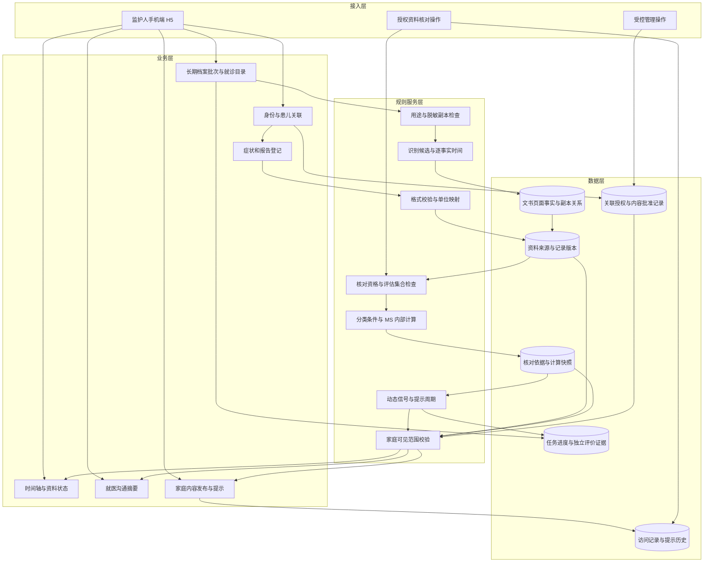
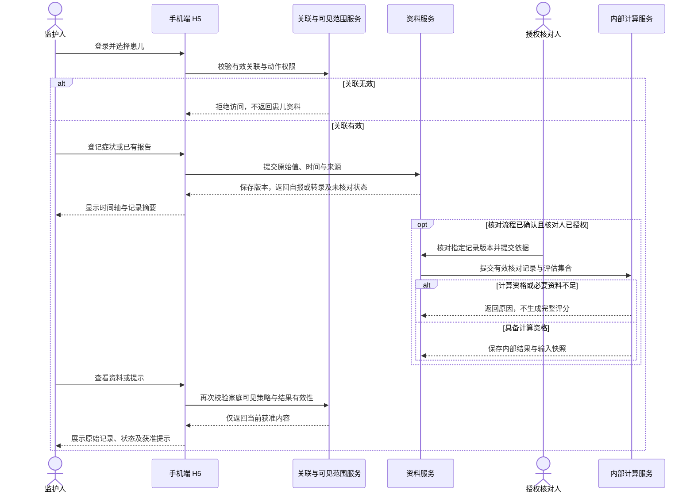
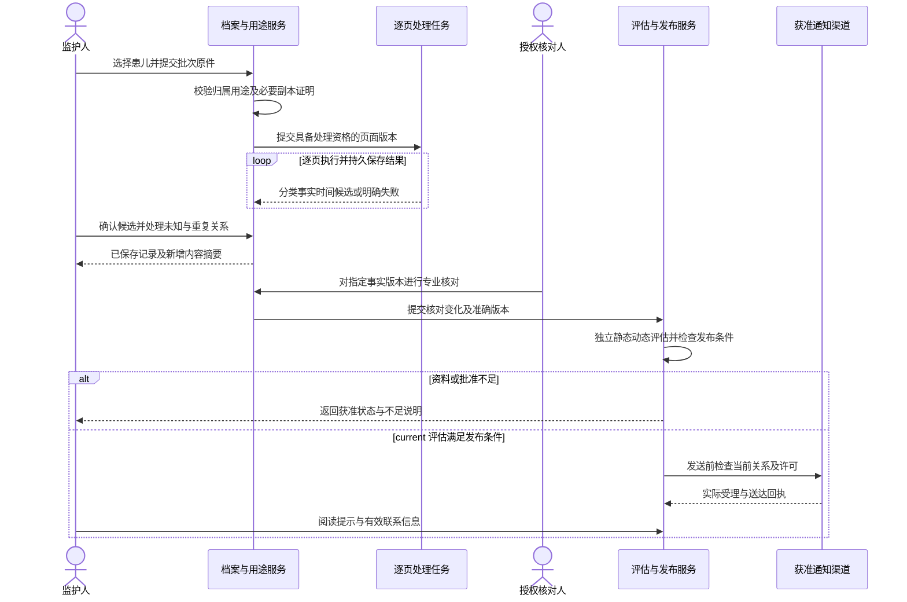
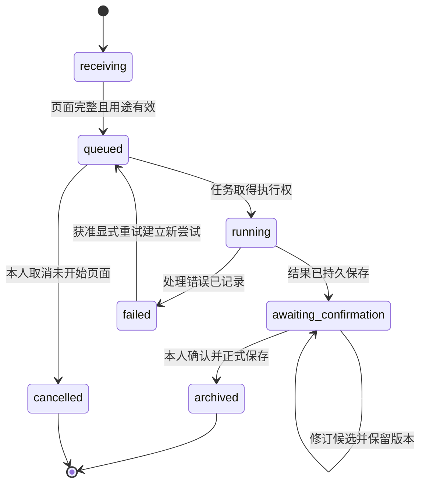
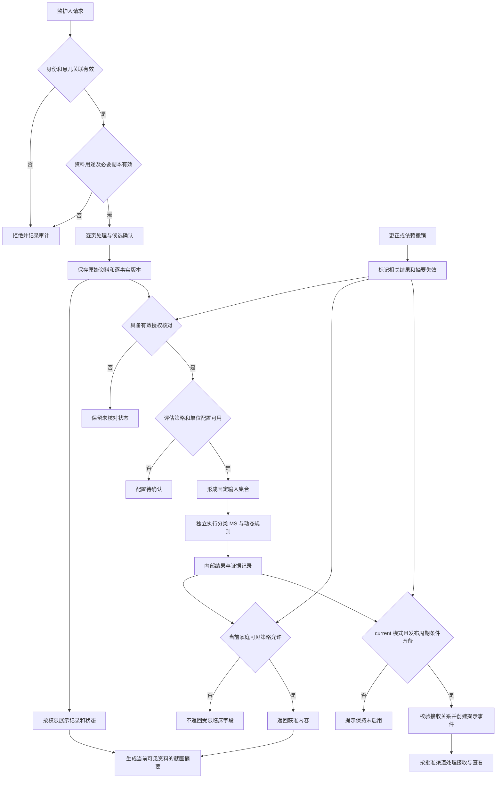
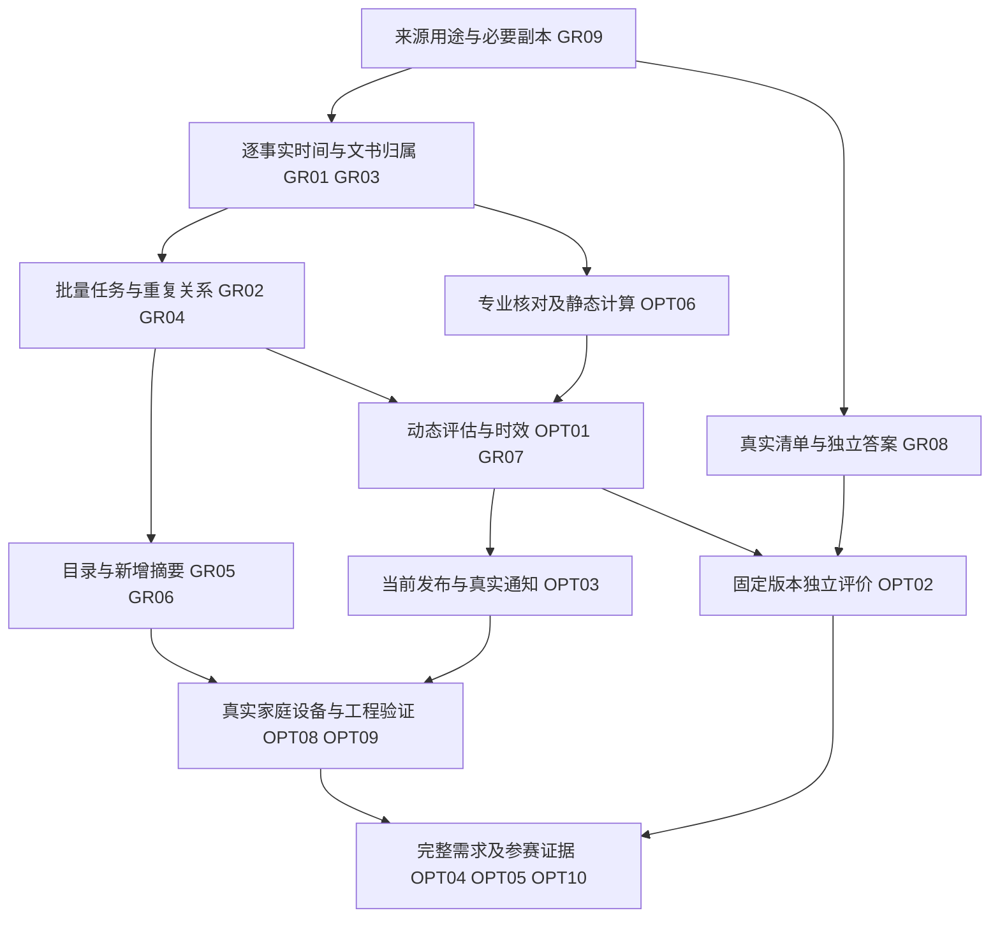

# sJIA 合并 MAS 预警平台 PRD 2.0

## 1. 版本记录与修订

| 日期 | 版本 | 文档状态 | 内容范围 | 编制责任 |
| --- | --- | --- | --- | --- |
| 2026-10-07 | V2.0.0 | DRAFT | 家庭 H5、长期档案与多时点事实、静态及动态评估、提示送达、资料摘要、独立评价与参赛交付；整合 OPT-01—OPT-10、GR-01—GR-10 | 产品需求编制；临床与运行条件按对应决定确认 |

本文件是当前完整业务需求与验收规范。原始 F01—F12、FR-01—FR-12、G01—G06 和既有验收编号继续有效；资料整理需求使用 FR-13—FR-22，并与 GR-01—GR-10 一一对应。GRAC 编号继续作为对应功能的验收编号，不建立重复验收集合。[参赛优化迭代方案](参赛优化迭代方案.md)维护工作组和任务安排，[赛事群资料问题自查与优化需求](赛事群资料问题自查与优化需求.md)保存来源及自查证据；业务要求以本文件为准。实际实施状态唯一来源为 [交付记录](planning/delivery-ledger.json)。

首期主要使用人为患儿监护人，依据为项目方于 2026-09-26 转述的主办方确认及本次用户指令。首期不包含医生端工作界面，接诊医生在平台之外作出临床判断。资料核对、临床内容批准和运行维护属于支持家庭使用的受控管理能力，承担人员及执行方式须按对应决定确认。

首期监护人入口采用手机端 H5，移动端设计和手机验收优先。用户通过手机浏览器打开页面，无需安装原生应用。手机竖屏承载关联、登记、时间轴、提示及就医摘要的完整流程；较宽屏幕采用自适应布局。手机端 H5 的选择已经确认，具体兼容版本与交付环境分别按第 12.3 节及 D01 管理。

产品面向家庭用户，以预警为核心定位。首页正文最前部展示当前获准预警结果及必要的下一步操作，评估时间和资料依据在详情中查看；无结果时明确区分未登录、服务未启用、资料不足、处理中与读取失败，不生成风险结论。报告与治疗资料主要采用拍照或相册选图，识别后在确认页面直接保存。体温记录、关联申请、更正和摘要在单页完成，必要信息优先展示，补充内容按需展开。流程指引贴近当前操作，不要求用户阅读全部规则才能继续。

交互以简单快捷为原则。识别、字段提取、来源关联、单位处理、权限、版本和临床规则校验由系统承担；用户只需提供资料、确认需要核对的内容并选择当前任务。完整原文和技术依据仍可查看，无法确定的数值、单位及时间保持未知。资料保存与风险评估分别反馈，后台计算不能增加无必要的确认页面，也不能跳过必要的权限或临床核对。

底部导航为首页、记录、我的。首页负责预警与资料添加；记录负责查阅、摘要及草稿；我的负责账号、患儿管理及资料使用说明。每项功能固定主要入口，只有与当前任务直接相关时提供快捷操作。预警详情从首页结果进入，更正、历史和历次检验从具体记录进入。首页支持患儿切换，登记和查阅页面只显示当前资料归属；账号、登录、说明及错误页面无需展示患儿区域。未登录时在账号区域提供一次登录操作，登录后才显示退出操作。原型页面目录通过独立评审地址访问。

本文件的能力类型为 `DESIGN`。首期使用人已确认；交付环境、资料核对资格、家庭可见范围及临床提示尚未全部确认。文档完成不表示功能已实现、临床规则已批准或病例验收已通过。

## 2. 文档说明

### 2.1 依据与范围

| 证据 ID | 来源 | 使用内容 | 证据性质 |
| --- | --- | --- | --- |
| E01 | [需求输入](/Users/liuhaoxian/Downloads/我的/AI项目/sJIA并发症预警平台/sJIA合并MAS预警平台需求输入.md)第 1—8 节 | 监护人使用场景、F01—F12、计算前提及家庭提示边界 | EXPLICIT |
| E02 | [产品目标](/Users/liuhaoxian/Downloads/我的/AI项目/sJIA并发症预警平台/sJIA合并MAS预警平台产品目标.md)第 1—7 节 | G01—G06、家庭任务、资料核对与家庭可见内容 | EXPLICIT |
| E03 | [项目评估与研发路线](/Users/liuhaoxian/Downloads/我的/AI项目/sJIA并发症预警平台/项目评估与研发路线.md)第 1—6 节 | D01—D09 定义、资料核对责任、首期范围及验收任务 | EXPLICIT |
| E04 | 2026-09-26 本次用户决定 | 首期面向监护人，按照更新后的输入调整 PRD | EXPLICIT |
| E05 | 需求输入第 4 节引用的 2016 年分类标准原始论文 | 分类前提、五项检验阈值及比较符 | 文献依据，沿用输入中已核验的内容 |
| E06 | 需求输入第 4.1 节引用的 2019 年 MS 评分原始研究 | 七项系数、单位、适用前提与阈值 | 文献依据，沿用输入中已核验的内容 |
| E07 | 需求输入第 7.1 节引用的 EULAR/ACR、EULAR/PReS 文献 | 资料连续记录、治疗背景与临床解释边界 | 文献依据，沿用输入中已核验的内容 |
| E08 | 2026-09-26 用户决定“手机端 H5 优先” | 首期家庭入口、移动端流程与手机验收优先级 | EXPLICIT；具体交互及兼容参数为本 PRD 的设计要求 |
| E09 | 2026-09-28 用户明确拍照识别、流程式交互与首页顶部预警结果 | 家庭用户的资料采集方式、任务引导与首页顺序 | EXPLICIT；识别服务、存储参数与临床批准分别按 D03、D05—D09 管理 |
| E10 | 2026-09-28 用户明确交互简单快捷，内部技术可以复杂 | 首页突出结果与拍照；短任务单页完成，补充信息按需展开；系统承担资料处理与校验 | EXPLICIT；全部来源、权限、版本和临床规则继续适用 |
| E11 | 2026-09-28 用户确认执行页面功能归属与入口优化 | 首页、记录、我的三项导航；摘要和草稿归属记录，账号和患儿管理归属我的；通用说明集中展示 | EXPLICIT；相关功能和状态需求完整保留 |
| E12 | 2026-10-07 用户提供赛事群讨论并要求自查、纳入必要优化 | 原始资料、长期档案、多时点事实、批量整理、资料查找、变化摘要与评价集合；完整要求见第 8.19 节 | EXPLICIT：自查及需求更新授权；群聊数量和日期为待核实转述；临床条件继续按 D03—D09 管理 |
| E13 | [参赛优化迭代方案](参赛优化迭代方案.md)，2026-10-07 | OPT-01—OPT-10、按当前分数排序、责任任务及证据要求 | 用户要求整合；评分与目标分为产品判断，不是官方成绩或获奖概率 |
| E14 | [赛事群资料问题自查与优化需求](赛事群资料问题自查与优化需求.md)，2026-10-07 | AUD-01—AUD-11 的源码证据、GR-01—GR-10 的必要需求及真实资料限制 | 自查结果按文件记录的代码范围解释；新增能力未经本次运行验证 |
| E15 | 2026-10-07 用户要求整合为 PRD 2.0 | 合并需求、规则、字段、状态、优先级、验收及实施关系 | EXPLICIT；文档整合授权，不代表临床启用批准 |

`EXPLICIT` 表示来源直接要求；`INFERRED` 表示本 PRD 的产品设计建议；`UNKNOWN` 表示缺少确认或证据。表单控件、版本关系和状态转移属于本 PRD 提出的设计；具体医学解释与授权规则按 D02—D09 确认。

目标范围为：监护人登录与患儿关联、可观察症状及报告登记、资料来源与核对状态、时间轴、就医沟通摘要、经批准的家庭内容。原始文书和长期档案优化按第 8.19 节纳入分类、归组、批量处理、查找和新增内容摘要。内部分类和评分保留为支持能力，其结果能否展示给监护人由 D06 单独决定。

D01 尚未确认，黑客松演示为当前交付建议。实际开放监护人使用前，应具备适用环境所需的身份关联、资料使用和运行责任。医院接口、报告上传与自动导入的具体形式按 D03、D07 决定；未提供的接口或识别服务不记为已接入。

### 2.1.1 参赛资料输入的采用范围

群聊反映家庭查找病历困难、长期就诊资料量大、希望了解每次新增内容，以及院内多次采样、院外稀疏采样的不同场景。PRD 2.0 将这些场景转为逐事实时间、批次整理、就诊目录、变化摘要、用途检查和独立评价要求。

| 群聊信息 | 本项目的记录方式 |
| --- | --- |
| 个案据称 60 次住院、80 次门诊、约 5000—6000 页 | 长期档案容量场景；以实际收到并获准使用的资料测量，当前没有该规模验收结论 |
| 已收集 36 份，MAS 相关资料较多 | 统计单位、独立患儿数、事件数、观察范围和标签待核实，不能直接换算为患儿数 |
| 建议约 50—100 张脱敏资料 | 格式与流程评价的来源建议；临床样本量由独立评价方案确定 |
| 发病、MAS 前后及变化前后资料 | 保留连续观察范围，同时登记稳定时段、未发生事件资料和缺失时段 |
| “8 号之前交付” | 未经正式赛事要求确认，不作为本项目截止日期 |

当前范围包含资料接收、候选整理、本人确认、专业核对、确定性规则、获准家庭提示及评价工具。首期没有医生诊疗工作界面；自由问答、RAG、模型训练、影像像素诊断、自动开药和自动安排检查均未纳入本次需求。影像附件可按获准文件能力归档，影像报告文字按原文整理。

### 2.2 术语与数据状态

| 术语 | 定义 |
| --- | --- |
| sJIA、MAS、MS | 全身型幼年特发性关节炎、巨噬细胞活化综合征、MAS/sJIA 评分 |
| 自报 | 监护人记录的观察、症状、疾病或治疗陈述；来源身份保持可追溯 |
| 报告转录 | 监护人依据已有报告登记的资料；提交或格式通过不代表内容已经核对 |
| 已核对 | 指定授权核对人按批准依据核对了明确的记录版本和字段范围；不表示患儿健康状况正常或临床诊断已确定 |
| 评估集合 | 一次内部计算选用的记录、核对证明、时间范围与版本集合 |
| 资料不足 | 缺项、未知状态、无效数值、单位不明、时间不明或资料未经核对等情况的明确状态；评估策略未确定另记为配置待确认 |
| 家庭临床提示 | 根据批准规则产生、供监护人查看的临床相关提示；其条件、文字、接收方式和联系路径均须确认 |
| 家庭可见策略 | 明确某类家庭用户可见字段、结果、解释文字、历史及使用范围的批准版本 |
| 手机端 H5 | 通过手机浏览器访问的响应式网页；首期监护人的主要使用入口 |
| 编辑草稿 | 尚未正式提交的表单内容；与临床记录分别保存，不进入时间轴、核对、摘要或规则计算 |
| 提交批次、文书、页面 | 批次记录一次收集与处理；文书保存独立来源和页序；页面保存原件版本与识别结果，三者分别管理 |
| 事实与就诊 | 事实具有自己的医学时间、来源及核对状态；一份文书可记载多次就诊，上传批次不决定就诊归属 |
| known_at | 历史评估时允许使用资料的截止时点；各事实同时保留实际取得和核对时间，禁止使用未来才可得的信息 |
| current、replay | current 为当前业务评估；replay 为受控历史评价，不能发布家庭事件、发送通知或推进当前提示周期 |
| 提示周期 | 同一患儿与规则族的一段持续触发记录；恢复、升级和再次提醒均需独立批准条件 |
| 新增内容摘要 | 相对于明确基准版本的新增文书、事实、重复、冲突和可比较变化；与按日期范围生成的就医摘要分别管理 |

来源类型、格式质量和核对状态分别保存。报告转录可以处于待核对或已核对状态；获得核对后仍保留转录来源。普通保存、自动校验或监护人确认均不能将资料设为已核对。

## 3. 项目背景与目标

监护人需要持续记录体温与可观察症状，整理已有检验报告，并在就医时说明历次资料的变化。平台将时间、原始单位、来源及核对状态展示在同一患儿记录中，帮助家庭准备可供沟通的资料。临床判断由接诊医生结合诊疗资料作出。

| 目标 ID | 用户结果及测量口径 | 当前状态 |
| --- | --- | --- |
| G01 | 监护人只能进入获准关联的患儿记录；逐项核对关联、多名监护人、撤销与跨患儿拒绝访问 | D02 与实际账号待提供；未运行 |
| G02 | 完成症状和报告登记；以原报告逐项比较数值、单位、采样时间、来源及更正结果，记录任务完成率和转录差错 | 获准报告与用户观察待提供；未测量 |
| G03 | 能找到历次值、采样时间、变化方向、资料来源和核对状态；记录任务完成、误解与中断原因 | 未运行 |
| G04 | 能生成、查看并使用就医摘要；检查时间、来源和资料不足说明的完整性 | 摘要字段设计见 FR-11，确认与用户验证待完成 |
| G05 | 家庭只看到批准范围内的提示；未经核对资料、未批准规则和缺项资料不生成临床风险等级 | D05、D06 待确认；未运行 |
| G06 | 授权人员能核对分类、MS 评分、换算、缺项处理和计算资格；每项输出可追溯 | D03、D04、D08 待确认；未运行 |

全部指标记录参与者、任务、病例范围、分母与实际结果；样本数、目标值和运行周期当前未知。文献中的评分表现不能作为平台成绩。平台能否改善 MAS 识别、减少漏报或改善患儿结局尚未验证。

### 3.1 优化顺序与复评依据

以下分数沿用参赛优化讨论，满分 10 分，仅用于安排工作。目标分须在取得对应证据后重新评估；功能数量和文档完成不能自动提高分数。

| 顺序与工作组 | 评价项目 | 当前分 | 复评目标 | PRD 2.0 必需结果 |
| --- | --- | ---: | ---: | --- |
| OPT-01 | 动态预警核心能力 | 2 | 8 | FR-06、FR-13、FR-16、FR-19；完整连续资料评估、周期、失效和回放隔离 |
| OPT-02 | 临床效果证据 | 2 | 6 | FR-20；EVAL-01—EVAL-05；独立答案、固定版本、真实分母及局限 |
| OPT-03 | 提醒送达与后续处理 | 3 | 8 | FR-07、FR-22；实际受理、送达、阅读与联系行为分别记录 |
| OPT-04 | 原始需求完成度 | 5 | 9 | F01—F12、FR-01—FR-22 的适用验收有证据且可复查 |
| OPT-05 | 创新性与竞争差异 | 5 | 8 | 同病例静态与动态对照、来源追溯、家庭任务结果支持每项优势陈述 |
| OPT-06 | 静态分类与 MS 评分 | 6 | 9 | FR-04、FR-05、FR-10；资格、时间、单位、边界与独立答案一致 |
| OPT-07 | AI 应用价值 | 7 | 8 | FR-02、FR-13—FR-16、FR-18、FR-21；真实报告及录音逐字段评价，采用后回读正确 |
| OPT-08 | 工程完成度与可靠性 | 7 | 9 | 批次恢复、幂等与并发、真实设备、容量及指定环境证据 |
| OPT-09 | 监护人使用体验 | 8 | 9 | 独立完成登记、查找、理解提示和准备摘要；记录耗时、协助及误解 |
| OPT-10 | 问题价值与选题意义 | 9 | 9 | 获准访谈、现行流程和真实评价支持服务人群与价值陈述 |

低分工作组优先获得投入，执行顺序依赖准确资料及静态计算。GR-09 的用途检查、GR-01 的逐项时间和 GR-03 的文书事实关系必须在相应原始资料进入外部处理或动态计算前具备。评价方案、真实资料清单与独立答案准备可与工程工作分别推进。

## 4. 应用与数据架构图

计算资格与家庭可见范围在服务端分别校验。内部计算成功不能自动发布结果。授权核对与内容批准属于受控支持流程，执行入口由 D03 与后续系统设计明确；管理员的账号管理权限不附带核对或读取病例权限。首期规则处理不依赖大模型或 Agent。

## 5. 业务流程与状态流转

### 5.1 家庭操作与内部核对流程

监护人记录与查看资料不以内部计算成功为完成条件。核对流程未配置时，资料保持未核对状态，家庭界面说明资料状态；不得承诺存在在线诊疗审核或响应时间。

### 5.2 对象状态与转移规则

| 对象 | 状态与进入条件 | 动作、后续状态及显示 |
| --- | --- | --- |
| 患儿关联 | 待核验：已申请但未满足 D02 | 不能读取病例；只显示本人申请状态 |
| 患儿关联 | 有效：授权主体、患儿、范围及依据齐全 | 按关联范围读取或提交；每名监护人有独立关联记录 |
| 患儿关联 | 未通过、已撤销或已失效 | 拒绝后续读取、写入、摘要及提示接收；恢复须重新满足 D02，不自动恢复 |
| 格式质量 | 待检查、格式有效、需补正 | 保存原始输入及缺项原因；格式有效仅表示结构符合要求 |
| 核对状态 | 未核对：自报或转录初次保存 | 不参与内部分类、评分或家庭临床提示 |
| 核对状态 | 待核对：按 D03 提交核对要求 | 保留来源；等待有效核对操作，未配置核对流程时不显示已受理 |
| 核对状态 | 需补正：核对发现来源或内容问题 | 向监护人显示其有权获知的补正原因；更正产生新版本 |
| 核对状态 | 已核对：授权人确认指定版本及范围 | 仅对应的字段、版本和评估用途获得资格；仍需检查时间与规则适用前提 |
| 核对状态 | 核对已撤销：依据、授权或结论不再有效 | 停止受影响计算；相关结果过期，家庭提示撤销当前展示 |
| 记录版本 | 当前有效版本、已更正、已撤销 | 当前版本用于后续操作；历史只读保存；新版本不能继承原核对通过状态 |
| 内部处理 | 未计算、配置待确认、资料不足、计算完成、计算失败；有效性另记当前有效或已失效 | 分类结论另记符合、未符合、资料不足或不适用；计算完成只产生内部结果 |
| 家庭临床提示规则 | 草稿、待确认、已批准、已启用、已停用 | 草稿、待确认和已批准均为未启用；已批准后仍须完成病例验证并检查依赖，才能启用 |
| 提示事件 | 当前有效、已失效 | 更正、撤销核对、规则停用或内容批准失效时终止当前展示；历史按当前可见策略读取 |
| 接收记录 | 未查看、已查看；外部渠道另记未发送、待发送、已受理、已送达或发送失败 | 查看只表示阅读动作；送达只能依据渠道回执，不代表已经获得医疗处理 |

任何撤销、更正和批准失效均应重新检查依赖关系。历史记录留存供授权追溯，家庭重新读取时仍执行当前授权与内容限制。

### 5.3 长期档案到当前提示的业务交接

接收原件不代表完成识别；识别完成不代表本人采用；本人采用不代表专业核对；内部评估完成不代表家庭发布。各交接对象可重新读取自身状态及版本。replay 仅供受控评价人员读取，永不进入图中的外部发送路径。

### 5.4 批次与逐页处理状态

该图表示单页处理的业务状态；任务执行终态与新尝试分别保存。批次依据逐页状态显示实际接收、等待、处理中、待确认、失败、取消及已归档数量；部分完成时显示各类数量，不把整个批次标为完成。归档表示资料已保存，专业核对状态独立。上传中断仅对尚未完整接收的页面继续上传；已接收页面按版本查询。在途外部请求不能承诺立即停止，取消后的返回结果不得自动采用。

## 6. 竞品分析

| 对标对象 | 可核查的公开能力 | 对本项目的设计启示 | 证据与范围 |
| --- | --- | --- | --- |
| MyTherapy，家庭健康记录应用 | 官方介绍症状与测量记录、健康日记、提醒和供医生查阅的健康报告 | 家庭记录及就医资料查看应连续可用；本项目的资料补充提醒按本人设置执行 | [官方产品介绍](https://www.mytherapyapp.com/)，2026-10-07 读取完整页面正文 |

本节用于参考家庭记录与就医沟通方式。未运行竞品，未进行临床表现或用户任务效率的比较；本项目范围以第 2 节来源及用户决定为准。OPT-05 的差异假设为：连续变化分析、逐事实来源核对和家庭联系流程共同提供可测量价值。该假设通过 EVAL-02、EVAL-03、EVAL-05 验证，不据公开产品介绍宣称独创或领先。

## 7. 功能概览与项目决定

### 7.1 功能及来源

| 功能 ID | 输入要求 | 功能 | 使用角色 | 关联目标 | 优先级 |
| --- | --- | --- | --- | --- | --- |
| FR-01 | F01 | 监护人账号、患儿关联与状态 | 监护人、授权管理人员 | G01 | P0 |
| FR-02 | F02—F04；治疗背景要求 | 症状、体温、报告及治疗资料登记 | 监护人 | G02 | P0 |
| FR-03 | F05 | 时间轴、来源和核对状态 | 监护人 | G03 | P0 |
| FR-04 | F06、F10 | 2016 年分类条件内部计算 | 规则服务、授权核对人 | G06 | P0 |
| FR-05 | F12、F10 | MS 评分内部计算 | 规则服务、授权核对人 | G06 | P0 |
| FR-06 | F07 | 家庭变化线索和临床提示启用控制 | 监护人、临床负责人 | G05 | P0 |
| FR-07 | F08 | 家庭提示详情与接收记录 | 监护人 | G05 | P0 |
| FR-08 | F11 | 更正、核对撤销和历史追溯 | 监护人、授权核对人 | G02、G03、G06 | P0 |
| FR-09 | F01、F11；资料保护要求 | 权限、使用依据与审计 | 监护人、授权管理人员 | G01、G06 | P0 |
| FR-10 | F02、F03、F06、F12 | 资料核对与计算资格 | 授权核对人 | G06 | P0 |
| FR-11 | F09 | 就医沟通摘要与联系信息 | 监护人、指定维护人 | G04 | P0 |
| FR-12 | F06—F08、F12 | 家庭可见字段与内容批准 | 临床负责人、项目负责人 | G05 | P0 |
| FR-13 | GR-01；E12—E15 | 多时点事实与逐项时间 | 监护人、授权核对人 | G02、G03、G06 | P0 |
| FR-14 | GR-02；E12—E15 | 长期档案与批量任务 | 监护人、处理服务 | G02、G03 | P1 |
| FR-15 | GR-03；E12—E15 | 文书分类与就诊归组 | 监护人、授权核对人 | G02、G03 | P1 |
| FR-16 | GR-04；E12—E15 | 重复资料与事实关系 | 监护人、授权核对人 | G02、G03、G06 | P1 |
| FR-17 | GR-05；E12—E15 | 就诊目录与资料查找 | 监护人 | G03 | P1 |
| FR-18 | GR-06；E12—E15 | 新增内容与变化摘要 | 监护人 | G03、G04 | P1 |
| FR-19 | GR-07；E12—E15 | 观察时段与资料时效 | 监护人、规则服务 | G03、G05 | P0 |
| FR-20 | GR-08；OPT-02 | 用途清单与独立评价集合 | 获准数据与评价人员、临床负责人 | G05、G06 | P0 |
| FR-21 | GR-09；E12—E15 | 原始资料与脱敏副本 | 监护人、获准资料处理人员 | G01、G06 | P0 |
| FR-22 | GR-10；E12—E15 | 自愿补充资料提醒 | 监护人 | G02、G05 | P2 |

P0 为核心评估、资料正确性、权限及评价前置；P1 为长期资料整理与查找；P2 为本人设置的资料提醒。全部条目均属于 PRD 2.0 范围，优先级不表示省略验收。P1 中的事实去重和就诊归属在对应资料进入临床计算前必须具备。临床功能启用继续受批准和真实验证限制。

### 7.2 D01—D10 的决定与运行依赖

| 决定 ID | 内容 | 当前状态与依赖行为 | 确认责任与产物 |
| --- | --- | --- | --- |
| D01 | 黑客松演示、受控试点或真实家庭使用的交付环境 | UNKNOWN；黑客松演示为建议，不自动开放真实家庭使用 | 项目负责人；交付范围、使用单位和运行责任 |
| D02 | 身份、患儿关联、多名监护人权限和撤销 | UNKNOWN；不能仅凭匿名标识完成关联；待核验关联无病例访问权 | 项目负责人；关联证明、账号规则与权限表 |
| D03 | 可录入项目、拍照识别、授权核对责任与条件 | 拍照识别及本人确认流程已明确；项目清单、文件限制、识别服务和核对条件仍为 UNKNOWN | 项目负责人、临床负责人；字段、识别与核对方法、授权人员 |
| D04 | 分类及 MS 评估时间、重复选值、缺项判定 | UNKNOWN；评估策略未批准时不执行患者级规则判定，不由监护人自行组合专业变量 | 临床负责人；评估策略、逐项判定与病例答案 |
| D05 | 家庭提示条件、等级、文字、接收方式和联系路径 | UNKNOWN；家庭临床提示未启用，不发送临床通知 | 临床负责人、项目负责人；提示规则与最终文字 |
| D06 | 家庭可见分类、评分、资料状态及历史范围 | UNKNOWN；原始登记资料与来源状态为基本家庭能力，内部临床结果默认不向家庭公开 | 临床负责人、项目负责人；逐字段可见表和文字版本 |
| D07 | 来源、同步、单位映射与更正 | UNKNOWN；未经确认的单位或来源不自动换算；接口与自动导入待决定 | 数据提供方、技术负责人；来源字段、单位及更正规则 |
| D08 | 病例使用依据、去标识化、标签和验收 | UNKNOWN；无使用依据的资料不能进入演示或病例验收 | 项目负责人、临床负责人；逐例依据及参考答案 |
| D09 | 保存、删除与联系信息维护 | UNKNOWN；保留期限与维护责任不预填；未确认的联系信息不展示 | 项目负责人；资料处置方案和联系信息管理规则 |
| D10 | 语音结构化与照片识别的大模型服务（火山方舟 Ark） | 语音转写后的候选结构化已明确；模型、密钥、调用额度、超时与数据保留仍待确认 | 技术负责人；模型版本、密钥管理与调用预算 |

## 8. 详细功能、数据、规则与验收

本节家庭页面以手机端 H5 为主要设计与验收对象，采用竖屏、单列内容和触控操作。跨页面的布局、输入保留、网络状态及浏览器要求见第 8.18 节和第 12.3 节。受控核对与管理操作的执行方式按 D03 及后续系统设计确定。所有写入需要有效账号、关联或岗位授权，成功后须能重新读取。本次新增验收使用获准真实资料和实际账号，状态为 `NOT_RUN`；已有功能证据按第 13.5 节的原环境、输入和版本解释，不统一改写其任务状态。

### 8.1 FR-01 监护人账号、患儿关联与状态

**用户故事：**作为监护人，我需要进入获准关联的患儿记录，以便管理正确患儿的资料。

监护人按 D02 确定的方式登录、申请患儿关联并查看申请状态。系统按每名监护人与患儿的关联分别保存权限；同一账号关联多个患儿时，每次登记明确当前患儿。申请、登录或知道患儿标识都不能直接取得病例访问权。多人关联时，可查看、可登记与可更正的范围分别确认；不能默认一名监护人有权修改另一名监护人的记录。

sJIA 自报状态和临床资料确认状态分别保存。监护人选择“已确诊”只构成自报，内部适用前提使用经过授权核对的临床资料状态。关联撤销后拒绝后续读写、摘要和提示读取；重新关联需新的有效依据。账号恢复不能扩大原有病例范围。

| 页面元素 | 控件与规则 | 必填／默认状态 |
| --- | --- | --- |
| 登录与关联申请 | 身份方式、证明材料按 D02；关联对象由获准流程建立 | 方式待定；无有效关联时显示“尚无可访问的患儿记录” |
| 患儿选择与标识 | 只列有效关联；登记页持续显示当前患儿 | 记录提交必需；不自动切换已编辑内容的归属 |
| 自报 sJIA 状态 | 已确诊、疑似、不了解；附来源描述 | 可空；显示“监护人自报” |
| 临床资料状态 | 按 D06 展示授权核对的状态与来源 | 不允许监护人修改；未确认时明示 |

**AC-01。** Given 实际账号拥有有效关联，When 打开该患儿并保存授权范围内资料，Then 读取和归属均一致；Given 待核验、已撤销或其他患儿标识，When 请求页面、详情或提交，Then 拒绝且不返回病例内容。验证多人关联的独立权限与撤销影响，不以页面按钮隐藏代替服务端拒绝。

### 8.2 FR-02 症状、体温、报告与治疗登记

**用户故事：**作为监护人，我需要保存观察及报告原文对应的资料，以便持续记录并在就医时说明来源。

监护人记录体温、观察到的发热、皮疹、关节疼痛或肿胀等获准项目，保存发生时间、录入时间、记录人及自报来源。未填写与“未观察到”分别处理，不用空值自动补全。持续发热、活动性关节炎、中枢神经系统受累、脾大和肝功能异常等专业变量需按 D03、D04 从临床资料核对，家庭观察不能自动映射为这些变量。

报告主要采用“拍照或从相册选择 → 上传并识别 → 本人确认 → 提交资料”。识别结果逐项关联原照片及文字位置，保留原报告标识、项目、原始数值、比较符、单位、采样时间、结果时间与登记时间。无法确定的识别内容独立标记待确认，不自动补全；允许根据原文修正和补充。监护人确认仅表示转录确认，提交后仍需授权人员核对。

照片必须在当前有效身份及患儿写入权限下处理。多页报告按顺序归组，支持重拍、替换、移除及确认报告归属。取消选图保留已确认内容；照片模糊、格式不支持、上传失败、识别失败或权限失效分别说明，保留可恢复内容并提供实际可用的重试入口。上传成功、识别完成、本人确认、正式保存和临床核对分别记录。文件格式、大小、保存期限、照片定位与识别服务等待 D03、D07、D09 确认；服务未接入时不接收照片、不模拟识别结果。

治疗资料优先通过处方或治疗记录照片提取原药名及出处，再由监护人确认实际使用状态与起止时间；无照片时可按家庭记录补充并保留自报属性。IL-1／IL-6 分类及与评估时段的关系由授权核对人依据临床资料确认。结束时间空缺不能独自证明持续使用，另存持续、已结束、未知状态；本功能不产生用药建议。

| 页面元素 | 控件与规则 | 必填／默认状态 |
| --- | --- | --- |
| 体温与测量记录 | 数值、原始单位、发生时间；测量方式有资料时保存 | 温度记录的数值与单位必需；不按未确认阈值自动判定发热 |
| 可观察症状 | 项目、出现／未观察到／未知、时间、补充说明 | 单条记录需项目与状态；默认未知 |
| 报告来源与项目 | 原报告标识或来源引用；每条项目关联到相应报告 | 完整记录必需；缺少时标“来源待补充” |
| 照片与识别确认 | 照片组、页序、上传状态、识别任务、原文定位、待确认字段和本人修订 | 未取得结果时不填入数值；识别不能修改核对资格 |
| 原始值与单位 | 十进制数、原始单位、检测限比较符分别保存 | 空缺可保存需补正状态；不得用零代替 |
| 采样与结果时间 | 带时区的时间及原始精度；不以录入时间替代 | 缺失明示；计算所需时间不可确认时停止相关计算 |
| 提交及保存反馈 | 保存版本与来源状态；错误定位到具体字段 | 确认失败时显示未保存；网络中断无法确认时显示保存结果待确认并查询请求状态 |

**AC-02。** Given 有效关联及获准报告，When 监护人登记并重新打开，Then 数值、单位、三类时间、来源和记录人均与输入一致，状态为转录且未核对；专业变量不能通过家庭输入设为已核对。测试零值与缺项分别存储、无效字符被指出、跨患儿提交被拒绝。

### 8.3 FR-03 时间轴与资料状态

**用户故事：**作为监护人，我需要找到历次资料及核对状态，以便理解记录的时间关系和来源。

症状按发生时间、报告项目按采样时间展示，录入与出具时间单独显示；无法确定事件时间的资料列入“时间待补充”，不插入可比较序列。每条记录展示来源和核对状态，同日多次采样保留独立记录，迟到结果标明新近录入，更正后可查看本人获准范围内的版本。

相同项目、可比较方法及已经确认的单位映射允许展示相邻有效时间点的数值变化方向。自报或转录资料可以显示其原始变化，同时显示实际核对状态；尚未核对的资料必须明确标注，不生成风险等级。相同采样时间存在不同结果时显示待核对，不任意选择先后。专业解释及临床提示文字按 D06 执行。

| 页面元素 | 控件与规则 | 必填／默认状态 |
| --- | --- | --- |
| 时间轴与筛选 | 发生或采样时间、项目、来源、核对状态 | 无记录显示“暂无记录” |
| 历次结果 | 原值、单位、采样时间及参与比较的两个记录版本 | 少于两次可比较结果时显示资料不足 |
| 状态说明 | 自报／报告转录与未核对／已核对分别显示 | 不使用仅靠颜色表达的状态 |

**AC-03。** Given 两条获准可见的报告记录，When 查看历次值，Then 方向、时间、来源和核对状态正确；未经核对的变化没有临床等级。相同时间冲突、未知单位及未知采样时间均给出不可比较原因。撤销关联后不能读取历史详情。

### 8.4 FR-04 2016 年分类条件内部计算

**用户故事：**作为授权核对人，我需要核查分类条件及其输入版本，以便确认规则执行与获准资料一致。

计算入口为具备 D03 核对证据与 D04 评估策略的内部处理。首先核对适用前提、记录所属患儿、当前版本、核对范围、时间和来源单位；只有获得资格的已核对字段可以进入条件比较。未核对字段按资料不足处理，不能先使用其数值判定再隐藏家庭结果。评估策略未确认时返回配置待确认，不创建患者级分类结论。

内部结果保存逐条件的满足、未满足、资料不足，及整体符合、未符合、资料不足或不适用。部分已核对条件能否决定整体结果按第 8.14 节待批准判定表执行。家庭查看结果另需 D06 批准，默认不返回分类标识、阈值、条件数量或解释文字。

| 受控核对信息 | 展示与规则 | 必填／默认状态 |
| --- | --- | --- |
| 评估集合 | 记录版本、核对证明、时间范围与策略版本 | 计算前必需；未配置则待确认 |
| 条件结果 | 原值、标准单位值、比较符、核对状态与缺项原因 | 按授权记录只读查看 |
| 内部整体结果 | 判定及输入快照 | 默认未计算；家庭默认不可见 |

**AC-04。** Given 获准病例、有效核对证据及已批准策略，When 运行分类，Then 五项边界、三值判定与参考答案一致；改变一项所用记录的核对状态后，不能继续使用该项原数值。家庭账号请求内部结果时，未经 D06 允许的字段在响应中不存在。

### 8.5 FR-05 MS 评分内部计算

**用户故事：**作为授权核对人，我需要查看七项贡献与完整计算依据，以便核查评分及缺项处理。

sJIA 与发热前提、三个专业临床变量及四个检验变量均须满足对应核对要求。专业变量出现为 1、未出现为 0、未知为缺项；不通过症状名称推断。七项齐全后计算各项贡献与总分，以未按展示精度取整的值比较 `≥ −2.1`。缺少任何一项不输出完整总分；保留对应原因。

内部结果同时保留治疗背景及其核对状态。治疗信息未知须明示，具体适用限制按临床负责人确认内容执行，不能把未知治疗状态当作未用药。家庭是否可见总分、贡献值、阈值和解释分别由 D06 确认，默认均不可见。

| 受控核对信息 | 展示与规则 | 必填／默认状态 |
| --- | --- | --- |
| 七项变量 | 值、规则单位、记录版本、核对证明及贡献 | 齐全后计算；缺项逐项说明 |
| 总分与阈值 | 精确计算值及比较结果 | 不完整则为空，不补零 |
| 治疗背景 | 原始治疗资料、核对结果与时间 | 资料不足时明示 |

**AC-05。** Given 已核对七项输入与适用前提，When 计算并回看快照，Then 贡献与总分可重现，`−2.1` 边界按包含等号执行；任一专业变量自报、未知或核对撤销时不生成完整评分。家庭接口不泄露未批准的总分或阈值。

### 8.6 FR-06 家庭变化线索与临床提示控制

**用户故事：**作为监护人，我需要查看获准线索和明确的功能状态，以便理解当前平台提供了哪些信息。

原始症状、报告变化与资料不足信息按当前可见范围展示。家庭临床提示需独立的 D05 触发规则、D06 字段及文字批准、D08 病例验证，所用资料还须满足 D03、D04、D07 的计算条件，并有 D09 确认的有效联系路径。任何必要条件缺失时，规则保持未启用；不创建临床提示事件，不发送临床通知，也不显示“当前安全”或低风险结论。

启用配置应明确：适用人群、基准值和当前值选取、观察时间、变化算法、阈值及比较符、组合条件、缺项与检测限处理、等级、触发时机、防重、再次触发、迟到及更正处理、接收人与渠道、文案、联系路径、批准版本和生效范围。当前所有这些参数不填示例值。

| 页面或管理元素 | 控件与规则 | 必填／默认状态 |
| --- | --- | --- |
| 家庭线索 | 原始记录及获准文字，不自动推断临床严重程度 | 无获准临床提示时显示服务未启用 |
| 提示规则配置 | 保存、病例验证、批准与启用为独立动作 | 默认未启用 |
| 生效记录 | 规则、内容、资料策略、联系信息的版本及启用时间 | 启用前全部有效 |

**AC-06。** Given 任一批准、核对或病例验证条件缺失，When 新数据保存、定时处理或重复请求，Then 家庭临床事件数与外部临床通知数均为零。全部条件齐全后，按获准病例验证触发与不触发路径；未通过前不得登记已启用。

#### 8.6.1 连续资料评估与静态、动态关系

FR-06 接收有效专业核对变化、获准配置变化和批准定时事件，保存实际触发与处理状态。一次资料保存和之后一次评估分别反馈。静态分类、MS 及动态路径独立检查资格和适用条件；分类不适用或 MS 缺项不能直接关闭有独立批准条件的动态路径。单次合格资料按适用规则形成静态结果，多次资料同时保留静态结果与动态结果。

| 静态触发条件 | 动态触发条件 | 必需处理 |
| --- | --- | --- |
| met | met | 保存两类依据；使用批准组合生成事件候选，按提示周期处理 |
| met | not_met | 保留静态依据；是否触发及文字使用批准组合，动态结果不能覆盖静态结果 |
| not_met | met | 保留动态依据；可进入独立批准的动态发布路径 |
| not_met | not_met | 记录当前条件未达到；不输出安全保证或排除 MAS 的结论 |
| 任一 unknown 或不适用 | 任意 | 保留各项状态，按三值组合求值；不将未知当作 not_met |

“静态触发条件”指配置中对分类和 MS 的明确组合，两项原结果仍分别保存。表中四种已知组合是验收覆盖要求，不预设未经批准的临床分级。

| 规则 ID | 业务要求与不足行为 |
| --- | --- |
| BR-D01 | 固定同患儿的 baseline、current、series、context、核对依据、assessment_at、known_at、规则及窗口版本；逐项保存纳入和排除原因 |
| BR-D02 | 绝对变化为 current − baseline；相对变化为该差值除以 baseline 后乘 100。基准为零或规则不接受的非正值时，相对变化为空并说明原因，绝对变化仍按资格独立计算 |
| BR-D03 | 可比较性同时检查项目、方法、批准单位映射、独立采样、医学时间与专业核对。仅日期精度保存时间区间及间隔范围；区间不能严格排序或不能完整满足批准窗口时，相关趋势不参与临床判定 |
| BR-D04 | n 个独立采样对应 n−1 次相邻变化；次数、方向、幅度、允许间隔、等值中断条件由 D05 确认。同次采样副本、引用及更正不增加连续次数，不通过插值或补值增加观察 |
| BR-D05 | 信号可包含分类结果、完整 MS、铁蛋白、血小板、AST、纤维蛋白原、甘油三酯、LDH 的变化及已核对专业状态；治疗仅提供获准上下文。纳入哪项信号及具体临床阈值需批准 |
| BR-D06 | all：存在 not_met 即 not_met，全部 met 才 met，其余 unknown；any：存在 met 即 met，全部 not_met 才 not_met，其余 unknown；at_least(k)：S≥k 为 met，S+U<k 为 not_met，其余 unknown。S 为 met 数量，U 为 unknown 数量 |
| BR-D07 | 允许嵌套组合，各层按直接条件与子组结果计算，不得重复引用同一信号增加计数；层数、数量上限由运行配置确定，超限拒绝。逐项保存未知原因，最终 unknown 不创建临床等级 |
| BR-D08 | 临床等级、优先级和家庭文字使用准确批准版本；多个有效提示均可查看，首页按批准优先级和稳定规则标识选择主提示，不隐藏其他依据 |
| BR-D09 | current 提交与发布前核查当前数据、核对、授权、规则及发布 epoch 和任务执行权；任何依赖改变则本次结果不能作为当前结果。按 assessment_at 与分配的 context_sequence 采用新评估，较早评估迟到完成不能覆盖首页或周期 |
| BR-D10 | replay 仅使用当时已经可得并满足当时资格的事实和版本；后来取得的出院结论不能提前使用。无法重建历史资格则返回不足；禁止创建家庭事件、发送通知和改变当前周期 |

#### 8.6.2 持续提示、恢复与再次提醒

| 周期与新条件 | 状态变化与事件行为 |
| --- | --- |
| 没有周期，met 且发布条件齐备 | 创建 open 周期与首次事件 |
| open，同一评估再次消费 | 返回原采用结果，事件与发送不增加 |
| open，持续 met | 保存评估；仅满足批准间隔、升级或再次提醒条件时创建新的 sequence，否则保存未再次提醒原因 |
| open，定时评估 met 且批准间隔已到 | 输入仍有效且符合批准策略才产生新 sequence；过期资料不能因定时任务重新取得资格 |
| open，unknown | 记录不足；不能视为恢复，既有事件依照其时效与依赖检查 |
| open，not_met | 满足批准恢复条件、持续时间或连续次数后转为 closed；阅读和拨号不关闭周期 |
| open，来源更正、核对撤销或必要依据失效 | 转为 invalidated，相关当前事件失效；不解释为健康恢复 |
| closed 后 met | 按批准再次触发规则建立新周期 |
| invalidated 后取得新的有效 met | 原周期保留失效，按批准规则新建周期；不得恢复旧事件 |
| 规则、联系、用途或发布许可失效 | 停止依赖该条件的新事件及发送，当前展示重新校验，保留已发生回执 |

冷却、升级、恢复、再次触发间隔、有效期及规则更换后的周期关系由 D05 决定。未阅读不自动升级临床等级；技术限流需记录发送受限及运行告警，不能把尚未发送标记送达。状态编号与 N00—N11 的执行关系见第 10.3 节。

| 验收 ID | Given | When | Then |
| --- | --- | --- | --- |
| AC-DYN-01 | 获准连续资料、独立答案、固定批准规则 | 执行四种静态／动态组合及缺项情形 | 两类结果独立，输入可回查，组合与参考一致；真实资料未覆盖的情况保留未覆盖 |
| AC-DYN-02 | 具有多次采样、重复引用、零基准或时间精度限制的实际资料 | 计算变化及连续次数 | 重复引用不增加次数，不能除零，不能确认的时间关系不参与对应判定 |
| AC-DYN-03 | current 任务与实际更正、撤销或配置变化并发 | 提交任务并读取首页 | 过期 epoch、执行权或较早顺序不能覆盖当前结果；新版本重新获得资格后才采用 |
| AC-DYN-04 | 同一周期的连续 met、unknown、not_met 及获准恢复资料 | 重复消费、到期评估、恢复及再次触发 | 事件数、sequence 与批准策略一致；unknown 和已读不关闭周期 |
| AC-DYN-05 | 已登记实际可得时间及独立临床识别时点的资料 | 运行 replay 并检查业务记录 | 无未来信息进入评估；家庭事件、发送及当前周期变化数量均为零 |

### 8.7 FR-07 家庭提示详情与接收记录

**用户故事：**作为获准接收提示的监护人，我需要查看批准文字、依据和有效联系信息，以便按获准路径进行沟通。

仅已启用规则可创建家庭临床提示。事件记录患儿、输入版本、核对依据、规则版本、内容版本、生成时间、联系信息版本和有效性。对同一事件、同一获准监护人和渠道防止重复发送；临床条件持续满足后的再次触发规则须由 D05 决定，不能将一次录入等同一次新提醒。

接收人必须是事件发送及读取当时仍有权限的监护人，多人接收范围由 D02、D05 决定。记录每名接收人的未查看或已查看状态；不把点击、阅读、拨号或查看摘要标为完成诊疗。外部通知渠道未确认时不发送；实际失败需记录，后续处理按已批准的 D05 执行，不转发给未指定人员。

| 页面元素 | 控件与规则 | 必填／默认状态 |
| --- | --- | --- |
| 提示列表 | 当前获准事件、时间、查看状态 | 未启用显示“临床提示尚未启用”，不能显示为无风险 |
| 提示详情 | 批准文字、关联记录、采样时间、来源和核对状态；版本信息可展开 | 当前关联与可见策略均有效才显示 |
| 联系入口 | 只显示批准且当前有效的信息，操作由监护人发起 | 未确认或失效时不提供过期联系方式 |
| 查看记录 | 保存真实查看时间 | 默认未查看，不自动生成处置结论 |

**AC-07。** Given 已获准提示及有效接收关系，When 监护人打开详情，Then 文字与批准版本相同且能追溯记录，只有阅读状态变化；重复请求不重复生成同一接收事件。关联撤销或提示失效后，历史链接也不能返回当前不允许展示的临床内容。

#### 8.7.1 真实渠道与发送结果

发送前重新核验事件、关系、内容、联系版本、渠道授权和发送许可有效期。事件、接收记录、防重依据及待发送事项保持一致，服务端任务承担发送；手机进入后台不影响已获准任务。接收人数和通知正文范围由 D02、D05、D06 确认，锁屏文字采用批准的最少信息。

| 渠道状态或操作 | 必需行为 |
| --- | --- |
| 待发送与已受理 | 分别记录请求时间、attempt、Provider 请求标识与实际受理凭证；accepted 不能转换为 delivered |
| 受理结果未知 | 记录未知并查询原请求，不自行新建重复发送；无法查询时按批准人工处理方式登记 |
| 已送达 | 仅有效 Provider 回执支持 delivered；检查签名、来源、事件对应和重复回执，过期回执不能更新其他版本 |
| 发送失败与显式重试 | 保存原失败原因；按批准次数、间隔、费用预算与有效性条件创建新尝试；不得自动转发其他联系人 |
| 撤权、过期、停用 | 撤销提交后不开始新发送；已经进入 Provider 的请求保留实际状态及可用取消结果，不承诺撤回已送达信息 |
| 查看与联系 | read_at 仅来自本人实际查看；联系入口可进入获准摘要或有效联系方式，拨号和阅读均不代表诊疗完成 |

**AC-NOTIFY-01。** Given 获准真实账号、渠道、有效临床事件和明确发送授权，When 实际发送并读取回执与详情，Then accepted、delivered、read_at 各自有对应证据，详情引用当前获准版本；重复消费和重复回执不增加通知。

**AC-NOTIFY-02。** Given 发送结果未知、许可到期或在途任务期间撤权，When 查询原请求、尝试重发及打开深层链接，Then 不重复提交未知请求，不开始无效发送，不能读取已无权访问的病例。没有实际触发的 Provider 异常登记未覆盖，不使用模拟回执证明通过。

### 8.8 FR-08 更正、核对撤销与历史

**用户故事：**作为监护人，我需要更正权限范围内的登记内容并识别当前版本，以便就医沟通使用准确记录。

监护人只更正自身获准编辑的记录，临床确认字段只可提交更正请求。更正必须包含原因，创建新版本并将其核对状态设为未核对；提交时关联原版本。系统同时标记依赖旧内容的内部结果已过期、家庭提示已失效、既有摘要需重新生成。重新核对只针对新版本，不覆盖历史确认。

核对撤销由获准人员执行，保存原因、核对证明及影响结果；家庭仅看到获准的状态说明。原始值、计算与已展示提示保留可追溯历史，历史读取仍受 D06 限制。多个监护人同时更正同一版本时执行版本检查，冲突方重新读取后提交，不自动合并临床数据。

| 页面元素 | 控件与规则 | 必填／默认状态 |
| --- | --- | --- |
| 更正表单 | 当前版本、可编辑字段和更正原因 | 原版本与原因必需 |
| 历史记录 | 获准字段、修改时间、来源及核对变化 | 当前版本优先；历史只读 |
| 补正提示 | 当前记录需补充的信息 | 不显示无权查看的核对内部意见 |

**AC-08。** Given 已核对记录被更正或其核对被撤销，When 重新打开内部结果、家庭详情及摘要，Then 旧依据不能继续作为当前有效结果，新的内容未经核对不能计算；两次并发修改仅接受满足当前版本条件的一次。检查历史可追溯且无家庭信息越权。

### 8.9 FR-09 权限、资料使用与审计

**用户故事：**作为监护人，我需要患儿资料只向获准人员开放，以便明确资料的使用范围并追溯相关操作。

登录身份、监护人与患儿关联、动作权限、字段可见范围及资料使用环境须共同满足。报告附件、历史、摘要、提示和直接结果请求均执行相同授权；单纯修改患儿或记录标识不能跨患儿访问。管理员仅凭管理角色不能读取原始报告、临床字段或内部计算结果。资料核对资格单独授予并记录依据。

演示与验收病例需具备 D08 使用依据和去标识化检查。访问、拒绝、写入、更正、核对、撤销和内容发布均有审计记录；普通运行日志只记必要标识和错误，不复制整份病历。保存期限及删除按 D09 确认，不将取消关联等同立即删除所有历史。

| 受控管理元素 | 控件与规则 | 必填／默认状态 |
| --- | --- | --- |
| 关联及授权记录 | 主体、患儿、动作、字段范围、有效期及依据 | 授权生效前必需 |
| 病例使用登记 | 使用目的、可展示范围、去标识化核验 | 演示或验收前必需 |
| 审计查询 | 限定资源与角色范围 | 管理员仅见管理所需元数据 |

**AC-09。** Given 实际获准账号及资料，When 访问允许范围，Then 正确返回且记录动作；Given 管理员普通角色、无效关联或未获准病例，When 读取病例、附件或内部结果，Then 拒绝并不返回内容。用服务端响应和审计持久化记录验证成功与拒绝路径。

### 8.10 FR-10 资料核对与计算资格

**用户故事：**作为授权核对人，我需要针对指定版本记录核对证据，以便只有具备资格的字段进入计算。

项目方与临床负责人按 D03 明确核对人员、权限、依据、专业变量定义及执行方式。受控核对操作只面向分配的资料与明确用途，核对人应能读取原始依据和指定版本，逐项记录一致、需补正或无法确定。管理员不能自行将数据核对状态改为已核对；临床负责人角色也不自动取得全部病例访问权。

核对证据必须绑定记录版本、字段范围、依据引用、执行人员、时间及核对规则版本；专业临床变量需有足够临床资料依据。审核执行中发生更正时拒绝提交旧版本的当前核对结果。核对流程未批准或核对人未授权时，记录继续保存为未核对，内部计算返回相应原因。

| 受控核对元素 | 内容与规则 | 必填／默认状态 |
| --- | --- | --- |
| 指定资料及依据 | 来源报告、记录版本、字段范围 | 核对前必需；仅限获准资料 |
| 逐项核对结果 | 一致、需补正、无法确定及原因 | 未填写不能记为通过 |
| 提交／撤销核对 | 核对人身份、实际时间、依据与状态变化 | 服务端检查资格及当前版本 |

**AC-10。** Given 获准核对人及明确记录版本，When 完成核对并重新读取，Then 只有批准范围内的字段获得计算资格，来源保持不变；监护人提交相同状态字段或管理员越权请求被拒绝。核对提交与资料更正并发时不能给新内容附加旧核对证明。

### 8.11 FR-11 就医沟通摘要与联系信息

**用户故事：**作为监护人，我需要查看带有时间、来源和资料状态的摘要，以便向接诊医生说明已有记录。

监护人选择当前获准患儿和时间范围，生成只读摘要用于就医时查看。摘要由结构化记录生成，至少包含匿名标识、时间范围、体温与可观察症状、报告原值及单位、采样时间、来源、核对状态、缺项说明、更正状态和生成时间。自报 sJIA 或治疗信息须带自报标识。摘要中任何临床结果仍需当前 D06 策略允许，不因“用于就医”自动公开。

摘要固定记录版本以便追溯，更正或核对撤销后提示重新生成，旧摘要不得展示为当前资料。首期定义平台内生成与查看；文件导出、公开分享或自动发送需要明确的资料范围和项目决定。联系信息由指定维护人提供机构、用途、联络方式、适用范围、来源、核验时间、有效期和批准记录；失效或来源不明时不提供可操作联系入口。

| 页面元素 | 控件与规则 | 必填／默认状态 |
| --- | --- | --- |
| 患儿及时间范围 | 选择本人有效关联的患儿与记录时间范围 | 生成前必需；范围内无数据时显示暂无记录 |
| 摘要内容 | 只读原始事实与状态；可回到原记录 | 无临床结论自动填充 |
| 更新时间与版本状态 | 生成时间及是否需重新生成 | 新增或更正记录后明示 |
| 联系信息 | 已批准名称、用途、渠道及有效性 | 未确认时显示“联系信息暂未提供”；不自动补全 |

**AC-11。** Given 有效关联和获准记录，When 生成并查看摘要，Then 所选患儿、范围、数值、来源和状态与输入一致；缺项没有被补造，隐藏评分不会出现在摘要。撤权、更正或联系信息失效后，重新读取执行相应限制，不能显示为最新有效内容。

### 8.12 FR-12 家庭可见范围与内容批准

**用户故事：**作为临床负责人，我需要逐项确认家庭可见字段和准确文字，以便平台按批准范围发布内容。

临床负责人及项目负责人按 D06 为家庭可见字段、专业解释、结果与历史制定明确策略。确认记录含内容 ID、准确文字、允许引用的字段、适用人群、环境、版本、确认人、日期和生效状态。采用经批准的模板填入获准事实；不自由生成诊断、治疗、风险概率或自行复查要求。

原始登记值及其基本来源、时间和资料不足状态属于家庭任务必需内容；内部分类结果、MS 总分、贡献、阈值、风险等级和专业解释在未批准前均不对家庭返回。可见策略同时用于首页、详情、历史、提示、通知和摘要。内容批准被撤销或版本缺失时，停止展示受影响临床内容；原始家庭记录仍按现有权限可读。

| 受控发布元素 | 内容与规则 | 必填／默认状态 |
| --- | --- | --- |
| 可见字段表 | 对每种内容和角色明确允许或拒绝 | 临床结果默认拒绝 |
| 文字与批准记录 | 精确文案、事实字段、依据、版本、批准人及时间 | 未提供则不发布 |
| 发布与停用 | 校验批准范围和依赖版本，记录实际生效时间 | 保存不等于启用 |

**AC-12。** Given 某结果内部计算完成但缺少家庭批准，When 监护人查看任何页面或接口，Then 不返回该结果；批准指定文字后只展示批准内容。停用、撤销或扩大字段请求均重新校验，历史与摘要不能绕过当前限制。

### 8.13 字段字典与计算资格

本表为产品字段定义，数据库结构由后续数据设计确定。账号、患儿归属、项目及版本等识别信息是保存所必需；缺少这些信息时拒绝提交。数值、单位、来源或医学时间未知的资料可以保存为需补正记录，完整记录要求不能被理解为必须补造未知事实。“计算必需”用于计算资格校验。原始来源、原始单位和原始数值不能被标准化结果覆盖。

| 字段 ID | 字段或字段组 | 类型、允许值与时间含义 | 必需条件与校验 | 来源及权限 |
| --- | --- | --- | --- | --- |
| FD-01 | guardian_id、account_status | 系统标识；有效、停用、注销处理中等账号状态 | 登录及授权校验必需；认证方式待 D02 | 认证服务；监护人不能指定他人标识 |
| FD-02 | patient_id、display_id | 系统患儿标识与获准显示标识 | 保存必需；不使用显示标识作为访问凭证 | 获准关联流程；最少展示个人信息 |
| FD-03 | relation_id、guardian_id、patient_id | 关联双方及唯一记录标识 | 有效关系必需；每名监护人独立记录 | D02 指定人员核验 |
| FD-04 | relation_status、permission_scope | 待核验、有效、未通过、已撤销、已失效；读、写、更正、接收范围 | 请求时校验；无有效状态即拒绝 | 监护人可申请，不能自行授予 |
| FD-05 | relation_evidence_ref、checked_by、checked_at、revoked_at、reason | 证明引用、核验人、核验及撤销时间、原因 | 授予与撤销时必需；证明种类待 D02 | 限获准身份核验人员读取证明 |
| FD-06 | reported_sjia_status | 自报确诊、疑似、未知及来源时间 | 可留空；不能自动生成临床适用前提 | 监护人登记 |
| FD-07 | verified_sjia_status | 已核对确诊、疑似、不满足、无法确定 | 分类或 MS 使用前需有效核对证据；适用人群按批准规则 | 授权核对人；不能由家庭表单写入 |
| FD-08 | observation_code、reported_state、observed_at | 获准可观察症状；观察到、未观察到、无法确定；发生时间 | 状态不得默认“未观察到”；项目与时间未知要标明 | 自报；项目列表待 D03 |
| FD-09 | temperature_value、temperature_unit、measured_at、measurement_method | 原始温度、单位、测量时间、测量方式 | 完整测量记录需数值与单位；缺失保存需补正；时间未知不补录入时间 | 自报；原值不直接判定发热前提 |
| FD-10 | verified_fever_state | 满足、未满足、无法确定；适用时间 | 临床前提需要核对依据及 D04 定义 | 授权核对；不使用家庭症状代替 |
| FD-11 | cns_involvement | 已确认存在 1、已确认不存在 0、未知 | MS 计算必需，未知不补 0 | 专业资料及有效核对 |
| FD-12 | hemorrhagic_manifestations | 已确认存在 1、已确认不存在 0、未知 | MS 计算必需，家庭观察不直接赋值 | 专业资料及有效核对 |
| FD-13 | active_arthritis | 已确认存在 1、已确认不存在 0、未知 | MS 计算必需，不由关节疼痛或肿胀自动推断 | 专业资料及有效核对 |
| FD-14 | professional_finding_code、state、effective_at | 脾大、肝功能异常等专业项目与状态、有效时间 | 可记录未知；参与提示须有对应获准规则 | 专业来源与核对证据 |
| FD-15 | report_id、source_ref | 报告标识、原始报告或获准来源引用 | 报告登记需说明来源；原件缺失不能取得核对资格 | 监护人转录；文件上传形式待 D03 |
| FD-16 | origin_type、source_organization | 自报、报告转录、获准临床资料；来源机构可未知 | origin_type 保存必需；接入来源按 D07 扩展 | 创建时记录；核对不改变来源类型 |
| FD-17 | analyte_code、original_analyte_name | 项目标识与报告原名称 | 保存检验记录必需；别名映射需版本 | 报告转录及 D07 映射 |
| FD-18 | raw_value、value_qualifier、raw_unit | 原始值；等值或原报告比较符；原始单位 | 数值与原单位配套；比较符独立保存 | 保留报告文字，不改写为精确测量值 |
| FD-19 | sampled_at、resulted_at、recorded_at | 采样、报告出具、系统登记时间，保存时区及时间精度 | recorded_at 由系统生成；其余未知要标注；规则所需时间缺失则不计算 | 报告及系统；不得彼此替代 |
| FD-20 | report_result_status、method、reference_interval | 报告结果状态、检测方法、参考区间及原单位 | 未提供即未知；不能用参考区间代替固定规则阈值 | 报告原文及映射 |
| FD-21 | ferritin | 原值及标准值；标准单位 ng/mL | 分类必需条件；MS 计算必需 | 当前有效、已核对检验记录 |
| FD-22 | platelet_count | 原值及标准值；标准单位 ×10⁹/L | 分类四项之一；MS 计算必需 | 同上 |
| FD-23 | ast | 原值及标准值；标准单位 U/L | 分类四项之一 | 同上 |
| FD-24 | triglycerides | 原值及标准值；标准单位 mg/dL | 分类四项之一；其他单位须批准映射 | 同上 |
| FD-25 | fibrinogen | 原值及标准值；标准单位 mg/dL | 分类四项之一；MS 计算必需 | 同上 |
| FD-26 | ldh | 原值及标准值；标准单位 U/L | MS 计算必需 | 同上 |
| FD-27 | additional_lab_items | 其他血常规及分类、肝功能、D-dimer、CRP；各项独立记录值、单位和时间 | 原样登记；具体项目名、绝对计数与比例分别确认 | 报告转录；不能加入未经批准的分类或评分公式 |
| FD-28 | normalized_value、normalized_unit、mapping_version | 十进制标准值、单位、映射版本 | 单位匹配和映射生效后才生成；不得覆盖 FD-18 | 确定性转换服务 |
| FD-29 | quality_status、quality_reasons | 待检查、格式有效、需补正；原因列表 | 保存状态必需；格式有效不表示临床可信 | 格式校验服务 |
| FD-30 | verification_status | 未核对、待核对、已核对、需补正、已撤销 | 默认未核对；按具体记录版本和字段范围保存 | 授权核对流程 |
| FD-31 | record_id、record_version、author_id | 记录标识、版本、创建者 | 保存必需，服务端生成；患儿归属不可通过更正转移 | 系统及获准写入人 |
| FD-32 | supersedes_version、correction_reason、corrected_at | 被更正版本、原因及更正时间 | 更正必需；新版本重新核对 | 有更正权限的人员 |
| FD-33 | medication_name、therapy_class | 原药名；经核对 IL-1、IL-6 或其他治疗分类 | 原药名可登记；专业分类未经核对保持未知 | 自报或获准报告，保留来源 |
| FD-34 | therapy_start、therapy_end、therapy_status | 开始、结束时间；持续、已结束、未知 | 时间精度和未知独立保存；结束时间空值不等于持续用药 | 已核对背景用于计算解释；不改变评分公式 |
| FD-35 | verification_id、record_version、field_scope | 核对证明、指定版本、核对字段集合 | 授予计算资格必需；不得使用对其他版本的核对 | 授权核对人 |
| FD-36 | verifier_id、verified_at、evidence_ref、verification_policy_version | 核对人、完成时间、证据引用、核对策略版本 | 已核对状态必需且均有效 | 核对流程；普通管理员无写入权限 |
| FD-37 | verification_revoked_at、revocation_reason | 撤销时间和原因 | 撤销必需；影响相关计算和展示 | 授权核对人及审计 |
| FD-38 | assessment_id、assessment_at、window_policy_version | 本次评估、评估时点与选值策略 | 内部计算必需；采样选择按 D04 | 受控计算流程 |
| FD-39 | input_record_refs、verification_refs、missing_items | 输入记录版本、核对引用、缺项及原因 | 每次计算必需；不能只存最后数值 | 规则服务 |
| FD-40 | rule_id、rule_version、rule_status | 规则及版本；草稿、待确认、已批准、已启用、已停用 | 批准与启用分开；规则文字、范围和依赖共同定版 | 临床负责人确认，授权人员发布 |
| FD-41 | classification_conditions、classification_result | 逐条件三值；整体符合、未符合、资料不足、不适用 | 仅在配置及资格成立后生成 | 内部计算；家庭默认隐藏 |
| FD-42 | ms_contributions、ms_total、ms_threshold_result | 七项贡献、完整总分、阈值比较结果 | 七项完整且核对后生成；保存未展示舍入值 | 内部计算；家庭默认隐藏 |
| FD-43 | computation_status、computed_at、validity | 未计算、配置待确认、资料不足、计算完成、计算失败；当前有效或已失效 | 失败不得保留成功标识；当前状态随依赖变化校验 | 计算服务 |
| FD-44 | family_content_id、content_version、approved_text | 获准文字模板、允许填入字段及版本 | 临床展示必需；不能加入模板以外结论 | 临床内容批准流程 |
| FD-45 | visibility_policy_version、allowed_fields、audience_scope | 按角色、患儿关系、使用环境定义可见字段 | 服务端投影必需；临床字段默认拒绝 | D06 批准策略 |
| FD-46 | approval_by、approval_at、approval_evidence、effective_scope | 确认人、时间、证据、环境及内容范围 | 生效需完整；没有真实确认时留空并标待确认 | 相应临床或项目负责人 |
| FD-47 | alert_id、alert_rule_version、input_snapshot、created_at、alert_validity | 临床提示事件、规则、输入快照、时间及有效性 | 仅全部启用条件成立后创建 | 规则服务；当前无已启用规则 |
| FD-48 | alert_content_version、contact_version、recipient_relation_id | 事件文字、联系版本及获准接收关系 | 展示和发送时重新核验 | 家庭提示服务 |
| FD-49 | channel、delivery_status、delivery_receipt、read_at | 渠道；未发送、待发送、已受理、已送达、发送失败；回执及本人阅读时间 | 无回执不标送达；阅读不代表诊疗处理 | 实际渠道与监护人动作 |
| FD-50 | summary_id、summary_scope、record_versions、generated_at、summary_validity | 摘要范围、依赖版本、生成时间及有效性 | 生成与读取时均检查关联及可见策略 | 结构化模板；家庭查看 |
| FD-51 | contact_id、contact_name、purpose、channel_value | 联系对象、用途与准确渠道内容 | 展示前必须批准；未知不得自动补充 | D09 指定维护人 |
| FD-52 | contact_owner、contact_source、updated_at、valid_until、contact_status | 维护责任人、来源、更新时间、有效期、生效状态 | 联系内容启用必需；有效期规则待 D09 | 指定维护人及发布记录 |
| FD-53 | data_use_basis、use_scope、deidentification_record | 资料使用依据、环境/用途范围、去标识化记录 | 演示与病例验证前必需；真实家庭使用按适用依据执行 | D08 项目负责人 |
| FD-54 | audit_id、actor_id、action、object_version、occurred_at、outcome | 审计标识、操作者、动作、对象版本、时间、结果 | 访问、修改、核对、授权、发布与拒绝操作必需 | 系统生成，不能由普通账号改写 |
| FD-55 | retention_policy_version、deletion_request、disposition_status | 保存策略、删除请求、批准及处理状态 | D09 确认后执行；不得自定保留年限 | 获准资料管理流程 |
| FD-56 | request_id、expected_version | 写入请求唯一标识与预期版本 | 重复提交识别及并发更正必需 | 系统生成；同标识不同内容拒绝 |
| FD-57 | draft_id、draft_version、draft_owner、patient_id、form_type、payload、saved_at、expires_at、draft_status | 编辑草稿的所有者、患儿、表单类型、原始输入、保存及到期时间；编辑中、已提交、已放弃、已到期 | 单独存储；服务端保存成功才显示时间；期限按 D09；不得取得计算资格 | 仅本人且患儿关联有效可恢复；不与其他监护人共享；恢复后重新校验 |
| FD-58 | archive_id、batch_id、patient_id、submitted_by、received_at | 患儿档案及一次提交批次；保存实际接收时间 | 批次必需；跨患儿页面不得归入同一批次 | 有效写入权限；FR-14 |
| FD-59 | document_id、document_version、page_id、page_order、checksum | 文书版本、页面顺序、文件内容校验和及原件引用 | 候选、原文、摘要均能定位对应页面版本 | 原件权限独立检查；FR-13—FR-15 |
| FD-60 | document_type、organization、episode_refs、grouping_status | 文书分类、来源医院、关联就诊及待归组／已确认状态 | 可未知；一份文书允许引用多个就诊 | 系统候选与本人修订分别记录；FR-15 |
| FD-61 | fact_id、fact_version、source_anchor、context_type、episode_ref | 逐事实身份、原页文字位置、既往／此次／出院／计划／实际语境及就诊 | 保存临床事实必需来源；未知语境保持未知 | 本人确认不授予专业资格；FR-13 |
| FD-62 | medical_time、raw_time_text、time_precision、timezone、documented_at、available_at | 医学时间、原文精度、时区、文书形成时间、平台实际取得时间；FD-19 与 verified_at 仍各自保留 | 逐事实绑定，不用共同时间覆盖明确时间；历史更正保留版本 | 原件与系统事实分别记录；FR-13、FR-19 |
| FD-63 | page_status、attempt_id、model_version、request_id、duration、cost | 逐页进度、尝试、模型、请求、实际耗时和费用 | 每页处理持久保存；未知费用保持未知 | 任务服务生成；FR-14 |
| FD-64 | relation_type、related_fact_refs、relation_version、evidence_ref、relation_status | 文件相同、文书副本、同次采样引用、独立采样、更正的关系与依据 | 未决不自动合并；解除关联保留原因及依赖变化 | 本人整理与专业核对分别授权；FR-16 |
| FD-65 | delta_summary_id、baseline_refs、current_refs、item_source_refs、validity | 新增内容摘要、明确比较基准、逐条证据及有效性 | 无基准不输出前后变化；更正后检查失效 | 按当前可见资料生成；FR-18 |
| FD-66 | observation_period_id、start_time、end_time、label_source、episode_refs | 本人观察时段、精度、自报标签与相关就诊 | 不能由标签推断临床恶化；范围修改保留版本 | 监护人当前资料范围；FR-19 |
| FD-67 | dataset_id、purpose、patient_partition、label_ref、observation_window、coverage | 资料集合用途、患儿划分、独立标签、观察区间及覆盖缺口 | 文件／页面／文书／患儿／事件分别统计 | 获准评价人员；FR-20 |
| FD-68 | original_ref、derived_ref、use_scope、processing_version、review_evidence、disposition_ref | 原件与用途副本、处理及人工复核证明、处置引用 | 外发前检查用途对应版本，状态标签不能替代证明 | 获准资料处理及复核角色；FR-21 |
| FD-69 | evaluation_id、mode、assessment_at、known_at、input_refs、epochs、context_sequence | 当前或历史评估、可得信息截止、固定输入、依赖版本及顺序 | current 提交重新检查；replay 不采用到当前家庭业务 | 受控评估及规则服务；FR-06、FR-20 |
| FD-70 | reminder_id、owner_id、target_ref、schedule、timezone、quiet_hours、status | 本人资料提醒、目标、计划、安静时段；关闭／启用／暂停／完成／取消 | 默认关闭；对象完成或撤权停止计划；不复用临床事件 | 仅本人设置与读取；FR-22 |
| FD-71 | quota_policy_version、accepted_count、completed_count、failed_count、cancelled_count、budget_status | 批次容量策略、实际数量及预算状态 | 数量由逐页记录汇总；容量须有实测来源 | 受控配置；家庭展示必要进度，详细费用按可见范围 |

字段长度、数值格式上限、账号认证方式、文件类型与大小属于 D02、D03、D07 的待确认参数，发布前应形成实际配置。未配置的上传和自动导入入口不开放。极端值保留原文并提示核对，不擅自设医学正常范围或截断数值。

### 8.14 内部规则判定表

#### 8.14.1 通用资格与时间规则

| 规则 ID | 判定及处理 | 依据与确认状态 |
| --- | --- | --- |
| BR-V01 | 患儿一致、资料使用范围有效、记录版本有效、字段核对证据有效、单位与时间可用，才允许字段进入临床计算 | E01—E03；D03、D07、D08 待确认执行细目 |
| BR-T01 | 评估时间、采样窗口、重复记录选值、迟到结果处理由一个有版本的 D04 策略确定；策略缺失即配置待确认，不形成患者级结论 | E01、E03；D04 待临床负责人确认 |
| BR-T02 | 同时点不同报告、跨机构方法不同、只有日期精度、跨时区、不同项目采样不同步均按批准策略处理；不能任取最大值、最小值或最新录入值 | INFERRED；D04、D07 待确认 |
| BR-P01 | 计算所用事实限定为固定记录及核对版本集合；更正或撤销使依赖结果失效，重新获取资格后形成新结果版本 | E01—E03；产品设计 |
| BR-P02 | 家庭请求在计算之外校验当前关联、逐字段可见策略与内容批准；所有详情、摘要及历史接口一致执行 | E02 G01、G05；D02、D06 待确认范围 |

D04 的确认记录必须明确：评估时点如何取得、症状有效区间、各项允许的采样时间差、重复值选择顺序、原报告更正优先级、时间精度不足处理、缺项判定表和治疗背景的适用解释。未经确认不得给出默认小时数、下降百分比或分级。

#### 8.14.2 2016 年分类条件

| 规则 ID | 条件 | 比较符与阈值 | 输入要求 |
| --- | --- | --- | --- |
| BR-C00 | 适用前提 | 已确诊或疑似 sJIA，且发热 | 专业资料已核对；具体适用及发热判定按 D04 |
| BR-C01 | 铁蛋白必需条件 | ferritin > 684 ng/mL | 已核对且可比较的精确值 |
| BR-C02 | 四项中的血小板条件 | platelet_count ≤ 181 ×10⁹/L | 同上 |
| BR-C03 | 四项中的 AST 条件 | ast > 48 U/L | 同上 |
| BR-C04 | 四项中的甘油三酯条件 | triglycerides > 156 mg/dL | 同上 |
| BR-C05 | 四项中的纤维蛋白原条件 | fibrinogen ≤ 360 mg/dL，即 3.6 g/L | 同上 |
| BR-C06 | 组合条件 | BR-C00 满足、BR-C01 满足，且 BR-C02—BR-C05 至少两项满足 | 采用以下三值判定表 |
| BR-C07 | 解释限制 | 内部分类结果不等同诊断、排除 MAS 或低风险证明 | 家庭是否展示及文字待 D06 |

以下组合判定为待临床负责人确认的产品逻辑，未批准时不启用患者级判定。每项条件的“未满足”必须来自具备资格的明确资料；缺项、未核对、未知单位、时间不可用均为“资料不足”。已核对报告中某个无资格字段仍按未知处理。

| 优先顺序 | 适用前提 | 铁蛋白条件 | 四项中已满足数 S、未知数 U | 整体结果 |
| --- | --- | --- | --- | --- |
| 1 | 任一必需前提明确未满足 | 任意 | 任意 | 不适用 |
| 2 | 无明确未满足，但有未知前提 | 任意 | 任意 | 资料不足 |
| 3 | 满足 | 明确未满足 | 任意 | 未符合 |
| 4 | 满足 | 满足或未知 | S + U < 2 | 未符合 |
| 5 | 满足 | 满足 | S ≥ 2 | 符合 |
| 6 | 满足 | 满足或未知 | 其余组合 | 资料不足 |

内部结果同时返回缺项名称及原因；“未符合”仍保留缺项标识。边界验证需覆盖等于 684、181、48、156、360 的情况及各边界两侧，来源为获准且经确认的验收资料，不能用临时编造的病例作为临床通过证据。

#### 8.14.3 MS 评分

BR-M01 的适用前提为已确诊或疑似 sJIA 且发热；按获准评估策略核对。仅使用七项均具备资格的输入，七项及贡献如下：

| 变量 | 输入及单位 | 系数 | 贡献计算 |
| --- | --- | --- | --- |
| 中枢神经系统受累 CNS | 1 或 0 | 2.44 | 2.44 × CNS |
| 出血表现 | 1 或 0 | 1.54 | 1.54 × hemorrhagic_manifestations |
| 活动性关节炎 | 1 或 0 | −1.30 | −1.30 × active_arthritis |
| 血小板计数 | ×10⁹/L | −0.003 | −0.003 × platelet_count |
| LDH | U/L | 0.001 | 0.001 × ldh |
| 纤维蛋白原 | mg/dL | −0.004 | −0.004 × fibrinogen |
| 铁蛋白 | ng/mL | 0.0001 | 0.0001 × ferritin |

`MS = 2.44 × CNS + 1.54 × hemorrhagic_manifestations − 1.30 × active_arthritis − 0.003 × platelet_count + 0.001 × ldh − 0.004 × fibrinogen + 0.0001 × ferritin`

内部比较条件为 `MS ≥ −2.1`。使用十进制运算，在展示舍入前比较。专业变量未知不按 0 计算；七项缺少任意一项时不产生完整总分和阈值结果，返回缺项说明。专业定义、时间与治疗背景解释待 D03、D04；家庭总分、贡献、阈值及解释默认隐藏，待 D06 分别批准。评分达到或未达到阈值均不能自行转换为诊断或家庭风险等级。

#### 8.14.4 家庭提示规则

| 规则 ID | 必需配置 | 缺少配置或证据时 |
| --- | --- | --- |
| BR-A01 | 指标组合、比较窗口、变化方向与幅度、再次触发条件、有效期、等级、适用人群及治疗限制 | 未启用；不推导原方案示例百分比 |
| BR-A02 | 家庭可见字段、准确文字、行动说明、联系路径、批准人和版本 | 未启用；不生成诊断或治疗文字 |
| BR-A03 | 接收关系、渠道、去重、失败处理与多人接收范围 | 对应渠道不启用；不发送到未经指定的接收人 |
| BR-A04 | D08 获准病例及触发、未触发、缺项、更正、撤权的验证结果 | 未启用；不能用分类或 MS 研究表现代替平台验收 |

当前 BR-A01—BR-A04 均缺少完整确认和验证记录，家庭临床提示及动态提醒保持未启用。原始记录变化、核对状态和资料不足展示不会自动创建临床提示事件。

### 8.15 单位映射与结果格式

所有映射需匹配原项目、原单位、检测方法适用范围及有效版本。下表定义候选数学关系；D07 尚未确认具体数据来源，不能据此宣称已完成接入或允许未知来源自动换算。

| 映射 ID | 项目与原单位 | 标准单位 | 数学关系及处理 | 发布条件 |
| --- | --- | --- | --- | --- |
| UM-01 | ferritin，ng/mL | ng/mL | 原值 × 1 | 来源与项目匹配，D07 确认 |
| UM-02 | ferritin，µg/L | ng/mL | 原值 × 1 | 同上；符号别名逐项登记 |
| UM-03 | platelet_count，×10⁹/L | ×10⁹/L | 原值 × 1 | 同上 |
| UM-04 | platelet_count，×10³/µL | ×10⁹/L | 原值 × 1 | 同上；不能把每 µL 裸计数直接套用 |
| UM-05 | AST、LDH，U/L | U/L | 原值 × 1 | 分别匹配项目，不因单位相同混用 |
| UM-06 | triglycerides，mg/dL | mg/dL | 原值 × 1 | 来源与项目匹配，D07 确认 |
| UM-07 | triglycerides，mmol/L | mg/dL | 换算系数待确认；不自动转换，不参与对应比较 | D07 明确系数、精度及来源后方可发布 |
| UM-08 | fibrinogen，mg/dL | mg/dL | 原值 × 1 | 来源与项目匹配，D07 确认 |
| UM-09 | fibrinogen，g/L | mg/dL | 原值 × 100 | 同上；核对后用于规则和 MS |
| UM-10 | D-dimer 的原单位及 FEU/DDU 标识 | 原单位 | 保留原值；FEU 与 DDU 不混用，不自动互换 | 仅展示原始记录；解释规则需独立批准 |
| UM-11 | CRP、其他肝功及血常规项目 | 原单位 | 原样保留；比例和绝对计数分别存储 | 扩展映射待 D07 |
| UM-12 | 体温，°C | °C | 原值 × 1；其他单位保留原值，映射待确认 | 不自动产生发热临床前提 |

原报告为 `<`、`>`、`≤`、`≥` 等限定值时保留比较符，不能把界限数值当作精确值。此类结果参与分类的区间判定方法尚待 D04 确认，当前不参与数值比较；MS 需要可用的精确输入。标准化值保留计算精度，界面舍入位数由字段显示规范确定；时间轴比较同时检查项目、单位及检测方法可比较性。

### 8.16 家庭可见内容与文字

| 内容 | 当前设计范围 | 需要的批准或权限 | 不允许的自动解释 |
| --- | --- | --- | --- |
| 关联及申请状态 | 本人申请及当前获准患儿 | D02 有效权限 | 显示标识可用于任意关联 |
| 自报症状、体温和治疗原文 | 原始内容、发生时间、记录人及自报状态 | 获准关联及记录范围 | 自动赋值专业症状、疾病诊断或药物类别 |
| 报告转录记录 | 原值、单位、时间、来源、核对状态 | 获准关联；原始资料读取范围 | 转录确认等于临床核对 |
| 原始时间变化 | 可比较数据的方向与时间；未知情况说明 | 单位/方法可比较；当前记录可见 | 变化直接表示高风险、低风险或病情恶化 |
| 资料不足与核对状态 | “资料尚未核对”“采样时间待补充”“该记录已更正”等状态文字 | 基本资料状态可见；专业原因及历史范围待 D06 | 缺项说明等于安全结论 |
| 分类、MS 总分、贡献及阈值 | 默认全部隐藏 | D06 逐字段批准，资料及计算有效 | 自动发布内部结论或风险概率 |
| 家庭临床提示 | 当前未启用 | D05、D06、D08 及全部依赖成立 | 使用尚未批准的等级、诊疗或复查建议 |
| 就医摘要 | 当前获准原始资料、时间、来源与状态 | 当前关联、字段可见策略有效 | 汇总时补全缺项或透露隐藏结果 |
| 联系信息 | 仅准确且有效的批准内容 | D09 指定维护及发布；D05 使用路径 | 自动生成电话号码、机构名称或处置要求 |
| 提示已查看状态 | 本人实际查看记录 | 有效接收及查看权限 | 已查看代表医生已处理或已完成诊疗 |

家庭页面采用普通中文描述当前资料状态，内部 D 编号、规则配置字段和批准流程编号不作为面向监护人的操作步骤。临床提示未启用时可显示功能状态文字“临床提示功能尚未启用”；该状态不作为风险评估结果。最终展示文字和阅读理解验证记录按 D06 保存。

### 8.17 异常处理与模块覆盖

| 异常 | 适用功能 | 必需行为与验收检查 |
| --- | --- | --- |
| 读取断网、超时或服务失败 | FR-01—FR-12 | 明确本次未能取得内容；不把加载失败显示成没有资料或没有提示；重新请求时重新鉴权 |
| 写入结果未知、重复提交 | FR-01、FR-02、FR-07—FR-12 | 请求标识相同且内容相同只形成一次操作；相同标识不同内容拒绝；未获服务器结果时不标保存成功 |
| 并发更正或核对 | FR-02、FR-08、FR-10 | 比较记录版本；冲突明确返回，读取当前版本后重新提交；不自动合并医学字段 |
| 并发批准、发布或停用 | FR-06、FR-09、FR-12 | 比较配置版本；发布使用明确批准版本，停用后在途任务也重新校验 |
| 关联无效、撤销、跨患儿标识 | 全部家庭功能 | 服务端拒绝，不能返回病例、附件、摘要和临床字段；在途发送取消不再有效的接收关系 |
| 管理员或监护人提交核对标识 | FR-02、FR-09、FR-10 | 拒绝受保护字段修改并审计；不得接受客户端提供的核对人身份 |
| 格式错误、单位未知、限定值 | FR-02—FR-05、FR-10 | 定位相关字段，保留来源及需补正状态；无计算资格的数据不得变为正常值 |
| 采样时间缺失或时间顺序可疑 | FR-02—FR-05、FR-11 | 保留原文、标记待核对；不自动调整为录入时间；不生成无依据的趋势比较 |
| 同时点冲突、迟到报告、原报告更正 | FR-03—FR-08、FR-11 | 按 D04 重新形成评估集合；配置缺失时停止受影响计算；旧摘要与提示不再显示为当前有效 |
| 核对撤销或证据无法读取 | FR-04—FR-08、FR-10—FR-12 | 移除对应计算资格，标记依赖结果失效；保留审计，不使用历史成功状态代替证据 |
| 计算失败、配置缺失 | FR-04—FR-06 | 返回失败或配置待确认；不保存成功结论、不创建临床事件；保留可核对原因 |
| 可见策略或文字批准缺失、被撤销 | FR-03、FR-06—FR-08、FR-11、FR-12 | 不返回受影响临床字段；基本获准记录按当前权限展示；历史页面同样限制 |
| 联系资料过期、撤销或缺失 | FR-06、FR-07、FR-11 | 联系内容不继续展示为有效；停止依赖该联系路径的新提示及发送，既有提示标记失效；不自动补全联系方式 |
| 外部通知失败或无回执 | FR-06、FR-07 | 保存实际状态；重试次数、间隔和再次授权按 D05；未确认策略时不启动渠道、不自动升级到其他接收人 |
| 资料来源接口、上传或识别失败 | FR-02、FR-03、FR-10 | 仅在能力获准接入后适用；明确导入未完成，不补造数据、不标核对成功；当前不假设接口存在 |
| 长文本、超长原值或不支持文件 | FR-01、FR-02、FR-08 | 依据批准字段配置即时指出原因；不得静默截断；文件能力未开放时无上传入口 |
| 无记录、缺少某项、全部无法比较 | FR-03—FR-05、FR-11 | 区分暂无记录、资料不足及不可比较；不使用零值、正常区间或安全文字填充 |
| 保存期限到期、删除处理中 | FR-08、FR-09、FR-11 | 按 D09 处理资料及依赖内容；取消关联与删除分别记录；无策略时不自动销毁授权证据 |
| 手机页面切换、刷新、后台恢复或会话过期 | FR-01—FR-03、FR-07—FR-09、FR-11 | 执行第 8.18 节的草稿、请求状态及重新鉴权要求；恢复页面不能重复提交、扩大患儿范围或沿用过期结果 |

全体页面采用加载、成功、空数据、失败四类明确状态。重复操作、越权、并发及依赖失败测试应按表中功能范围执行；每次错误需可追溯请求标识，运行日志不复制完整病历。

### 8.18 手机端 H5 页面与交互要求

本节适用于全部监护人流程，关联 FR-01—FR-03、FR-06—FR-09、FR-11、FR-12。手机端 H5 优先来自 E08；以下布局、尺寸、草稿及交互属于产品设计要求，不表示已经取得手机运行结果。

#### 8.18.1 页面组织与触控操作

| 页面或元素 | 手机端要求 | 状态与操作规则 |
| --- | --- | --- |
| 首页及患儿选择 | 顶部显示预警结果及当前必要操作；卡片内提供患儿入口，后续为拍照主操作、体温与治疗快捷入口 | 评估时间和依据进入详情查看；无有效结果时明确真实状态；切换患儿前处理当前编辑内容，不能转移输入归属 |
| 页面导航 | 首页、记录、我的三项导航；摘要和草稿归属记录，账号和患儿管理归属我的；详情返回来源页面，保留查看条件与位置 | 预警及登记归属首页；更正与历史返回当前记录；浏览器返回及深链访问可用；有待处理输入时按草稿规则执行 |
| 功能入口与说明 | 每项功能固定主要入口，任务相关快捷操作按当前状态提供；通用规则集中于资料使用说明，字段附近仅展示与当前操作相关的提示 | 一页保留一处明确的访问状态及必要操作；保存按钮旁显示实际保存状态；未知状态不能被合并为成功或空数据 |
| 症状与报告登记 | 报告与治疗资料采用添加照片、确认保存两个页面状态；体温与症状在同页记录；测量方式、资料来源及补充字段按需展开 | 独立标签、数值与单位相邻；需要本人处理的字段优先显示；确认页直接保存；返回保留当前内容，预览切换不代表任务完成 |
| 数值与单位 | 数值输入适配十进制数字键盘；比较符独立选择；单位可搜索并完整显示 | 键盘提示不代替校验；保持原始精度；不能用默认单位静默补全未知单位 |
| 日期及时间 | 可触控选择并编辑，显示时间含义、时区和精度；支持只知道日期或无法确定 | 采样时间、结果时间、症状发生时间不得预填为当前时刻；系统登记时间独立生成 |
| 时间轴与历史值 | 按时间纵向显示卡片；指标、数值、单位、采样时间、来源及核对状态在同一卡片内 | 长名称换行；不要求横向移动整页才能读取关键字段；筛选及详情适合单手触控 |
| 趋势内容 | 提供历次值的文字列表和可比较方向；若后续采用图表，每个点可通过触控查看 | 核心信息不依赖悬停；不能用缩小整个桌面表格解决窄屏展示 |
| 提示及来源详情 | 批准文字、依据记录、状态和有效联系内容纵向排列；专业版本信息可展开 | 不设置默认勾选的临床处理动作；进入页面才记录实际查看，预加载不计阅读 |
| 就医摘要 | 患儿标识、时间范围、资料状态及生成时间位于摘要前部；内容按类别纵向阅读 | 支持手机当面展示；关联、可见策略及摘要版本重新校验后才显示内容 |
| 按钮及输入区域 | 主要触控目标至少 44 × 44 CSS px；正文及输入文字设计基准 16 CSS px；标签不依赖占位文字 | 触控目标不重叠；支持文字放大；键盘展开后当前输入、错误及主要操作仍可到达 |
| 固定操作区及弹层 | 避让屏幕安全区域和浏览器工具栏；弹层内容可滚动，关闭方式明确 | 不遮挡末尾字段、错误提示或提交结果；横竖屏切换不清空输入 |
| 联系操作 | 仅展示有效批准的联络信息；由用户主动发起浏览器支持的联络动作 | 无法发起时仍可查看获准联系文字；不自动拨号，不把发起动作记为联系成功 |

布局验收覆盖 320、360、390、430 CSS px 宽度，页面主体不出现非必要横向滚动；更宽屏幕保持完整功能和合理阅读宽度。竖屏完成核心任务，横屏旋转、浏览器文字放大至 200% 后关键内容与操作仍可访问。以上为本项目设计基准，不作为已验证的兼容结论。

#### 8.18.2 草稿、提交与中断恢复

1. **编辑草稿：**已登录且具备患儿写入权限时，表单字段失焦及页面内离开编辑页时请求保存服务端草稿；连续编辑期间，每 10 秒检查并保存有变化的最新草稿。同一草稿的写入串行处理并校验版本，旧响应不能覆盖新输入。草稿按账号、患儿和表单类型隔离，显示最近一次服务端确认的保存时间。草稿自动保存不等于正式提交，不改变资料核对状态或触发临床规则。保存及清理期限纳入 D09。
2. **页面切换：**主动切换页面或患儿时，存在尚未确认保存的内容应提示继续编辑、保存草稿后离开或放弃编辑。浏览器关闭、系统终止页面及网络中断不承诺最后输入必然保存；表单持续显示实际保存状态，不单独依赖离页提示。
3. **断网与弱网：**当前页面保留尚未保存的输入并明确显示“尚未保存”；网络恢复后，重新鉴权并由用户发起重试。首期不把患儿表单持久保存在浏览器本地，也不创建离线自动提交队列；断网期间离开或刷新可能使未保存内容丢失，页面须说明影响。已经保存的服务端草稿可在恢复连接和权限后读取。
4. **正式提交：**提交前确认患儿归属、数值、单位和时间。请求发出后显示处理中，防止重复触控；请求超时则查询原 request_id 的状态。已提交时显示服务器确认的记录；确认未提交后才允许重试，同一逻辑提交复用原请求标识。状态未明时禁止新建重复提交。
5. **恢复草稿：**刷新、重新打开页面或会话恢复后，由当前账号选择恢复自己的有效草稿。检查患儿权限、草稿版本和字段配置；更正表单还须检查被更正记录版本，冲突时说明原因并要求重新核对。已提交草稿不能再次形成新记录，过期或已放弃草稿不提供恢复。
6. **会话与隐私：**退出登录、切换账号或发现关联已撤销时清除页面内病例及草稿内容。重新登录后不得向其他账号显示上一账号数据；浏览器返回及后台恢复需重新检查当前授权和结果有效性。会话过期不得继续保存或提交；仅重新认证的同一账号且权限有效时可以恢复其已保存草稿。
7. **浏览器权限：**普通症状文字登记不请求相机、定位或通知权限。照片添加由用户主动发起拍照或相册选择，使用手机浏览器原生能力。文件选择取消、读取失败或相机权限拒绝时给出明确状态并保留已确认内容；用户可重新选择照片。只有上传成功才关联原件，只有实际识别成功才展示提取内容。文件及服务参数按 D03、D07 管理。

H5 页面关闭或进入后台后，不以页面定时器承担必须执行的临床判断或消息发送。获准启用后的提示判定由服务端完成；页面恢复前台时获取当前获准内容。短信、微信通知、浏览器推送及其他外部渠道须按 D05 分别确认，采用 H5 不自动取得任何通知渠道或微信身份授权。

#### 8.18.3 手机端 BDD 验收

| 验收 ID | Given | When | Then | 关联需求 |
| --- | --- | --- | --- | --- |
| AC-H5-01 | 支持范围内的实际手机、有效账号和获准资料 | 以竖屏完成关联、登记、时间轴查看及摘要阅读，并展开键盘、旋转屏幕和放大文字 | 患儿归属始终明确；输入、单位、状态与主要操作完整可达；无关键内容被遮挡 | FR-01—FR-03、FR-11；G01—G04 |
| AC-H5-02 | 数值、单位及不同时间精度的获准报告 | 在手机输入、选择单位及时间后提交并重新读取 | 原值、比较符、单位和时间精度一致；键盘不能导致截断或改值；未知时间未变为当前时刻 | FR-02；G02 |
| AC-H5-03 | 存在已确认保存的草稿和未保存输入 | 页面内切换、刷新、后台恢复、重新打开或恢复连接 | 已保存草稿按本人和患儿恢复；未保存内容如实说明；草稿不进入计算、时间轴或摘要；同一提交无重复记录 | FR-02、FR-08；G02、G06 |
| AC-H5-04 | 提交请求的响应中断，或两次触控提交 | 查询原请求、恢复网络并按允许动作重试 | 可以确认实际提交结果；不会生成重复记录；结果未知期间不显示保存成功 | FR-02、FR-08；G02 |
| AC-H5-05 | 手机页面曾有病例、摘要或提示内容 | 退出、切换账号、撤销关联后返回历史页面或从后台恢复 | 受限内容不可继续读取；不同账号无法恢复原草稿；原链接重新鉴权且不返回越权数据 | FR-01、FR-07—FR-09、FR-11、FR-12；G01、G05 |
| AC-H5-06 | 对应系统和浏览器中的有效家庭账号 | 通过链接打开，执行返回、输入、提交、摘要查看及获准联系操作 | 核心任务均可完成并记录实际版本；微信环境不自动授予病例权限；未批准临床提示不产生事件或外部通知 | FR-01—FR-03、FR-06—FR-07、FR-11；G01—G05 |

以上验收使用实际手机、真实账号及获准资料，网络中断在实际测试环境执行。测试记录需包含设备、系统、浏览器版本、页面入口、网络条件、操作及结果；完整实际设备验收未取得通过证据，现有本地页面证据参照第 13.5 节。

### 8.19 原始资料与长期档案优化

本节完整定义 FR-13—FR-22，保留来源编号 GR-01—GR-10 和验收编号 GRAC-01—GRAC-10。家庭可以提供原始资料，由系统生成待确认的文书分类、就诊归组、逐事实内容与时间；临床计算资格仍依赖专业核对与批准规则。全部家庭操作沿用 FR-01、FR-09 和第 8.18 节；全部受控操作需要独立授权。

| 需求与验收 | 用户结果 | 原有需求关联 |
| --- | --- | --- |
| GR-01／GRAC-01 | 同份文书内不同采样、症状及治疗事实保留各自时间、精度、来源与实际可得时间 | FR-02／FR-03／FR-04／FR-05／FR-10 |
| GR-02／GRAC-02 | 长期档案按批次接收，逐页进度、已完成结果、失败与恢复可查看 | FR-02／FR-09；AC-H5-03／AC-H5-04 |
| GR-03／GRAC-03 | 住院与门诊等原始资料完成分类、就诊归组及事实候选核对 | FR-02／FR-03／FR-10 |
| GR-04／GRAC-04 | 文件重复、同次检查引用、独立采样与正式更正具有准确关系 | FR-03／FR-06／FR-08 |
| GR-05／GRAC-05 | 按医院、就诊、文书类型、时间与确认文本关键词找到资料和原件 | FR-03／FR-09 |
| GR-06／GRAC-06 | 每批资料呈现新增事实、重复资料、变化与待核对内容，并可查看来源 | FR-03／FR-08／FR-11 |
| GR-07／GRAC-07 | 观察时段、同日多次采样、院外检查间隔与资料时效明确呈现 | FR-03／FR-06／FR-12 |
| GR-08／GRAC-08 | 格式、流程与临床评价资料分别记录用途、统计单位、标签及观察范围 | G05／G06；EVAL-01—EVAL-05 |
| GR-09／GRAC-09 | 原件与脱敏副本分别用于获准的外部处理、测试及展示 | FR-09／FR-10；D08／D09 |
| GR-10／GRAC-10 | 家庭可以自主启停补充已有资料的提醒 | FR-02／FR-07；新增资料提醒语义 |

多次独立检查按各自采样保存，不因格式相同而减少临床观察记录。病例文书的形成时间、所述事实时间、平台取得时间及核对时间分别保留。没有新资料、观察间隔较长、资料未知或分类待确认时，系统不形成无依据的安全结论。

资料提醒不生成检查安排或医嘱。新增内容摘要使用可追溯事实，临床相关提示依照现有批准流程。新增字段、接口和状态由相应详细设计接收后实施；全部 GRAC 当前为 NOT_RUN，群聊中的数量与时间不作为本项目验收结果或正式截止日期。

#### 8.19.1 FR-13／GR-01 多时点事实与逐项时间

**用户故事：**作为监护人，我需要同份文书中的每项检查、症状和治疗保留准确时间，以便查看历史并提交核对。入口为报告或长期档案的候选确认页；前置为有效患儿写入权限及获准原件。

**BR-G01：**每个事实独立保存医学时间、原始时间文字、精度、时区、文书、页面及原文定位。分别保存采样、报告出具、文书形成、平台取得、系统登记及专业核对时间；不能相互替代。整份资料共同时间仅在原文明确一致、本人确认适用项目后使用，不能覆盖已有明确逐项时间。仅知月份、日期或未知时保持该精度。

既往病史、此次病情、出院结论、计划治疗和实际治疗分别标识。同一文书可引用多次就诊，归组以事实依据确定。时间或归属未明的事实可保存为待补充，不进入需要该时间的计算。出院总结所述的早期事实还须保留资料实际可得时间，不能据病史日期提前参加回放。

| 页面元素 | 行为及校验 | 状态 |
| --- | --- | --- |
| 逐项时间编辑 | 每项显示时间类型、原文、精度和来源；可以逐项更正 | 未知不预填当前时间 |
| 共同时间应用 | 明确选择适用项目并确认共同依据 | 有明确不同时间的项目保持原值 |
| 事实语境与就诊 | 展示系统候选及不确定原因，本人可修订归属 | 本人确认仍为未专业核对 |

**GRAC-01。** Given 获准多时点报告或住院文书，When 查看候选、逐项确认、提交并重新读取 API、时间轴、摘要和评估集合，Then 每项医学时间、精度、患儿与原页引用一致。Given 时间无法确定、跨患儿原件或后来形成的出院结论，When 保存或回放，Then 未知保持未知、越权被拒绝、未来才可得的内容不进入早期评估。

依赖 D03、D04、D07；T13 主责，关联 T10、T16—T20、T27；字段 FD-58—FD-62、FD-69。

#### 8.19.2 FR-14／GR-02 长期档案与批量任务

**用户故事：**作为监护人，我需要分批提交长期资料并查看已完成和待处理内容，以便在手机关闭后仍能继续整理。入口为记录中的长期档案；单份拍照快捷入口继续保留。

**BR-G02：**分别管理档案、批次、文书、页面、事实、就诊和专业核对。上传、等待、处理、待确认、失败、取消和归档依据第 5.4 节逐页持久保存。每页结果包含模型版本、原件校验和、请求标识、尝试、耗时及费用信息；已完成页不能因其他页失败而丢失。仅对失败页显式重试，原尝试保持原状态；未开始页面可以取消，在途调用记录实际结果。页面刷新和后台恢复查询服务端进度。

受理时返回实际页面数、当前处理数量及适用预算条件。每批、每页、并发、超时、处理期限、成本及可接受等待时间依 D01、D03、D09、D10 实测确认后配置；超出限制明确指出受影响部分，不静默截断。一次上传总数不能作为一次模型上下文大小。每次处理重新核验身份、用途、页面版本及任务幂等，权限撤销后停止新的处理与采用。

| 页面元素 | 行为及校验 | 状态 |
| --- | --- | --- |
| 批次添加与清单 | 显示实际接收数量、格式限制及未接收原因 | 未完整接收的页面不计处理完成 |
| 批次进度与页面列表 | 各状态数量及页级结果按需读取 | 部分完成与全部完成分别显示 |
| 重试、取消与继续确认 | 重试失败页、取消未开始页、恢复已保存候选 | 不自动重新执行已成功页 |

**GRAC-02。** Given 实际收到且获准处理的一批真实资料，When 上传、刷新、关闭页面后重新进入、在实际环境中中断网络并恢复，Then 已完成结果、进度和原件版本一致。Given 部分页失败、重复提交、预算不足或撤权，When 重试及取消，Then 仅合法目标进入新尝试，成功页仍可按权限读取，数量不重复，取消与在途状态准确。实际规模和未覆盖异常写入证据；没有 5000—6000 页真实运行结果时不登记该容量通过。

依赖 T05、T06 及 GR-09；T12 主责，关联 T13、T31；字段 FD-58、FD-59、FD-63、FD-71。

#### 8.19.3 FR-15／GR-03 文书分类与就诊归组

**用户故事：**作为监护人，我需要直接提供已有资料并确认系统提出的分类和归组，以便减少事前整理。入口为长期档案及候选确认页，使用当前获准原件。

**BR-G03：**接收已有照片、截图、扫描图片和文本；类型包括检验报告、住院病历、出院记录、门诊记录、治疗资料、影像报告文字、影像附件和待分类。保存医院、就诊类型、原始时间、页序与事实候选。多页文书保持边界；病史摘要与所附检查原件各自保留出处。一个文书允许关联多个就诊，其事实分别归属；不以文书日期覆盖全部医学时间。

用户无需事前分类才能上传。系统建议和本人确认分别记录，临床核对独立。无法读取或分类的页面保持可查看和可更正；已确认文本才进入对应家庭查找。新增文件格式必须登记解析依赖、来源保留和真实样本验收，格式未启用时明确拒绝。影像归档不表示具备像素诊断能力。

| 页面元素 | 行为及校验 | 状态 |
| --- | --- | --- |
| 文书边界与页序 | 显示原始页序，允许在当前权限内修订分组 | 保留页与文书版本 |
| 类型、医院与就诊候选 | 本人确认或修改；未知可保存 | 不预设医院和就诊日期 |
| 事实列表及来源 | 显示所属就诊、语境及逐项原文 | 无法归属进入待归组目录 |

**GRAC-03。** Given 实际收到的各类获准文书，When 分类、归组、修订并重新读取，Then 页面、文书和事实来源完整，多就诊事实各自关联。Given 不支持格式、无法识别文字、错误归组或无权限来源，When 处理及更正，Then 明确失败或待分类原因、拒绝越权；合法更正形成新版本并使依赖内容重新评价。

复用已有 ClinicalEpisode、ClinicalStatement、RecordFieldGroup 的适用语义；T27 主责，关联 T13、T14、T17；字段 FD-59—FD-62。具体结构和接口由数据及后端 LLD 接收，不将已有结构化导入当作任意原件处理的验收。

#### 8.19.4 FR-16／GR-04 重复资料与事实关系

**用户故事：**作为监护人和授权核对人，我需要辨认重复来源与独立检查，以便保留完整档案并防止同次检查增加趋势次数。入口为候选关系确认及指定事实核对页。

**BR-G04：**同患儿范围内分别表达相同字节、同文书不同照片、同次采样的病史引用、独立重复采样及正式更正。字节摘要仅用于文件一致性；相似度仅提供线索。临床事实依据报告标识、项目、采样时间、来源及更正关系核对，数值相同不等于同次检查。未决关系保持冲突说明；不能自动删除医学记录。

同一任务及原件版本可复用仍有效的结果；本人明确重新识别或模型版本变化产生新任务证据。重复关联可解除，原件继续可追溯。仅足以确认同次采样的事实避免重复计数；更正或解除关系使相应评估及摘要失效。跨患儿请求不返回相同文件是否存在的信息。

| 页面元素 | 行为及校验 | 状态 |
| --- | --- | --- |
| 关系候选与依据 | 并列显示获准来源、时间、报告和关系理由 | 相似提示保持待确认 |
| 确认或解除关联 | 检查当前版本、权限、理由；专业关系按核对资格确认 | 保存新关系版本，不删除来源 |
| 独立采样标识 | 显示当前判断及核对证据 | 未决状态不能伪装已去重 |

**GRAC-04。** Given 真实重复照片、病史引用、独立采样及报告更正，When 确认关系并计算连续变化，Then 同次采样不增加次数，独立检查保留。Given 错误关联被解除、资料被更正或其他患儿访问重复检查接口，When 重新读取，Then 依赖失效并重新核验，历史来源仍可追溯，不向其他患儿账号披露重复文件是否存在。

依赖 GR-01、GR-03；T13 主责，关联 T12、T16、T20、T24；字段 FD-64。

#### 8.19.5 FR-17／GR-05 就诊目录与资料查找

**用户故事：**作为监护人，我需要根据医院、就诊和报告内容找到原件，以便就医时准确提供资料。入口为记录中的档案目录，默认仅查询当前有效关联患儿的允许范围。

**BR-G05：**保留类别、项目、来源、核对状态和日期筛选，增加医院、门诊／住院、就诊时间、文书类型及确认文本关键词。返回匹配片段、医学时间精度、来源状态、当前版本和原件入口。未知时间或就诊归属的资料在待归组目录中可查。分页、缩略图及原件按需读取，不要求加载全部原图；修订、更正和撤权同步影响结果及片段。

| 页面元素 | 行为及校验 | 状态 |
| --- | --- | --- |
| 医院与就诊目录 | 保留筛选、位置及未知归属入口 | 不以无目录条目推断无资料 |
| 关键词和组合筛选 | 仅查询当前可见原始记录及确认文本 | 查询失败与没有命中分别显示 |
| 匹配结果和原件 | 片段可回到准确文书页与事实版本 | 读取原件再次校验权限 |

**GRAC-05。** Given 获准长期档案及指定待查原件，When 家庭按医院、就诊、项目和词语查询并翻页，Then 找到一致片段及来源，分页无重复或遗漏，并记录真实耗时和规模。Given 更正、撤权或无效患儿标识，When 重查及访问原链接，Then 不返回过期片段或越权原件。目录功能通过不能替代大规模容量验收。

依赖 GR-01、GR-03；T16 主责，关联 T27、T30、T31；查询实现采用成熟依赖，由实际数据和测量确定，不增加 RAG 要求。

#### 8.19.6 FR-18／GR-06 新增内容与变化摘要

**用户故事：**作为监护人，我需要了解这批资料增加了哪些事实及哪些内容需要处理，以便继续核对和准备就医。入口为批次完成反馈及记录中的摘要，比较基准版本必须明确。

**BR-G06：**列出新增文书、已确认新增事实、重复资料、冲突、未知时间和待核对项目。相对于指定基准的变化只使用可比较事实；每条引用文书、页、字段和记录版本，检验变化同时引用前后依据。治疗保持原文、实际使用状态及时间。未提供不能改写为未出现，不补诊断、不推算剂量，不自动产生临床等级。

没有基准时只显示该批新增与待处理内容，不能编写前后变化。更正、关系调整、核对撤销或授权改变后检查摘要依赖，失效内容不作为当前有效摘要。原有就医摘要继续按所选范围生成。结构化比较承担事实判断；若模型组织文字，逐条证据验证失败应明确报告。

| 页面元素 | 行为及校验 | 状态 |
| --- | --- | --- |
| 批次及比较基准 | 显示两侧版本与生成时间 | 基准未知时无变化结论 |
| 新增、重复、冲突与未知列表 | 每条提供原件与更正入口 | 候选和已确认事实分别展示 |
| 摘要有效性 | 提示需要更新并重新生成 | 不悄然改写历史摘要 |

**GRAC-06。** Given 两次真实提交及指定基准，When 生成、逐条查看来源并重新读取摘要，Then 新增与变化均有准确依据，重复资料不形成新的病情变化。Given 基准不足、错误分组更正、不可比较值或撤权，When 重新生成或查看，Then 明确限制并停用失效内容，不补造结论，合法原件仍可追溯。

依赖 GR-01、GR-03、GR-04；T25 主责，关联 T13、T16、T24；字段 FD-65。

#### 8.19.7 FR-19／GR-07 观察时段与资料时效

**用户故事：**作为监护人，我需要按关心的时段查看资料并了解实际检查间隔，以便准确理解资料范围。入口为时间轴、就诊详情及获准预警依据页。

**BR-G07：**用户明确选择观察时段或已有就诊；自报标签保存来源，不因建立时段就认定病情恶化。院内同日多次采样独立保留；院外资料稀疏时显示最近医学时间、间隔、缺项和是否符合批准比较条件。没有新资料不能判为健康，不能以最近上传时间代替采样时间，不能插值补足检验。窗口和时效继续由 D04、D05 决定，旧病历按相应用途与时间条件参加回放。

| 页面元素 | 行为及校验 | 状态 |
| --- | --- | --- |
| 观察范围及自报标签 | 显示时间范围、关联就诊、创建人和自报性质 | 未选择时沿用当前查询范围 |
| 同日采样与资料间隔 | 列出独立采样、精度、实际间隔与缺项 | 无法排序或间隔不确定时明示 |
| 比较资格与当前状态 | 使用获准普通文字解释时效及不足 | 无资料不等同无风险 |

**GRAC-07。** Given 获准高频与稀疏采样资料，When 查看时段、排序并形成评估集合，Then 各次采样独立，医学时间与窗口一致。Given 时间未知、精度不足、超出批准间隔或无新增资料，When 评估与显示，Then 保存准确不足原因，不使用上传时间替代，不产生无依据安全结论。

依赖 GR-01、OPT-01、D04、D05；T20 主责，关联 T16、T22、T30、T32；字段 FD-66。

#### 8.19.8 FR-20／GR-08 用途清单与评价集合

**用户故事：**作为获准评价人员，我需要知道每份资料的单位、用途、观察范围与独立答案，以便形成可以复查的评价。入口为受控资料接收与评价管理，不增加家庭导航。

**BR-G08：**分别统计文件、页面、文书、独立患儿、就诊、采样事件、MAS 事件及观察区间，登记来源、形态、时间精度、用途、标签、参考答案及覆盖缺口。格式评价使用页面与字段，流程评价使用操作与业务结果，临床评价使用独立患儿、事件和观察人时；三类分母不得混用。

临床标签按明确观察区间和独立参考依据确认；没有 MAS 记录不自动赋阴性，未知标签保留未知。保留稳定时段与未发生事件资料，以及缺失时段说明。按患儿隔离开发与验证集合，同患儿的重复文书及多次就诊不得跨集合；资料划分、参数和统计口径在正式评价前固定。MAS 资料集中收集的集合不能直接给出普通家庭环境的阳性预测值结论。回放纳入报告可得与核对延迟，具体指标见第 9.2 节。

| 受控元素 | 行为及校验 | 状态 |
| --- | --- | --- |
| 接收清单与统计 | 各单位分别计数，关联来源、用途与实际接收记录 | 未收到不计入 |
| 标签与观察范围 | 显示独立答案、责任人、证据、未知及完整度 | 无依据不可标阴性 |
| 评价集合与运行 | 固定患儿划分、资料版本、规则版本与方案 | 资料不足保持未评价 |

**GRAC-08。** Given 实际获准资料清单与独立答案，When 重新统计各单位、检查患儿划分并执行固定版本评价，Then 数量可复现，每项指标有分母、观察范围、输入及结果引用。Given 单位未明、缺少稳定时段、标签未知、用途不符或试图使用未来资料，When 纳入评价，Then 保留缺口并限制对应使用；不能构造样本补齐覆盖。

依赖 D03、D04、D07、D08、GR-01、GR-09；T32 主责，关联 T27、T29；字段 FD-67、FD-69。工程人员记录执行，资料提供方负责来源，临床负责人负责专业答案和解释。

#### 8.19.9 FR-21／GR-09 原始资料与脱敏副本

**用户故事：**作为监护人及获准资料处理人员，我需要原件和用途副本具有明确授权与处理记录，以便准确控制资料使用。入口为原件详情、用途检查与受控副本管理。

**BR-G09：**原件依当前许可保存；外部识别、测试、比赛展示和导出／分发分别核验用途、目标环境与允许版本。需要去标识化的用途必须在外发或导出前完成处理和检查；状态不满足时阻止动作。副本独立保存，不覆盖原件，记录关联、校验和、处理版本、自动检查证据和人工复核证明。DEIDENTIFIED 类型或 deidentification_ref 本身不能证明通过。

处理覆盖文字、页眉页脚、图片内标识、条码／二维码、文件名及元数据。复核同时检查身份信息和临床字段；数值、单位、患儿内部关联、时序、精度及观察间隔不能被损害。批准方案调整日期时采用一致策略，保留对回放适用性的影响。身份映射、原件和副本分别授权，撤销、删除及已外发资料处置按 D09 记录依赖和实际结果。导出仅在相应用途和功能获准后开放。

| 受控元素 | 行为及校验 | 状态 |
| --- | --- | --- |
| 原件与副本关系 | 展示版本、用途、校验和及处理记录 | 原件始终独立保留 |
| 处理与人工复核 | 保存检查范围、复核人、时间及证据 | 未复核不显示完成 |
| 发送／展示／导出校验 | 请求时校验目标用途及获准版本 | 无依据明确拒绝 |

**GRAC-09。** Given 获准真实原件、用途和副本处理方案，When 生成并复核副本，Then 身份处理证据完整，临床数值与时间关系可追溯。Given 缺少复核、用途撤销、版本不符或删除请求，When 外发、导出和读取，Then 只允许有效范围，拒绝无效动作并记录副本依赖处理；未取得外部删除结果不能登记删除成功。

依赖 D08、D09；T12 主责，关联 T03、T26、T27、T29；字段 FD-68。处理采用成熟依赖和真实材料验证，人工复核责任需要指定人员。

#### 8.19.10 FR-22／GR-10 自愿补充资料提醒

**用户故事：**作为监护人，我需要按自己的安排提醒补充已经产生的资料，以便继续未完成记录。设置归属我的，任务入口关联草稿或已有资料；本人主动启用，默认关闭。

**BR-G10：**提醒对象限已产生报告、未完成草稿或本人明确设置的记录任务；可以暂停、延后、调整时间和关闭。保存时间及时区、安静时段、提醒对象、去重标识、关联状态和实际发送结果。资料任务完成或取消、患儿关系撤销后停止对应计划；暂停和关闭阻止新的发送。外部发送复用真实渠道及有效许可，在途状态依第 8.7.1 节处理。

到期只表达资料任务待处理，不创建临床事件、不改变专业资格、评分和健康状态、不安排检查频次。安静时段只适用于本人资料提醒，不能自行改变临床提示的批准策略。未处理、已阅读和已完成分别记录，提醒链接仅打开本人当前获准任务。

| 页面元素 | 行为及校验 | 状态 |
| --- | --- | --- |
| 开关、时间及时区 | 本人明确选择；显示下一次计划时间 | 默认关闭 |
| 暂停、延后与安静时段 | 保存实际设置，重新计算计划并防重 | 未保存不得显示已生效 |
| 待办与完成记录 | 进入原草稿或资料任务 | 完成后终止相应计划 |

**GRAC-10。** Given 有效真实账号、本人设置及获准通知环境，When 到期发送并打开任务，Then 只产生该资料提醒，重复消费无重复通知。Given 未启用、暂停、关闭、已完成、取消或撤权，When 再次调度和访问链接，Then 不开始无效发送、不越权读取；未处理提醒不改变任何临床状态。

依赖 T11、T22、T23 与 D05、D09 的适用渠道要求；T23 主责，关联 T30；字段 FD-70。

## 9. AI 与算法规格

### 9.1 候选输出、本人采用与计算规则

首期使用照片 OCR、语音结构化快速记录、结构化登记、授权核对、确定性规则和批准文字模板。OCR 根据 E09 和 FR-02 提取照片原文、定位字段并标记待确认内容；用户只需核对需要处理的项目，完整原文可以展开查看。每个提取字段关联照片页标识及原文位置，保留识别原文、用户修订和资料版本。识别失败或部分识别时保留已经取得的照片与内容，提供重新识别或核对原文的路径，不猜测缺失数值、单位或时间。

语音结构化快速记录：浏览器通过 MediaRecorder 采集普通话录音，发送至本项目服务，通过本地 faster-whisper 模型转写。录音仅在内存处理，不保存音频文件；每段最多60秒、5MB，失败时允许本人重新转写或输入文字。核对文字后，由获准大模型（火山方舟 Ark）提取体温数值、单位、症状与时间等候选字段，逐项返回给本人确认；本人确认后才作为自报观察保存。大模型只产生候选，不直接写入记录，也不授予临床核对资格；数值、单位或时间不确定时不猜测，标记待补充。

2016 年分类、MS 评分、单位转换、版本校验与家庭内容过滤按确定性规则及授权机制执行。OCR、语音结构化完成和用户确认均不授予临床核对资格。首期不包含自由问答、RAG、诊疗内容生成或 Agent 功能；大模型产生资料与语音结构化候选，不生成临床结论。第 8.19 节新增文书分类、就诊归组和多时点事实提取候选，逐项来源与不确定状态均需核对；变化摘要的每项事实必须可追溯。OCR 与大模型服务、文件格式与容量、处理超时、质量验收、存储期限及删除规则由 D03、D07、D08、D09、D10 确认。家庭报告与治疗照片使用已配置的 Ark 服务提取候选；缩略图、逐页状态、重新识别与本人核对共同展示，识别失败保留原图与已有内容。新增文书能力的实际采用按 GRAC 验收，不由现有照片识别证据直接推定通过。

| 评估项目 | 验收方法及证据 | 验收要求 | 当前状态 |
| --- | --- | --- | --- |
| 验证资料 | D08 获准病例、用途、去标识化记录、临床标签与独立参考计算 | 每项引用可追溯；无使用依据不进入验证 | NOT_RUN，资料待提供 |
| OCR 与本人确认 | 使用获准照片逐项检查原文、照片位置、名称、比较符、数值、单位、时间与本人修订；覆盖多页、部分识别、替换和重试 | 不覆盖原始证据，不猜测缺项；质量指标及阈值由 D08 确认；识别与临床核对状态独立 | NOT_RUN，服务及照片待提供 |
| 内部计算资格 | 检查版本、核对人权限、证据、单位、时间及适用前提 | 未核对字段进入计算的次数为零；未知不补正常值 | NOT_RUN |
| 分类正确性 | 逐条件边界、组合三值及整体状态与确认答案比较 | 获准验收集逐项一致；差异必须解决后通过 | NOT_RUN |
| MS 正确性 | 七项贡献、总分、十进制精度、−2.1 边界与独立答案比较 | 逐项一致；任一必需项未知不输出完整评分 | NOT_RUN |
| 更正可追溯性 | 更正、核对撤销、迟到结果及规则版本变化 | 能重现原输入和计算；失效结果不充当当前结论 | NOT_RUN |
| 家庭展示范围 | 实际账号访问页面、接口、摘要、历史及提示 | 未批准临床字段返回次数为零；批准文字及参数一致 | NOT_RUN |
| 未启用提示 | 无完整批准、核对或验证证据时提交及重放任务 | 临床事件创建次数、临床通知发送次数均为零 | NOT_RUN |
| 家庭理解与任务完成 | 监护人使用获准资料完成关联、登记、查看及摘要任务 | 记录完成、中断、转录差错和文字误解；目标数值由项目方确认 | NOT_RUN |
| 临床表现 | 目标环境病例、临床标签、评估时间及预设统计方法 | 漏报、误报、每患儿单位时间提示数量和接收情况的目标由 D08 确认 | NOT_RUN |

计算一致性不能直接证明早期识别能力或改善患儿结局。研究中的敏感度与特异度不作为平台已达到的结果。出现错误时终止受影响的计算或展示并记录原因，不通过大模型猜测缺项、推断核对结论或生成替代临床提示。

上表状态指 PRD 2.0 所需的获准真实资料评价；QA04 的本地识别与功能证据按原有输入性质保留，不能直接转换为上表的真实临床评价通过。

| AI 处理要求 | 必需输入与输出 | 质量检查 |
| --- | --- | --- |
| 文书及照片识别 | 该用途允许的页面版本；输出文书类型、文字定位、项目、比较符、数值、单位、逐项时间、语境和未知原因 | 与独立原文答案逐字段核查；模型无证据时保留未知，不输出临床诊断 |
| 语音结构化 | 获准真实录音经本地转写并由本人核对的文字；输出自报候选及原文引用 | 单独统计转写错误、结构化错误、本人修订和保存值；否定、未知、药物原文及时间分别验证 |
| 归组与重复建议 | 获准原件、事实和来源；输出候选关系及理由 | 相似不等于同次采样，本人整理与专业资格分别验证 |
| 新增摘要 | 明确基准、当前事实版本及可见字段 | 逐条来源完整；无证据陈述数量为零；失败明确报告 |
| 全部调用 | 模型、提示和 Schema 版本、请求标识、输入版本、耗时、实际费用及结果状态 | 同一采用动作幂等；结果格式无效立即报错，不自动切换 Provider 制造成功结果 |

模型候选未经本人确认不能写入正式家庭记录；本人修订后重新确认，保存后回读与采用内容一致。由本人主动选择文字输入或重新识别是独立操作，系统不得将失败输出标为成功候选。批次恢复依照 FR-14 保存的逐页结果执行。

### 9.2 独立评价方案与指标

正式评价前由临床负责人确认研究单位、纳入条件、观察范围、独立参考结论、标签形成时间、参数固定时间、资料划分、缺失处理、样本量依据、评价目标和统计方法。工程执行者不能使用待评价的同一计算函数生成参考答案。按患儿隔离开发与验证集合；使用固定代码、数据、规则、配置及批准版本，验证集合不能用于调整待报告规则。

| 编号 | 对象及口径 | 必需证据与解释范围 |
| --- | --- | --- |
| EVAL-01 | 每个合格评估时点的分类条件、整体三值结果、MS 七项贡献与总分 | 与独立答案逐项一致；边界缺少真实资料时列出未覆盖，不能构造病例证明临床通过 |
| EVAL-02 | 独立 MAS 事件：事件级敏感度、漏报、首次有效提示相对独立临床识别时点的时间差 | 时间窗口预先固定；纳入资料取得和核对延迟；同时报告可评价事件数、未知及无法评估比例、置信区间 |
| EVAL-03 | 明确观察人时：阳性预测值、首次与重复提示次数、未发生事件时段内提示负担 | 阳性事件配对、重复提示和无事件窗口口径预先确定；报告实际分母及样本构成，MAS 富集集合不泛化到普通家庭 |
| EVAL-04 | 治疗与资料差异：IL-1／IL-6、激素、年龄、感染背景、完整度等获准分组 | 保留治疗状态未知及各组人数和事件数；证据不足的分组不宣称效果成立 |
| EVAL-05 | 家庭实际任务：独立完成比例、耗时、协助次数、转录错误、文字误解及中断 | 获准参与者、真实设备、真实可访问资料；能说明来源、资料不足、下一步和联系方法；阅读不能替代实际就医结局 |

敏感度以获准定义的真实阳性事件为分母，阳性预测值以获准定义的有效提示事件为分母；未评估项目不能直接计作阴性或正确。报告全部纳入、排除、无法评估和缺少观察时段的数量及原因，置信区间方法按实际事件与患儿相关性预先确定。样本不足时明确适用范围，不能以研究论文中的性能填入平台结果。

同一资料、相同可得时间和参考结论下分别运行静态规则与完整动态规则，比较提示时点、覆盖及负担；输入资格差异必须报告。回顾性提前提示只支持该回放条件下的时间差，不证明实际就医提前或患儿结局改善。

### 9.3 评价验收与参赛陈述

| 验收 ID | Given | When | Then |
| --- | --- | --- | --- |
| AC-EVAL-01 | 获准清单、独立参考答案及固定评价方案 | 按患儿划分后运行 EVAL-01—EVAL-04 | 每条结果可回查输入和版本，无未来信息或患儿跨集合，分母、置信区间与未覆盖完整 |
| AC-AI-01 | 真实报告与授权录音、独立原文答案 | 分别核对模型候选、本人确认和保存回读 | 名称、比较符、数值、单位、时间、否定、来源逐项记录正确与错误；耗时成本可查；未核对资料不取得临床资格 |
| AC-UX-01 | 获准监护人、真实设备和可访问资料 | 完成登记、查找、理解提示、联系入口及摘要任务 | 保存完成、耗时、协助、误解与中断记录；未启用服务、资料不足、已保存和处理中可以区分 |
| AC-COMP-01 | 官方规则已取得，已有获准演示流程及评价结果 | 建立官方评分项、提交要求与证据映射并核查演示 | F01—F12 和本期需求均有状态；每项优势或价值陈述有引用；未知、未实现和未验证内容准确标记 |

AC-AI-01 的字段正确性阈值、AC-UX-01 的目标完成率与耗时由 D08 和项目负责人在测量前确认，不填入无依据比例。参赛材料说明服务人群、现行资料流程、核对责任、真实渠道和已有成果；使用获准访谈与观察支持价值，不虚构合作机构、购买方、改善比例或获奖概率。正式赛事材料与截止时间尚未提供，完整参赛提交验收保持待完成。

## 10. 核心算法逻辑与执行流程

### 10.1 处理步骤

1. **校验身份与患儿关系：**输入当前账号及患儿标识，取得当前有效关联和操作权限；失败时拒绝，不返回病例内容。
2. **接收并整理原始资料：**校验用途、患儿及原件版本，必要时采用已检查副本；保存批次与逐页进度，生成分类、就诊、逐事实时间和重复关系候选。本人确认后保存来源、单位、医学时间及版本；形成质量状态与未专业核对状态。
3. **展示家庭原始记录：**按患儿权限生成时间轴与资料状态；项目、方法和单位可比较时才展示原始变化，不生成临床等级。
4. **执行授权核对：**按 D03 从获准来源核对指定记录版本和字段，保存证据、人员、时间及策略。来源不因核对而改变。
5. **形成评估集合：**按 D04 选择同一患儿的适用记录，校验单位映射、时间、核对资格、治疗背景及使用范围；配置缺失时返回配置待确认。
6. **运行确定性计算：**独立执行分类、完整 MS、获准动态信号和嵌套三值组合；不足分别说明。保存输入、known_at、规则版本及资格；current 提交前复核 epoch 与评估顺序，replay 只保存受控评价结果。
7. **过滤家庭内容：**对当前关联、内容有效性、字段可见策略和批准文字执行服务端校验。未经批准的临床结果不进入家庭响应或摘要。
8. **查找并生成摘要：**在当前授权范围按医院、就诊、文书和确认文本查找；按时间范围形成就医摘要，按明确基准另行形成新增内容摘要，两者均保存逐条依赖及有效性。
9. **处理家庭提示及资料提醒：**current 评估满足全部发布条件后按持续周期创建临床事件，真实渠道校验许可并记录实际回执；本人资料提醒按独立计划执行。查看均不代表完成诊疗。
10. **处理依赖变化：**更正、撤权、核对撤销、规则停用或联系失效后，重新校验相关对象；保存历史但阻止失效内容继续被当作当前有效内容。

### 10.2 技术执行流程图

计算模块读取结构化记录及批准版本，不引入自主规划、外部知识检索或模型记忆。照片识别、语音候选及第 8.19 节的文书整理按各自来源、核对责任和验收范围执行，只有具备专业核对资格的结构化事实进入相应临床规则。

### 10.3 N00—N11 的执行要求

| 节点 | 产品必须观察到的结果 | 失败与限制 |
| --- | --- | --- |
| N00 | 当前任务、用途、患儿及触发事件合法 | 不合法拒绝，不能取得病例正文 |
| N01 | 固定规则、窗口、核对、映射及 current／replay 模式 | 配置缺失返回配置待确认，不形成临床结论 |
| N02 | 固定全部合格输入及排除原因 | 资料不足与查询技术失败分别记录 |
| N03 | 明确治疗资料与适用范围 | 未知不能推断未用药；阻止依赖未知适用条件的发布 |
| N04 | 分类与 MS 分别返回结果或不足 | 不能相互补充缺项或合成风险概率 |
| N05 | 形成批准动态信号与逐项证据 | 不补值、不额外引入未批准信号 |
| N06 | 完成所有嵌套组合并记录三值结果 | unknown 不生成等级，全部条件仍保留证据 |
| N07 | 提交前复查 epoch、规则、输入、用途、任务执行权与评估顺序 | 过期任务保存未采用原因，不覆盖当前状态 |
| N08 | current 的批准、实际验证、内容、联系和周期条件全部有效 | 条件不足只保存内部结果；replay 无家庭发布资格 |
| N09 | 一致写入事件、防重、接收、依赖和待发送事项 | 失败不能产生成功回执，同一事件不能重复创建 |
| N10 | 家庭响应采用当前可见投影；渠道发送取得当前许可 | 页面可见、受理、送达和阅读分别记录 |
| N11 | 更正、撤销、过期或停用即时阻止依赖内容作为当前结果 | 受控重算建立新任务；历史回放不恢复失效事件 |

具体接口和存储结构继续由 [预警编排 LLD](sJIA合并MAS预警平台预警编排LLD.md)、数据及后端 LLD 维护；PRD 规定产品结果，详细设计必须保留上述节点及证据关系。新增字段和接口需在实施前完成设计接收。

## 11. 用户角色与权限矩阵

“条件允许”表示同时满足分配范围、有效身份、用途和字段权限。角色名称本身不能授予全量病例访问。项目负责人承担决定责任，获得病例操作能力仍须独立授权。接诊医生在平台外作出临床判断。

| 模块与操作 | 监护人 | 授权核对人 | 临床负责人 | 平台管理员 | 数据隔离与控制 |
| --- | --- | --- | --- | --- | --- |
| 申请患儿关联 | 本人允许 | 不因角色获得 | 不因角色获得 | 可管理申请状态 | D02 决定证明与核验责任；管理状态不等于病例访问 |
| 核验及授予关联 | 不允许自行授予 | 须另有身份核验授权 | 须另有身份核验授权 | 仅获准核验权限允许 | 操作者、证明、范围和时间可追溯 |
| 查看家庭原始资料 | 有效关联及范围内允许 | 分配资料内允许 | 另获病例授权后允许 | 默认不允许 | 每次请求校验患儿、记录及用途 |
| 登记症状或报告 | 有写入权限允许 | 仅核对职责不自动获得代录权 | 不因角色获得 | 不允许 | 自报、转录与专业来源分别保存 |
| 更正记录 | 当前更正范围内允许 | 按授权流程指出补正或更正 | 须另有记录操作授权 | 不允许 | 不覆盖历史；多人权限独立 |
| 核对专业资料、授予计算资格 | 不允许 | 指定字段与版本内允许 | 同时具有核对授权时允许 | 不允许 | 核对人、证据、版本、范围必须完整 |
| 撤销核对 | 不允许 | 按撤销权限允许 | 同时具有撤销权限时允许 | 不允许 | 记录原因及全部受影响对象 |
| 查看内部分类、MS 与输入 | 仅 D06 获准的家庭投影 | 分配病例及职责内允许 | 另获病例授权后允许 | 不允许 | 内部接口独立鉴权；家庭默认不返回 |
| 批准临床规则和家庭文字 | 不允许 | 无内容批准授权不允许 | 临床职责内允许 | 不允许代签 | 准确内容、版本、适用环境及确认记录 |
| 配置与发布版本 | 不允许 | 无发布授权不允许 | 可提交临床批准 | 有发布授权且批准完整时允许 | 无批准、依赖无效或验证未通过时拒绝启用 |
| 查看临床提示及记录已查看 | 本人当前有效接收范围 | 不因核对角色获得家庭接收权 | 不因负责人角色获得家庭接收权 | 不允许读取病例提示内容 | 阅读不代表临床处理 |
| 查看就医摘要 | 有效关联及可见范围内允许 | 须另有相应资料权限 | 须另有相应资料权限 | 默认不允许 | 所有字段经过当前可见策略 |
| 维护联系信息 | 不允许修改批准内容 | 被指定维护时允许 | 被指定维护时允许 | 被指定维护时允许 | 需来源、用途、责任人、有效期和批准记录 |
| 查看审计 | 本人可见操作历史按 D06 | 本人职责或另获审计权限 | 另获审计权限 | 运行审计权限内允许 | 病例字段最少化；不得借审计读取整份资料 |
| 删除资料与保存策略 | 可提交本人权限内申请 | 不因角色获得销毁权限 | 按 D09 的批准职责 | 按获准执行职责 | 保存期限、证明保留、依赖数据处理待 D09 |

上传原件、报告链接、通知深层链接和摘要地址与页面执行相同权限检查；不能使用可猜测标识或长期公开链接代替授权。账号停用、关联撤销和内容停用必须影响后续请求及在途任务。

### 11.1 PRD 2.0 新增操作的授权

| 主体 | 资源与动作 | 范围与必要条件 | 失败责任 |
| --- | --- | --- | --- |
| 监护人 | 提交批次、确认逐项时间和归组、查找原件及摘要 | 有效关联及对应写入／读取权限；修订仍为本人确认 | 页面保留实际保存状态，服务端拒绝越权 |
| 授权核对人 | 核对时间、语境、同次采样关系及专业事实 | 分配患儿、明确字段版本、核对用途和依据 | 记录需补正或未知，不越过资料资格 |
| 获准资料处理人员 | 创建用途副本、执行处理和登记复核 | 原件、用途和目标环境均获准；人工复核人单独记录 | 无证明不放行外部处理，保留原因 |
| 获准评价人员 | 建立清单、读取评价集合、运行 replay 和报告 | D08 许可范围、受控评价环境、固定资料版本 | 不触发家庭事件，完整登记未覆盖与失败 |
| 临床负责人 | 确认标签、窗口、参考答案、动态规则与统计方案 | 当前职责和具体资料授权；姓名、时间、版本及依据真实 | 未确认内容保持待定 |
| 监护人 | 设置、暂停、延后或关闭资料提醒 | 仅本人且目标任务当前可访问；外部渠道另需许可 | 撤权、完成或关闭后停止新发送 |
| 平台管理员 | 维护任务容量、渠道和运行状态 | 运行权限不附带原件、全文片段或临床结果读取权 | 技术错误明确告警，不能代签专业确认 |

资料提供方负责来源、数量及可用用途；项目负责人负责赛事要求、交付环境与运行责任；技术负责人负责接收、处理、版本和证据保存。具体组织名称及人员尚未提供，各职责需关联真实身份后生效。跨系统仅将用途允许的版本发送给获准模型或通知 Provider，回执与失败由相应任务记录并返回本平台，不把接口成功等同业务完成。

## 12. 数据埋点与非功能需求

### 12.1 事件及指标

行为事件仅记录必要标识、动作、耗时、结果及规则版本，不复制症状原文、报告数值或身份凭证。审计记录与产品统计分别授权。

| 事件 ID | 事件及口径 | 目标 | 解读限制 |
| --- | --- | --- | --- |
| EV-01 | 关联申请、核验、拒绝、撤销及病例访问拒绝；按请求和关系统计 | G01 | 不以申请数代替有效关联数 |
| EV-02 | 登记开始、提交成功、校验失败、更正；按记录版本统计 | G02 | 网络重试去重；成功保存不等于转录准确 |
| EV-03 | 时间轴、来源及核对状态查看；按页面成功读取统计 | G03 | 点击次数不证明理解资料 |
| EV-04 | 摘要生成、生成失败、查看与失效；按摘要版本统计 | G04 | 查看不代表已就医或医生采纳 |
| EV-05 | 家庭临床提示规则状态、事件产生、发送、回执、查看、失效 | G05 | 未启用时无临床事件；送达与阅读分别统计 |
| EV-06 | 核对提交、补正、撤销；计算成功、不足、失败与失效 | G06 | 核对数量不代表临床有效性 |
| EV-07 | 家庭任务观察中的完成、中断、差错及误解记录 | G01—G05 | 需实际观察和使用依据，不能由页面访问次数推定 |
| EV-08 | 批次接收、逐页处理、部分失败、恢复与取消；按批次、页、尝试分别计数 | G02、G03 | 上传页数与独立患儿数分别统计；耗时和费用来自真实任务 |
| EV-09 | 分类、逐项时间、归组及重复关系的本人确认、修订与专业核对 | G02、G06 | 本人采用与专业资格分别记录；统计不复制全文 |
| EV-10 | 档案查询、原件定位、新增摘要生成与失效 | G03、G04 | 查询耗时和任务成功独立测量，不以点击数推定找对资料 |
| EV-11 | 资料提醒设置、到期、暂停、延后、关闭、完成及发送结果 | G02 | 与 EV-05 临床事件分开，未完成提醒不能转为健康状态 |
| EV-12 | 评价运行、版本、集合规模、覆盖和失败 | G05、G06 | 独立评价结果受用途控制，不写入普通家庭埋点 |

### 12.2 非功能要求

| 编号 | 要求 | 验收口径及待确认参数 | 关联目标 |
| --- | --- | --- | --- |
| NFR-01 | 患儿资料隔离与服务端授权 | 实际账号验证本人允许、跨患儿拒绝、多监护人独立权限、撤权生效、管理员拒绝；未经授权响应内容为零 | G01、G05 |
| NFR-02 | 输入、来源、时间和版本完整 | 保存及重新读取保持原值与单位；多种时间不混用；每个计算能定位指定记录与核对证明 | G02、G03、G06 |
| NFR-03 | 确定性计算与精度 | 同一输入及规则版本结果一致；换算、边界、缺项与贡献逐项核对；舍入不影响判定 | G06 |
| NFR-04 | 变更一致性 | 更正、撤权和停用后立即阻止相关内容作为当前有效内容被读取或发送；写入失效状态与版本变化应一致提交；重新计算可异步执行 | G01、G03、G05、G06 |
| NFR-05 | 家庭可读性 | 手机端 H5 竖屏、单列及触控优先；状态文字明确，数值均有单位及时间；颜色配合文字；按第 8.18 节验收触控尺寸、字体、键盘、放大及错误定位 | G02—G05 |
| NFR-06 | 性能与容量 | 在第 12.3 节的实际手机与浏览器中测量；D01 确定患儿数、并发和记录量；分别确认首次打开、登录、草稿保存、正式提交、时间轴、摘要和计算耗时指标，记录 Wi-Fi、移动网络及网络中断情形，未确认不填写通过 | G01—G04 |
| NFR-07 | 安全存储与传输 | 敏感资料传输加密、存储保护、访问控制、必要脱敏、密钥管理及审计；具体部署与机构要求由 D01、D08、D09 确定并提供检查证据 | G01、G06 |
| NFR-08 | 故障可识别与可恢复 | 保存结果未知可查询请求状态；重复写入可识别；失败不标成功；监控计算失败、失效展示和通知失败，并明确运行负责人 | G02、G04、G05 |
| NFR-09 | 保存与删除可追溯 | D09 明确资料、核对证据、审计、备份和已发送信息的处理边界；删除请求、审批、执行及无法立即删除原因分别记录 | G01、G06 |
| NFR-10 | 临床内容发布控制 | 未确认家庭临床提示保持未启用；家庭接口、缓存、摘要、历史同样执行当前字段策略；确认与病例验收记录齐全后才可启用 | G05、G06 |
| NFR-11 | 手机端 H5 兼容 | 第 12.3 节全部目标环境执行 AC-H5-01—AC-H5-06；记录设备和版本；核心流程不能依赖悬停、桌面插件或安装应用 | G01—G05 |
| NFR-12 | 移动编辑与提交连续性 | 服务端草稿与正式记录分开；弱网、刷新、后台恢复及重复提交均可说明当前状态；重复提交产生的新记录为零；未保存输入不得显示已保存 | G02、G04 |
| NFR-13 | H5 会话与资料保护 | 病例不进入 URL 参数、普通埋点或浏览器持久草稿；病例响应禁止浏览器持久缓存，任何离线资源缓存不得包含病例；退出、账号切换、历史返回及前台恢复重新检查权限 | G01、G05、G06 |
| NFR-14 | 批次恢复与数量一致 | 实际中断、取消及失败后逐页回读，已完成结果不丢失；数量与任务一致；相同逻辑提交不产生重复档案 | G02、G03 |
| NFR-15 | 长期资料性能与预算 | 固定真实资料量、文件形态、账号数、并发及设备网络，测量列表、查找、摘要、评估的 P95／P99、失败率、资源和模型成本；容量目标与上限在测试前确认，未知不填通过 | G02—G06 |
| NFR-16 | 用途副本与外部处理可追溯 | 每次外发可定位原件、副本、用途、处理与复核版本；必要检查未满足的外发数量为零；删除和撤销按真实结果记录 | G01、G06 |
| NFR-17 | 当前评估与历史评价隔离 | replay 引起的家庭事件、外部通知和当前周期更新数量为零；current 的过期 epoch 与顺序不得覆盖当前内容 | G05、G06 |
| NFR-18 | 恢复与运行观测 | 获准隔离环境验证任务执行权、并发、服务中断与备份恢复；附件、记录、核对、配置、依赖一致；恢复时限、可接受资料损失及责任人按 D01、D09 确认 | G01—G06 |

存在缓存时需绑定患儿权限、数据版本和可见策略，撤权及停用使相关缓存不可继续读取。通知正文仅含获准且必要的信息，设备锁屏展示范围纳入 D05、D06 确认。真实家庭使用所需备份恢复、服务时段、故障响应和数据保存参数由项目负责人确定并验证，不能由演示结果代替。

### 12.3 浏览器兼容范围与移动验收条件

| 编号 | 目标环境 | 版本与设备基准 | 验收重点 |
| --- | --- | --- | --- |
| ENV-H5-01 | iPhone 的 Safari | 兼容清单定版时，当前稳定 iOS 主要版本及前一个主要版本；记录具体系统、Safari 和设备型号 | 数字键盘、日期输入、安全区域、返回、旋转、后台恢复及会话 |
| ENV-H5-02 | Android 手机的 Chrome | 当前稳定 Chrome 主要版本及前一个主要版本；选择覆盖目标家庭的 Android 系统与至少两种设备型号，并记录具体版本 | 输入精度、返回操作、键盘遮挡、草稿恢复、网络中断及长列表 |
| ENV-H5-03 | iPhone 微信内置浏览器 | ENV-H5-01 对应系统范围及清单定版时的稳定微信版本；记录具体版本 | 链接打开、登录后返回原目标、页面返回、表单与获准联系操作 |
| ENV-H5-04 | Android 微信内置浏览器 | ENV-H5-02 对应系统范围及清单定版时的稳定微信版本；记录具体版本 | 链接打开、键盘、会话、页面恢复、提交防重及摘要 |
| ENV-H5-05 | 较宽屏幕与手机横屏布局 | 在支持的浏览器环境中验证实际可用宽度 | 信息完整、操作可达；手机竖屏的主要流程无功能缺失 |

上述环境为本 PRD 的兼容设计范围。具体版本号、设备清单、目标家庭系统分布和测试网络参数尚未取得，需在实现前形成有日期的兼容基准，发布前按相同清单验证；不得把“当前稳定版本”作为没有具体版本号的验收记录。平台不承诺兼容全部历史浏览器，检测到已知不支持环境时明确说明，不能误显示保存成功。

手机 H5 的 HTTPS 入口、登录后返回原页面、刷新、浏览器返回及直接打开详情链接均属于验收范围。公开 URL 只承载必要的不透明资源标识，不包含姓名、症状、检验值或认证凭证；任何标识均不能代替权限校验。微信内打开仅为浏览器使用环境，账号建立及认证方式仍按 D02，微信通知方式仍按 D05。

功能验收以实际手机操作及服务端记录为证据。桌面窄屏检查可用于布局开发，不能代替手机键盘、系统返回、后台恢复和微信浏览器验收。性能报告分别记录首次访问与再次访问、页面内容量、设备、版本和网络条件，具体目标值与容量由项目方确认；不得以单次快速打开宣称全部手机环境通过。

## 13. 发布条件、确认记录与交付追溯

### 13.1 研发与验收依赖

| 里程碑 | 工作内容 | 必需证据与准入条件 | 当前状态 |
| --- | --- | --- | --- |
| M01 需求及项目决定 | 评审 PRD 2.0，处理 D01—D10 的适用输入 | 完整范围、确认人、准确版本、资料用途与赛事原文 | PRD 已编制；必要批准与外部输入待确认 |
| M02 页面与系统设计 | 既有 HLD／LLD 接收 FR-13—FR-22、动态评估和真实发送要求 | 逐项字段、接口、状态、权限、页面与验收映射；指定设备基准 | 既有设计可引用；V2.0 新增要求待接收 |
| M03 实现与功能验证 | FR-01—FR-22、动态及通知验收、NFR-01—NFR-18 | 实际代码、真实账号、获准资料、设备、合法与拒绝路径 | 已有局部证据；新增功能及完整 V2.0 验收 NOT_RUN |
| M04 规则与家庭内容验证 | EVAL-01—EVAL-05、静态与动态对照、文字及联系路径 | 固定版本、独立答案、观察范围、完整指标与家庭任务记录 | 独立真实评价待完成 |
| M05 指定环境交付 | 依据 D01 完成全部指定演示和运行安排 | 官方评分与提交映射、真实流程、权限、容量、恢复及运行责任 | 赛事要求待确认；不登记整体参赛交付完成 |
| M06 家庭临床提示启用 | 核对全部规则、内容、联系及渠道依赖，记录生效范围 | D05、D06、D08 全部确认并通过验证，D02、D03、D04、D07、D09 相应依赖有效 | 未启用 |

各里程碑的日期、人员和资源尚未提供。监护人主流程设计与临床规则确认可同步进行；部署或演示成功不自动授权真实家庭使用，也不自动启用临床提示。

### 13.1.1 参赛优化验收节点与责任

保留优化方案 M1—M4 作为参赛证据节点；与上述 M01—M06 的产品发布条件分别对应，不建立新的任务状态系统。

| 节点 | 必需结果与验收 | 责任任务 | 对应发布条件 |
| --- | --- | --- | --- |
| M1 评估可以追溯 | 专业资格、静态和动态计算、顺序与失效；AC-04—AC-06、AC-10、AC-DYN-01—AC-DYN-05、GRAC-01／GRAC-04／GRAC-07 | T17—T20、T24、T32 | M03、M04 |
| M2 提示可以采用 | 批准文字、当前展示、真实回执与阅读；AC-07、AC-12、AC-NOTIFY-01／02；资料提醒独立满足 GRAC-10 | T21—T23、T29、T30 | M03、M06 |
| M3 证据可以复查 | 真实清单、用途及独立评价；GRAC-08／09、AC-EVAL-01、AC-AI-01、AC-UX-01 | T12、T26、T27、T30、T32 | M04 |
| M4 比赛流程可以演示 | 原始 F01—F12 与完整档案流程；GRAC-02／03／05／06、AC-COMP-01、适用 NFR | T29、T31、T33 | M05 |

GR-10 使用既有任务与渠道服务，以独立语义实施和验收。资料准备、规则确认及评价方案可以在各自依赖满足后推进；正式临床评价使用固定实现。没有正式期限与资源输入时不编造天数或完成日期。

### 13.1.2 设计接收与已有资料迁移

| 接收节点 | 必需设计内容 | 消费任务与文档 |
| --- | --- | --- |
| Data | FD-58—FD-71、批次与页面、逐事实医学及可得时间、就诊、重复、副本、评价用途和依赖关系 | T12、T13、T16、T17、T20、T25、T27；数据 LLD |
| Backend | 页级持久进度、恢复与取消、候选确认、查询、摘要、用途校验、通知和资料提醒状态 | 后端 LLD、共享接口规范；家庭端和 Worker |
| Algo／AI | 逐事实输出与原文定位、语境和未知；N00—N11 与确定性规则、replay 隔离 | 预警编排 LLD、Schema；T13、T17—T20、T32 |
| Frontend | 记录内长期档案入口、进度、逐项时间、归组关系、目录、新增摘要、我的内提醒设置 | 页面流程、前端 LLD 与文字规格；T12—T16、T22、T25、T30 |
| Integration | 原件到回读、核对、评估、送达及失效；真实清单、设备和评价证据 | T29—T33、适用任务主记录及验收矩阵 |

已有记录、原件与核对证明保留历史。迁移不能将已有共同时间自动提升为逐事实已核对时间，不能从上传时间补造医学时间，也不能默认已有 DEIDENTIFIED 标识满足新用途检查。原始依据不足的对象保存准确未知状态并限制相关新能力；必要迁移核对实际数量、来源与依赖，已有证明仅用于它原来确认的字段及用途。

共享接口修改同时更新 Schema、调用方类型、状态说明及验收映射；数据迁移使用现有成熟工具，在获准环境验证。逐项设计接收完成后才实施相应变化，本次 PRD 编制不表示 HLD／LLD 已全部更新。每项任务继续维护 [开发记录索引](docs/development/index.md) 登记的唯一主记录，状态回写既有交付记录。

### 13.2 临床负责人及项目确认记录

本表记录当前证据状态，待确认行未产生批准效力。确认必须指向准确字段、策略或文案版本，包含真实姓名或获准身份、日期、适用环境和证据引用。PRD 编写完成不代表负责人已签署。

| 记录 ID | 对应决定及确认内容 | 应确认责任方 | 当前证据与结果 | 姓名／确认时间 |
| --- | --- | --- | --- | --- |
| CR-00 | 首期主要使用人为患儿监护人；首期没有医生端工作界面 | 主办方 | 用户当前指令及三份更新材料明确确认 | 主办方具体姓名未提供；本次需求记录日期 2026-09-26 |
| CR-01 | D01 交付环境、使用范围及运行责任 | 项目负责人 | 待确认；黑客松演示为建议 | 未提供／未确认 |
| CR-02 | D02 身份、关联证明、多人权限、撤销和恢复 | 项目负责人 | 待确认；参照 FR-01、FR-09、权限矩阵 | 未提供／未确认 |
| CR-03 | D03 可录入项目、报告方式、专业定义、核对条件和人员 | 项目负责人、临床负责人 | 待确认；参照字段字典及 FR-10 | 未提供／未确认 |
| CR-04 | D04 适用前提、选值时间、缺项三值、MS 输入与治疗解释 | 临床负责人 | 待确认；参照 BR-C00—BR-C07、BR-M01、BR-T01—BR-T02 | 未提供／未确认 |
| CR-05 | D05 家庭提示触发、等级、文字、接收、重复处理及联系处置路径 | 临床负责人、项目负责人 | 待确认；BR-A01—BR-A04 未启用 | 未提供／未确认 |
| CR-06 | D06 分类、评分、状态、历史及通知的家庭可见范围 | 临床负责人、项目负责人 | 待确认；临床结果默认隐藏，原始资料按权限展示 | 未提供／未确认 |
| CR-07 | D07 来源、同步、单位映射、报告更正及接口 | 数据提供方、技术负责人；临床负责人确认医学适用 | 待确认；UM-01—UM-12 未形成数据源生效配置 | 未提供／未确认 |
| CR-08 | D08 病例授权、去标识化、标签、参考答案及验收标准 | 项目负责人、临床负责人 | 待确认；没有获准病例验收记录 | 未提供／未确认 |
| CR-09 | D09 保存、删除、联系信息来源、维护及有效期 | 项目负责人、指定维护人 | 待确认；未提供可发布联系内容 | 未提供／未确认 |
| CR-10 | 首期监护人入口采用手机端 H5，移动设计与验收优先 | 用户明确决定 | E08 已确认；具体兼容版本与设备按第 12.3 节形成清单，移动交互按第 8.18 节执行 | 用户当前指令／2026-09-26 |
| CR-11 | D10 模型版本、外部处理用途、额度、超时、保留及真实资料评价 | 技术负责人、项目负责人 | 已有本地服务证据；PRD 2.0 的实际来源与运行条件仍需确认 | 当前生产批准记录未提供 |
| CR-12 | PRD 2.0 整合范围与编号 | 用户明确决定 | E15 授权整合；FR-01—FR-22、OPT 和 GR 保留追溯 | 本次需求记录／2026-10-07；不代表临床启用批准 |

### 13.3 风险与控制

| 风险 ID | 风险 | 控制与验收证据 |
| --- | --- | --- |
| RISK-01 | 关联或多人权限错误导致其他患儿资料可见 | FR-01、FR-09；NFR-01；实际账号及拒绝访问证据 |
| RISK-02 | 自报、转录或格式有效被当成临床核对 | FR-02、FR-10；BR-V01；逐版本核对证据与计算资格测试 |
| RISK-03 | 时间、单位或重复值选取改变规则结果 | FR-03—FR-05；BR-T01、UM-01—UM-12；参考答案与边界结果 |
| RISK-04 | 分类或评分被家庭理解为诊断或安全证明 | FR-12；NFR-10；家庭字段检查及获准文字理解验证 |
| RISK-05 | 未批准动态提醒被启用或使用示例百分比 | FR-06、FR-07；BR-A01—BR-A04；未启用事件与发送数量检查 |
| RISK-06 | 更正、核对撤销后继续展示或发送旧结论 | FR-08；NFR-04；版本变化及在途处理证据 |
| RISK-07 | 联系信息失效或已读被视为已诊疗 | FR-07、FR-11；联系有效性、接收与阅读状态分别验证 |
| RISK-08 | 演示资料越过使用范围或长期保存 | FR-09；D01、D08、D09；逐例依据和资料处置记录 |
| RISK-09 | 手机输入中断、弱网或重复触控造成资料丢失、重复记录或错误归属 | 第 8.18 节；NFR-11—NFR-12；AC-H5-01—AC-H5-04 的实际手机与请求记录 |
| RISK-10 | 手机历史页面、账号切换或恢复草稿时显示其他账号资料 | FR-09；NFR-13；AC-H5-05 的实际账号与拒绝访问证据 |
| RISK-11 | 文书共同日期或后来取得的结论改变历史评估 | FR-13、FR-19、FR-20；BR-D01、BR-D10；GRAC-01、AC-DYN-05 |
| RISK-12 | 重复引用增加连续次数，或独立检查被自动合并 | FR-16；BR-D04；GRAC-04；来源和关系版本核对 |
| RISK-13 | 大批次失败后丢失结果、数量失真或超出预算 | FR-14；NFR-14、NFR-15；GRAC-02 的实际恢复与容量证据 |
| RISK-14 | 用途副本未复核即外发，或临床字段在处理后改变 | FR-21；NFR-16；GRAC-09 的处理、人工复核及实际发送版本 |
| RISK-15 | 富集病例、未知标签或同患儿跨集合造成效果结论不可靠 | FR-20；EVAL-01—EVAL-04、AC-EVAL-01；独立清单与完整统计 |
| RISK-16 | 新增摘要出现无来源陈述，或资料提醒被理解为医嘱 | FR-18、FR-22；GRAC-06、GRAC-10、AC-UX-01 |

### 13.4 需求与验收追溯

| 输入需求 | 功能及验收 ID | 产品目标 | 数据、规则与控制 |
| --- | --- | --- | --- |
| F01 患儿与关联 | FR-01、FR-09；AC-01、AC-09 | G01 | FD-01—FD-07；D02；NFR-01；RISK-01 |
| F02 临床及症状信息 | FR-02、FR-10；AC-02、AC-10 | G02、G06 | FD-08—FD-14；D03；BR-V01；RISK-02 |
| F03 关键检验 | FR-02、FR-10；AC-02、AC-10 | G02、G06 | FD-15—FD-26；UM-01—UM-09；D03、D07 |
| F04 其他检验 | FR-02；AC-02 | G02 | FD-27；UM-10—UM-11；未经批准不加入规则 |
| F05 时间轴 | FR-03；AC-03 | G03 | FD-19、FD-31—FD-32；BR-T01—BR-T02；RISK-03 |
| F06 2016 分类 | FR-04、FR-12；AC-04、AC-12 | G05、G06 | BR-C00—BR-C07；D04、D06；NFR-03、NFR-10 |
| F07 家庭线索及提示 | FR-06、FR-12；AC-06、AC-12 | G05 | BR-A01—BR-A04；D05、D06、D08；RISK-05 |
| F08 提示详情 | FR-07、FR-12；AC-07、AC-12 | G05 | FD-44—FD-49；NFR-10；RISK-04、RISK-07 |
| F09 就医沟通摘要 | FR-11；AC-11 | G04 | FD-50—FD-52；D06、D09；NFR-04 |
| F10 资料不足 | FR-02—FR-06、FR-10；AC-02、AC-04—AC-06、AC-10 | G02、G05、G06 | 三值判定；FD-29—FD-30；不得补造或默认正常 |
| F11 历史 | FR-08、FR-09、FR-12；AC-08、AC-09、AC-12 | G01、G03、G06 | FD-31—FD-32、FD-54；NFR-04、NFR-09；RISK-06 |
| F12 MS 评分 | FR-05、FR-12；AC-05、AC-12 | G05、G06 | BR-M01；FD-11—FD-13、FD-42；D04、D06 |
| 治疗背景及来源 | FR-02、FR-04、FR-05、FR-10；AC-02、AC-04、AC-05、AC-10 | G02、G06 | FD-33—FD-34；核对及适用解释待 D03、D04 |
| E08 手机端 H5 优先 | 第 8.18 节；FR-01—FR-03、FR-06—FR-09、FR-11—FR-12；AC-H5-01—AC-H5-06 | G01—G05 | FD-56—FD-57；NFR-05—NFR-06、NFR-11—NFR-13；ENV-H5-01—ENV-H5-05；RISK-09—RISK-10 |

| 优化输入 | 当前需求与验收 | 责任任务及主要依赖 | 优化组 |
| --- | --- | --- | --- |
| GR-01 | FR-13；GRAC-01；FD-61／62 | T13；T10、T16—T20、T27；D03／04／07 | OPT-01／06／07 |
| GR-02 | FR-14；GRAC-02；FD-58／59／63／71 | T12；T05／06／13／31；GR-09 | OPT-07／08／09 |
| GR-03 | FR-15；GRAC-03；FD-59—FD-62 | T27；T13／14／17；获准真实形态清单 | OPT-04／07／09 |
| GR-04 | FR-16；GRAC-04；FD-64 | T13；T12／16／20／24；GR-01／03 | OPT-01／07／08 |
| GR-05 | FR-17；GRAC-05；BR-G05 | T16；T27／30／31；GR-01／03 | OPT-04／09 |
| GR-06 | FR-18；GRAC-06；FD-65 | T25；T13／16／24；GR-01／03／04 | OPT-05／07／09 |
| GR-07 | FR-19；GRAC-07；FD-66 | T20；T16／22／30／32；D04／05 | OPT-01／09 |
| GR-08 | FR-20；GRAC-08；FD-67／69 | T32；T27／29；D08 与独立答案 | OPT-02 |
| GR-09 | FR-21；GRAC-09；FD-68 | T12；T03／26／27／29；D08／09 | OPT-07／08 |
| GR-10 | FR-22；GRAC-10；FD-70 | T23；T11／22／30；本人设置与实际渠道 | OPT-03／09 |
| 动态预警及四种组合 | FR-06；AC-DYN-01—AC-DYN-05；BR-D01—BR-D10 | T06／17—T22／24／29／32；批准窗口、规则与连续资料 | OPT-01 |
| 临床表现与独立评价 | FR-20；EVAL-01—EVAL-05；AC-EVAL-01 | T17—T20／27／32；固定版本与独立资料 | OPT-02 |
| 真实送达与后续联系 | FR-07；AC-NOTIFY-01／02；AC-07 | T21—T23／29／30；发布、渠道和发送授权 | OPT-03 |
| 原题完整性 | 第 13.4 节 F01—F12；AC-01—AC-12；AC-COMP-01 | T09—T29／32／33；各功能有效证据 | OPT-04 |
| 同病例静态动态增益 | FR-06／18／20；EVAL-02／03／05；AC-COMP-01 | T20／22／25／30／32／33；真实对照与观察 | OPT-05 |
| 静态分类和 MS | FR-04／05／10；AC-04／05／10；EVAL-01 | T04／17—T19／24／32；独立边界答案 | OPT-06 |
| AI 字段提取与采用 | FR-02／13—FR-16／18／21；AC-AI-01 | T12—T15／29／30／32；真实报告录音与用途 | OPT-07 |
| 运行与可靠性 | NFR-01—NFR-18；AC-H5-01—AC-H5-06 | T03／05／06／28—T33；环境、设备和容量目标 | OPT-08 |
| 家庭完整任务 | FR-01—FR-03／07／11／17／18／22；AC-UX-01 | T07—T16／22／25／30；实际家庭与批准文字 | OPT-09 |
| 服务人群与价值陈述 | G01—G06；AC-COMP-01、EVAL-05 | T30／32／33；获准访谈及官方赛事要求 | OPT-10 |

### 13.5 交付状态与运行停止条件

本文件完成 PRD 2.0 整合编制，文档状态为 `DRAFT`，能力类型为 `DESIGN`。文档授权、临床批准、功能实现与运行验收分别记录。新增 GRAC、AC-DYN、AC-NOTIFY、AC-EVAL、AC-AI、AC-UX、AC-COMP 验收为 `NOT_RUN`；既有任务状态继续由交付记录维护，不因本次文档更新改变。

| 交付对象 | 当前状态 | 后续证据 |
| --- | --- | --- |
| PRD 2.0 的 22 项功能、规则、字段、状态、权限及验收 | 已编制 | 第 13.1.2 节设计接收与相应责任人评审 |
| 已有本地家庭流程与识别能力 | 存在局部工程证据 | [QA04 报告](docs/testing/QA04-report.md)记录 268 项后端回归及实际 Ark、本地转写、页面业务检查；输入包含当时获准合成材料，仅支持该环境和范围 |
| D01—D10 的剩余运行与临床条件 | 未取得全部必要确认 | 真实批准记录、适用范围、模型与渠道配置、资料及附件 |
| FR-13—FR-22 与 PRD 2.0 增量 | 本次完成需求设计，未实施或运行新增业务 | 当前版本代码、真实输入、实际回读与 GRAC 证据 |
| 临床效果、真实手机、渠道及容量、生产运行 | 尚无完整 V2.0 通过证据 | T30—T33 与对应任务记录；真实来源、设备、Provider 和环境分别验证 |
| 家庭临床提示及动态提醒的临床启用 | 未取得完整启用依据 | 完整批准、有效联系路径和获准病例验证，不能由本地功能成功推定 |

发现跨患儿访问、未核对资料进入计算、未批准内容返回或失效提示继续发送时，应停止受影响访问、计算或发送，保存审计并由指定责任人处理。恢复需重新通过相应验收并记录授权，不能仅凭服务重启恢复临床提示。停用规则不改变已经发生的接收事实；既有通知的后续处理依照 D05 批准路径执行。

### 13.6 文档检查记录

2026-10-07 文档检查范围为原始 F01—F12、G01—G06、既有 FR-01—FR-12、OPT-01—OPT-10 与 GR-01—GR-10 的整合关系。PRD 保留 13 个主章节，定义 22 项功能、FD-01—FD-71、NFR-01—NFR-18，以及原有验收、10 项 GRAC 和动态、通知、评价、AI、家庭任务、参赛陈述的新增验收。需求、规则、字段、角色、责任任务与必要输入均在正文可查。

文档检查使用成熟 Markdown 解析器，检查结果为 PASS：13 个主章节、22 个功能定义、71 个字段组、18 项非功能要求、10 项 GRAC 定义及对应映射完整；四份相关文档的 24 处本地链接均可访问，6 个 Mermaid 内容块的围栏配对完整。复核命令为 `node .review-work/prd20-check.mjs`，使用本机已安装的 Node.js 运行时与 marked 依赖。

本次只检查文档结构、编号、覆盖及引用，不运行产品、真实病例、外部模型、通知或设备验收；未验证 Mermaid 图形渲染。文档完成与后续业务验收分开记录。
