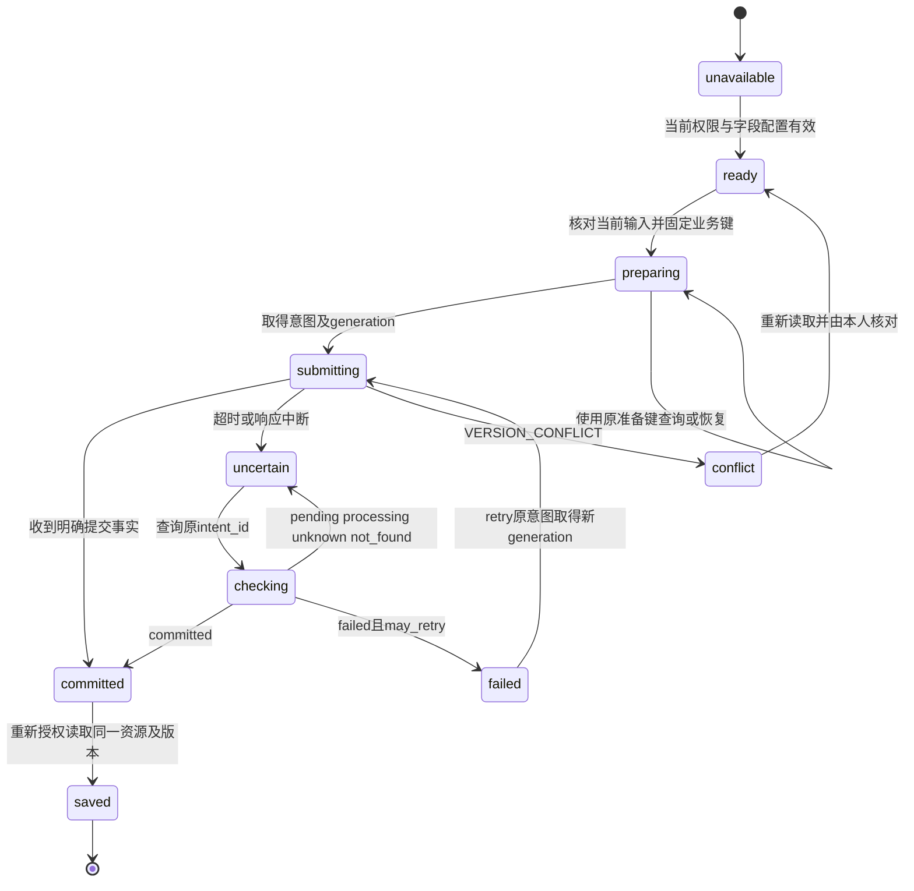
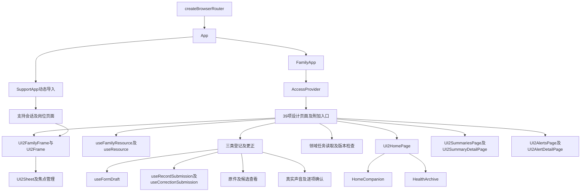
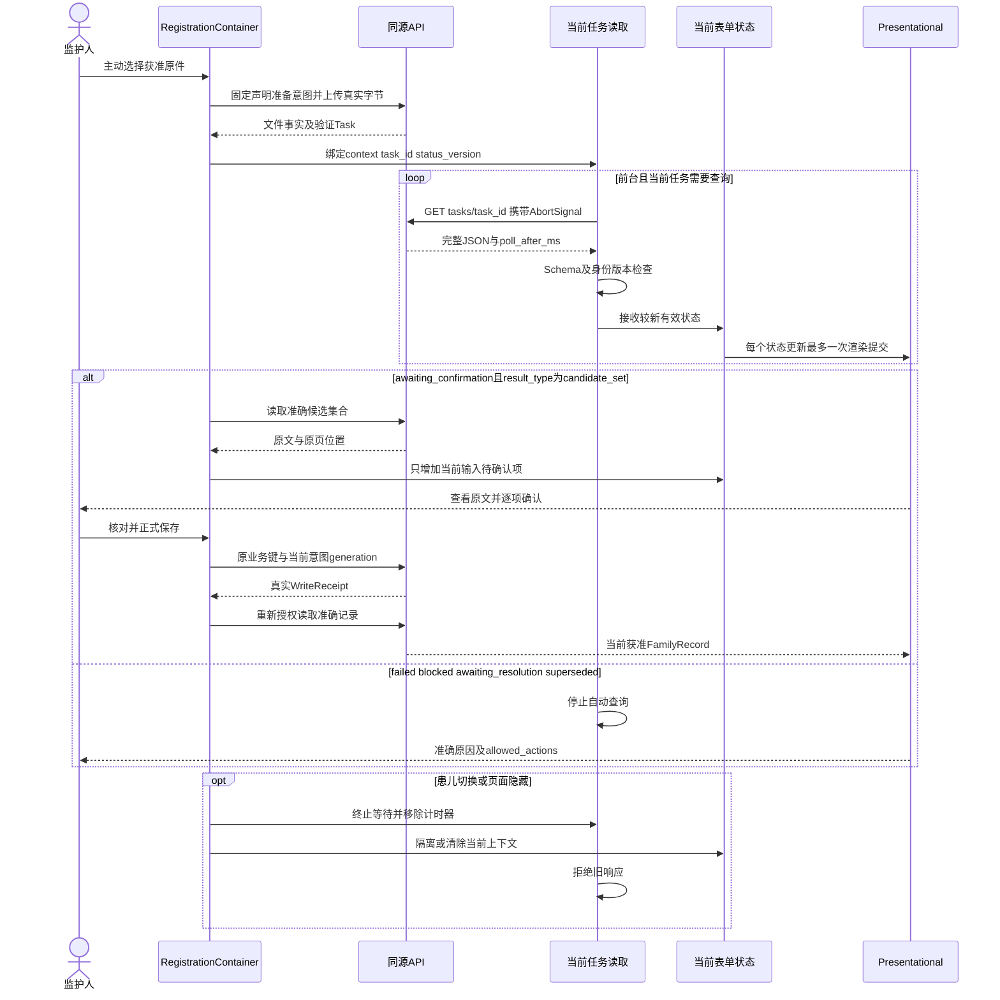

# sJIA 合并 MAS 预警平台前端详细设计（LLD-FRONT）

日期：2026-10-20。版本：FRONT V2.0。模式：`DESIGN / CONTINUOUS_DELIVERY`。文档有效性：CURRENT。维护责任为S005-4／T38，当前开发分支为codex/current-design-reception。目标为监护人手机H5及六项受控设计页面；实际附加入口一并维护。类型、实际源码、设计检查、完整业务、手机和临床验收分别保存证据。

## 1. 架构上下文与上游资产映射

### 1.1 输入与维护责任

| 资产 | 当前版本、维护位置 | 前端承接内容 | 依赖状态 |
| --- | --- | --- | --- |
| 产品需求 | [PRD](./sJIA合并MAS预警平台PRD.md) V2.0.0；S002 | FR-01—FR-22、FD-01—FD-71、全部 AC／GRAC／NFR | SATISFIED：设计输入；业务验收按交付记录 |
| 页面与原型 | [页面流程](./sJIA合并MAS预警平台页面流程.md)、[39 页清单](./ui-delivery/v2/screen-design-map.csv)、[App](./guardian-h5/src/app/App.tsx) | 全部 39 页、328 状态与中断恢复 | SATISFIED：页面依据；正式接入由 T54 验证 |
| UI 规范 | [UI2 规范](./ui-delivery/v2/design-system.md)、[Token](./ui-delivery/v2/tokens.json)、[页面规格](./ui-delivery/v2/screens/page-specifications.md)、[状态规格](./ui-delivery/v2/states/state-specifications.md) | 准确布局、三维资产、儿童形象、三项导航与全部控件 | SATISFIED：源码及文本规范；视觉 NOT_RUN |
| 系统边界 | [HLD](./sJIA合并MAS预警平台HLD.md) V2.0；S004 | C01—C12、ADR-001—ADR-010、用途、任务、持续资料与评价 | SATISFIED：设计输入 |
| 数据语义 | [数据 LLD](./sJIA合并MAS预警平台数据LLD.md) DATA V2.0、[新增规范](./data-design/v2-data-specification.md) | 原值、逐事实时间、关系、副本与评价分母 | SATISFIED：设计输入；T39 本地迁移已验证 |
| 后端协议 | [后端 LLD](./sJIA合并MAS预警平台后端LLD.md) BACK V2.0、[新增接口](./backend-design/v2-api-catalog.csv)、[新增 Schema](./backend-design/v2-protocol.schema.json) | V1 兼容与 V2 协议，意图、任务、逐页恢复和真实通知 | SATISFIED：设计输入；运行采用由功能任务验证 |
| 预警编排 | [预警编排 LLD](./sJIA合并MAS预警平台预警编排LLD.md) ALERT V2.0；S005-3 | 逐事实候选、专业资格、current／replay、顺序与周期 | SATISFIED：设计；实际采用由 T41／T49／T50 验证 |
| 当前资料 | [资料状态](./data-design/clinical-dataset-status.json)、[QA25](./docs/development/QA25-real-evaluation-source-inventory.md)、[QA43](./docs/development/QA43-existing-data-upgrade.md) | 指定63份原件、290页和准确摘要；本地软件测试、现有Ark处理及候选确认保存已经获准 | 独立患者、专业核对、临床答案及正式用途分别取得准确依据 |

UI 的静态情景只提供交互结构。业务入口从 Session、Relation、Capability 和当前资源读取内容。页面不引用 `preview/design-scenario.js`、设备预览数据库或评审状态控制器作为业务来源。

全部 UI2 新增字段、组件、路由和状态采用由 [FRONT V2.0](./frontend-design/v2-interaction.md)、[39 路由](./frontend-design/v2-routes.csv)、[新增类型](./frontend-design/v2-types.ts)、[状态采用表](./frontend-design/v2-state-adoption.csv)与 [当前 Token 映射](./frontend-design/v2-token-map.json)维护。本文件保留全部提交、草稿、来源、安全、性能与验证要求；准确现状及验收以唯一交付记录和当前检查证据为准。

### 1.2 业务、页面与完成条件

| 需求 | 页面／容器 | 当前设计的完成条件 | 验收 |
| --- | --- | --- | --- |
| FR-01 | S01、S02-A/B/C、S03、S13-A | 当前本人 Session 与独立 Relation 有效；申请与访问分别呈现 | AC-01、AC-H5-05 |
| FR-02 | S04、S05、S06、S08、S14 | 原文、单位、三类时间和来源经服务保存并重新读取；仍保持当前核对状态 | AC-02、AC-H5-02、AC-H5-03、AC-H5-04 |
| FR-03 | S07、S08、S09、TW-PANEL | 当前授权原值和来源可访问；比较方向及不可比较原因来自 TrendView | AC-03 |
| FR-04、FR-05 | 家庭页面仅消费获准投影 | 内部分类和 MS 由后端及支持入口计算；家庭无调用入口 | AC-04、AC-05、AC-12 |
| FR-06、FR-07 | S03、S11-A/B | 获准临床文字和有效事件分别读取；实际进入详情才保存本人阅读 | AC-06、AC-07 |
| FR-08 | S08、S10-A/B、S14 | expected_version 检查、新版本重读、旧依据失效；专业字段使用更正申请 | AC-08 |
| FR-09 | 全部资源页面、S13-B、S15-A/B/C | 当前权限、用途与环境成立；撤权清除受限内容；处置按获准流程 | AC-09、AC-H5-05 |
| FR-10 | 家庭来源及核对组件 | 展示逐字段核对覆盖；核对执行属于受控支持入口 | AC-10 |
| FR-11 | S12-A/B | Task 到达有效结果后重读 SummaryView；范围、来源、生成时间和有效性一致 | AC-11 |
| FR-12 | S03、S08、S09、S10-B、S11、S12 | 服务端只返回当前获准字段；前端采用当前投影及准确文字 | AC-12 |

### 1.3 工程选择与物理边界

工程继续使用 [package.json](./guardian-h5/package.json) 中的 React 18.3.1、TypeScript 7.0.2、Vite 8.3.1、React Router 7.18.4、antd-mobile 5.43.0、Tailwind 4.3.3、lucide-react 1.48.0。版本以 `package-lock.json` 为准，构建要求 Node >=22.12.0。

| 决定 ID | 来源、决定及状态 | 实施位置与验证 |
| --- | --- | --- |
| FRONT-001 | ACCEPTED／INFERRED：当前React Context及页面Hook分别管理身份、输入、提交和任务 | AccessProvider、useFormDraft、useRecordSubmission及领域页面任务读取；原任务维护完整行为验收 |
| FRONT-002 | ACCEPTED／INFERRED：createBrowserRouter承载App，FamilyApp与SupportApp分别登记Routes | main.tsx、App.tsx及SupportApp.tsx；读取由当前Hook和页面负责，useFormDraft使用useBlocker保护离开 |
| FRONT-003 | ACCEPTED／INFERRED：同源Fetch及成熟JSON Schema2020-12校验 | api/client、api/schema及准确AJV8.17.1；请求和响应分别核验准确Schema及身份 |
| FRONT-004 | 继承HLD ADR-001/006：病例只保留当前内存，前台有界轮询及服务端草稿 | 当前Hook结果按主体、对象、权限代次及顺序采用，退出、切换、撤权和前台恢复重新授权 |
| FRONT-005 | 继承 UI 2.0：三项主页面显示导航，二级页面显示返回；品牌及资产使用原稿位置 | `Layout`、`TaskHeader`、`BrandLockup`；素材及 CSS 引用准确来源，DOM 与视觉分别验收 |

C01通过同源HTTPS访问C03。App对/support/*使用React.lazy加载SupportApp，家庭路由由AccessProvider维护；支持会话及岗位读取独立进行。六项支持设计页面及其附加入口逐请求取得准确岗位和病例范围。C04负责独立处理OCR、规则、摘要和通知；页面关闭或后台不替代服务端执行。源码边界、构建输出、实际权限和设备分别验收。

### 1.4 接口接收与外部条件

接口的准确字段和领域规则由 [跨层接口接收规范](./backend-design/handshake.md) 维护。SATISFIED 表示设计已接收；接口实现和业务验收独立记录。

| ID | 现有依据与必需内容 | 接收责任／受影响功能 | 当前处理 |
| --- | --- | --- | --- |
| FRONT-D01 | HomeView.assessment_state、assessed_at；接收规范第 1 节 | S005-2/3；首页状态与时间 | SATISFIED；只有 current 且无有效事件显示 clear |
| FRONT-D02 | HomeView.current_alert_id | S005-2；S03 → S11-B | SATISFIED；按准确事件 ID 读取详情 |
| FRONT-D03 | field_config_read、FieldConfigView、FieldDefinition | S002、S005-2；登记、更正、关注指标 | SATISFIED；读取获准字段、枚举、限制及可写范围；无配置禁用 |
| FRONT-D04 | CandidateField.proposed_field、field_config_version | S005-2；OCR 确认映射 | SATISFIED；采用准确 FieldInput，前端不解析医学原文 |
| FRONT-D05 | TaskView/runtime/DDL 的 alert_evaluation | S005-1/2；评估进度 | SATISFIED；家庭只读获准进度，内部结果不可见，完成后重读首页 |
| FRONT-D06 | history_search、HistoryEntry、RecordSearch.medical_time_id | S005-2；TW04、日期／月份资料 | SATISFIED；保留精度、原文与准确时间引用；HomeQuery.at 仅表示同秒 |
| FRONT-D07 | application_read、ApplicationView.version、ApplicationAction | S005-2；申请详情与 withdraw | SATISFIED；本人申请展开读取，版本冲突重新读取；relation_id 单独使用 |
| FRONT-D08 | FamilyRecord.correction_reason、author、original_files、original_files_complete | S005-2；历史与治疗原件 | SATISFIED；不完整清单禁止替换整组；原件按记录版本关联 |
| FRONT-D09 | auth_bootstrap、SessionView.csrf_token、runtime.session | S005-2、S011、D02；身份与写入 | 设计 SATISFIED；当前自建身份已有运行源码，完整业务复验以交付记录为准 |
| FRONT-D10 | target_key 规范、request_recent_account、RequestView 操作标识 | S005-2；写入及申请恢复 | SATISFIED；准确目录路径、本人无患儿意图查询、原意图恢复 |
| FRONT-D11 | D01—D09 的有效配置及批准依据 | 对应业务负责人；环境及临床能力 | PENDING；能力依当前批准独立开放 |
| FRONT-D12 | source_resolve、SourceResolution | S005-2；提示、摘要、趋势来源 | SATISFIED；授权后取得准确 record_id/version，原件继续单独授权 |
| FRONT-D13 | FamilyRecord/AlertView/SummaryView.patient_id、display_id | S005-2；直接详情与跨患儿上下文 | SATISFIED；依据当前授权资源归属建立页面上下文 |

具体浏览器和设备清单、性能目标及运行容量由 D01 和 PRD 第 12.3 节维护，不能填入未经测量的通过结论。api-bindings 的 PENDING 表示应用尚待接入；本节记录设计接收状态。

## 2. 前端边界与安全要求

### 2.1 身份、患儿与资源连续性

`AccessProvider` 的唯一身份来源为 SessionView.principal_id，家庭入口要求 audience=family。关联选择从当前 RelationView 取得 patient_id、display_id、actions、version。不能由 URL、患者称呼、账号名称或前端按钮生成权限。

1. 进入资源页：读取 Session、本人 Relation、Capability；只在有效范围内发送资源请求。资源深链由服务端执行对象授权，前端不通过遍历其他患儿猜测资源归属。
2. 请求发出：固定 `AccessContext`、目标 ID、目标版本和 sequence。身份、患儿或关联改变时 scopeGeneration 递增。相同读取条件的较新请求也递增 sequence。
3. 结果采用：当前 context 的全部标识与 generation 一致，objectId、版本及 sequence 一致；Task 同时检查 task_id 和 status_version。任何旧响应都不能更新当前页面。
4. 患儿切换：未保存内容经同页离开确认处理；记录和草稿不改变 patient_id；终止旧读取、停止轮询、释放 Blob URL、清除旧数据和历史选择，再读取目标上下文。
5. 账号切换、会话过期或关联撤销：清除病例、草稿、照片、转写、页内筛选及返回内容，进入访问状态。仅同一账号重新认证且权限有效时可以读取其有效服务端草稿。
6. 页面隐藏：停止请求轮询与语音，遮蔽受限结果，释放已显示原图 URL；当前未提交表单保持隔离内存。恢复前台后核验 Session、关联及配置，再读取当前资源。验证失败清除全部受限内容；成功后恢复同一上下文的输入。
7. pageshow、浏览器历史返回和路由恢复均执行授权门禁；BFCache 恢复期间不显示上次结果。导航记忆只在内存保存，按 principalId、patientId、scopeGeneration 绑定。

状态已准备或已提交的业务请求在客户端取消传输后仍需查询。`AbortController.abort()` 只终止客户端等待，不能证明服务器未写入，也不能代表 Worker 已终止。

### 2.2 数据、日志与内容安全

| 边界 | 强制行为 | 验证 |
| --- | --- | --- |
| 浏览器存储 | localStorage、sessionStorage、IndexedDB、Cache Storage 和历史 state 不保存病例、照片、草稿、转写、凭证或筛选正文 | FRONT-Q01、Q02、Q05；浏览器存储及历史内容检查 |
| HTTP | HTTPS、同源 credentials、受保护响应 no-store/private；写入使用获准 CSRF 证明；不向其他域发送病例 | FRONT-Q01、Q18 |
| 日志 | 白名单仅允许 operation_id、错误 code、耗时、前端构建摘要及服务端 trace_id；普通日志不含主体／患儿 ID、URL 原文、请求正文、原值、原图、Cookie | FRONT-Q18；telemetry 参数在类型入口校验，开发模式同样适用 |
| 错误追踪 | 当前未安装远程错误追踪；引入时关闭 DOM、网络正文、breadcrumb 原文与 Session Replay，脱敏配置经实际输出检查生效 | FRONT-Q18；不能假定第三方默认安全 |
| 文本 | React 按纯文本渲染用户及 approved_text；不使用 dangerouslySetInnerHTML | FRONT-Q18；检查 HTML 不执行 |
| URL | content_path 只接受 `/api/v1/files/{file_id}/content` 的同源已登记路径；联系渠道必须符合后端登记协议及当前批准 | FRONT-Q09、Q18；拒绝 javascript/data 外部地址 |
| 文件 | 仅 capability 可用且限制齐全时收集；真实字节保留；已处理内容不修改原件；文件状态由后端决定 | FRONT-Q09；容量、媒体类型、权限及摘要一致 |
| 临床字段 | 家庭包只消费家庭 Schema；内部分类、MS、核对意见不能从支持接口读取后隐藏 | FRONT-Q11；服务端响应及 DOM 同时检查 |

序列化使用显式字段映射；禁止将 FormState、Session 或 reducer 全部内容展开为 RecordInput。未知数值使用 null 和准确 value_state；字段缺失与 null 依 Schema 区分。额外保护字段在 API 层拒绝。格式、范围、引用及输入合法性错误在对应位置抛出；框架 errorElement 显示安全错误页面，不生成替代结果。

### 2.3 状态所有者与错误呈现

| 状态 | 来源／所有者 | 更新与清理 |
| --- | --- | --- |
| 会话与关联 | SessionView、RelationView／AccessProvider | 集中选择和撤销事件；有效状态变化使全部受限读取失效 |
| 服务端页面内容 | useResource、useFamilyResource及各领域页面 | 当前身份读取和重新验证取得新响应，核对及临床结果依服务端事实采用 |
| 表单输入 | 登记组件的受控状态及当前表单Hook | 稳定client_field_id、准确输入版本和固定患儿；输入与已保存版本分别管理 |
| 草稿保存 | useFormDraft | 串行保存、原意图恢复及准确saved_at，正文不进入URL |
| 写入与恢复 | useRecordSubmission、useCorrectionSubmission及领域提交函数 | 固定载荷、request_id、intent_id和generation，查询原请求后继续 |
| OCR及后台任务 | 领域页面、当前任务读取函数及版本检查 | 同一task_id的status_version单调采用，有效结果重读资源，明确终态释放计时器 |
| 表单展开与弹层 | 页面组件 | 与临床对象分开；单个 BottomSheet；关闭恢复焦点 |
| 导航与筛选 | NavigationMemory／ContextLink | 内存条件与返回位置；history.state 只含无病例地址和定位键 |
| 公共资产 | Vite 静态资源 | 按内容摘要缓存；角色不参与诊断或临床状态 |

SessionBoundary 在 RouterProvider 外维护同源跨窗口清理。家庭与支持的登录、注册、退出及患儿选择通过 Web Locks 执行会话操作；其他窗口卸载受限组件及当前内存。localStorage 的 sjia.session.boundary.v1 仅包含随机 version、随机 owner 和 changing/settled 状态，任何账号、患儿、凭据和资料均不能进入该记录。版本变化使旧 JSON、Blob 和语音结果失效；重新挂载后读取实际 Session 与访问范围。操作窗口关闭后取得已释放的浏览器锁，通过实际服务核验恢复，不能将记录状态作为已登录证明。

HTTP 非 2xx、业务不足和能力未配置保留各自准确状态。网络及协议失败由 Router errorElement 和提交状态协调器接收明确失败事件；缺少响应的写入进入 uncertain。正式保存、OCR 完成与临床核对分别显示，不以 Toast 作为唯一结果。不使用自动替换服务、补齐数值或历史成功内容。

## 3. 设计系统与 Token 资产

### 3.1 语义映射

当前数值来源为 `ui-delivery/v2/tokens.json`、`src/tokens.css` 与 `src/styles.css`。[v2-token-map.json](./frontend-design/v2-token-map.json)维护准确映射；专用组件遵守设计 CSS 的选择器、顺序和媒体条件，颜色与材质数值统一引用当前设计来源。

| Semantic Token | 准确来源及值 | 组件 |
| --- | --- | --- |
| `--navy` | color.brand.primary `#173F70` | TaskHeader |
| `--blue` | color.action.primary `#2369AE` | 主要操作 |
| `--link` | color.action.text `#2E689E` | ContextLink |
| `--canvas` | color.surface.base `#F1F5FA` | Layout |
| `--ink` | color.text.primary `#243B55` | 正文及原值 |
| `--radius` | radius.lg `20px` | 通用 Card |
| `--shadow` | shadow.sm 及 tokens.css 的 inset | Card |
| `--font` | font.family | 全部文字 |
| `--motion` | motion.fast `180ms`，减少动态为零 | 控件 |
| 专用组件 | src/styles.css 的全部准确选择器 | 字号、梯度、间距、圆角、阴影、布局及状态 |

UI2Frame的designStyle引用当前语义Token，按sourceStyles、richStyles、richPageStyles、richRegistrationStyles及richThemeStyles顺序加载正式样式。主题及按钮状态由rich-theme.css中的明确变量维护，clinical等级和文字仍须获准投影。Tailwind及antd-mobile沿用当前工程职责。具体样式来源和顺序由成熟AST及PostCSS核验，完整呈现和设备仍分别验收。

### 3.2 组件、资产与响应式规则

| 对象 | 必需参数及行为 |
| --- | --- |
| 正文与数字 | 系统字体；准确字号、行高和字重逐选择器继承 styles.css；原精度和单位不改写 |
| 内容宽度 | 最小 320px；普通边距 18px；手机独立页面 20px，紧凑条件 14px；最大 580px；按设计媒体条件采用 |
| 首页 | 预警 → 儿童与三项症状 → 三项快捷记录；长获准提示允许正文自然增长；动态内容不以固定画框裁切 |
| 导航 | 仅 `/home`、`/records`、`/account` 显示 TabBar；二级页面返回来源，无来源时返回已定义父页面 |
| 固定区域 | 主页面正文保留导航实际高度及 safe-area；二级页面末尾保留 24px 及 safe-area；提交按钮位于表单之后 |
| 弹层 | 最大 88dvh；一个内部滚动区域；真实 dialog 标题、关闭按钮、焦点限制和关闭恢复；不叠加多层临床内容 |
| 三维图标 | 三张 `assets/master/*-3d-icons.png` 四乘四图标表；格位与裁切直接继承 [图标组件](./ui-delivery/preview/three-d-icons.jsx) 的 index、0.08 内边距和 0.84 viewBox；共享 Icon 组件；保留原始颜色与文字名称 |
| 儿童形象 | HomeCompanion采用当前明确选择的示意资产，useCompanionPreference提供17项既有选项；rich-ui.css通过clamp(232px,64vw,300px)控制高度，宽度按135／164计算，object-fit=contain保持原比例；位置标记表示资料分类 |
| 品牌 | `identity/2x/logo-embrace@2x.png` 与产品名称；登录上部、我的管理内容之后；任务标题保留当前操作 |
| 原图 | contain 显示真实字节；缩放、翻页、旋转作用于查看视图；区域框跟随同一变换；不修改原件 |

### 3.3 可访问性与动态内容

按钮、输入与链接使用真实语义，字段有可见 label；错误通过 aria-describedby/aria-invalid 关联。正在读取和保存结果使用 polite，字段错误区域使用 alert；紧急临床内容的播报按批准文字执行。颜色始终配合标题、说明和操作。当前页面标题获取焦点；关闭面板回到触发控件；新增或移除项目明确播报并保持焦点位置。

320/360/390/430/580px、手机横屏、200% 字号、长项目名、长原值、空资料、部分结果、结果出现、底部安全区、系统键盘及 prefers-reduced-motion 都进入 FRONT-Q14/Q15。三项症状的概念标记和插画不声明真实患儿症状；观察数据的状态、时间和来源来自同一当前资源。

## 4. 全局数据字典与状态机

### 4.1 TypeScript 类型与序列化

[types.ts](./frontend-design/types.ts) 为本次前端类型交付，准确映射 BACK Schema 的原名、必需字段、空值与枚举，并定义 AccessContext、RequestIdentity、FormState、SubmissionState、NavigationMemory。API 输入／输出保留 snake_case；组件视图需要 camelCase 时在 adapter 显式转换。

```typescript
// 组件时间只能从服务端确认字段转换。
export interface SaveView {
  confirmedAt: string;
  recordPath: string;
  recordVersion: string;
}
// receipt.saved_at → confirmedAt；resource_id → 真实记录地址；version → recordVersion。
// Version/status_version/generation 使用字符串，比较使用 BigInt。
// Decimal 保持原字符串；表单不使用 parseFloat、Number 或科学计数法转换。
```

运行时 JSON Schema 仍负责 UUID、日期、decimal 格式、19 位版本及跨字段限制。TS 接口不代替 `allOf/if/then`：unknown/invalid 不携带有效 numeric；ocr_confirmed 必须有候选及确认；draft_id/version 同时存在；ContactView.unavailable 只含 state。家庭请求的 MedicalTimeInput 不含 id/patient_id，instant 固定 null；解析瞬时时间由后端执行。

### 4.2 字段传播检查表

下表维护 FD-01—FD-57 的读取、转换、页面采用与验收；新增 FD-58—FD-71 的准确 DTO 与消费页面见 FRONT V2.0 和 v2-routes。数据库／Entity 归 S005-1，DTO／Schema 归 S005-2。业务状态按唯一交付记录维护，结构检查见第 7.3 节。

| 业务字段 | 数据库／Entity | DTO／API Schema | 前端类型／采用页面 | 转换规则及验收 |
| --- | --- | --- | --- | --- |
| FD-01、FD-02 | principal、patient | SessionView、RelationView、HomeView | AccessContext、PageFrame、S03 | Session 主体一致；patient_id 为真实授权对象；AC-01 |
| FD-03、FD-04、FD-05 | relation_application、relation、access_grant | ApplicationView、RelationView | S02、AccessProvider | 申请和关系身份分别保存；动作不合并；证明限核验人；AC-01、AC-09 |
| FD-06、FD-07 | record_field 两个 field_code | FieldInput、FamilyField | S04、S08、S12 | 自报仅写 reported_sjia_status；专业状态只读获准投影；AC-04、AC-10 |
| FD-08、FD-09 | record_field、medical_time | FieldInput、MedicalTimeInput | S04、S07、S08 | observed/not_observed/unknown 的具体业务代码来自字段配置；原温度和单位不产生发热判定；AC-02 |
| FD-10、FD-11、FD-12、FD-13、FD-14 | 专业 record_field、verification_field | FamilyField 或支持内部类型 | S08／获准摘要；家庭无写入类型 | 未确认状态不补零；专业字段不自动从家庭文字提取；AC-05、AC-10、AC-12 |
| FD-15、FD-16、FD-17 | report、source_revision、concept_code、origin_type | ReportInput、FamilyRecord、DictionaryView | S05、S08、S09 | 保留原名称和机构；字典身份需版本；来源与 capture_method 分别表达；AC-02、AC-03 |
| FD-18、FD-19、FD-20 | raw_*、qualifier、medical_time、method、reference_interval | FieldInput、ClinicalField、ReportMetadata | S05、S07、S08、S09 | 原值、限定符及单位分开；采样、结果和登记时间不替代；未知参考范围不推断正常；AC-H5-02 |
| FD-21、FD-22、FD-23、FD-24、FD-25、FD-26 | concept_code、normalized_measurement | ClinicalField；内部 AssessmentView | S05、S09；获准投影 | 正式项目代码来自批准字典；家庭不参与专业选值和评分；AC-04、AC-05、AC-12 |
| FD-27、FD-28 | dictionary_entry、unit_mapping、normalized_measurement | DictionaryView、TrendView | DictionaryField、S09 | 百分比／绝对值、FEU/DDU 区分；方向使用服务器 comparison；原值保留；AC-03 |
| FD-29、FD-30 | quality_status、verification_field | FamilyRecord、FamilyField | SourceStatus、S07/S08/S12 | quality_reasons 与逐字段核对分别展示；partial 不映射全部已核对；AC-10 |
| FD-31、FD-32 | record、record_version | FamilyRecord、CorrectionInput | S08、S10 | version 字符串；expected_version 与当前版本准确一致；历史原因依 FRONT-D08；AC-08 |
| FD-33、FD-34 | medication_event/item、治疗 record_field、medical_time | FieldInput、FamilyField | S06、S08、S12 | 药名原文、状态和两端时间独立；结束空值不推出持续；IL-1/IL-6 无家庭自动分类；AC-02 |
| FD-35、FD-36、FD-37 | verification、verification_field | SourceReference、FamilyField | SourceReferenceView、S08/S11/S12 | 仅准确 field_id/version/purpose 引用；内部人员和意见只在获准字段出现；AC-10、AC-12 |
| FD-38、FD-39 | assessment、assessment_input | 内部 AssessmentView、获准 FamilyClinicalProjection | S03/S11 获准文字与来源 | 无家庭 assessment_create/read；评估时间依 FRONT-D01；AC-04、AC-12 |
| FD-40、FD-41、FD-42、FD-43 | config_version、assessment_output | FamilyClassification、FamilyMs（可选） | 获准结果组件 | 只展示实际返回属性；不补齐贡献／总分／阈值；内部结果无批准时字段不存在；AC-05、AC-12 |
| FD-44、FD-45、FD-46 | config_version、config_approval、release_component | FamilyClinicalProjection | S03、S08、S10-B、S11、S12 | approved_text 纯文本及 content_id/version；不将 Schema 可选字段当作批准；AC-12 |
| FD-47、FD-48、FD-49 | alert_event、alert_recipient、notification_* | AlertView、FamilyClinicalProjection | S11、阅读动作 | alert_id、validity、read_at、delivery_status 独立；阅读不修改等级；AC-06、AC-07 |
| FD-50 | summary、summary_item | SummaryInput、SummaryView | S12-A/B | 范围、时区、固定版本、needs_regeneration；Task 完成后重读；AC-11 |
| FD-51、FD-52 | contact_version、config_approval | ContactView | ContactContainer、S11/S12 | unavailable 不含渠道值；available 仍检查有效时间和当前读取；AC-07、AC-11 |
| FD-53、FD-54、FD-55 | data_use_authorization、audit_event、retention_policy、disposition_request | Capability、DispositionInput/View；受控审计 | S13-B、权限门禁 | 使用和处置状态来自真实批准；申请不表示删除完成；审计非家庭全量入口；AC-09 |
| FD-56、FD-57 | write_request、write_intent、draft | IntentView、RequestView、DraftView | FormActions、DraftCoordinator、S14 | request_id 仅业务头和准备载荷；saved_at → confirmedAt；本人／患儿／表单／版本一致；AC-H5-03、AC-H5-04 |

### 4.3 正式提交与未知结果



准备 POST `/write-intents` 使用一个固定 request_id，payload 为本次准确业务输入。业务请求使用 `Idempotency-Key`、`X-Write-Intent`、`X-Intent-Generation`；RecordInput 正文不增加 request_id。正在准备、处理中、结果未知或查询中均禁止新建相同业务操作。

| RequestView.state | 当前操作 | 显示与完成条件 |
| --- | --- | --- |
| pending / processing | 按原意图继续或查询；不能准备新键 | 正在确认本次提交；查询有时限 |
| unknown | 保留原身份与键，停止业务重发 | 保存结果待确认；只提供查询 |
| not_found | 按原准备 request_id 和固定 payload 恢复意图 | 查询没有证明未提交；不能提供新建提交 |
| failed 且 may_retry=true | POST 原 intent/retry；携带 expected_generation；更新 generation 后重发相同业务键与正文 | 明确本次未提交；恢复协议不改变原输入 |
| failed 且 may_retry=false | 保留安全错误与原请求 | 当前动作不能重试；不制造可用按钮 |
| committed 且 receipt 有值 | 重读对应资源；核验 resource_id/version/request_id | 真实记录可读后进入 saved |
| committed 且 receipt=null | 保存提交事实；当前资源可能不可见 | 显示本次提交已完成，资料当前无法读取；不显示记录正文，不重发 |

明确 422 字段错误允许修改输入；已有 intent 需按后端证明关闭或建立新的合法逻辑动作。原意图同键不同正文不能提交。版本冲突要求用户核对当前内容，禁止自动合并。`FormActions` 的 ready/submitting/uncertain/checking/failed/conflict/saved 接收协调器转换；unavailable 只表达当前能力不可用。

### 4.4 草稿、时间、字典与语音

| 状态对象 | 事件、输入身份及后续状态 | 规则 |
| --- | --- | --- |
| 草稿 | 失焦、10 秒变更检查、主动离开 → 串行保存 → receipt → draft_read | 保存固定 inputRevision；只更新该次确认版本及 savedInputRevision，不覆盖后续输入；有新内容时继续下一次串行保存 |
| 草稿结果未知 | 相同 intent 查询 → 明确事实后继续 | 未确认写入期间不增加另一草稿版本；正式提交等待该草稿写入事实明确 |
| 恢复草稿 | 本人选中 → draft_read → Session/Relation/field_config/原版本核验 → 恢复 | submitted/abandoned/expired 不恢复；冲突保留两份获准内容并要求核对 |
| 放弃草稿 | 本人确认 → draft_abandon → 重读 | 服务未确认不移除列表；取消关联不等于删除草稿 |
| 医学时间 | 精度选择 → 填写原文、当地日期／时间／年月／相对描述 → MedicalTimeInput | 不填当前时刻；年/月/month_range/relative 保持对应意义；客户端不计算 instant；服务端返回已解析时间才进入精确序列 |
| 字典 | compositionend 或查询停止 300ms → dictionary_search → 本人选择 | 防抖采用实际 composition 状态；查询结果绑定 category/query/context/sequence；返回完整 id、concept_code、version，ambiguous 不自动采用 |
| 语音 | idle → connecting → listening → stopping → reviewing → 本人确认 → idle | 主动开始；连接 15 秒、单次 60 秒、自动重试零次；确认文字只追加说明，capture_method=voice_confirmed |
| 语音失败或取消 | 浏览器实际事件 → error／取消本次 | 停止采集；既有已确认文字保留；当前转写不自动写入数值、时间、疾病或药物字段 |

正在 composition 的 Enter 只提交输入法文字。表单提交同时检查 nativeEvent.isComposing、FormState.composing、语音是否已结束、未确认文字是否处理。当前语音已有同源本地转写与 Ark 结构化入口；候选逐项本人决定后进入字段，未确认语音不进入草稿或正式记录。声音处理与用途条件缺少时入口准确不可用，文字登记保持独立可用。自然语言检索和生成式诊疗建议没有当前批准接口。

## 5. 路由、组件拓扑与 API 挂载

### 5.1 路由与导航

[v2-routes.csv](./frontend-design/v2-routes.csv)维护全部 UI2-01—39 的准确地址、容器、受众、父页面、接口和实施责任；全部适用状态引用 UI2 清单。既有 S 标识与 routes.csv 保留兼容引用。根路径 `/` 使用 replace 导向 `/home`。路由角色为前端访问门禁，服务端继续逐请求授权。

| 页面组 | 主要地址与返回父页面 | 身份与交互要求 |
| --- | --- | --- |
| S01、S02 | `/login` → `/account`；`/associations` → `/account`；new／relationId → `/associations` | relationId 只表示真实关系；本人申请状态在列表展开；认证返回目标只使用登记站内标识 |
| S03、S04、S05、S06 | `/home`；`/register/{observations,reports,therapies}` → `/home` | 登记保持固定患儿；照片及确认是同一路由状态；不增加临床确认页面 |
| S07、S08、S09、S10 | `/records`；recordId → `/records`；analyteId → `/records`；correct/history → 当前记录 | analyteId 精确映射 concept_code，不能使用字典 entry.id 代替；历史版本在同页展开，调用 version_read |
| S11 | `/alerts` → `/home`；alertId → `/alerts` | 首页当前提示缺少准确 ID 时进入列表；阅读只在详情正式显示后执行 |
| S12、S14 | `/summaries`、`/drafts` → `/records`；summaryId → `/summaries` | 草稿恢复进入对应登记或更正路由；Summary 原来源以 SourceReference 的准确版本读取 |
| S13 | `/account`；data-use → `/account` | 账号及说明页无患儿常驻区域；处置操作满足能力时才打开获准对象选择 |
| S15、S00 | `/access-denied`、`/service-unavailable`、`*`；`/prototype` 独立评审 | 无残余病例；错误页不随意推断删除原因；评审入口限定 review 环境 |

公开 URL 只包含不透明 ID；症状、原值、患儿称呼、日期筛选正文和认证凭证不进入 URL 或 history.state。ContextLink 传递无病例返回路径及定位键，实际 filters/panel/selectedInstant 保存在 NavigationMemory 内存。直接打开记录先通过服务端对象范围，不假设属于上一次患儿；无法取得归属时不显示猜测身份，依 FRONT-D13 完成安全资源上下文。

### 5.2 组件拓扑



页面和当前Hook负责获准数据、提交、草稿及任务，展示组件采用准确props并发出明确动作。UI2FamilyFrame维护当前导航与返回，UI2Frame维护ShadowRoot、样式、焦点和说明弹层，UI2Sheet负责当前弹层及清理。写入未知期间保留同一获准表单的隔离输入，重新读取原请求事实后继续；来源、语音和任务的副作用由各自当前所有者释放。

### 5.3 核心组件接口与共享回归

| 组件 | 类型／所有状态及副作用 | Props／Events | 使用页面／可访问性与验收 |
| --- | --- | --- | --- |
| UI2FamilyFrame、UI2Frame及UI2Sheet | 导航、当前ShadowRoot、样式、焦点及说明弹层 | screenId/title/backTo/primary/overlay及明确事件 | 全部UI2页面；真实h1、导航、弹层及焦点；Q14/Q15/Q20 |
| SourceStatus、RecordCard | Presentational；无请求 | FamilyField/FamilyRecord → openRecord/openSource | S03/S07/S08/S09/S10-B/S11/S12/TW；长原文和缺项；Q03/Q11/Q15 |
| TwinPanelContainer | Container；类别、历史选择和授权读取 | AccessContext/HomeView → openRecord/register/close | S03/TW；单个 dialog；未知时间独立列示；Q03/Q04/Q15 |
| Field、SelectField、TimeField | Presentational；受控值 | value/config/errors/composing → change/blur/composition | S04/S05/S06/S10-A/S12-A；label、错误路径；Q03/Q07/Q16 |
| DictionaryContainer／DictionaryField | Container／Presentational；查询和纯选项展示 | category/query/options/version → query/select/retainOriginal | S04/S05/S06/S10-A；完整项目和单位文字；Q03/Q16 |
| PhotoCoordinator／PhotoReview | Container／Presentational；文件内存及上传 | group/pages/allowed_actions/busy → add/move/replace/remove/open | S05/S06/S10-A 获准照片；动作有具体页号；Q09/Q10/Q15 |
| OriginalViewerContainer | Container；授权 Blob、变换及 URL 生命周期 | file/page/anchor/context → close/changePage | S05/S06/S08/S11/S12 来源；dialog、44px 操作、焦点恢复；Q09/Q15 |
| CandidateReview／RecognitionSourceView | Presentational；确认事件 | CandidateField/decision/currentInput/anchor → accept/modify/unknown/exclude/openSource | S05/S06；原文、页码与待确认原因；Q10 |
| VoiceEntryContainer | Container；MediaRecorder、同源语音转写、计时器、取消与重试 | context/currentText → confirmedText/cancel/error | S04；按钮状态和转写 label；Q16 |
| FormActions及DraftActions | 当前提交和草稿状态展示 | 准确状态、saved_at及明确submit/check/retry/save动作 | 三类登记及更正；aria-busy和准确保存时间；Q06/Q07/Q08 |
| RecordsContainer／AnalyteContainer | Container；筛选、分页和当前读取 | context/filter/conceptCode → filter/readSource | S07/S09；未知时间和不可比较说明；Q03/Q04 |
| CorrectionContainer／CorrectionRequestContainer | Container；原版本、可编辑字段和写入 | FamilyRecord/editable_field_ids → correct/request | S08/S10-A；专业字段只申请，原因必填；Q07 |
| SummaryContainer／SummaryDetail | Container／Presentational；范围、Task、重读 | SummaryInput/SummaryView → generate/openSource | S12；生成状态和有效性各自说明；Q12 |
| AlertDetailContainer／AlertCard | Container／Presentational；阅读意图和当前数据 | AlertView/approved_text → openSource/read/contact | S03/S11；已查看与送达独立；Q11/Q13 |
| ContactContainer | Container；当前联系读取及获准动作 | ContactView → userInitiatedContact | S11/S12；未提供时无可执行渠道；Q13 |
| DraftsContainer／LeaveDialog | Container／Presentational；草稿操作及 Router blocker | DraftView/dirty/uncertain → restore/abandon/stay/saveAndLeave/discard | S14 和全部表单；危险操作不默认焦点；Q08/Q14 |
| DispositionContainer | Container；批准政策下的对象选择、申请和状态 | capability/approvedPolicy/targets → request/read | S13-B 的可选内嵌流程；无政策时不开放；Q17 |

共享组件修改需要覆盖对应全部调用页面，核查空值、长内容、部分资料、新结果、弹层、滚动、键盘、深色和权限失效。前端实体ID使用真实UUID，数组位置只表示页面顺序。39项设计页面的实际组件、转出及React.lazy来源由[路由检查](./frontend-design/read-route-ownership.mjs)核验；[附加入口](./frontend-design/runtime-entry-map.csv)维护13项实际入口的准确职责和任务。

### 5.4 接口适配清单

[api-bindings.csv](./frontend-design/api-bindings.csv) 为全部家庭及 family_support 操作指定 owner、输入/输出 Schema、错误策略、取消、重试、缓存和 telemetry；方法与路径唯一引用后端 api-catalog，不重复维护另一份路由定义。家庭使用 file_content/correction_request_read/disposition_read/task_* 时仍限定本人获准范围。

| 接口组 | 映射及受影响对象 | 完成与清理 |
| --- | --- | --- |
| session/auth/relations | 登录 Provider proof 采用登记 Schema；Relation 和 Application 两组类型分别使用 | 登录成功重读 Session 和 Relation；退出立即清理本地，再确认真实 Session 失效 |
| records/search/analytes | form → RecordInput；filter → POST RecordSearch；analyteId → concept_code | 保存后重读准确 record_id/version；CURSOR_EXPIRED 清除该分页并重读当前过滤第一页 |
| drafts | payload → DraftInput；更新使用 DraftUpdate.expected_version | receipt 后重读 DraftView；与当前 inputRevision 分别更新；未确认草稿阻止关联正式提交 |
| uploads/files | 字节声明 → FileDeclaration；组建立 → 逐文件 PUT → complete → Task → file_group_read | BinaryUpload 业务正文是真实字节；准备意图只传声明；完整摘要使用 Web Crypto；每个原图请求独立鉴权 |
| recognition/candidates | group_id/version → RecognitionInput；Candidate 原文和来源 → 本人确认 | task awaiting_confirmation 后读取准确 candidate_set；文件组变化使旧候选不可采用 |
| corrections | 可编辑范围 → CorrectionInput；专业字段 → CorrectionRequestInput | 正式更正与申请分别呈现；成功记录新版本并刷新依赖，不继承旧核对 |
| summaries | 日期范围、时区及未知时间选择 → SummaryInput | 202 只表示受理；Task completed 后重读 SummaryView，检查 validity/needs_regeneration |
| alerts/contacts | 首页进入列表 → AlertView；实际显示详情 → alert_mark_read | 不预加载阅读写入；联系先取得当前 ContactView；阅读和送达不改写临床等级 |
| requests/tasks | intent/task 身份与 status_version → 领域状态 | 原请求身份查询和单任务轮询分别管理，过期结果不得更新其他页面 |
| dispositions | 批准 policy_id、当前对象 ID/version 与依据 → DispositionInput | 申请通过重读 DispositionView；completed 及逐对象回执才表达已处理 |

当前读取Hook和页面将Fetch的signal与准确context绑定。读取失败显示当前请求错误，范围变化取消旧读取；Schema或枚举不一致立即产生协议错误并阻止采用。已提交资源当前不可读时保留准确提交事实和访问状态，不重新创建同一业务动作。

## 6. 异步交互引擎与 BFF 挂载

### 6.1 SSE 与任务轮询

SSE、WebSocket、eventId 去重、UTF-8 Chunk 组装、Last-Event-ID、逐 Token Markdown、retrieving/generating 与内部推理展示为 `NOT_APPLICABLE`，依据 PRD 第 9 节、HLD ADR-005/006 及 BACK 第 4.3 节。接口使用完整 UTF-8 JSON，采用 Response.json 与成熟 Schema 校验。当前任务更新的去重依据为 `task_id + status_version`，上下文采用依据为 RequestIdentity；内部 Broker event_id 不进入家庭 UI。



| TaskStatus | 展示／结果采用 | 自动轮询 |
| --- | --- | --- |
| accepted / queued | 已受理／等待处理；不展示候选或生成结果 | 按当前 poll_after_ms |
| running | 正在处理；显示准确任务说明 | 按当前 poll_after_ms |
| uncertain | 外部处理结果待确认；禁止提交同一未知任务 | 有界查询，同一 task_id |
| cancel_requested | 正在确认停止；不得提前标记 cancelled | 有界查询 |
| awaiting_confirmation | 仅 result_type=candidate_set 且引用有效时读取候选 | 停止；等待本人动作 |
| completed | 重新读取 result_type 对应资源；assessment 的完成不表示资料齐全 | 停止 |
| blocked / awaiting_resolution | 准确阻止原因；只提供 allowed_actions 的安全家庭操作 | 停止 |
| failed / cancelled / superseded | 明确失败／已取消／资料已变化；没有当前成功内容 | 停止；retry 须显式允许并创建新任务 |

任务查询使用上一请求完成后安排 setTimeout，不能使用重叠 setInterval。连续网络失败只允许 3 次额外只读查询，间隔 `max(poll_after_ms, 1000/2000/4000ms)`；429 采用 Retry-After 和当前预算；耗尽后停止并保留查询入口。前台连续自动查询预算建议 5 分钟，状态 `PROPOSED`，不能用此期限改变服务端 Task。手动继续查询前重新授权。服务端 poll_after_ms 缺失或非法时停止并报告协议问题，不自行采用默认间隔。

### 6.2 提交、照片与原图流程

照片采集要同时满足 Session、有效患儿、write_record、file capability、真实文件服务和获准限制。UI 示例中的 10 张／20MB 等数值不作为业务限制；实际 max_pages/max_bytes/max_pixels/media_types 来自 Capability。文件选择取消保留原输入；一份资料组固定患儿和用途。

1. 创建真实服务端 Draft，确认 draft_id 后建立 file_group；每页具有 upload_id、准确 SHA-256、size_bytes、media_type、ordinal。
2. 每个写操作分别准备合法意图；业务 PUT 为原始字节。客户端网络发送进度只代表字节传输，available 必须来自服务器验证；Fetch 未提供可靠上传字节事件时显示处理中，不制造百分比。
3. complete 核对准确 file_ids/version，Task 完成后 file_group_read 确认整组 available，再受理识别。
4. 调整、替换、移除通过 file_group_revise 建立新组；服务确认前保留旧组指针。新组确认后清除受影响候选和本人确认，当前人工输入保留为待核对；不能被新结果直接覆盖。
5. CandidateField 锚点缺失时显示原文位置未取得；anchor.kind=page 显示整页；bbox 执行边界检查并在原图对应区域展示。完整值提取依 FRONT-D04，前端不解析医疗原文。
6. 本人确认覆盖每项 accepted/modified/unknown/excluded，保存准确 candidate_set_id、candidate_field_id 与 confirmed_text；confirmation 和 clinical verification 保持独立。
7. 正式保存经过原意图及真实重读；保留原字节、字段来源和确认关系。清除页面临时文件，服务端文件保留／处置按 D09 执行。

原图使用当前授权的 content_path 读取 Blob，Object URL 仅用于当前查看。重读、关闭、对象切换、权限失效、路由卸载及后台遮蔽均 revokeObjectURL；原图读取失败提供准确原因，不能用缩略图表达原件可用。旋转与缩放保持源图坐标统一；region 的 left/top/width/height 均有准确比例和边界。原件地址不放入复制链接、日志或持久状态。

### 6.3 请求数据与缓存生命周期

useResource、useFamilyResource和当前领域页面负责读取、取消及重新验证。病例进入、返回、写入后重读和手动更新均需真实请求；结果按完整身份保留当前内存，身份变化后失效。提交Hook单独保存原意图及固定载荷，临床状态依当前服务端事实采用。

```typescript
// 身份键用于读取采用与取消；不写入浏览器持久存储。
export type ReadIdentityKey = readonly [
  principalId: string, patientId: string, relationId: string,
  relationVersion: string, scopeGeneration: number,
  operationId: string, objectId: string, objectVersion: string | null,
  capabilityConfigVersion: string | null, querySequence: number
];
```

| 内容 | 键、版本和有效范围 | 失效／重新读取 |
| --- | --- | --- |
| Session、Relation、Capability | 当前本人、入口、relation/version、capability.config_version | 登录、退出、关联变化、前台恢复及每次资源进入 |
| 首页、记录、详情、历史、历次值 | ReadIdentityKey + 当前过滤条件摘要、snapshot_version | 新增、更正、核对撤销、分页版本失效、策略变化、返回 |
| 草稿 | 当前本人／患儿／form_type／draft_id/version／field_config_version／原版本 | 保存事实确认、恢复、正式提交、放弃、到期、配置变化 |
| Candidate、FileGroup、Task | 患儿、group_id/version、candidate_set_id、task_id/status_version | 文件变化、取消、终态、撤权；每次采用检查当前身份 |
| 提示、联系、摘要 | 当前关系、alert_id/content_version/contact_version/summary_id | 更正、停用、内容失效、联系到期、新增资料、阅读写入后；重读当前投影 |
| 字典选项 | category/query/version + 当前 Session 与使用资格 | 当前版本改变立即失效；允许缓存的公开定义仍核验当前使用资格 |
| 公共产品资产 | 文件内容摘要 | 制品摘要变化；不包含病例字节 |

每个读取仍由服务器在当前快照中校验 data/verification/publication epoch。未返回客户端的 epoch 不填写为前端事实；前端以当前请求与实际投影执行采用，不认为缓存状态能代替授权。

### 6.4 首页多维状态与采用顺序

服务状态、资料状态、处理状态、事件有效性、阅读及送达分别管理。[预警 UI](./ui-delivery/alerts/specifications.md) 的 10 种画面只是表现组件，真实判定依据如下。

| 真实条件，按表中优先级执行 | HomeDisplayState／呈现 | 必需行为 |
| --- | --- | --- |
| 身份、有效关系或读取权限不成立 | access | 清除资料并显示一次当前访问操作 |
| 读取失败、协议失败或当前家庭投影不可验证 | failed | 不显示无资料、clear 或历史临床结果 |
| service_state=disabled | disabled | 临床提示未启用；原始资料依独立权限可查看 |
| clinical 当前有效且有获准 level | attention/warning/urgent | 原文显示批准文本；处理中不遮蔽仍有效提示；详情取得真实 alert_id |
| 无有效 clinical，processing_state=pending/running | pending/evaluating | 查看已保存资料；不显示完成等级 |
| 无有效 clinical，当前 assessment_state 不足 | incomplete | 展示获准缺项；家庭不代填专业核对 |
| 无有效 clinical，assessment_state=not_evaluated/configuration_pending/stale | not_evaluated | 准确说明未评估、配置待生效或评估需要更新；缺少必填状态属于协议错误 |
| assessment_state=current 且无有效事件 | clear | 当前没有有效预警；不声明疾病排除或无需就医 |
| 历史事件 validity=invalid | expired（历史详情） | 停止把历史结果作为当前提示，历史内容按当前可见策略读取 |

`alert_state=current` 但缺少 clinical 或 level 时，只能展示已取得的获准文本及准确状态；不自行选用等级颜色。`processing_state=failed` 可与仍有效 clinical 同时出现，失败显示为独立更新说明。整体服务不可用时停止采用无法验证的当前结果。新增 Home 字段必须通过 S005-2 的 Schema 版本及家庭投影共同发布。

### 6.5 性能、IME、取消与浏览器约束

| 对象 | 设计预算及具体动作 | 验证口径 |
| --- | --- | --- |
| 输入 | 受控值立即更新；字典查询防抖 300ms；composition 期间停止自动查询和提交 | 实际输入事件、请求条件及时间记录；Q16 |
| 动态显示 | 照片缩放／拖动／滚动节流至每个 requestAnimationFrame 一次；临床有效性和权限变化立即处理 | 真实浏览器 Performance 记录；Q15/Q19 |
| 草稿 | 每 10 秒检查变化；失焦和主动离开立即进入同一串行队列；IME 未完成内容等待 compositionend | 真实 draft 版本、inputRevision 和保存时间；Q08 |
| 列表 | 按服务端 limit 分页；默认不构造超长 DOM；项目按稳定 field_id/client_field_id keyed | 页数、当前过滤、重复或缺少记录和长文本；Q03/Q04/Q19 |
| 页面资源 | 按 features 使用 React.lazy；原图只在主动查看时请求，公共角色与图标按摘要缓存 | 构建输出、实际网络资源、用户可达操作；Q09/Q19 |
| 主线程 | 建议交互反馈 <100ms、持续任务不占用主线程 >50ms；完整字节摘要按实际容量测量，必要时独立 Worker | PROPOSED；真实设备和原件容量下测量，不作为已通过结果 |
| 图片解码 | 不并行解码全部原图；完成解码后释放 ImageBitmap；内存临时对象按所属文件集中释放 | 大文件获准实机检查；Q09/Q19 |
| 生命周期 | unmount、路由／患儿／账号切换取消读请求，清除计时器和语音监听；隐藏停止轮询 | 请求、采集、内存和迟到响应断言；Q01/Q02/Q05/Q10 |
| 浏览器权限 | 相机／相册／麦克风只由用户发起；不请求定位或通知；拒绝权限准确说明 | 实际 iOS/Android/微信环境；Q09/Q16/Q20 |

首期没有流式 Markdown。未来批准此能力时，需新增正式路由及事件 Schema，并采用成熟 SSE 和 Markdown 库；UTF-8 分段、未闭合 Markdown、事件去重、会话取消和上下文切换需要独立验收。本次不能将相应未实现能力登记通过。

## 7. 工程与 QA 验收清单

### 7.1 可执行业务验收

全部用例使用真实账号、获准资料、实际服务及对应批准配置。测试定位使用当前 DOM 的 role/accessible name 并限定所属表单、dialog 或卡片；不得猜测控件、不执行截图或视觉比较。本次业务状态均 `BLOCKED` 或 `NOT_RUN`，详见 [验收目录](./frontend-design/acceptance.csv)。

| ID | 需求、入口／身份、输入和操作 | 完成断言与后续使用 |
| --- | --- | --- |
| FRONT-Q01 | FR-01、FR-09、AC-01、AC-09、NFR-01、NFR-07；实际本人、待核验、撤销、跨患儿及普通管理员账号访问全部家庭资源 | 本人正确读取；其余服务端拒绝且内容为零；不含残余照片、摘要或临床值；审计实际重读 |
| FRONT-Q02 | AC-H5-05、NFR-13；患儿／账号切换后返回原记录，原请求延迟返回 | 当前 ID 与页面归属一致；旧内容不写入；存储和 history 无病例；不同账号不能恢复草稿 |
| FRONT-Q03 | FR-02、FR-03、AC-02、AC-03、NFR-02、NFR-03；原值、零值、限定符、未知单位、多类时间的真实报告输入并重读 | decimal 字符串及原文完整；null 和零分开；时间精度、原单位、来源及字段核对一致；无家庭评分计算 |
| FRONT-Q04 | S07/S09/TW、AC-03；相同时间冲突、时间未知、单位或方法不一致、迟到真实资料及 cursor 失效 | 服务器方向或准确原因；无插值；未知时间不入曲线；清除过期分页并重新读取相同筛选 |
| FRONT-Q05 | AC-H5-03、AC-H5-05、NFR-04、NFR-13；真实页面隐藏、pageshow、会话过期、撤权后恢复 | 前台取得 Session/Relation/资源新响应后显示；后台无轮询和语音；失效内容清除 |
| FRONT-Q06 | AC-H5-04、NFR-08、NFR-12；真实服务响应中断、重复触控、prepare 中断、unknown/not_found | 原逻辑键唯一效果；generation 正确；未知期间只有查询；committed 后准确资源重读；未保存不显示成功 |
| FRONT-Q07 | FR-08、AC-08、NFR-04；两名有权监护人并发更正同一版本，专业字段更正请求 | 只有当前 expected_version 成功；冲突方核对后继续；新字段未核对；更正申请不直接修改专业事实 |
| FRONT-Q08 | S04/S05/S06/S10/S14、AC-H5-03、NFR-12；真实草稿失焦、10秒保存、输入继续、未知响应、刷新恢复及放弃 | 串行版本；旧保存响应不覆盖新输入；saved_at 准确；草稿不进时间轴／摘要／规则；已提交不重复生成 |
| FRONT-Q09 | S05/S06/S08、AC-02、AC-H5-02、NFR-07；真实获准照片采集、超限拒绝、上传、原图查看、旋转／区域及撤权 | 原字节摘要一致；实际限制生效；临时 URL 释放；每页权限独立；缺失原件不显示读取成功 |
| FRONT-Q10 | S05/S06、AC-02、AC-10；真实 OCR、部分字段、替换／重排／移除、任务取消及旧候选迟到 | 来源页位置一致；逐项本人决定；换组后旧候选不能采用；本人确认未授予核对；取消按真实 Task 事实 |
| FRONT-Q11 | FR-04、FR-05、FR-06、FR-10、FR-12、AC-04、AC-05、AC-06、AC-10、AC-12、NFR-10；配置不足与有效批准分别读取全部家庭页面 | 未批准字段在响应中不存在；不产生临床事件或发送；获准文字版本一致；任务完成不自动代表当前评估完整 |
| FRONT-Q12 | FR-11、AC-11、NFR-02、NFR-04；当前范围生成、真实 Task 完成、原记录引用、新增／更正后重读 | 范围、时区、原值及来源一致；旧摘要 needs_regeneration 正确；准确版本可追溯；无导出或公开分享动作 |
| FRONT-Q13 | FR-07、AC-07；详情实际显示、预加载、重复显示、渠道受理／送达及联系到期 | 只有真实显示产生 read_at；重复不改首次时间；等级不变；联系当前有效；阅读／拨号不变成就医完成 |
| FRONT-Q14 | NFR-05、AC-H5-01；实际 DOM 全页面320/360/390/430/580px、200%字号、长文、空态、结果、弹层及键盘焦点 | 标签、错误、主要操作可达；无非必要横向滚动；触控至少44px；固定区域无关键遮挡；视觉检查仍未运行 |
| FRONT-Q15 | NFR-05、NFR-11、AC-H5-01；共享组件全部页面、深色／减少动态／低高度横屏、原图面板与三维资产 | 正文及颜色对比度按样式数值核查；单个 dialog、关闭恢复焦点、资产缺少准确说明；真实内容不被裁切 |
| FRONT-Q16 | S04、Dictionary、AC-H5-02、NFR-05；实际中文 IME、普通话口述、权限拒绝、取消、后台、确认文字 | composition Enter 不提交；语音未确认不保存；数字／时间／症状不自动写入；60秒及15秒行为来自实际事件 |
| FRONT-Q17 | FR-09、AC-09、NFR-09；有获准政策的实际本人提交处置并重新读取 | 申请与处理分开；完整对象范围／版本；逐对象保留、等待或删除准确；关联撤销不宣称删除完成 |
| FRONT-Q18 | NFR-07、NFR-13；真实网络、日志、CSRF、HTML文本、content_path 与错误输出 | 病例和秘密不在 telemetry、URL、存储；保护字段拒绝；纯文本不执行；同源内容地址与准确错误代码 |
| FRONT-Q19 | NFR-06；批准设备、网络、真实记录量和文件容量，首次／再次加载、查询、草稿、提交、OCR及摘要测量 | p95、资源字节、主线程、内存及任务耗时有实际证据；与 D01 目标比较，未确定目标不登记通过 |
| FRONT-Q20 | ENV-H5-01—05、AC-H5-06；实际 Safari/Chrome/微信及横屏，链接打开、认证返回、表单、原图、联系和系统返回 | 记录具体设备／系统／浏览器／网络版本；全部核心操作完成；导航三项仅主页面显示；旧链接不扩大权限 |

E2E 监听在动作之前建立，按 operation_id、方法、业务 ID、request_id 或 task_id 绑定。保存断言必须包含业务资源和服务端重新读取；任务断言等待真实终态及准确结果；列表和筛选断言比较当前请求条件与内容。HTTP 200、Toast、路由数量和构建退出码单独不能登记业务通过。

### 7.2 适用性与交接

- [ ] 全部家庭 API 方法、路径和 Schema 引用与后端目录一致，FRONT-D01—D10、FRONT-D12、FRONT-D13 已完成对应协议维护。
- [ ] 全部页面、字段和组件保持当前身份；过期、重复或其他 context 的响应拒绝采用。
- [ ] 正式保存和草稿采用真实意图；unknown、not_found、committed 无 receipt、版本冲突各有准确动作。
- [ ] 原件、候选、本人确认和专业核对独立；文件更换及取消不沿用旧结果。
- [ ] 首页多维状态符合 current assessment 的条件，仍有效提示与处理中信息可以同时显示。
- [ ] 中文 IME、语音确认、后台恢复、未保存离开、焦点和安全区域完成真实浏览器验证。
- [ ] 生命周期释放 AbortController、Blob URL、ImageBitmap、轮询计时器和采集监听；请求取消不宣称业务未提交。
- [ ] S009 使用第 7.1 节实际入口、role、异步完成条件及准确版本；S010 检查家庭攻击面；S011 提供 HTTPS、配置、设备与运行环境。
- [ ] SSE、逐 Token Markdown 和生成式 Agent 当前 NOT_APPLICABLE，依据第 6.1 节；没有已执行的对应验收。

### 7.3 设计检查与交付证据

当前检查为[check_v2.py](./frontend-design/check_v2.py)、[类型检查](./frontend-design/check-v2-types.mjs)及[实际路由来源](./frontend-design/read-route-ownership.mjs)，主记录为[T38](./docs/development/T38.md)。39项设计页面、328项状态、13个附加入口、193项类型及1334个属性均按准确源码核验。Page明确引用frontend-design/types.ts，其余对象采用准确声明和显式绑定。

资产检查覆盖原稿9项资产及121项页面引用，以及当前源码导入和公开地址使用的23份图片。来源清单、Pillow格式元数据及当前SHA256分别核验；清单提供准确摘要时逐项比较，图标公开副本与明确设计来源保持相同字节。当前8份导入CSS使用PostCSS解析，正式Frame的5份样式顺序具有实际JSX依据。检查不读取图像像素，视觉验收保持NOT_RUN。

```bash
python3 frontend-design/check_v2.py --report-path .qa-work/QA48/current.json
```

正式命令由已有Python3.13.13解释器执行，TMPDIR位于.qa-work/QA48/tmp，准确依赖通过原package-lock.json执行npm ci取得。完整命令、工具版本、输入、输出及收据见T38；七节设计、全部FD和FR／AC／NFR继续保留，业务输入与临床答案没有通过静态检查取得资格。

Mermaid 本次仅检查结构，语法渲染为 NOT_RUN；视觉、真实账号业务、服务接入、手机和临床验收均未完成。设计检查通过只证明报告所列范围。用户禁止视觉功能，本次没有读取图像像素、截图或比较画面。

### 7.4 实施任务与交接责任

| 任务 | 责任及产物 | 依赖与当前状态 |
| --- | --- | --- |
| FRONT-DESIGN-01 | S005-4：本文件七节、types、routes、api-bindings、token-map、acceptance、设计检查 | DESIGN；证据以报告为准 |
| FRONT-PROTOCOL-01 | S005-2/S005-3：FRONT-D01—D10、FRONT-D12、FRONT-D13 的准确 Schema、字段配置、映射及用途 | SATISFIED：设计接收；D02 及真实服务接入另行验收 |
| FRONT-ACCESS-01 | AccessProvider、当前路由、上下文取消、CSRF及清理 | 当前源码已接收，完整身份与业务由T56验收 |
| FRONT-UI-01 | S008：UI Token、三维资产、品牌、三项导航及响应式组件 | UI 2.0、当前资产；T54 维护实际状态 |
| FRONT-FORM-01 | 受控输入、时间、字典、IME、草稿、离开及提交恢复 | T41及T54—T56维护完整实际操作 |
| FRONT-FILE-01 | 原字节上传、原件、候选、本人确认及取消 | T40—T43维护真实来源、逐项保存及重读 |
| FRONT-READ-01 | 记录、历史、历次值及准确医学时间 | T45／T47／T56维护当前可见范围和实际消费 |
| FRONT-ALERT-01 | 多维状态、准确事件、阅读及联系 | T50—T52维护全部当前发布资格及真实回执 |
| FRONT-SUMMARY-01 | 摘要范围、任务、来源、失效及处置申请 | T46／T56分别保存完整实际业务证明 |
| FRONT-VOICE-01 | 真实采集、同源转写、逐项确认、取消及期限 | T55维护真实模型范围，T58维护实际设备 |
| FRONT-INTEGRATION-01 | FRONT-Q01—Q20及业务、安全和手机证据 | T54—T59按原范围分别验收，准确状态来自交付记录 |

S006 检查字段传播与共享组件全部调用方；S007 按任务和用例编号建立实施记录。上游医学规则、专业资格、角色范围、Token 数值及接口变更仍由对应唯一维护位置负责。
