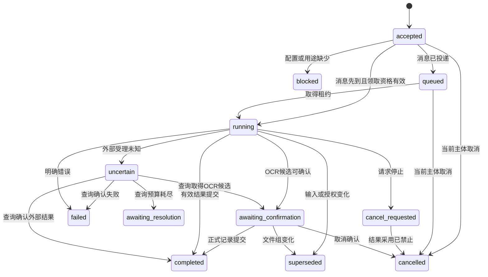
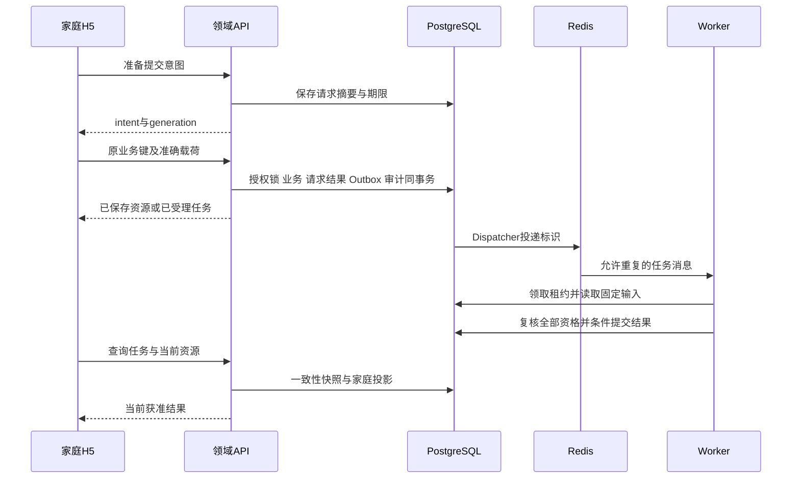

# sJIA 合并 MAS 预警平台后端详细设计（LLD-BACK）

日期：2026-10-07。版本：BACK V2.0。模式：`DESIGN / CONTINUOUS_DELIVERY`。责任：S005-2。实际实施与业务验收由 [交付记录](./planning/delivery-ledger.json)维护。

原件字节范围读取继续检查完整原件授权、当前可用状态与内容处置范围，依据不可变FileObject的登记大小使用现有get_range读取请求字节。读取长度不一致立即返回409 FILE_OBJECT_SIZE_MISMATCH；非法范围由统一处理返回416，完整读取保留200语义。当前真实原件及内存测量见[QA29](./docs/development/QA29-real-original-range-reads.md)。

backend_artifact_manifest将完整api源码与Schema、config及全部本地应用、依赖与正式Schema纳入准确后端制品清单。配置核验、进程采用及业务结果使用同一准确摘要；图像与文本用途处理配置继续采用各自处理制品范围。当前完整清单包含780个文件及53份API文件，实际采用与来源检查由QA29维护。

专业核对范围读取要求实际病例字段授权。实际记录包含字段且当前账号没有任何获准核对字段时，verification_creation_scope立即返回403 VERIFICATION_FIELD_SCOPE_DENIED，不返回原始字段；取得获准范围后继续准确版本、字段、用途、来源、保留策略和核对人员检查。全局verify_field岗位不授予病例字段范围，真实验证见[QA27](./docs/development/QA27-real-clinical-access-scope.md)。

FR-16重复资料目录使用当前请求内的ArchiveRelationReadContext批量读取准确来源，保留全部事实版本、原始记录作者、锚点、文件版本、文书页与核对证明检查。来源授权继续逐项执行当前账号、字段、用途及实际期限检查；读取上下文限制为只读用途，原有写入锁及来源检查独立执行。正式接口、候选规则、版本与签名分页语义保持，实际验证见 [QA24](./docs/development/QA24-real-relation-read-performance.md)。

FR-18确定性档案整理的准确可见字段、运行引用、事务、历史失效及迁移规范见 [新增内容运行设计](./backend-design/archive-delta-runtime.md)。archive_delta_visibility_config_id只用于本人档案整理；家庭提示与就医摘要继续采用既有发布、联系和内容资格。实际真实资料验证由QA19维护。

FR-19本人观察资料明确使用observation_period_visibility_config_id，完整配置、权限、未知时间与迁移规范见 [观察资料运行设计](./backend-design/observation-period-runtime.md)。采样医学时间、可得时间、专业核对及频率资格分别保存和检查；实际真实资料验证由QA20维护。

观察范围保存同时要求当前唯一有效的observation类保留策略与本人写入权限。读取结果提供的保存操作采用相同条件，策略不足时保留获准读取及明确限制；保存准备继续独立检查。本人实际查询范围、历史版本、原回执和依赖失效的当前验证由QA21维护。

## 1. 架构上下文与资产映射

### 1.1 输入与依赖

| 来源 | 当前维护位置 | 承接范围及状态 |
| --- | --- | --- |
| 产品需求 | [PRD](./sJIA合并MAS预警平台PRD.md) V2.0.0 | FR-01—FR-22、FD-01—FD-71、全部 AC 与 NFR |
| 系统边界 | [HLD](./sJIA合并MAS预警平台HLD.md) V2.0，ADR-001—ADR-010 | 模块化单体、独立 Worker、数据库权威状态、轮询；接收范围见 T34 |
| 数据结构 | [数据 LLD](./sJIA合并MAS预警平台数据LLD.md) DATA V2.0、[完整新增规范](./data-design/v2-data-specification.md) | 82 张基础与病例表、6 张运行表及 22 张新增实体；准确类型、关系与未知语义由 S005-1 维护 |
| 交互 | [页面流程](./sJIA合并MAS预警平台页面流程.md)、[原型说明](./guardian-h5/原型交互说明.md) | S01—S15、草稿、照片整理、请求恢复、历史、摘要 |
| 当前调用方 | guardian-h5/src/app/App.tsx、guardian-h5/src/api/client.ts | 正式 H5 已有业务接口；UI 2.0 的 39 页接收与完整业务适配由 T38／T54 负责 |
| UI 补充 | [UI 决定](./ui-delivery/assumptions-and-open-questions.md)、[提示状态](./ui-delivery/alerts/specifications.md) | 语音确认、原图、关注项目、历史时间查看；预览情景不作为运行规则 |
| 本地病例 | [demo 说明](./demo-data/README.md)、[当前资料状态](./data-design/clinical-dataset-status.json) | 已有用户授权本地使用的病例、四张附件和数据投影；生产导入、临床核对、独立答案分别未完成 |
| Agent | PRD 第 9 节、HLD ADR-005 | `NOT_APPLICABLE`：当前工作为 OCR 候选和确定性规则，无自主 Agent 或 RAG |

认证及关联接入依赖 D02；OCR 与专业核对依赖 D03；评估依赖 D04、D07、D08；家庭临床内容与渠道依赖 D05、D06；生产资料保留与联系依赖 D09；部署、容量及运行责任依赖 D01。这些依赖限制对应能力启用，设计继续覆盖完整接口与失败路径。本地病例可用于结构、引用和序列化检查，其用途不能自动扩展为外部 OCR 传输或临床验收。

### 1.2 后端模块与调用责任

保留 HLD 的 Python 3.13、Django 5.2 LTS、DRF、psycopg、PostgreSQL 17、Celery 5.6、Redis Broker、boto3、Pillow、Nginx、Gunicorn 和 OpenTelemetry 选择。补丁及依赖组合在 S008 实施时锁定；本次校验使用现有本地 Python 与 PostgreSQL，实际版本写入报告。

| 模块 | 写入所有权 | 读取和调用方 |
| --- | --- | --- |
| identity / relations | 主体、Session、独立关联、岗位与患儿动作授权 | 全部请求、支持入口、Worker |
| records / case_details | 不可变记录版本、医学时间、病例领域结构、更正申请 | 家庭详情、时间轴、专业查询、摘要与规则 |
| drafts / requests | 本人草稿、提交意图、业务请求结果 | FormActions、草稿恢复、网络恢复 |
| files / recognition | 文件清单、页组、候选、位置和本人确认 | PhotoReview、报告与治疗登记、核对人 |
| verification / assessment | 指定字段证明、计算资格、固定输入与结果 | 受控支持入口、提示服务 |
| configurations / family_content | 配置、批准、验证证明、环境启用状态、家庭字段投影 | 首页、所有详情、历史、摘要、通知 |
| summaries / notifications | 摘要引用、提示接收、发送许可、外部回执和阅读 | 家庭查询、通知 Worker |
| audit / retention / tasks | 审计、处置、Task、Outbox、租约及恢复 | 运维、各领域服务、Dispatcher |

HTTP View 只协调认证、Serializer、领域动作和响应；QuerySet 负责授权查询；领域动作负责事务和状态转换；Provider Adapter 负责与指定外部服务通信。禁止直接使用通用 ModelViewSet 或默认 ModelAdmin 修改临床表。

### 1.3 设计决定

| ID | 来源与决定 | 状态及影响 |
| --- | --- | --- |
| BACK-001 | `INFERRED`，HLD ADR-003/006：同源 Cookie Session，家庭与支持入口分别限定 Cookie 与角色 | `PROPOSED`；D02 确认认证 Provider 后绑定身份，所有业务接口沿用 |
| BACK-002 | `INFERRED`，DATA TX01—TX08：增加环境资格行，提供发布尚未建立时的共同锁对象 | `PROPOSED`；[后端补充 SQL](./backend-design/schema.sql) 为本文件唯一维护位置 |
| BACK-003 | `INFERRED`，PRD NFR-08/12：业务写入使用持久提交意图及代次，解决响应未知和延迟请求竞争 | `PROPOSED`；业务、write_request、Task、Outbox 和成功审计仍同事务 |
| BACK-004 | `INFERRED`，FR-08/12：岗位授权、配置验证与专业字段更正申请有独立持久结构 | `PROPOSED`；与既有病例动作授权共同检查，不扩大管理权限 |
| BACK-005 | `INFERRED`，HLD ADR-006：任务采用有界轮询，无 SSE、WebSocket 或模型流式输出 | `PROPOSED`；前端恢复通过当前状态与 status_version 完成 |

本文件、[接口目录](./backend-design/api-catalog.csv)、[协议 Schema](./backend-design/protocol.schema.json)、[跨层接口接收规范](./backend-design/handshake.md) 和后端补充 SQL 共同定义当前后端设计。S005-1 维护医学事实和 82 张数据表；补充运行表由 S005-2 维护，S008 的 Django migrations 成为实际结构变更入口。S005-4 维护页面适配，S005-3 维护动态预警编排。接收规范第 1—7 节分别维护首页与归属、配置与候选、来源与原件、申请与恢复、CSRF、任务和持久关系。

PRD 2.0 新增服务由 [V2 接口目录](./backend-design/v2-api-catalog.csv)、[V2 协议 Schema](./backend-design/v2-protocol.schema.json)及 [V2 服务行为](./backend-design/v2-service-behavior.md)维护，完整继承本文件的身份、幂等、事务、轮询、外部处理和监控要求。V1 调用方继续使用既有 Schema；V2 新增枚举与字段采用明确映射。

## 2. 安全、幂等与输入边界

### 2.1 身份与授权判定

```text
allow(subject, action, object, purpose, environment, now) =
  session.valid AND principal.account_status = active
  AND session.auth_epoch = principal.auth_epoch
  AND environment_gate.enabled
  AND action_grant.active_at(now)
  AND grant.patient_id = object.patient_id
  AND grant.record_scope permits object.record_id / author_id
  AND requested_field_codes subset_of grant.field_codes
  AND data_use_authorization permits purpose AND environment
  AND source_revision / retention_policy valid
  AND (family_request implies current_relation.active_at(now))
```

全局配置、关联核验和运维动作使用 `service_role_grant`；病例动作还需要 `access_grant`。`is_staff`、`is_superuser`、Django Group 和服务进程身份均不自动授予病例读取。列表、搜索、总数、关联子项、创建、附件、历史、任务和请求结果分别执行同一范围规则。无权对象与不存在对象统一 404；已认证主体对明确可见对象缺少动作权限返回 403。支持入口限定网络与主机，仍逐请求鉴权。

合法前置路径：D02 Provider 验证 subject → 映射 principal → 建立数据库 Session → 本人申请关联 → 获准核验人读取证明并作出决定 → 同事务建立 relation 与明确动作的 access_grant → 家庭取得患儿与能力清单。岗位授权由具备授权管理权限的人员根据证据授予，限定环境、动作、有效期；授权管理人不自动拥有被授予动作。初始管理主体通过获准部署操作建立，禁止公共注册提升岗位。

`read_raw / write_record / correct_record / read_history / read_file / view_request / manage_draft / receive_alert / create_summary / read_summary / request_correction / request_disposition / verify_field / revoke_verification / read_assessment / execute_assessment / read_case / import_case` 为动作标识。更正他人记录必须有对应范围，`own` 按当前记录最初作者的授权语义判定，不能因更正版本作者变化取得他人全部记录。

### 2.2 Session 与输入

Session 使用 Django 数据库 backend，Session 内绑定 principal UUID、入口 audience、建立时间与认证时 principal.auth_epoch；过期、退出和账号停用全部执行服务端失效。认证 Adapter 创建身份时核验 issuer/provider 与 subject，不接受前端声明的 principal_id。登录成功轮换 Session；支持域 Cookie 不共享给家庭域。Django CSRF、Origin/Referer 检查与 Secure、HttpOnly、SameSite 配置必需，认证回调按实际协议校验 state/nonce；认证协议未确定时入口返回未配置。

采用 DRF 显式 Serializer 字段与成熟 JSON Schema 校验器；额外字段直接拒绝，不能依赖默认反序列化忽略保护字段。家庭输入不能提供 patient_id、author_id、verifier_id、verification_status、quality_status、rule_result、approved_by 或 permissions；患儿由路径、主体由 Session、来源用途和保留策略由服务端选择。候选引用必须属于当前文件版本与本人权限。纯文本按文本渲染，不执行 HTML 或模板表达式。

JSON 使用 UTF-8；decimal 为有限十进制字符串；bigint 版本及 epoch 对外使用十进制整数字符串，防止 JavaScript 精度损失。缺失字段、显式 null、未知状态分别校验。临床字段长度、精度、项目数量、页数及图像限制读取获准配置；未配置时受影响写入口不开放，超限返回 413/422，不截断。

### 2.3 写入身份与请求恢复

每个有业务副作用的请求携带 `Idempotency-Key: UUID`，正文不重复携带 request_id；`X-Write-Intent: UUID` 与 `X-Intent-Generation: positive integer string` 指向当前提交意图。作用域为 `(actor_id, operation_id, target_key, request_id)`。POST `/write-intents` 是自动的协议准备步骤，无新增家庭确认页面：提交完整业务载荷及目标，服务端校验、规范化并保存摘要、患儿、有效期；客户端取得意图后调用业务接口。

规范化采用版本 `back-json-1`：DRF/JSON Schema 完成类型检查；序列化成熟 JSON 实现按键排序、固定分隔符、UTF-8 和禁止非有限数字；保持数组顺序、原文、decimal 字符串、空值与缺失差别；摘要覆盖 operation、target、schema_version 和 payload，不含 CSRF、Session 和追踪头。文件正文使用服务器核验的完整字节 SHA-256、字节数与声明媒体类型参与摘要，上传流结束后再次比对。不同正文使用同一业务键返回 `IDEMPOTENCY_CONFLICT`。

| 意图及写入事实 | 查询结果 | 可执行动作 |
| --- | --- | --- |
| prepared，尚无业务成功 | pending | 自动继续原业务请求；超时后查询，禁止新建业务键 |
| 业务事务持有意图锁 | processing | 查询不等待长事务；稍后继续查询 |
| committed，write_request 同事务已提交 | committed | 重新授权读取原资源；当前不可见时只返回安全状态 |
| 期限已到且锁可取得，确认没有成功记录 | failed / REQUEST_EXPIRED | 同事务关闭该代次，明确未提交；可以重试原业务键 |
| 结果存储不可读取或锁状态无法判明 | unknown | 保留结果待确认，不允许新键重复提交 |
| 查询范围内没有意图 | not_found | 不宣称原提交失败；按原准备键恢复意图，禁止创建另一业务提交 |

业务事务在固定锁顺序中锁定意图，核对 generation、状态、摘要、当前权限和 expires_at；准备的截止时间也作为数据库执行超时上限，提交前再次核验。成功时同时写入 write_request、业务资源、意图 committed、Task、Outbox 与审计。失败即中止当前事务；Reconciler 取得同一意图锁后核查成功记录，只有证明未提交才记录失败。不得捕获事务异常后继续执行后续业务。

`POST /write-intents/{id}/retry` 只接受 failed 且 `expected_generation` 一致、无成功效果的意图；原摘要相同则 generation+1 并重新授权，旧在途请求因代次不一致拒绝。同键相同正文准备重试返回现有意图；业务重放返回原资源标识，响应内容按当前可见策略重新生成，禁止缓存以前的病例响应。已 committed 的动作保留幂等身份至 D09 保留期与允许重试窗口结束。

### 2.4 一致性事务与审计

固定顺序：`environment_gate` → 患儿（UUID 排序）→ principal 与关联/岗位/动作授权 → 提交意图 → 业务对象。普通写入对环境行取得共享锁，资格变更取得排他锁；患儿级更正、核对和结果提交串行化。纯查询在短 `REPEATABLE READ READ ONLY` 事务内完成授权、字段选择与序列化；附件取得允许读取的快照后关闭数据库事务再传输。任何撤销提交后开始的新快照均不得取得旧资格。

数据库使用 `lock_timeout < statement_timeout < request_deadline`；冲突就地失败并返回 409 或明确技术错误。Provider 网络调用、文件读取与队列发布不置于业务事务中。写入成功审计与业务同事务；读取和拒绝的审计由独立短事务确认后才发送响应；审计无法保存时拒绝受保护操作并告警。运行日志只记录 trace_id、对象标识、操作、错误码和耗时。

Django `atomic()` 提供明确事务边界；`on_commit` 仅作及时唤醒，可靠投递以 Outbox 为准。[Django 事务说明](https://docs.djangoproject.com/en/5.2/topics/db/transactions/)

## 3. 存储结构、ORM 与字段传播

### 3.1 Schema 维护与补充表

[schema.sql](./data-design/schema.sql) 与 [case-schema.sql](./data-design/case-schema.sql) 的列、枚举、复合外键和索引完整继承。`UUIDField` 对应 uuid；`DateTimeField` 对应 timestamptz；医学当地时间使用无时区 timestamp 并单独保存时区；不限定小数位的 finite_decimal 需显式 PostgreSQL numeric/domain 映射与迁移，禁止 ORM 自动转换为具有固定 scale 的数值列。其余 text、jsonb、text[]、bigint 分别映射相应成熟 Django/PostgreSQL 字段。

| 补充表 | 字段与索引责任 | 业务效果 |
| --- | --- | --- |
| environment_gate | environment varchar(64)、version/publication_epoch bigint、enabled boolean、active_release_id、runtime_config_id、updated_at；环境主键 | 发布不存在时仍有可锁行；启用组合与环境版本共同原子改变 |
| service_role_grant | principal_id、environment、action varchar(64)、证据、有效时间、撤销；主体/环境/动作索引 | 全局岗位动作与病例授权分别核查 |
| write_intent | 主体、患儿、operation varchar(80)、target varchar(256)、request UUID、摘要、generation、状态、期限、resource；业务键唯一 | 准备、恢复、关闭过期代次、复用原业务键 |
| upload_part | 文件组、页序、声明摘要/字节/媒体类型、确定对象键、对象版本、意图与处理状态；组内页序唯一 | 在接收字节前保存准确文件清单，上传中断后查询实际对象 |
| config_validation | config_id、环境、制品摘要、数据集与运行证据、结果、执行主体、时间；准确配置/环境索引 | 配置启用需要实际验证证据，无法由勾选框自行生成 |
| correction_request | 版本、请求者、字段范围、原因、更正建议、状态、处理引用；同患儿复合外键 | 家庭对专业字段提出请求，授权人员依据原文处理 |

六张表的准确字段、长度、空值、枚举与约束见 [后端补充 SQL](./backend-design/schema.sql)。其 text 临床输入上限由获准字段配置限制；varchar 长度只用于后端协议标识。Django 自带 Session 表由 Django migration 管理，不计入 88 张 sjia 业务与运行表。任务种类包含 file_validation 与 alert_evaluation，完整枚举同时维护于 runtime 和 TaskView。

### 3.2 不可变资料、文件与病例领域

RecordVersion、RecordField、医学时间、已批准配置及其 JSON 内容不原地改写；更正建立新记录版本及相应病例领域实体，旧字段 ID 保留。新版本字段 ID 全部重新生成，核对状态为 unverified。Report 元数据发生变化时建立新 report 行，旧版本继续指向原 report，禁止覆盖旧 report 影响历史。`patient.current_profile_id` 与当前记录版本共同有效。

照片重排、替换或移除形成新 file_group ID，version 递增，创建新页清单；通过依赖节点记录前一组。原组变为 superseded，其页及对象不改写，旧 CandidateSet 不再可采用。可复用同一患儿且用途有效的文件字节，但新 file_object 清单仍独立，禁止跨患儿复用可见引用。移除不等于物理删除，D09 处置任务检查全部引用与保留依据。

病例 18 张扩展表按当前不可变 record_version 连接。基本资料、就诊过程、检查分组、病原学、临床陈述、影像及图片关联、药物动作、非药物处理、外部评分、随访和质量问题保持既有结构。`case_read_scope` 只用于拥有 read_case 与整条记录字段权限的内部主体；家庭投影逐字段取得授权，禁止将内部查询 `SELECT *` 直接序列化。SJADAS、SMS 作为来源量表保存，不能转换为 MAS 的 MS。

### 3.3 字段传播与序列化

| PRD 字段 | ORM / SQL 来源 | API 及使用方 | 转换与拒绝条件 |
| --- | --- | --- | --- |
| FD-01、FD-02 | principal、patient | SessionView、RelationView → PageFrame | 主体来自 Session；display_id 无认证效力 |
| FD-03、FD-04、FD-05 | relation_application、relation、access_grant | RelationView → AssociationsPage | pending/rejected 只返回本人申请资料；证明正文限核验人 |
| FD-06、FD-07 | record_field 的两个独立 field_code | FamilyRecord / InternalRecord | 自报与专业状态分别投影；家庭输入专业代码拒绝 |
| FD-08、FD-09 | record_field、medical_time | FieldInput / FamilyField → ObservationsPage | 已观察、未观察、未知明确区分；温度不自动赋值发热前提 |
| FD-10、FD-11、FD-12、FD-13、FD-14 | 专业 field_code、verification | InternalRecord / Verification | 家庭写入拒绝；未核对不能进入评估 |
| FD-15、FD-16、FD-17 | report、source_revision、origin_type、concept_code、original_name | RecordInput / FamilyRecord → ReportsPage | 项目身份由字典或明确的未匹配原名提供；不以名称推断身份 |
| FD-18、FD-19、FD-20 | raw_text/raw_numeric/qualifier/raw_unit、medical_time、method、reference_interval | FamilyField / MedicalTime → 详情与时间轴 | decimal 字符串；原值不替换；三类时间独立 |
| FD-21、FD-22、FD-23、FD-24、FD-25、FD-26 | concept_code、normalized_measurement | AssessmentInput | 精确版本、核对和映射全部有效才选值 |
| FD-27、FD-28 | dictionary_entry、unit_mapping、normalized_measurement | DictionaryView、TrendView | 原值与标准值分别呈现；相同单位不代表相同项目 |
| FD-29、FD-30 | quality_status、field_verification_state | FamilyField、verification_coverage | 质量、来源、逐字段用途核对独立；partial 不表示整份报告通过 |
| FD-31、FD-32 | record、record_version | FamilyRecord、CorrectionInput → CorrectionPage | expected_version 为字符串，数据库严格比较 bigint |
| FD-33、FD-34 | 治疗原字段、medication_event/item、medical_time | FamilyRecord / 专业 CaseView | ongoing 需明确来源；结束时间 null 不推断持续 |
| FD-35、FD-36、FD-37 | verification、verification_field | Verification → 核对支持入口 | verifier_id 和 verified_at 由服务端填入；证据不可缺少 |
| FD-38、FD-39 | assessment、assessment_input | AssessmentView → 内部核查 | 固定字段、核对、时间、映射与不足原因 |
| FD-40、FD-41、FD-42、FD-43 | config_version、assessment_output | AssessmentView；FamilyClinicalProjection | 未获 D06 的字段在家庭响应中不存在，不能返回 null 占位 |
| FD-44、FD-45、FD-46 | config_approval、release_component | ApprovedContent → 各家庭响应 | 准确文字、允许字段、环境、有效期共同判定 |
| FD-47、FD-48、FD-49 | alert_event、recipient、attempt、receipt | AlertView → AlertsPage | 发布、受理、送达与阅读独立；首次实际阅读时间保持 |
| FD-50 | summary、summary_item | SummaryView → SummariesPage | 新资料、更正、核对和策略变化使摘要需重新生成 |
| FD-51、FD-52 | contact_version | ContactView → 联系入口 | 有效批准才有 channel_value；不可用时不返回旧号码 |
| FD-53、FD-54、FD-55 | data_use_authorization、audit、retention、disposition | 受控使用与处置接口 | 仅获准岗位可读证明；普通日志无病例正文 |
| FD-56、FD-57 | write_intent、write_request、draft | RequestView、DraftView → FormActions | saved_at → confirmedAt；resource.record_id → `/records/{id}` |

MedicalTime 继承数据 Schema 的八种 precision。仅日期不能形成 instant；month_range、relative 保持原文和实际范围；时区未知不取服务器或浏览器时区。返回体医学时间可以保留原始无效文字与 resolution_status，写入不接受客户端计算的 instant，服务端通过成熟 datetime/zoneinfo 解析并核验当地时间与时区往返一致性。

`SourceAnchor` 使用 decoded_pixel 坐标；确认图像的解码方向与 file_page.rotation 后，前端 `RecognitionSource.region` 为 `left=x/image_width, top=y/image_height, width=width/image_width, height=height/image_height`。图像展示和坐标采用同一方向；纯页面定位返回 region=null，组件需支持整页引用，不构造矩形。原始坐标保存 decimal，比例浮点仅用于界面显示，禁止进入医学计算。SourcePhoto.url 使用当前授权获取字节后创建的 Blob URL，服务端返回 content_path，禁止返回对象存储地址。

跨字段验证由领域校验器执行：版本在 PostgreSQL bigint 正值范围内；medical_time 的年/月区间有序；引用的 dictionary_entry 与 concept_code 及字典版本一致；同一输入的 client_field_id 和 ordinal 唯一；所有候选都有明确决定；BBox 的边界和 confidence 在合法范围；draft_id 与 draft_version 同时存在或为空。`draft.payload` 保存完整 DraftInput，外层 form_type、correction 指针必须与结构列一致；其 schema_version 固定为 backend-draft-1。客户端 client_field_id、upload_id 只作为本次输入映射，数据库实体 ID 由服务器生成；upload_part.client_upload_id 保存映射。

### 3.4 索引、检索、迁移与保留

沿用 `record_patient_kind / version_recorded / field_patient_concept / time_ordering / access_lookup / dictionary_alias_lookup / dependency_reverse / outbox_dispatch / task_pending` 及病例索引。病例分页先按父实体 ID 选一页，再关联全部获准子项，禁止在联表展开之后 LIMIT 截断药物分项或检查组。时间范围使用实际精度及获准策略，unknown 单独一组；相同时间 UUID 仅稳定排列，不决定临床先后。

字典查找返回当前获准版本的代码、原名、别名和匹配状态；多匹配需要选择，未匹配保留原名。向量库、embedding、模型上下文及医学推理图均不在当前执行路径。PostgreSQL dependency_node/edge 按 dependent→prerequisite 保存来源、输入、核对、映射、政策、发布及联系关系；逐边核验真实对象，禁止循环与跨患儿依赖。

不根据未知人数设置分库、分区或只读副本。索引通过真实获准数据的查询计划、选择性、写入成本及 p95/p99 验证；授权和当前有效性始终读取主库。生产迁移须核对数据库身份、取得备份，按增加字段、数据迁移、逐值核对、调用方切换、验证后移除兼容字段执行。恢复在隔离环境进行，并在开放读取前重放删除、撤权与停用登记。

每类资料绑定 D09 保留政策；包含原件、派生对象、OCR 响应、候选、草稿、历史、请求意图、审计、Provider 副本和备份。请求身份不得早于允许重试窗口清理。删除申请逐项记录 deleted/retained/awaiting_provider 等状态与回执，未取得必要副本处置证据时不标 completed。

## 4. 接口协议与网关治理

### 4.1 通用协议

基础路径 `/api/v1`。完整操作目录见 [api-catalog.csv](./backend-design/api-catalog.csv)，列出 operation_id、调用方、方法、路径、动作、输入/输出、超时类别和事务。正文结构见 [protocol.schema.json](./backend-design/protocol.schema.json) 与本节补充对象；格式版本 `1.0.0`。目录中的路径包含资源 ID，查询条件只包含限定列表；不接受任意排序字段、SQL、对象键或 URL。

成功返回 `{schema_version, trace_id, data}`；集合 data 为 `{items,next_cursor,snapshot_version}`。目录指定 WriteReceipt 的同步写入返回 `resource_type,resource_id,version,saved_at,request_id`；文件、意图等操作返回目录指定的资源 View。异步受理返回 TaskView，包含 `task_id,task_type,request_id,accepted_at,status,status_version,poll_after_ms,result_type,result_ref`。全部业务写入的持久结果均可通过原意图查询。同步创建 201、读取/更新/重放 200、任务受理 202；保存成功与任务完成分别表达。错误返回 Error Schema，非 2xx 不携带成功 data。GET 不改变临床或阅读状态；明确的 read 动作使用 POST。

资源版本整数对外为字符串；UUID 使用标准格式。接口缺少必需字段或包含额外字段返回 422；语法损坏 400；鉴权失败 401；受保护输入拒绝 403。相同资源的响应严格按当前角色选择字段，禁止动态 `fields=*`。新字段只有在 schema_version、可见策略和调用方均支持时发布；破坏性改名、枚举变化或含义变化升级主版本并检查全部调用方。

既有 DATA 1.1.0 受控交换格式保留其整数版本表达，仅在专业导入与病例实体交换中适用；服务端使用 Python 整数验证 PostgreSQL 范围。家庭资源版本及新后端协议统一使用字符串。JSON Schema 的格式通过之外，日期先后、作用域、交叉引用、状态资格、配置上限和字段允许表均需领域校验。

所有敏感响应设置 `Cache-Control: no-store, private`、`Vary: Cookie`、`X-Content-Type-Options: nosniff`、`Referrer-Policy: no-referrer`；CORS 默认为同源，允许来源逐项配置，不能与凭据使用通配符。Nginx 负责 HTTPS、请求体与连接上限、IP 速率限制、上游超时及日志脱敏；应用执行真实主体和动作额度。DRF 列表及创建权限须显式实现范围过滤与创建校验。[DRF 权限说明](https://www.django-rest-framework.org/api-guide/permissions/)

### 4.2 接口族与详细载荷

| 对象 | 请求、响应及服务端处理 |
| --- | --- |
| SessionView | principal_id、account_status、expires_at、audience、capabilities；未登录 401。capabilities 包含 capability_id、state、reason_code、配置版本及可用输入限制，不包含秘密和临床结论 |
| AuthStart / AuthComplete | Start 仅接受注册的 return_path 标识；响应 auth_flow_id、Provider 要求的当前操作。Complete 接受 auth_flow_id 与符合 Provider Schema 的证明；校验 nonce、时效、单次使用和 issuer。D02 未确定时返回 CAPABILITY_NOT_CONFIGURED，不接收任意凭据对象 |
| RelationApplication | 本人提交核验服务认可的 evidence_ref 与说明；patient_id 由核验流程确定；列表和详情只返回本人状态。核验人提交 expected_state、decision、evidence_ref 和明确动作/字段范围；拒绝时不创建关系 |
| RelationView | relation_id、patient_id/display_id、status、version、valid_from/until、本人 actions；有效期及权限从数据库读取。撤销关系不删除资料 |
| DraftInput / DraftView | form_type、field_config_version、完整当前输入、correction_record_id/version；保存返回 draft_id、version、saved_at、expires_at、status。更新必需 expected_version。payload 采用当前 form_type 的输入结构，允许未完成字段但拒绝保护字段 |
| RecordInput | kind=observation/report/therapy、capture_method、source_revision_id?、报告元数据、逐字段输入、draft_id/version?、candidate_set_id?、confirmation decisions。source/retention/use_authorization 由当前主体用途取得；报告转录需原名或有效项目代码 |
| CorrectionInput | expected_version、reason、完整替换输入；创建新版本，未提供字段不自动复制旧隐藏字段。家庭只修改获准范围，其余字段由领域服务引用当前不可变值并建立新版本；新字段全部重新核对 |
| FamilyRecord | record_id、record_version_id、version、kind、origin_type、capture_method、recorded_at、质量状态、家庭获准字段、报告元数据、来源引用、editable_field_ids、verification_coverage；字段内部意见不直接返回 |
| RecordSearch / TrendView | kind、concept_code、origin_type、verification_status、from_date/to_date、scope_timezone、time_group、cursor、limit。TrendView 返回双方 field/version、原值、单位、时间、核对状态、direction 或不可比较 reason；范围冲突与限定值不计算方向 |
| FileGroupInput / FileGroupView | draft_id、用途、声明文件清单；服务器分配组 ID。上传每页准确字节，校验 SHA-256/大小/格式后生成 file/page ID；返回 group_version、页序、状态、content_path、允许动作。完成接口核对 declared files 与实际文件一致 |
| FileGroupRevision | expected_version、按顺序的现有 file_id 或新上传文件引用；所有引用属于当前患儿及有效用途；完整成功才更换组指针并使旧候选失效 |
| RecognitionInput / CandidateSetView | 固定 file_group_id/version；输出 task 与候选集合。候选含 raw_text、recognition_status、source_anchor、confidence?；confidence 不产生核对资格。partial 结果如实保留，每项需 accepted/modified/unknown/excluded 决定 |
| VerificationInput | record_version_id、purpose、policy_id、evidence_source_id/evidence_ref、field_id→result/reason；服务端设置核对人、时间和当前指针。未填写字段不授予资格；撤销必须 reason 与 expected_state_version |
| AssessmentInput / AssessmentView | 内部受理 kind、assessment_at、准确策略与规则版本；字段由服务器选取。输出 computation_status、validity、missing_items、固定 input_refs，完成后提供对应类型的条件或七项贡献。家庭无直接访问权限 |
| ConfigInput / ConfigView | kind、config_key、schema_version、payload、source_revision_id；每个 kind 使用登记的成熟 Schema 校验，未经登记的 kind/schema 拒绝。返回 id/version/checksum/status；内容不可变，修改产生新版本 |
| Approval / Validation / Release | 批准绑定 config_id/checksum、岗位、evidence_ref、scope、有效期；验证绑定 config_id、运行/数据/制品摘要；发布输入准确组件 ID、contact_version_id、validation_config_id、环境和 expected_gate_version。保存、批准、启用分别操作 |
| HomeView / AlertView | service_state、data_state、processing_state、alert_state、read_state 分别返回；内部临床结果只由 FamilyClinicalProjection 提供。无批准时 clinical 字段整体不存在；最新体温只按已定义事件时间返回，未知时间独立说明 |
| FamilyClinicalProjection | 准确 content_id/version、批准模板文本、允许事实参数、依据引用、可操作 contact；只有当前可见策略允许的字段存在。事件标识由 HomeView.current_alert_id 或 AlertView.alert_id 提供；有效性由所属资源提供。UI attention/warning/urgent 由批准映射产生；clear 要求 assessment_state=current 且无有效事件 |
| ReadReceipt | 当前本人接收关系、alert_id、前端实际打开动作；首次写入 read_at，重复不改变时间；不改变等级、validity 或 delivery_status |
| SummaryInput / SummaryView | from_date/to_date、scope_timezone、include_unknown_time；服务器固定当前获准记录及模板。响应来源字段、范围、生成时间、当前有效性和重新生成状态；失效后不返回禁止内容，无法生成时任务失败与空范围分别表达 |
| CorrectionRequest | record_version_id、field_ids、reason、proposed_text；专业字段原文建议作为待处理材料。处理人依获准原件建立正式更正版本并关联 resolution_record_version_id；请求本身不能修改专业事实 |
| CaseView / CaseImport | 受控 read_case/import_case；使用 DATA 1.1.0 交换结构及 18 张领域表，导入先校验全部引用和用途，再在一项事务内写入及逐值回读。创建 UUID 由导入服务登记并与来源 ID 映射；家庭接口不能调用 |
| Disposition / Audit | 处置输入 policy_id、对象范围、依据，批准与执行分开；审计查询仅限定岗位范围和元数据，按 created_at/id 分页；病例正文与认证证明不从审计接口返回 |

支持接口的临床配置 payload 细目由相应 D03—D07 批准的配置 Schema 维护。尚未取得配置内容时，接口结构和生命周期已定义，实际配置创建及启用返回 `CONFIG_SCHEMA_UNAVAILABLE`，不接受无类型 JSON 作为已生效规则。

配置的保存／读取／提交、批准／撤销、验证、启用／停用分别执行 manage_configs、approve_config、register_validation、publish_config 权限。验证结果来自准确批准来源登记的实际报告；ValidationInput 不接收 outcome。证明引用、目录、完整格式、制品摘要与执行人员要求见 [配置批准与验证证明](./backend-design/configuration-evidence.md)。配置写入及恢复使用 RequestView.controlled_input；历史凭据绑定原始 WriteRequest 和同事务准确 AuditEvent。

资料前置支持接口包括来源登记、不可变来源版本、用途授权、保留政策和专业记录。登记来源时核验实际 evidence_ref；只有具有准确批准证据的版本可进入 approved。policy 创建保持 draft，activate 校验 D09 证据并设置批准人员与时间；用途授权由 manage_data_use 主体核验后创建。病例导入传入的主体验证、核对、来源及保留 ID 均需回查；服务器登记来源标识到新实体 ID 的对应关系，并核对完整结果，不能凭交换文件授予权限。

`professional_record_create` 与 `professional_record_correct` 只允许 write_professional 的指定病例主体操作；前者只接收一条准确记录及其领域实体，后者核对目标 record_id、expected_version 和原因后建立新版本。两者保持专业来源、未核对状态与实际依据。CorrectionRequest 的 resolved 必须关联通过该流程生成的新版本；解决申请不构成临床核对。

读取 QuerySet 的 `own` 范围通过 version=1 的作者判定；继承 Q02 骨架时在该位置明确关联首个版本，后续版本作者只表示本次更正者。`assigned` 范围按准确 record_id，字段范围按获准 field_code；不通过更正历史改变原记录所有者。

config_enable/config_disable 面向准确环境、配置 checksum、批准和验证记录执行，更新 gate.version 并使相关结果失效；规则配置启用只提供内部计算资格。家庭临床内容还需要完整 release_bundle。contact_activate 核对维护人、来源、批准及有效期后设置 active；验证时间来自实际核验动作。release_approve 只确认组件齐全，不能代签临床批准。release_enable 在同事务设置唯一启用组合、environment_gate.active_release_id 与 publication_epoch；任何组件停用即使原组合不能通过当前资格检查。

联系操作使用 `manage_contacts`，发布操作使用 `publish_config`。联系保存使用准确 ContactInput，不填写默认来源、批准配置或有效期。`content/contact-1` 的批准正文完整包含 `contact_id`、`contact_name`、`purpose`、`channel`、`channel_value`、`owner_id`、`environment`、`source_revision_id`、`valid_until`；不允许额外字段。保存的联系内容逐项对应该正文，创建状态为 draft，verified_at 为空。启用检查实际批准、验证、当前维护主体及来源，按 GateAction 核查环境版本；停用按 StateAction 核查当前状态。本人提交意图、业务变更和审计同事务处理，重复提交返回原凭据。

### 4.3 查询、附件和状态恢复

游标使用 Django 签名工具生成并带到期时间，包含主体、患儿、过滤摘要、排序键、data_epoch、verification_epoch、publication_epoch、授权版本和最后父实体 ID；任一版本变化返回 409 CURSOR_EXPIRED。临床过滤请求正文使用 POST search，避免原值或症状进入 URL；其语义为只读，无写入意图。分页上限、搜索长度与时间范围读取批准的运行配置，不返回未授权总数。

`HomeQuery.at` 仅用于查看指定实际时点所属的原始记录集合；不自动沿用更早值，不在前端重现历史临床等级。响应标明资料来源时间，最新提示仍检查当前有效性。概念部位和儿童形象属于公共 UI 资产，后端不依据这些资产生成病变位置或真实外貌。

HomeQuery.at 精确到秒时只选相同 instant 的已解析记录；仅日期和月份资料不据此推断发生时刻，通过 records/search 按精度分组查询。ReadReceipt 在一次事务内更新同一 alert_id 与本人当前 relation 的全部渠道接收行，read_at 保留首次真实阅读时间；送达时间与渠道状态分别保存。

`GET /files/{id}/content` 与每个 Range 请求均核验当前权限、文件状态、准确 object_version 和字节完整性。仅单范围读取，支持 200/206/416；不支持的多范围请求明确拒绝。Content-Type 使用实际解码类型；返回 Content-Length、Accept-Ranges 与 Content-Range，限制媒体格式。原件不改写，缩略图单独版本。原始对象缺失或校验不一致返回 SOURCE_UNAVAILABLE，不能用缩略图替代原件成功响应。已发送的合法字节无法撤回。

upload_part 在接收前保存声明、确定对象键及意图。上传网络传输不持有数据库行锁；写入前核验 generation 并登记 receiving，返回后重新锁定并核验，只有准确对象版本及摘要匹配才提交 FileObject。PUT 受理未知标 uncertain，Reconciler 查询同一对象键/版本；不得立即重复上传或关闭意图为可重试。Range 读取依赖原件可用时已经验证的完整摘要以及准确对象版本；流中断只终止当前传输，不能在已发送响应后伪造 JSON 成功。上传及图片解码的失败不创建 available 页。

任务查询返回单调递增 status_version、允许动作、经过家庭过滤的 result_ref 和 poll_after_ms；不返回 Worker 输入、内部错误详情或病例范围以外内容。前端前台按建议间隔查询，失败采用有界等待，隐藏页面停止查询；回到前台重新验证 Session、关系、任务与资料，不继续展示未核验内存内容。终态、awaiting_confirmation、blocked、awaiting_resolution 停止自动轮询，页面按真实可执行动作继续。SSE 的连接、心跳、Chunk、Last-Event-ID 均不适用；当前没有该路由和恢复协议。

### 4.4 稳定错误与恢复动作

| code | HTTP / 可重试性 / 日志 | 家庭安全消息与动作 |
| --- | --- | --- |
| AUTH_REQUIRED | 401 / 重新认证 / INFO | 登录后继续；清除未授权页面内容 |
| FORBIDDEN / RESOURCE_NOT_FOUND | 403/404 / 否 / WARN | 当前无法访问；返回关联或记录入口 |
| CSRF_REJECTED | 403 / 取得新会话证明 / WARN | 页面状态已变化，请重新打开 |
| INVALID_INPUT / PROTECTED_FIELD | 422/403 / 修改输入 / INFO/WARN | 指出获准字段路径；保护字段不回显原值 |
| VERSION_CONFLICT / CURSOR_EXPIRED | 409 / 重新读取 / INFO | 当前资料已变化；保留输入并核对当前版本 |
| IDEMPOTENCY_CONFLICT / INTENT_GENERATION_CONFLICT | 409 / 否 / WARN | 当前提交与已登记请求不一致；查询原请求 |
| REQUEST_EXPIRED / REQUEST_UNKNOWN | 409/503 / 按 RequestView / WARN | 分别表达未提交或结果待确认 |
| CAPABILITY_NOT_CONFIGURED / CONFIG_SCHEMA_UNAVAILABLE | 503 / 配置有效后 / WARN | 对应服务尚未开放；其他独立操作保持可用 |
| PAYLOAD_TOO_LARGE / UNSUPPORTED_MEDIA | 413/415 / 修改输入 / INFO | 返回当前获准容量或格式限制 |
| SOURCE_UNAVAILABLE / DEPENDENCY_INVALID | 409 / 取得有效依据 / WARN | 原始依据暂不可用或已变化 |
| RATE_LIMITED | 429 / Retry-After 后 / INFO | 操作频繁，请稍后重试 |
| PROVIDER_UNAVAILABLE / PROVIDER_TIMEOUT | 503/504 / 依副作用状态 / ERROR | 处理暂未完成；查询任务状态 |
| RESULT_SUPERSEDED / RESULT_UNCERTAIN | 409 / 查询或重新发起获准任务 / WARN | 资料已变化或外部结果待确认 |
| INTERNAL_ERROR | 500 / 查询写入状态 / ERROR | 本次处理失败；只提供 trace_id |

### 4.5 外部依赖、超时与故障返回

以下数值为 `PROPOSED` 的工程上限，须由实际供应商与 S011 确认后写入版本化 runtime 配置；没有已批准配置时不启用相应能力。禁止将这些数值用作临床时间窗口或通知升级规则。

| dependency / owner | data_shared / auth | 超时时长与重试次数 | 熔断及错误返回 |
| --- | --- | --- | --- |
| IdentityProvider / identity | 最少身份凭据；实际协议、固定 endpoint、TLS、secret_ref | 连接 3 秒，读取 10 秒，总计 15 秒；自动重试 0 次；会话用户重新认证 | 60 秒内 5 次技术失败停止新认证 60 秒；返回 503 PROVIDER_UNAVAILABLE，现有有效会话依当前账号状态使用 |
| OCR / recognition | 获准准确文件版本与处理用途；服务身份、TLS、地区与保留政策 | 连接 5 秒，单次读取 60 秒，任务 180 秒；提交自动重试 0 次；状态查询最多 3 次，间隔 5/15/30 秒 | 同一配置 60 秒内 5 次技术失败停止受理 60 秒；受理未知进入 uncertain，查询仍未知进入 awaiting_resolution |
| Notification / notifications | D05/D06 允许的接收标识和最少内容；TLS、渠道凭据 | 连接 3 秒，读取 10 秒，发送许可 15 秒；提交自动重试 0 次；状态查询最多 3 次，5/15/30 秒 | 60 秒内 5 次失败停止新发送 60 秒；返回 RESULT_UNCERTAIN 或 PROVIDER_UNAVAILABLE；不得自动换渠道 |
| ObjectStore / files | 获准字节及 object_version；boto3、限定 IAM、TLS | 连接 3 秒，读取 30 秒，单文件处理 120 秒；SDK 自动重试设为 0 次额外尝试 | 读取失败返回 SOURCE_UNAVAILABLE；PUT 结果未知按确定对象键查询版本/摘要，确认前不能再次保存副本 |
| Redis / tasks | event_id/task_id/schema_version；私网 TLS 独立凭据 | 连接 2 秒，命令 3 秒；即时额外重试 0 次；Dispatcher 有界重新投递最多 5 次，间隔 1/2/4/8/16 秒 | Outbox 保留未投递记录；返回业务已受理和任务当前状态，不能标任务完成 |
| 语音转写 / recognition | MediaRecorder 音频；同源会话、CSRF、患儿 write_record 权限；项目服务内存转写 | 单次60秒、5MB；停止延迟容许1秒；页面等待120秒；自动重试0次 | PyAV 解码、faster-whisper 本地推理；进程内并发容量1；繁忙返回429；无模型返回503；失败保留已有文字；不保存录音 |

统一故障返回使用 Error Schema 的 `code,message,trace_id,retryable,recovery,request_id,task_id,field_errors`；`recovery` 为 `none/reauthenticate/reload/query_request/query_task/retry_after/review_input`。熔断后只允许运维授权的健康探测；外部不确定结果不会因熔断恢复变成成功。业务不合法、权限拒绝和字段缺项不计入 Provider 技术失败计数。

Provider Adapter 的 `submit/query/cancel/delete` 返回受约束的 accepted/completed/failed/uncertain/unsupported 类型；支持范围在配置中登记。HTTP 成功但结果 Schema 或来源无效时任务 failed；不得捕获后生成替代候选。回调按实际 Provider 官方签名协议验证原始字节、时间窗口与去重 event_id，通过后才写入 notification_receipt；没有签名/查询证据的渠道不能标送达。当前无 HIS 外部导入接口；受控数据导入沿用已有交换 Schema 与来源准入。

## 5. 任务生命周期与结果采用

### 5.1 生命周期与配置发布



状态转换通过条件 UPDATE，要求 status、status_version、lease_generation 与预期一致，每次变化 status_version+1；终态不改写。blocked、awaiting_resolution 由获准人员处理后创建新任务并关联原任务，不能直接改成 completed。failed/superseded/cancelled 重新执行也创建新 task_id，保留原尝试。外部处理已经开始时取消只保证不采用后续结果，Provider 是否终止由实际回执说明。

当前无 Agent 注册、Prompt 调试、工具循环或模型上架。受控配置沿用 `draft→pending→approved→enabled→disabled`；发布组合为 `draft→approved→enabled→disabled`。若恢复使用历史内容，创建新的 release version，引用仍有效的精确配置、重新检查验证证据和联系，不修改历史发布事实。未来批准 Agent 需求后由 S005-3 维护内部节点、路由及上下文，后端继续承担任务、身份、配置和结果采用。

### 5.2 任务输入、租约与重试预算

| task_type | input_refs 与真实完成条件 | 执行、取消与重试 |
| --- | --- | --- |
| file_validation | file_group_id/version、upload_part、对象版本与完整摘要、处理配置 | 独立文件 Worker 使用 Pillow 解码与安全检查；成功建立 file_page 并标 available；任一文件失败则整组保持 failed，不受理 OCR |
| ocr | file_group_id/version、全部文件摘要、provider_config_id、用途、来源主体授权版本；候选绑定原页和位置 | 独立识别 Worker；候选就绪释放租约；本人确认并提交记录后 completed；外部提交无自动重试 |
| assessment | kind、assessment_at、规则/窗口/核对/映射、字段及证明、data/verification/publication epoch | 固定 Decimal 处理；前提不齐全保存 configuration_pending 或 insufficient 的内部评估状态；执行成功与临床资料齐全分别表达 |
| summary | 患儿、日期范围、时区、未知时间选择、模板、可见策略、固定字段及 epoch | 结构化生成及准确来源引用；提交时有新资料则 superseded；不生成自由文字结论 |
| notification | recipient_id、release、准确联系和内容、渠道配置 | 当前资格下创建 send_permit；accepted 与 delivered 依回执分开，uncertain 禁止重复提交 |
| disposition | request_id、政策、准确对象与版本列表 | 每个对象回执单独保存；未知外部删除保留 awaiting_provider；未完成全部必要项不完成申请 |
| reconcile | 原任务/意图/事件、当前尝试、查询截止时间 | 只查询准确资源并进行获准状态推进；禁止换接收人、扩大输入或自动补值 |

建议内部计算与摘要执行期限 30 秒、租约 45 秒、心跳 10 秒；file_validation 执行期限 120 秒、租约 150 秒、心跳 30 秒；OCR 按第 4.5 节 180 秒总期限，租约 90 秒、心跳 20 秒；任务队列等待上限建议 300 秒，超过即明确失败。参数写入 runtime 配置，启用前验证 `heartbeat_interval < lease_duration / 2`、`lease_duration > 单次不可中断调用上限`、`visibility_timeout > Worker 执行上限与清理预算`。Worker 并发由实际负载决定，不能以未知规模宣称通过。

内部无外部副作用的计算/摘要在确认上次事务未提交且输入仍有效时，最多 2 次额外尝试，间隔 5 秒、15 秒；输入、权限、Schema 和临床不足错误不重试。每次 task_attempt 保存开始、结束、错误、Provider request_id、租约代次与实际计量依据。任务租约到期只允许 Reconciler 检查后取得新代次，旧 Worker 条件更新影响行数必须为零。

### 5.3 Outbox 与提交时序



Dispatcher 使用 `FOR UPDATE SKIP LOCKED` 领取 Outbox 租约，在事务外 publish，返回后按 lease_generation 标记 published_at。消息内容只含 event_id、task_id、schema_version；消费去重与业务结果提交同事务。Redis 仅传消息，业务结果读取 PostgreSQL；Celery result backend 不承载病例结果。Celery 的 Redis visibility timeout 会造成消息重新投递，需与执行预算一致配置。[Celery Redis 说明](https://docs.celeryq.dev/en/stable/getting-started/backends-and-brokers/redis.html)

消息先于 published_at/queued 更新抵达时，Worker 可从 accepted 领取，但必须证明 event_id 对应已提交 Outbox、task_id 和 schema_version 一致；Dispatcher 的 queued 更新仅作用于仍为 accepted 的任务，不能覆盖 running 或终态。任务完成后才记录最终消费效果；领取时不预写 completed 的 consumer_receipt。

### 5.4 结果有效性与发送许可

结果采用同时检查：记录当前版本、字段当前证明、来源用途、主体验证、当前关系或岗位范围、规则/映射/窗口批准、环境及发布 epoch、租约代次。无一项可以由缓存成功状态替代。摘要和提示读取也递归检查准确依赖；数据库的 validity=valid 仅是必要条件。

发送许可建立时按共同锁顺序核对事件、接收人、关系、渠道、联系、发布和预算，保存 permit ID、authorized_at、expires_at 及各 epoch。开始外部调用前再次检查许可状态与时限并记录 started。撤销先提交时禁止开始；外部请求已经开始时保存实际在途状态，按 Provider 能力查询或取消。回执是已发生事实，即使当前提示失效仍保留，不再恢复其家庭显示资格。

## 6. 并发、缓存与资源治理

### 6.1 运行配置与生效

runtime 使用 `config_version.kind=provider`、`config_key=backend.runtime`、独立 `schema_version=backend-runtime-1` 保存版本化运行配置，由 environment_gate.runtime_config_id 指定。业务医学配置按各自 kind 独立管理，不能混入 runtime。秘密仅保存 secret_ref，真实值由部署环境注入。启动校验数据库身份、Schema 版本、批准环境、Secret、HTTPS、Provider 固定 endpoint、保留配置、任务期限和依赖；能力声明已启用但缺少必要配置时启动失败，不启动测试模式。

机器格式见 [runtime.schema.json](./backend-design/runtime.schema.json)。首次环境初始化由获准部署操作登记真实管理主体、环境资格、审计保留政策、认证及基础配置证据；初始化不创建病例、临床批准或已发送通知。环境未完成准入时普通业务入口全部拒绝，部署管理入口按独立受控身份和准确初始化权限工作，不受尚未开放的家庭入口控制。

| 配置类别 | 类型与合法范围 | 当前读取方及生效规则 |
| --- | --- | --- |
| API / DB | 正整数毫秒；lock < statement < request；JSON 字节/字段/数组上限为正整数 | Nginx/API 启动读取准确配置摘要；配置切换要求入口制品与版本一致 |
| 会话 / CSRF | 过期秒数>0；固定 Cookie/Origin 清单；绝对与空闲期限 | 每次认证检查 principal.auth_epoch；退出同步清理 Session |
| 文件 / OCR | media_types 非空白名单；max_bytes/pixels/pages>0；provider/model/schema/region/retention 非空 | 文件接收、Worker 启动、调用及采用处都检查；新版本不改变在途任务固定输入 |
| 任务 / Broker | 最大等待、执行、租约、心跳、尝试预算和 visibility_timeout | 任务建立时固定配置；禁用立即阻止新处理及旧结果采用 |
| 查询 / 速率 | max_page_size、max_query_length、poll_after_ms>0；主体/动作请求窗口及数量>0 | 查询与受理时读取当前环境资格；变更提高 gate.version |
| Provider 故障 | 统计窗口、失败阈值、停止受理期限、状态查询预算>0 | 单一活动调度所有者管理 Provider 并发；状态作为运行元数据记录并审计 |
| 保存 / 告警 | 保留政策引用、运行联系人、告警阈值和恢复条件必需 | D09/D01 批准后启用；数据与通知正文不进入配置日志 |

发布 runtime 时记录期望值、实际进程读取版本和配置摘要；配置状态 enabled 不能代表执行器已采用。`/internal/readiness` 返回依赖检查及 loaded_config_version；部署验收同时查询进程配置和实际成功/拒绝业务行为。全局停用事务更新 gate、release 与 publication_epoch，查询立即执行当前规则。

### 6.2 资源隔离与缓存

API、OCR、规则/摘要、通知和处置各用独立进程、队列、连接预算与数据库角色。OCR 仅能读取指定原件和写入对应候选，通过内部受控领域服务提交结果，不授予 verification/release 表写权限。通知进程只取得获准接收记录和许可，不能批量读取完整病例。反序列化只使用 JSON；Celery 禁止 pickle 和任意 task name。

病例响应不配置 L1/L2 缓存；公开静态资源按摘要缓存；获准字典内容可按不可变 config_id 缓存在进程内，每次使用仍查询当前启用资格。Redis Broker 独立实例、认证、TLS、noeviction；容量不足明确投递失败，Outbox 保留。无需引入额外病例缓存或分布式锁。

主体/患儿在途 OCR 数、每日实际调用/金额额度在 PostgreSQL 按共同锁判定；Provider 额度在受控调度流程原子领取。耗时文件验证使用独立 Worker，不占用 API 执行线程。API 请求、文件流和数据库连接分别配置预算；限流返回 429 与 Retry-After，禁止排队无限等待。没有实际成本回执时 usage_evidence 标未知，不预估成实际账单。

限流以审计中的受理事实和当前意图/任务共同计数：按主体/动作窗口统计 audit_event，按在途 task 统计并发；同一主体的受理在 principal 锁内仲裁。Provider 调度在固定配置行锁内核查其实际尝试与剩余额度，并写入调用许可审计后释放锁。停止受理和恢复事件以 object_type=provider_config、准确配置 ID 保存；状态读取最新有效事件并结合批准的故障窗口，恢复必须有健康探测证据。审计索引见补充 SQL；不把不稳定的进程内计数作为唯一仲裁依据。

### 6.3 容量、故障及恢复

容量输入为 D01 的活跃人数、操作频率、患儿记录量、文件页数和字节、保留周期、实际 OCR 延迟与费用。连接预算满足 `API进程连接 + 全部Worker连接 + Dispatcher连接 + 运维余量 <= PostgreSQL批准连接上限`。任务并发根据实测到达率和服务时间估算，并以获准真实资料压测验证。p95/p99、吞吐量、成本与 RTO/RPO 当前无测量结论。

Broker 中断时已提交业务和 Outbox 可查询；Worker 中断后由租约与外部状态核查决定恢复；数据库不可用时所有病例读写明确失败；对象存储不可用时原件及依赖核对失败；配置失效只停止受影响动作。不得把加载失败当成空列表、将失败任务当成完成、或返回旧临床结果。

失败任务以 task.status=failed/awaiting_resolution 与索引形成受控失败列表，无需新增消息组件。重放必须选择准确 task_id、原因、当前权限、输入和预算，并生成新的任务及审计；批量重放同样逐项核验，不能对 uncertain 外部提交盲目重放。

## 7. 可观测性、运行和告警

### 7.1 追踪与健康

入口生成 trace_id；可信内部调用可继承经过校验的 W3C traceparent；客户端不得伪造日志字段或身份。HTTP、领域动作、数据库、Outbox、任务尝试与 Provider 请求通过 trace_id、request_id、event_id、task_id 关联；外部受理 ID 仅在受限运行记录保留。日志不输出请求正文、原图 URL、Cookie、secret、OCR 原文和临床数值。

`/internal/liveness` 只检查进程循环；`/internal/readiness` 检查 DB、Schema、当前配置、已启用能力的依赖；`/internal/capabilities` 显示每项能力可受理及理由。实际业务可用性通过获准环境中的真实流程验证，健康返回 200 不代表 OCR、规则或通知验收通过。三个入口仅供内部身份或网络，家庭 capability 投影返回安全状态。

### 7.2 指标与告警

内部 `/internal/metrics` 输出 Prometheus 格式；标签限 operation、task_type、provider_config、status、error_code，禁止 patient_id、原值、姓名和高基数资源 ID。OpenTelemetry 追踪与日志采样率按环境配置，安全拒绝和发布动作审计不能采样丢弃。

| 指标 | 口径及责任 | 建议告警与恢复条件 |
| --- | --- | --- |
| api_request_duration_seconds / api_requests_total | 各操作耗时直方图、成功与 5xx；API 负责人 | 5 分钟至少 100 请求且 5xx>5% 持续 5 分钟：P1；10 分钟<1% 恢复 |
| authorization_violation_total / forbidden_field_return_total | 真实检查确认的越权与未批准字段；安全负责人 | 任意一次：P0，停止受影响能力；完成复验并有运行授权才恢复 |
| outbox_oldest_unpublished_seconds / task_queue_wait_seconds | 未投递最老事件与排队耗时；任务负责人 | 超过批准 queue_wait_limit：P1；连续 10 分钟恢复预算内 |
| task_lease_expired_total / task_uncertain_total | 租约过期、外部结果待确认；任务负责人 | uncertain 超过 Provider 查询期限：P1；逐任务取得事实与处置记录才结束告警 |
| provider_request_duration_seconds / provider_failures_total | 按准确 Provider 配置统计；运行负责人 | 第 4.5 节故障阈值触发停止受理；健康检查和授权恢复 |
| evidence_unavailable_total / stale_result_adoption_total | 原件缺失、旧版本结果被采用；资料负责人 | 后者任意一次 P0；前者 P1，停止依赖处理直至证据修复验证 |
| db_query_duration_seconds / db_lock_wait_seconds | 查询、锁等待及连接使用；数据库负责人 | 超过已批准查询预算或连接余量：P1；10 分钟回到预算内 |
| notification_status_total | authorized/started/accepted/delivered/failed/uncertain 分别统计 | 依据批准渠道时限告警；accepted 不能抵消 delivered 缺少 |
| provider_usage_units / provider_cost | 仅实际回执；OCR 页数、金额、币种及价格版本 | 达到批准额度即停止新调用并 P1；授权额度调整后恢复 |
| disposition_pending_seconds / audit_write_failures_total | 处置期限与审计失败；资料及运行负责人 | 超过 D09 期限 P1；审计写入失败停止对应受保护动作 |

这些工程阈值状态为 `PROPOSED`。P0 通过 D01 指定值班通道和联系人通知；P1 通过获准运行消息渠道通知，消息只含运行标识及安全链接。没有有效联系人和实际通道送达验证时，正式环境运行验收保持 BLOCKED。TTFT、模型 Token 消耗与向量召回指标当前不适用。

### 7.3 发布与恢复检查

发布记录包含制品摘要、Schema migration、配置版本、环境、数据库身份、对象存储地区、秘密版本、Worker 队列、容量预算、验证记录及责任人。启用前检查准确 config checksum 的批准与实际 config_validation；普通管理员不能上传自己编写的 PASS 字符串代替运行证据。应用制品或关键配置改变后相关验证需要重新执行。

备份恢复包含 PostgreSQL、对象版本清单、运行配置、权限与处置登记；恢复环境禁止外部发送。确认恢复点之后的真实提交、孤立对象、丢失引用、撤权和删除状态，逐项回读后才重新开放。RTO/RPO 依据 D01；本次未建立生产环境或执行数据迁移。

## 8. 验收、设计证据与交接

### 8.1 验收矩阵

全部业务验收使用实际账号、获准原件、真实服务和当前运行配置。输入、角色、动作、期望、实际断言、运行命令、数据/代码/配置版本与原始记录共同保存；禁止模拟 Provider、合成病例或自行生成参考答案登记通过。

| ID | 需求、入口及真实操作 | 必须断言的结果 | 当前状态 |
| --- | --- | --- | --- |
| BQA01 | FR-01、AC-01、NFR-01；申请、核验、多个监护人读取及撤销 | 本人成功；待核验、跨患儿、管理员普通角色被拒绝；审计重新读取 | BLOCKED：身份与业务服务 |
| BQA02 | FR-02、AC-02、NFR-02；真实报告上传、OCR、本人修订、保存回读 | 字节/页/原文/比较符/单位/时间/来源一致；未核对；候选不能自行授予资格 | BLOCKED：Provider 与服务 |
| BQA03 | FR-03、AC-03；记录、历次值、字典、病例父项分页 | 同时点冲突与未知时间可解释；全部获准子项返回；未知值未补齐 | BLOCKED：业务查询 |
| BQA04 | FR-04、AC-04；已核对真实字段运行分类 | 精确输入与批准判定表一致；资格缺少不采用字段；家庭无越权字段 | BLOCKED：D04/D08 及执行器 |
| BQA05 | FR-05、AC-05、NFR-03；固定七项及参考答案 | Decimal 贡献/总分可重现；任意缺项无完整评分；SJADAS/SMS 保持来源量表 | BLOCKED：独立答案与执行器 |
| BQA06 | FR-06、AC-06、NFR-10；缺少依赖及齐全依赖分别触发 | 缺少任一依赖时临床事件和外部发送为零；获准完整条件按 D05 判定 | BLOCKED：批准与服务 |
| BQA07 | FR-07、AC-07；真实渠道发送、未知受理、回执与阅读 | 重复消息无重复发送；未知受理先查询；阅读与送达独立 | BLOCKED：渠道与真实接收对象 |
| BQA08 | FR-08、AC-08、NFR-04；并发更正、核对撤销、迟到结果 | 仅一个当前版本；新字段未核对；旧摘要和提示不可当作当前内容 | BLOCKED：领域服务 |
| BQA09 | FR-09、AC-09、NFR-07/NFR-09；全部资源允许/拒绝、删除及恢复 | 无跨患儿/跨岗位内容；逐对象处置回执；恢复后撤权与删除继续生效 | BLOCKED：获准环境 |
| BQA10 | FR-10、AC-10；分配核对、字段证明、旧版本提交 | 仅指定字段及用途有资格；越权保护字段拒绝；来源保持 | BLOCKED：核对流程与服务 |
| BQA11 | FR-11、AC-11；生成摘要、回查来源、更正、新增及联系过期 | 原值和范围一致；失效提示准确；无隐藏评分和过期联系 | BLOCKED：摘要服务 |
| BQA12 | FR-12、AC-12；配置、批准、验证、启用、停用与全部家庭读取 | 启用使用准确制品/版本证据；未批准字段不存在；当前策略覆盖历史 | BLOCKED：配置执行器 |
| BQA13 | AC-H5-01、AC-H5-02、NFR-05/NFR-11；实际手机输入、原图和时间 | 数值字符串、时间精度及比例坐标对应；移动操作可达 | NOT_RUN |
| BQA14 | AC-H5-03、AC-H5-04、NFR-08/NFR-12；中断响应、过期意图、延迟旧请求与重试竞争 | 原业务键唯一效果；旧 generation 被拒绝；成功必须重新读取 | BLOCKED：真实请求流程 |
| BQA15 | AC-H5-05、AC-H5-06、NFR-13；退出、换账号、撤权、后台恢复 | 受限内容清理；新请求重新鉴权；浏览器无病例持久缓存 | BLOCKED：身份及手机环境 |
| BQA16 | NFR-06；真实数据查询计划与峰值读取、写入、OCR并发 | 目标容量、p95/p99、连接和成本符合获准目标，未删减字段 | BLOCKED：D01 容量目标 |
| BQA17 | Outbox、租约、Broker 与 Worker 中断恢复 | 业务与事件一致；旧代次不提交；不重复未知外部操作 | BLOCKED：真实任务环境 |
| BQA18 | 配置版本、秘密及 observability 检查 | 运行时采用准确配置；日志无临床正文与秘密；告警有实际回执 | BLOCKED：运行环境 |

### 8.2 本次设计验证

检查脚本：[validate.py](./backend-design/validate.py)。结果：[validation-report.json](./backend-design/validation-report.json)。执行 `PYTHONPATH=.data-work/deps python3 backend-design/validate.py`，使用 jsonschema、referencing、markdown-it-py 与实际 PostgreSQL；所有中间产物位于已忽略的 `.backend-work/`。检查文档结构及本地引用、接口标识及 Schema 引用、Schema 自身合法性、原病例医学时间与领域结构引用、补充 SQL 与基础 SQL 组合建表和参数化查询准备。

设计检查不调用业务 Provider、不创建临床核对或家庭提示，不运行视觉功能。完整后端业务服务与目标 PostgreSQL 17 的业务集成验收仍需实施；本地数据库实际版本、检查输入 SHA-256、输出和退出码以报告为准。Markdown Mermaid 内容仅作结构检查，未运行渲染。

### 8.3 任务与交接

| 任务 | 责任与产物 | 依赖及状态 |
| --- | --- | --- |
| BACK-DESIGN-01 | 本文件八节、接口目录、协议 Schema、补充 SQL、设计校验 | DESIGN；文档已编制，机器检查结果见报告 |
| BACK-IDENTITY | S008：Session、岗位、关系、Policy Gate、审计 | 本设计、D02、运行环境；TODO |
| BACK-RECORDS | S008：资料版本、病例领域、请求意图、草稿、查询与字段投影 | 数据结构、字段配置、身份；TODO |
| BACK-FILES | S008：文件隔离、原图代理、页组版本、OCR 与本人确认 | D03/D08/D09、获准 Provider；TODO |
| BACK-CLINICAL | S008：核对、确定性评估、配置批准及家庭投影 | D03—D08、独立答案；TODO |
| BACK-ASYNC | S008：Task、Outbox、租约、结果采用与未知结果核查 | 真实 Broker、Worker 与各领域动作；TODO |
| BACK-SUMMARY-NOTIFY | S008：确定性摘要、发送许可、渠道回执与本人阅读 | D05/D06/D09 及对应依赖；TODO |
| BACK-OPS | S011：进程、网络、配置、秘密、指标、备份与恢复 | D01、D09 和运行责任；TODO |
| BACK-INTEGRATION | S005-4/S008/S009/S010：全部组件映射、BQA01—BQA18 | 各接口实际实施及获准环境；TODO |

S006 审查范围、字段传播和事务完整性；S007 以这些任务和 BQA 编号建立实施记录。接口清单的完成表示设计覆盖；服务、数据库迁移、临床启用、外部通知和手机业务通过声明必须引用对应真实证据。
