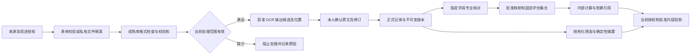
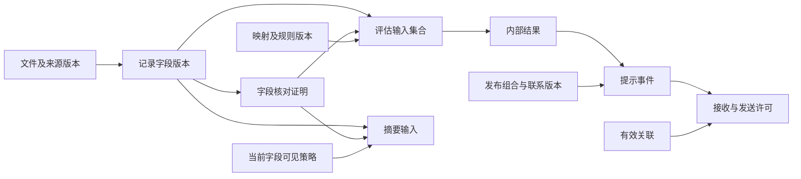
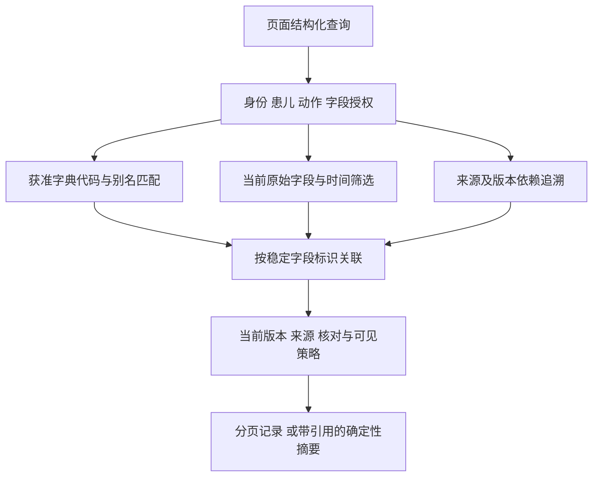

# sJIA 合并 MAS 预警平台数据详细设计（LLD-DATA）

日期：2026-10-07。版本：DATA V2.0。模式：`DESIGN / MIGRATION / CONTINUOUS_DELIVERY`。文档状态：`DRAFT`。设计责任：S005-1；业务及临床确认人尚未指定。新增物理结构见 v2-schema.sql，完整字段、事务及迁移规范见第 4.10 节；数据服务、真实样本与临床功能分别验收。

## 1. 架构上下文与前置资产映射

### 1.1 依据、范围与维护责任

| 依据 | 当前版本或检查位置 | 本设计承接内容 |
| --- | --- | --- |
| [PRD](./sJIA合并MAS预警平台PRD.md) | V2.0.0；第 7—13 节 | FR-01—FR-22、FD-01—FD-71、D01—D10、BR、UM、AC、NFR |
| [HLD](./sJIA合并MAS预警平台HLD.md) | V2.0；第 3—6、8—9 节 | PostgreSQL、Django ORM、私有对象、Celery、Redis、档案、用途、事务与 epoch |
| [产品目标](./sJIA合并MAS预警平台产品目标.md) | 第 2—7 节 | 家庭使用、独立关联、就医沟通与临床内容批准 |
| [需求输入](./sJIA合并MAS预警平台需求输入.md) | 第 3—8 节 | 症状、检验、治疗背景及来源；医学规则继续引用 PRD |
| [报告页面](./guardian-h5/src/features/registration/ReportsPage.tsx) | 本次读取源码 | 多项目报告、项目独立采样时间、原比较符、方法及参考区间 |
| [保存状态](./guardian-h5/src/components/SaveActions.tsx) | 本次读取源码 | 保存结果未知、请求查询、冲突、服务器确认时间 |
| [字典组件](./guardian-h5/src/components/DictionaryField.tsx) | 本次读取源码 | `id / label / aliases / version`；未接入字典时保留原文 |

当前项目已有正式家庭 H5、Django ORM、sjia_dev 数据库、Ark 与本地语音。T34 已读取实际运行身份及既有资料数量；数量不证明独立临床样本、当前用途或核对资格。现有病例原文及 PNG 按原有本地许可管理。当前维护数据语义、实体、字段、索引、来源与生命周期；API、HTTP 和 Serializer 归 T36，组件适配归 T38，固定识别及评估编排归 T37。自主 Agent 与 RAG 不属于当前业务路径。

本文件和 [SQL Schema](./data-design/schema.sql) 共同维护物理设计；[JSON Schema](./data-design/dataset.schema.json) 维护受控交换格式。SQL 中跨表当前资格、字段权限、状态转换及不可变要求由第 4.8 节的领域事务执行，DDL 检查通过不能证明这些服务已经实现。Django migrations 在实施时成为数据库变更执行入口，不能与本 SQL 分别修改同一生产数据库。

用户病例的逐项字段与数据库设计见 [病例数据与数据库设计](./data-design/病例demo数据库覆盖核查.md)。[基础结构](./data-design/schema.sql) 与 [病例领域结构](./data-design/case-schema.sql) 依次执行，共 82 张表；患者资料、月份范围、临床陈述、治疗事件、影像关联、外部量表、随访、动态评估及版本原件清单均有明确结构。病例查询 Q13–Q23 见 [case-queries.sql](./data-design/case-queries.sql)，评估与原件查询 Q24—Q27 见 [queries.sql](./data-design/queries.sql)。六项评估结构、复合引用、周期防重、来源约束及迁移要求见 [跨层接口接收规范](./backend-design/handshake.md) 第 7 节，SQL 由 S005-1 维护。

### 1.2 数据设计决定

| ID | 决定、依据与权限来源 | 状态及重新评估条件 | 接收任务 |
| --- | --- | --- | --- |
| DATA-001 | 承接 HLD 的 PostgreSQL 17 与私有对象存储；关系、关键词和依赖关系由 PostgreSQL 承载 | `PROPOSED / INFERRED`；D01 或实际容量改变时交 S004 复核 | S005-2、S011 |
| DATA-002 | 单个使用单位独立部署；每个患儿域对象带 `patient_id`，复合外键约束归属 | `PROPOSED / INFERRED`；多机构共享需要机构归属、唯一键与权限设计，当前不开启 | S005-2、S010 |
| DATA-003 | 原始事实不可变，当前指针与核对证明独立；映射与内部结果单独版本化 | `PROPOSED / INFERRED`；PRD FR-08、FR-10、NFR-02—NFR-04 | S005-2、S009 |
| DATA-004 | 首期按字段和获准字典查询，维护依赖图；向量召回、医学知识图谱推理、重排器不进入当前运行路径 | `PROPOSED / INFERRED`；PRD 第 9 节。新增获准检索需求时补充语料许可和评测 | S004、S005-3 |
| DATA-005 | 字段使用十进制字符串交换、有限 `numeric` 存储；医学时间保存原文、精度、当地时间、时区与可用瞬时值 | `PROPOSED / INFERRED`；PRD FD-18、FD-19、FD-28、NFR-03 | S005-2、S005-4 |

`PROPOSED` 表示本次设计建议，未改变 HLD 的 ADR 状态或临床批准记录。用户授权依据已有文档完成设计；D01—D09 的确认责任继续由 PRD 第 7.2 节维护。

### 1.3 未知条件及影响范围

| 依赖 | 必要输入 | 受影响操作 | 当前状态 |
| --- | --- | --- | --- |
| D01、D02 | 使用单位、环境、认证方式、真实关联证明及多人权限 | 正式部署、身份接入、真实关系授予 | `NEEDS_INPUT` |
| D03 | 项目清单、字段限制、Provider、核对人员与证据范围 | 上传、OCR、专业核对启用 | `NEEDS_INPUT` |
| D04、D07 | 评估窗口、重复选值、精度处理、单位和方法映射 | 患者级分类、MS、可比较趋势 | `NEEDS_INPUT` |
| D05、D06 | 触发规则、字段可见表、准确文字、渠道及发送边界 | 提示创建、家庭临床内容与通知 | `NEEDS_INPUT` |
| D08 | 获准中文原报告、用途、脱敏检查、独立答案 | 病例样本、OCR 和规则联调 | `BLOCKED` |
| D09 | 各类保存期限、处置责任、供应商删除范围、有效联系 | 接收真实资料、清理执行、联系发布 | `NEEDS_INPUT` |

### 1.4 业务覆盖与查询出口

| 需求 | 数据产出与使用出口 | 验收 |
| --- | --- | --- |
| FR-01 | 身份、申请、独立关联及授权；Q01 | QA01 |
| FR-02 | 观察、报告、治疗、原件、候选及服务端草稿；Q02、Q09 | QA02、QA09 |
| FR-03 | 当前字段、医学时间、来源及可比较关系；Q02、Q03 | QA03 |
| FR-04 | 分类评估集合、核对、逐条件结果；Q04、Q05 | QA04 |
| FR-05 | MS 固定输入、逐项贡献、总分及不足原因；Q05 | QA04 |
| FR-06 | 批准配置、真实验证证据及发布组合；Q01、Q08 | QA06 |
| FR-07 | 提示、接收关系、发送回执及阅读；Q08 | QA07 |
| FR-08 | 更正版本、字段核对当前状态、依赖失效；Q11 | QA05 |
| FR-09 | 来源用途、权限、审计及处置；全部查询 | QA01、QA11 |
| FR-10 | 核对申请、逐字段结果、准确证明与撤销；Q04 | QA04、QA05 |
| FR-11 | 固定引用摘要、有效联系；Q07、Q08 | QA08 |
| FR-12 | 字段可见范围、准确文字、批准和生效版本；全部家庭查询 | QA06 |

## 2. 真实数据寻源与采集矩阵

### 2.1 来源登记与许可

本次执行本地设计资料审查。项目文档用于需求追溯与格式验证，用户当前指令允许在本项目内处理这些资料；公开转载许可未知。没有采集临床全文、没有导入医院数据、没有将文献网址的存在视为下载或再分发许可。

| source_id | 来源、所有者与版本 | 目的、获取方式及格式 | 许可、敏感级别与更新 | 准入状态 |
| --- | --- | --- | --- | --- |
| SRC-PRD | 项目 PRD V2.0.0；所有者为项目提供方，具体主体待登记 | 本地只读 Markdown；需求和数据语义追溯 | 本项目设计用途；`project_internal`；文档修订时按 SHA-256 更新 | 本地内容已读；不作为临床样本 |
| SRC-HLD | 项目 HLD V2.0；项目提供方 | 本地只读 Markdown；组件及生命周期依据 | 本项目设计用途；`project_internal`；随架构修订更新 | 本地内容已读 |
| SRC-DEMO | 用户提供病例文章与四张 PNG；数据版本 2026-09-30.2 | 本地保存原始字节、人工转录结构化资料及原文引用 | 用户授权本地开发、展示和数据库核查；公开再分发依据未建立 | `LOCAL_DEMO_AVAILABLE`；临床核对与规则验收未完成 |
| SRC-REPORT | 监护人提供的获准中文报告或处方；所有者及版本待 D08 | 私有上传；逐页保留原字节、校验和和 OCR 来源 | `clinical_restricted`；D03、D08、D09 待确认；按提交更新 | `BLOCKED`；没有获准原件 |
| SRC-OBS | 获准家庭观察及确认的语音文字；来源主体为记录人 | 结构化表单；确认文字纳入记录；不保存录音 | `clinical_restricted`；用途、保留与浏览器处理范围待确认 | `BLOCKED`；没有真实账号及观察 |
| SRC-CLINICAL | 分配给核对人的获准临床资料 | 受控录入专业变量及来源文件；逐版本核对 | 病例级用途授权；D03、D08；按资料修订更新 | `BLOCKED` |
| SRC-DICTIONARY | D07 数据提供方批准的项目、单位、别名与方法映射 | 受控 JSON 导入；来源名称保持原文 | 许可、版本、校验和与适用机构必须齐全；更新频率待负责人确认 | `BLOCKED`；PRD UM 表仅作配置需求 |
| SRC-RULE | PRD 第 8.14—8.16 节指向的规则、内容与可见范围 | 经批准版本形成配置；文献证据引用与临床批准分开 | 配置用途、正文许可和批准证据分别登记 | 设计依据可用；运行配置未批准 |
| SRC-CONTACT | D09 指定维护人的联系信息 | 受控表单，来源、有效期与批准记录 | `restricted_contact`；每次维护形成新版本 | `BLOCKED`；没有可发布内容 |

医学来源沿用 PRD 的文献引用，本次没有重新查证文献全文、许可或更新状态，没有形成可供检索的医学语料。若启动实际采集，逐来源登记 `owner / location / purpose / license / allowed_use / sensitivity / update_frequency / version / checksum / retention / status`，由权利依据控制下载、解析、索引、展示和再分发各项动作；任一必要依据未知即停止对应动作。

### 2.2 采集身份与去重

`source_registry` 表示持续来源，`source_revision` 表示不可变版本。登记资料及附件引用准确 `source_revision_id`。外部报告标识只在来源命名空间和患儿范围内比较；同名报告与相同字节均不能自动合并为同一次采样。

上传按 `request_id` 识别同一业务请求，文件按 `sha256 + size_bytes` 检查完整性。跨患儿不共享可见文件对象，不返回是否已经存在其他患儿相同文件的信息。同一报告的重新拍照保存新文件组版本；只有获准来源证明报告一致时建立 `replaces_report_id`，不通过 OCR 相似度自动建立关系。

获准字典批量导入记录输入清单、准确版本、校验和、行级来源、未匹配条目、冲突原因及审核人。重复导入相同来源版本和相同摘要返回同一导入记录；相同版本携带不同内容立即拒绝。

## 3. 数据清洗与加工流水线

### 3.1 数据流与失败位置

| 阶段 | 输入与输出 | 校验及幂等 | 失败、重试、隔离与责任 |
| --- | --- | --- | --- |
| P01 接收 | 来源、用途、主体、患儿 → `ingestion_run` | 当前身份、许可、保留配置、请求载荷摘要 | 缺少依据立即拒绝；资料服务记录错误元数据 |
| P02 文件验证 | 隔离对象 → 可用 `file_object` 与页清单 | 字节摘要、格式、尺寸、页数、解码及获准限制 | 保留 `failed` 原因；不进入 OCR；用户按获准预算重新上传 |
| P03 外部处理准入 | 文件及用途范围 → 限定 Provider 请求 | Provider 配置、地区、保存政策及当前授权；固定输入版本 | 不符合允许范围即 `blocked`；不自动更换 Provider |
| P04 识别 | 固定页组 → `candidate_set / candidate_field / source_anchor` | 输出 Schema、页 ID、原文、坐标及版本 | 明确失败为 `failed`；受理未知为 `uncertain`，查询确认前不重复调用 |
| P05 本人确认 | OCR 候选及本人修订 → `candidate_confirmation` | 本人身份、候选版本、患儿及每项采用情况 | 缺少字段保持未知；候选变化则冲突；原候选不覆盖 |
| P06 正式保存 | 已确认内容或手动输入 → `record_version / record_field` | 识别身份必需、质量原因、草稿版本；同请求唯一效果 | 同事务记录、草稿、请求结果与审计；错误即时返回 |
| P07 专业核对 | 当前字段、来源证据 → `verification / verification_field` | 岗位、病例范围、用途、字段和当前版本 | 未确认、需补正及无法确定分别记录；不补充专业结论 |
| P08 标准化 | 有效映射及原值 → `normalized_measurement` | 项目、来源、方法、单位、精度及映射生效资格 | 保留原文；映射未匹配记录原因，无标准值 |
| P09 计算与摘要 | 固定字段引用和资格 → `assessment / summary` | 输入版本、核对、epoch、租约与发布依赖 | 更改后提交记 `superseded`；明确错误不返回旧成功结果 |
| P10 发布与处置 | 有效依赖及批准范围 → 家庭投影或删除回执 | 每次查询、发送及清理重新核验 | 缺少资格停止受影响路径；分别登记供应商、对象及备份状态 |

全部阶段记录开始、结束、输入版本、输出标识、错误码、尝试次数、处理配置与责任模块。日志仅含必要标识与状态；正文和原图处于受限存储。外部副作用恢复遵循 HLD 第 5.4 节，不执行无上限自动重试。

### 3.2 隐私、格式与内容处理

原始医疗资料保留原字节，去标识化副本通过独立 `file_object` 关联原件及处理记录。姓名、证件、地址、条码和图像中的文字均属于检查范围；正则、NER 和人工核验不能单独证明隐私信息完全清除。临床验收资料必须具有逐项检查记录、用途及获准环境，未经检查的副本不能标为可公开。

照片使用 HLD 指定 Pillow 完成格式检查，OCR 使用获准 Provider。首期没有 PDF 采集需求，因此 MinerU 及 PDF Layout 解析为 `NOT_APPLICABLE`；新增 PDF 需求时须确认来源、格式、布局模型版本、表格单元格位置与实际中文复杂报告验收，不能将照片识别直接登记为 PDF 解析通过。

语音仅把本人确认后的文字、`capture_method=voice_confirmed` 和确认时间保存为自报来源。取消或未确认的语音文字不进入正式记录；平台不保存录音。浏览器处理依据由 D03、D08 确认。

不删除原文中的比较符、计量单位、大小写、负号或检测限。去除空白、Unicode 归一化仅用于搜索键或格式检查，原字段另外保留。单位候选唯一匹配仍需生效映射；未知数值、无效输入、零值和未观察到均保持不同含义。

### 3.3 医学时间与十进制

`medical_time` 使用 `precision=unknown/year/month/month_range/relative/date/minute/second`，保存 `raw_text`、独立年月与区间末尾年月、`relative_text`、`local_date`、`local_datetime`、`timezone_name`、`utc_offset_minutes`、`instant` 和 `resolution_status`。月份不构造月份第一日；相对描述不推算日期。只有时区及必要精度成立时才形成 `instant`。仅日期资料保持日期，不构造午夜采样时间；时区未知时不能沿用服务器时区。夏令时重叠或不存在的当地时间保持待确认，使用成熟时区库检验。

系统 `recorded_at / created_at / saved_at / computed_at` 使用服务端 `timestamptz`。报告级采样时间只在原报告明确适用于该项目时作为项目来源；`sample_time_origin=report/item/unknown` 保存采用依据。项目独立采样时间优先表达项目事实，不能从出具时间或登记时间补齐。

原值文字与有限 `numeric` 同存；未知或格式无效时数值为空，并带 `value_state`。跨 API 和数据集的 decimal 使用字符串，禁止 JavaScript 浮点参与规则或单位计算。数据库 `numeric` 不指定会自动舍入的固定小数位；位数与输入长度由获准配置检查。`NaN / Infinity / -Infinity` 明确拒绝。计算系数、单位换算及显示精度继续引用 PRD 第 8.14—8.15 节和批准配置，文档不复制医学公式。

## 4. 四类存储职责、Schema 与分块策略

### 4.1 存储决策与访问模式

| 数据职责及访问模式 | 一致性与延迟 | 规模、增长及运维 | 承载方式与依据 |
| --- | --- | --- | --- |
| 关系事实：保存、核对、版本、发布、摘要 | 同一事务；性能目标待 D01 | 实际患儿数和记录量未知；须测量索引与备份 | PostgreSQL 17；HLD C08 |
| 原件和 OCR 原始响应 | 数据库可用清单与对象校验和一致；读取重新授权 | 日增字节、版本、派生对象及保留周期待确认 | 私有 S3 API；仅 API 代理读取 |
| 关键词：项目名、缩写、获准别名、结构化筛选 | 读取当前批准字典，明确空结果 | 字典数量、真实查询分布待取得 | PostgreSQL B-tree 精确匹配与有界字典过滤；不需要独立搜索服务 |
| 关系图：记录、证据、结果、内容的依赖追溯 | 关系边与业务写入同事务；即时失效 | 深度由对象类型规定；评估后再确定容量预算 | PostgreSQL 外键和依赖边；不运行医学因果推理 |
| 向量：语义召回 | 当前无获准业务查询 | 缺少获准语料、模型版本和评测 | `NOT_APPLICABLE`；不建 embedding 表或向量索引 |
| 待执行消息 | 允许重复投递；数据库提供幂等与当前资格 | 队列等待及租约监测 | Redis Broker；消息仅携带任务及事件标识 |

当前不按未知数据量预设分区。`record_version` 以患儿和时间索引满足查询；审计及 Outbox 按时间清理。采用分区前须取得真实增长、保留及查询计划，并验证全局唯一键、复合外键与分区处置；不能直接按月份分区后削弱版本唯一性。

### 4.2 标识、所有权与公共约束

1. 服务端生成 UUID，版本使用递增整数；显示标识不参与授权。`patient_id` 创建后不可更改，新的患儿归属需要独立记录与获准来源。
2. 每个患儿域父表提供 `(id, patient_id)` 唯一键，子表复合外键引用它；字段再引用 `(field_id, record_version_id, patient_id)`，防止核对及评估使用其他版本或患儿的字段。
3. 原始版本及已经批准的配置内容仅允许新增；当前状态、撤销时间、epoch 与当前指针由指定领域操作更新。API、OCR、计算、通知、审计和迁移账号分别授权。
4. 核对状态按字段投影。部分字段已核对时返回 `verification_coverage=partial`，不把整份报告标为全部已核对；PRD 的状态字段保留，覆盖率另外表达。
5. 资格检查使用当前权威状态，`validity=valid` 仅是存储标记。实际有效性要求全部依赖及时间条件同时满足；待处理的后台失效任务不能成为继续显示的依据。
6. `jsonb` 仅保存受版本 Schema 约束的载荷、错误原因及不可变快照；患儿归属、引用、比较值、版本、状态和查询键均为独立列。禁止把全部临床记录保存在无类型 JSON 中。

### 4.3 实体、字段及生命周期

物理列、类型、非空、主键、唯一键及可由数据库执行的约束见 [schema.sql](./data-design/schema.sql)。表中 `?` 表示可空；所有 JSON 文本必须经过对应版本的输入 Schema 验证。敏感类别与保留分类是实体属性；实际保留期限统一引用 `retention_policy`，不预填天数。

| 实体组 | 关键字段与来源 | 所有者、使用方及生命周期 |
| --- | --- | --- |
| `principal / principal_identity` | 账号状态、`auth_epoch`、Provider subject；身份来源命名空间唯一 | 身份模块创建；Session、关联与每次请求读取；停用影响全部后续请求 |
| `patient / relation_application / relation / access_grant` | 显示标识、患儿 epoch、申请证据、独立动作及字段授权、有效期 | 身份核验创建关联；家庭与支持权限分别检查；撤销保留历史 |
| `source_registry / source_revision / data_use_authorization` | 所有者、许可、用途、版本、摘要、患儿及用途范围、脱敏依据 | 资料管理创建；采集、处理、展示检查；依据失效禁止继续使用 |
| `retention_policy / config_version / config_approval` | 保存规则、不可变配置、批准主体、证据、范围及撤销 | 责任人批准；运行前核验；内容更改创建新版本，批准不自动启用 |
| `dictionary_entry / dictionary_alias / unit_mapping` | 获准代码、别名、来源、单位、方法、比例与加数 | 数据管理创建；表单匹配与标准化读取；映射独立于临床核对 |
| `draft / write_request` | 本人、患儿、表单、payload、版本、保存及到期、载荷摘要、资源引用 | 家庭编辑；本人恢复；提交、放弃、到期终止，草稿没有临床资格 |
| `file_group / file_object / file_page` | 患儿、组版本、页序、字节摘要、对象版本、格式、处理状态及派生关系 | 文件服务创建；OCR、原图代理及核对读取；处置遍历全部对象版本 |
| `candidate_set / source_anchor / candidate_field / candidate_confirmation` | Provider、模型、Schema、原始响应、页内矩形、原文及本人修订 | OCR 只写候选；本人确认不改变专业资格；文件更换使旧候选失效 |
| `medical_time / report / record / record_version / record_field` | 原报告 ID、原字段、时间、来源、作者、质量状态、原值、比较符、单位、项目、方法、参考区间 | 资料服务创建；时间轴、核对及摘要读取；新版本不能继承原核对 |
| `patient_profile_version / clinical_episode / clinical_statement / statement_evidence` | 原文年龄、参考时间、就诊阶段、症状、诊断与鉴别状态、证据字段 | 资料服务创建；专业病例与获准家庭投影读取；继承准确 record version 的来源、用途和保留政策 |
| `record_field_group / record_field_group_member` | 检查类型、标本、方法、原文引文及同版本成员 | 实验室、生命体征与病原学查询；原值继续由 record_field 保存 |
| `imaging_study / imaging_study_site / imaging_asset_link` | 检查方式、多个部位、增强方式、检查时间及文件关联证据 | 报告详情与原图代理；关联待确认时 study_id 为空 |
| `medication_event / medication_event_item / procedure_event` | 治疗动作、药物、剂量、单位、浓度、频次、途径、关联事件和非药物处理 | 治疗记录与随访读取；原文当前用药使用独立 ongoing 事件 |
| `external_score_observation / external_score_component` | 外部量表名称、版本、总分字段与分项字段 | SJADAS 来源表展示；外部评分与内部 assessment 分别管理 |
| `followup_encounter / followup_reference / data_quality_issue / data_quality_issue_reference` | 随访时间、症状、复查、评分和治疗关系；多来源问题与解决证据 | 随访详情、资料核对；引用目标逐项验证当前用途、版本和权限 |
| `verification / verification_field` | 核对人、字段、版本、结果、证据、策略、用途、撤销原因 | 指定核对人创建；计算资格检查逐字段读取；撤销同步提高 epoch |
| `verification_request / field_verification_state` | 指定版本的核对申请、任务分配、字段用途、当前核对指针与状态版本 | 核对流程创建；每项用途只有一个当前状态；撤销不自动采用以前的核对证明 |
| `normalized_measurement` | 原字段、映射版本、标准值、标准单位、标准化时间 | 确定性服务产生；趋势及规则读取；映射停用后不再采用 |
| `assessment / assessment_input / assessment_output` | 类型、时点、固定输入、核对、映射、规则与策略、epoch、缺项、贡献及结果 | 规则服务创建；内部核查及家庭投影读取；失效保留原快照 |
| `release_bundle / release_component / contact_version` | 环境、准确规则与文字、可见策略、联系、验证证据及启用状态 | 批准与发布分别执行；家庭读取和发送检查当前有效期 |
| `alert_event / alert_recipient / notification_attempt / notification_receipt` | 触发标识、输入、发布、关系、渠道、发送许可、Provider 回执、阅读 | 提示与通知服务创建；每名接收人独立；实际阅读不改变临床结果 |
| `alert_evaluation / alert_evaluation_input / alert_evaluation_assessment / alert_signal_result` | 准确上下文、用途、全部 epoch、多时点输入、专业 assessment 引用与每对计算证据 | task_id 唯一；同患儿复合引用；零个或多个 assessment；unknown 保留原因 |
| `alert_episode / alert_decision` | 规则族持续周期、评估时序、采用动作及全部决议 | 同规则族至多一个 open；评估/规则唯一；重复消费不增加 sequence |
| `record_attachment` | record_version_id、patient_id、file_id、ordinal | 每个不可变记录版本保存完整有序原件；家庭投影明确完整性 |
| `summary / summary_item` | 范围、请求者、模板、可见策略、输入字段及版本、生成时间、epoch | 确定性摘要任务创建；重新鉴权后读取；新增或更正使摘要需重新生成 |
| `task / task_attempt / outbox_event / consumer_receipt` | 固定任务输入、Schema、租约、尝试、事件身份及消费唯一键 | Dispatcher、Worker 使用；终态及副作用事实不被普通重投覆盖 |
| `dependency_node / dependency_edge` | 注册对象、准确版本、患儿或全局范围、依赖种类、当前有效性 | 领域事务创建；失效分析与追溯读取；外键禁止悬空边 |

contact_version 的未核验草稿使用 `verified_at=NULL`。`approved` 与 `active` 状态必须具有准确核验时间，由 `contact_verified_state_requires_time` 约束保证；停用记录保留原有核验时间。联系批准配置采用 `content/contact-1`，完整固定联系标识、名称、用途、渠道、渠道值、维护主体、运行环境、来源版本和有效期。保存只形成草稿；启用操作验证该准确内容、配置批准及环境验证后记录核验时间。现有资料原值保持，结构变更由 `contacts/0003_contact_verification` 实施。
| `audit_event / product_event / disposition_request / disposition_item` | 主体、动作、结果、对象、时间、处置依据与逐对象回执 | 审计、统计、资料管理分别授权；不记录病例全文 |

临床实体及原图分类为 `clinical_restricted`，身份与关联证明为 `identity_restricted`，联系为 `restricted_contact`，审计及任务为 `operations_restricted`；源文档样本为 `project_internal`。每类创建时核对适用 `retention_policy_id`。运行数据库中不得以 SQL 的可空字段代替真实资料接收前的保留政策准入。

每个字段和用途以 `field_verification_state` 保存当前状态，历史证明通过 `verification_field` 保留。新核对、需补正和撤销都在同事务更新该指针及 `verification_epoch`；资格查询要求当前指针明确指向有效且一致的证明。核对申请使所选字段进入待核对，未配置流程时不创建已受理申请；更正后的新字段从未核对开始。用于临床适用判断的用途必须在获准策略中声明，不能沿用其他用途的证明。

### 4.4 产品字段传播表

`record_field` 表达一个有稳定身份的原始字段；数值、枚举、文字及医学时间分别使用类型列。检验项目使用 `field_code=lab_result`，`concept_code` 区分指标；扩展项目经批准字典登记。单个版本允许同项目多次测量，以 `field_id / ordinal` 区分，不能通过代码唯一约束合并实际多条结果。

| PRD 字段 | 权威表或查询字段 | 创建与读取、实际使用方 | 转换与验收 |
| --- | --- | --- | --- |
| FD-01、FD-02 | `principal.account_status / patient.display_id` | 身份流程 → `PageFrame` 与患儿切换 | 主体从会话取得；AC-01 |
| FD-03、FD-04、FD-05 | `relation_application / relation / access_grant` | 核验支持 → 全部家庭与支持查询 | 申请不授予访问；独立 action 与字段范围；AC-01、AC-09 |
| FD-06、FD-07 | `record_field.field_code` 为 `reported_sjia_status / verified_sjia_status` | 家庭自报或获准专业资料 → 资格服务 | 保存不同字段和来源；AC-04、AC-10 |
| FD-08、FD-09 | 症状或测量字段的 `concept_code / categorical_value / raw_numeric / raw_unit / medical_time_id / method` | `ObservationsPage` → 时间轴 | 无观察与未知分别编码；AC-02、AC-03 |
| FD-10、FD-11、FD-12、FD-13、FD-14 | 专业字段 `field_code / categorical_value / medical_time_id` 及 `verification_field` | 指定支持流程 → 评估集合 | 家庭写入拒绝；核对后产生计算资格；AC-04、AC-05、AC-10 |
| FD-15、FD-16 | `report.external_ref / record_version.source_revision_id / origin_type / source_organization` | `ReportsPage` → 原图与详情 | 未提供来源保持未知；AC-02 |
| FD-17、FD-18 | `concept_code / original_name / raw_text / raw_numeric / qualifier / raw_unit` | `ReportsPage`、`DictionaryField` → 趋势与规则 | 原文始终保留；decimal 字符串；AC-02、AC-H5-02 |
| FD-19、FD-20 | `medical_time / report.result_time_id / recorded_at / report_status / method / reference_interval` | 逐项目来源 → 时间轴和原报告 | 不以登记时间填采样；AC-03 |
| FD-21、FD-22、FD-23、FD-24、FD-25、FD-26 | `record_field.concept_code` 对应 PRD 六项指标 | 检验字段 → 评估选择器 | 代码语义引用 PRD，正式代码清单需批准；AC-04、AC-05 |
| FD-27、FD-28 | 扩展 `dictionary_entry`；`normalized_measurement` | 项目匹配与确定性映射 → 历次检验及规则 | FEU/DDU、比例/绝对值分别匹配；AC-02、AC-03 |
| FD-29、FD-30 | `quality_status / quality_reasons`；核对查询投影 | 格式服务及核对人 → 详情与计算资格 | 格式状态、来源、核对覆盖各自独立；AC-10 |
| FD-31、FD-32 | `record.current_version / record_version.version / supersedes_version / author_id / correction_reason` | 资料更正 → 历史与失效服务 | 当前版本条件更新；AC-08 |
| FD-33、FD-34 | 治疗字段代码、原药名、专业类别、开始与结束时间、`therapy_status` | `TherapiesPage` → 治疗背景与摘要 | 结束为空不推断持续；AC-02、AC-05 |
| FD-35、FD-36、FD-37 | `verification / verification_field` | 指定核对人 → 资格与失效查询 | 字段及版本复合外键；AC-10 |
| FD-38、FD-39 | `assessment / assessment_input` | 服务端选值 → 内部核查 | 固定策略与逐项不足原因；AC-04、AC-05 |
| FD-40、FD-41、FD-42、FD-43 | `config_version / assessment_output / computation_status / validity` | 规则处理 → 授权内部查询 | 资格不足无完整总分；家庭默认不返回；AC-04、AC-05、AC-12 |
| FD-44、FD-45、FD-46 | `config_version / config_approval / release_component` | 临床及项目批准 → 每个家庭响应 | 字段允许表与准确文字绑定版本；AC-12 |
| FD-47、FD-48、FD-49 | `alert_event / alert_recipient / notification_attempt / notification_receipt` | 已启用提示服务 → `AlertsPage` 与阅读动作 | 显示、发送、送达、阅读独立；AC-06、AC-07 |
| FD-50 | `summary / summary_item` | 结构化模板 → `SummariesPage` | 固定引用，读取用当前策略；AC-11 |
| FD-51、FD-52 | `contact_version / config_approval` | 指定维护人 → 联系入口 | 当前有效期和批准共同检查；AC-07、AC-11 |
| FD-53、FD-54、FD-55 | `data_use_authorization / audit_event / retention_policy / disposition_request` | 资料管理与审计 → 使用和处置检查 | 取消关系不等于删除；AC-09 |
| FD-56、FD-57 | `write_request / draft` | `FormActions / DraftState` → 提交与恢复 | DTO `confirmedAt` 来自 `saved_at`；AC-H5-03、AC-H5-04 |

原始字段已经具有 ORM、API 和家庭页面入口，实际范围见 T34 的接收清单。T36 维护字段选择、权限投影、空值和错误，T38 接收类型及枚举。FD-58—FD-71 的数据规范见第 4.10 节，其实现与真实回读由 T39—T59 验收；字段名称存在不能代替字段传播验收。

### 4.5 关键词职责与分块

获准字典的精确代码和别名采用 `(dictionary_version_id, normalized_alias)` 索引；别名允许指向多个候选，返回歧义状态，不自动选取。中文名称采用获准字典的完整名称和别名匹配。H5 当前 `includes` 过滤可用于已经取得的有界获准列表，不能在浏览器下载全部病例后过滤。查询长度、列表容量和服务端有界包含查询的启用参数由 S005-2 配置，实际负载由 S009 测量。

原报告的最小引用单位为页、原文位置和字段。`source_anchor` 保存文件字节摘要对应的页、原文、定位方式及坐标；原报告表格保存行列标识和单元格位置，不能将标题、单位与结果错误归组。`anchor_kind=page` 表示只能定位整页，`bbox=null`；无法定位时明确记录证据不足，不制造矩形。坐标以未经 UI 缩放的解码图像为参照，保存宽高、旋转及坐标系；矩形必须在边界内。

当前没有面向模型上下文的 Chunking，也没有 `800/150` 等分块参数。资料按真实报告和字段保存完整关系；本地设计样本按 Markdown 章节形成引用，属于文档结构验证。新增获准语义检索时，分块须保存 `chunk_id / document_version / source_anchor / section_path / language / rights / checksum / index_version`，通过真实语料决定 Token 预算、重叠与表格边界，当前不登记未运行的参数。

### 4.6 图关系与依赖有效性

`dependency_edge` 方向为 `dependent → prerequisite`，`edge_type` 限定 `source / verification / mapping / policy / input / publication / contact`。领域服务只允许设计中的对象类型连接，禁止循环和跨患儿连接；全局规则节点可被多个患儿依赖。节点类型、真实对象存在性及准确版本由同事务注册检查，边表不能替代实际实体外键。反向索引 `(prerequisite_id, dependent_id)` 用于失效查找；需要多级追溯时采用有类型边界、去重和循环检测的递归查询。

PostgreSQL 中的依赖图用于来源及有效性追溯。医学实体、药物禁忌及因果推理没有首期批准需求，Neo4j 和 Cypher 执行属于 `NOT_APPLICABLE`。因此当前 SQL 是图关系的可执行 Schema，不另交付无法运行的 Cypher 表结构。未来获准 GraphRAG 必须保留断言来源、审核、方向、适用条件、否定语义及删除传播，并取得独立临床评测。

### 4.7 实际查询要求

| 查询 ID | 入口及输入 | 数据选择、索引及返回要求 | 无结果或失效语义 |
| --- | --- | --- | --- |
| Q01 | 首页；认证主体与当前患儿 | `principal → relation → access_grant → patient`；再查询当前发布与提示；分别返回服务状态、处理状态和当前事件 | 没有有效关联即拒绝；服务未启用与无当前事件分别表达 |
| Q02 | 记录时间轴；患儿、时间范围、种类及游标 | 当前 `record_version`，发生或采样 `medical_time`；精确时间与日期精度分组，未知时间独立分组；索引 `record(patient_id,kind)` 与字段时间索引 | 空记录保持空；不从登记时间构造事件顺序 |
| Q03 | 历次检验；患儿和获准 `concept_code` | `record_field + current_version + normalized_measurement`；返回双方原值、限定符、方法、映射、时间与核对覆盖 | 同时点冲突、未知单位、时间区间重叠及方法不匹配各自返回原因 |
| Q04 | 专业核对；准确记录版本及字段列表 | 复合外键、`access_grant`、原件可读性、当前版本；读取 `verification_field` 的有效状态 | 旧版本提交拒绝；未核对字段无计算资格 |
| Q05 | 固定评估集合；内部主体、时点与批准策略 | 当前字段、有效核对、适用时间及获准映射；由服务端决定选值并保存 `assessment_input` | 策略缺少为配置待确认；字段资格缺少为资料不足 |
| Q06 | 本人草稿及请求结果；主体、患儿、表单、请求 ID | `draft(owner_id,patient_id,form_type,status)` 与请求唯一键；重新核验病例权限 | 他人草稿拒绝；终止草稿不能再提交；未知请求不冒充失败 |
| Q07 | 家庭摘要；范围及摘要 ID | `summary_item` 固定引用、当前授权、可见策略、epoch；禁止直接返回内部快照 JSON | 无数据与任务失败分别表达；过期摘要标需重新生成 |
| Q08 | 提示详情、阅读与发送 | `alert_event → release_bundle → release_component → contact_version`，独立有效关联及接收记录 | 失效事件不作为当前提示；阅读唯一更新本人状态 |
| Q09 | 授权原图；文件 ID、版本及 Range | 从数据库清单取得私有对象键，校验归属、引用及授权，代理读取准确对象版本 | 文件不存在或摘要不符即证据不可用；不返回对象 URL |
| Q10 | 字典搜索；版本、类别、名称或代码 | `dictionary_entry / dictionary_alias` 当前获准版本；精确代码优先，多个候选保持歧义 | 未配置、无匹配及多匹配分别表达 |
| Q11 | 更正及撤销影响查询 | 真实引用外键、依赖图反向索引、患儿与发布 epoch | 后台遍历未完成仍由当前资格检查阻止旧内容 |
| Q12 | 来源、删除与恢复核验 | 来源版本、原件、候选、记录、结果、摘要、回执及处置项逐对象核对 | 任何对象或供应商未确认均保留未完成状态 |
| Q13–Q23 | 基本资料、检验组、外部评分、治疗、随访、影像、陈述、质量问题、就诊过程、非药物处理和附件 | `case_read_scope` 检查来源、用途、环境及整条记录权限；同患儿和同版本关联；SQL、索引及父实体分页要求见病例数据库设计 | 不自动提供家庭投影；未知日期、当前剂量和未确认影像关联保持原状态 |

列表采用稳定排序和键集分页。游标绑定主体、患儿、过滤摘要、排序、`data_epoch` 及最后排序键，由 S005-2 签名；资料版本改变返回游标过期，重新取得列表，不能继续拼接两个版本的页面。相同时间记录的 UUID 只用于稳定展示，不决定临床先后。

实际查询骨架见 [queries.sql](./data-design/queries.sql)。内部 QuerySet 必须先形成获准字段集合；数据库表上的数值筛选不能先采用未核对字段后再隐藏结果。查询计划使用获准真实数据执行 `EXPLAIN (ANALYZE, BUFFERS)`，当前无行数、p95 或扫描比例的通过结论。

### 4.8 事务、并发与幂等

统一锁顺序：环境及发布资格 → `patient` → `principal` 与关联／岗位授权 → 业务对象，同类多个 ID 排序获取。所有会影响对应资格的写入路径遵守同一顺序。读取在一个短的 `REPEATABLE READ` 事务中取得身份、关联、数据与策略，返回时点依据该一致性快照；撤销提交后开始的新请求必须读取撤销状态。多条独立 `READ COMMITTED` 查询不能共同充当同一家庭响应快照。

| 事务 ID | 锁定与前置条件 | 同事务写入 | 失败与并发结果 |
| --- | --- | --- | --- |
| TX01 正式提交 | 有效写入关联、本人草稿、`expected_version`、请求唯一键 | 当前记录与字段、来源引用、草稿已提交、request 资源引用、epoch、Task、Outbox、审计 | 相同键相同摘要重新鉴权后返回同一资源；不同摘要拒绝；草稿终态不可重复提交 |
| TX02 更正 | 有效更正授权、当前记录版本和更正原因 | 新不可变版本、当前指针、未核对初态、`data_epoch + 1`、相关结果失效、任务与审计 | 两个并发更正只接受当前版本条件成立的请求；历史值不覆盖 |
| TX03 核对或撤销 | 当前版本、分配字段、核对人权限、依据、策略 | 核对证明及字段结果或撤销事实、`verification_epoch + 1`、依赖失效与审计 | 核对与更正不能把旧证明附加到新字段；撤销理由必需 |
| TX04 关联或账号撤销 | 独立核验权限，关联或账号准确版本 | 状态及 `auth_epoch + 1`、任务取消请求、审计 | 每个新请求及任务采用当前授权；重新关联创建独立关系 |
| TX05 发布或停用 | 准确批准配置、适用环境、有效联系及真实验证证据 | 发布组合状态及 `publication_epoch + 1`、审计、必要任务 | 停用即时影响查询；不能依赖后台标记全部提示后才生效 |
| TX06 Worker 提交 | task 租约代次、固定输入、当前主体和全部依赖 | 结果、输入、依赖边、task 终态与 Outbox | epoch、版本或租约变化则 `superseded`；结果不能继续发布 |
| TX07 发送许可 | 当前事件、接收关系、发布、联系、渠道及预算 | 唯一发送许可、attempt ID、授权时间及有效期 | 已开始外部请求按 HLD 在途边界记录；受理未知先查询，不能重复发送 |
| TX08 删除处置 | 有效政策、批准范围及保留限制 | 处置申请、逐对象任务、业务不可用标志、epoch、审计 | 后续物理删除独立取得回执；关联撤销不触发未经批准的销毁 |

`write_request` 唯一作用域为 `(actor_id, action, target_key, request_id)`，输入采用受版本规则规范化后的摘要。请求登记、业务提交及结果引用同事务；请求处理中由数据库唯一键及锁串行化。事务失败后查询不到已提交记录时，S005-2 区分正在运行、明确未提交和未知状态；不把查询超时当作未提交。保留期不得短于允许请求查询及重试窗口。

Outbox 保存 `event_id / event_type / schema_version / aggregate_id / aggregate_version / occurred_at / causation_id / correlation_id / task_id`；业务事实和事件同事务。消息不含病例正文。Dispatcher 在事务内领取有期限的投递租约，事务外发送，成功标记采用租约代次条件；重复投递通过 `consumer_receipt(consumer,event_id)` 和业务效果唯一键处理。OCR 和通知的未知外部结果不能因租约过期而直接重新调用。

SQL 提供结构约束；不可变列禁止更改、批准主体职责分离、发布组成齐全、合法状态转移、权限投影、递归图检查及事务重试分类需要在领域服务实施，并交 S009 并发验证。发生错误时终止当前动作并明确返回，不以缓存、旧值或另一 Provider 生成成功结果。

### 4.9 迁移、删除传播与恢复

当前没有业务数据库可迁移。SQL 用于从空结构建立和审查，实际目标版本为 PostgreSQL 17；不能向已有未知数据库直接执行。Django migration 建立前登记数据库实例、schema、版本、对象存储及来源清单，确认是否确实空库；前端预览资料不属于可迁入的临床来源。

后续字段更名或存储迁移按增加兼容字段 → 获准源数据逐键迁移 → 核对字段内容与关联 → 切换写入和读取 → 通过业务查询验证后移除旧字段执行。每批保留起止键、来源摘要、目标摘要、未匹配原因和检查记录；并发写入使用迁移水位与版本条件，不覆盖更新后的记录。新旧 QuerySet、ORM、DTO、API、页面及任务都列入第 4.4 节传播检查。

执行前完成可恢复备份和配置快照，禁止迁移角色承担业务请求。失败时停止迁移和受影响写入；按获准恢复流程在隔离数据库恢复备份及增量日志，核对恢复点之后的真实提交后决定重新开放。不得删除备份后继续迁移，不执行 Git 恢复代码。

| 数据类别 | 处置条件及传播对象 | 完成证据 |
| --- | --- | --- |
| 身份与关系 | 账号、授权、证明、Session；关联取消与资料删除分别处理 | 后续访问拒绝；保留证明依据和期限独立确认 |
| 草稿与原件 | 草稿、全部页、原件及派生对象版本、未关联隔离文件 | 数据库不可用、对象版本删除回执、引用不存在或受批准保留 |
| OCR 与临床事实 | 候选、原始响应、Provider 副本、记录历史、核对、评估、摘要、提示 | 当前读取受阻；每个副本及历史的保留或删除结果可查 |
| 关键词与依赖图 | 字典或来源版本失效、依赖节点及相关查询 | 当前检索不再命中失效内容；历史仅在获准审计范围读取 |
| 发送与备份 | 已受理通知、备份、归档、灾备副本 | 无法立即删除的项目记录原因及到期日期；不登记全部完成 |
| 审计与幂等 | 处置事实、请求及消费记录 | 不早于批准期限及重试窗口删除；审计不保留病例全文 |

`disposition_item` 状态为 `pending / blocked / retained / deleted / failed / awaiting_provider`，每项绑定目标准确版本、政策、执行人、实际时间及回执摘要。`retained` 必须有有效保留依据和重新检查时间。全部必需项形成可接受终态后才可结束申请。备份恢复后先重放处置、撤权与发布停用登记，校验文件清单和引用，然后开放读取；RTO、RPO 与清理时间目标仍待 D01、D09。

### 4.10 PRD 2.0 逐事实、档案、用途与评价规范

[完整新增数据规范](./data-design/v2-data-specification.md)与 [v2-schema.sql](./data-design/v2-schema.sql)共同维护 FD-58—FD-71。该规范明确所有新增实体、生产与使用方、字段类型、约束、事务、数量、查询、用途副本、逐事实时间、current／replay、旧资料迁移和独立验收。旧字段规范继续有效；新增结构引用既有 RecordField、MedicalTime、Verification 和 SourceAnchor，保留原值与证明。

T35 使用独立空结构数据库校验完整 SQL 和实际约束，不导入病例。T39 统一创建 Django migrations，在获准隔离环境完成备份、迁移前后逐项比较、真实旧资料回读与恢复。D03、D04、D07 的窗口、核对和可比较条件未知时，完整模型继续实施，准确资格保持不足。

## 5. 查询组合、检索与引用规范

### 5.1 当前检索执行路径

三条路径分别提供项目身份、临床记录与证据关系，没有向量分数、BM25 分数或模型重排分数。关键词匹配不能改变医学字段，依赖关系不能产生新诊疗断言。查询次序和分组由业务语义决定，不执行无依据的跨通道加权。

### 5.2 多路混合检索适用性

| 机制 | 本次职责与 Schema | 配置、更新及验收 |
| --- | --- | --- |
| Dense 召回 | `NOT_APPLICABLE`；无获准自由文本问答和语义知识查询，无 embedding 产物 | 新需求须明确文档许可、模型及维度、版本、权限过滤和真实召回集 |
| Sparse／关键词 | 首期精确代码、名称和已批准别名；`dictionary_alias` 与结构化字段 | 配置版本发布后生效；停用立即影响查询；QA10 |
| Graph | 版本与来源依赖；`dependency_node / dependency_edge` | 同事务创建，逐边回查真实对象；撤销从反向索引定位；QA05 |
| Fusion | 使用 `(record_version_id, field_id)` 关联查询结果，保留全部相同项目的独立记录 | 重复页面项去重不能删除真实重复采样；QA03 |
| Reranker／Context 组装 | `NOT_APPLICABLE`；摘要为批准结构化模板 | 未来启用需真实标注集、模型版本、分数含义、阈值及证据不足路径 |

需要新增 RAG 时，S004 确认范围和组件，S005-1 增补文档及 chunk Schema，S005-3 定义引用与模型执行，S009 以合法实际语料验证 Recall@K、引用准确性、权限过滤与删除传播。当前不设 Top-K、权重、Token 预算或得分阈值，不宣称已完成混合语义召回。

### 5.3 来源引用与摘要边界

`SourceReference` 包含 `source_revision_id / record_version_id / field_id / file_id? / page_id? / anchor_id? / verification_ids / mapping_id?`。所有标识均回查当前授权，原文引用只能来自对应版本。`anchor_id` 缺少时不显示精确定位。当前没有 LLD-AGENT 的 `ContextReference`，故不声明与 Agent 接口已经通过一致性验收。

摘要保存字段 ID、版本、原值及文字模板来源，以准确引用重建展示。保存内部值的 summary_item 不直接序列化给家庭；当前 `visibility_policy` 逐字段投影。已发布摘要读取时检查当前授权和依赖，新增、补正、核对变更或政策变化导致需要重新生成；历史查看也不能返回当前禁止字段。摘要禁止自动补全未知变量、生成诊疗建议或把缺项描述为安全结论。

## 6. 数据集规范与实际交付物

### 6.1 交换结构

[dataset.schema.json](./data-design/dataset.schema.json) 使用 JSON Schema Draft 2020-12，分别定义项目文档样本和临床字段交换。所有对象禁止未声明字段；未知值显式为 `null` 并携带状态。decimal 为字符串，日期、UUID、SHA-256、枚举和来源引用均检查。它是数据层交换格式，生产 API 仍由 S005-2 按权限设计请求和响应。

临床交换覆盖来源清单、原始记录版本、报告元数据、字段、医学时间及准确引用；配置、账号、授权和核对证明通过受控数据库已有标识解析。导入程序必须验证全部引用确实存在、版本和患儿一致、用途仍然有效；交换文件中的许可或核对标识不授予权限。UUID 唯一性、`supersedes_version = version - 1`、原文字段和 decimal 一致性、日期有效性、IANA 时区和坐标边界在业务校验中检查；JSON Schema 的结构通过不替代这些跨字段及跨对象检查。

| 产物 | 完整性及使用限制 |
| --- | --- |
| [schema.sql](./data-design/schema.sql) | 全域物理结构与约束参考；无临床种子数据，无正式账户，无已批准规则 |
| [case-schema.sql](./data-design/case-schema.sql) | 18 张病例领域表、同患儿引用、版本关联、状态与证据约束 |
| [case-queries.sql](./data-design/case-queries.sql) | 11 条病例读取查询及当前用途权限范围函数 |
| [case-extension.schema.json](./data-design/case-extension.schema.json) | 正式临床交换 1.1.0 的病例领域结构 |
| [case-design-projection.json](./data-design/case-design-projection.json) | 实际 demo 向领域结构的确定性转换结果；生产身份、用途与临床核对未绑定 |
| [queries.sql](./data-design/queries.sql) | 时间轴字段、有效核对、请求结果与 Outbox 的参数化查询骨架；权威引用来自 SQL 表 |
| [dataset.schema.json](./data-design/dataset.schema.json) | 来源、真实文档样本、原始临床字段、时间及引用的机器校验格式 |
| [sample_dataset.json](./data-design/sample_dataset.json) | 实际本地 PRD/HLD 原文片段；`project_documentation`；用于来源、版本和结构校验 |
| [clinical-dataset-status.json](./data-design/clinical-dataset-status.json) | 用户病例 demo 已提供；独立临床参考答案、专业核对与正式导入依赖分别登记 |
| [当前病例 demo](./demo-data/README.md) | 原文、四张图片、完整结构化资料、独立预览及复用读取模块 |
| [病例覆盖核查](./data-design/病例demo数据库覆盖核查.md) | 现有字段能力、扩展设计、查询使用方及病例专属验收 |
| [验证脚本](./data-design/validate.py) | 通过成熟 Markdown、JSON Schema 与 PostgreSQL 工具验证产物；错误直接终止 |
| [验证记录](./data-design/validation-report.json) | 实际检查版本、命令、断言、输入摘要、运行范围及未运行验收 |

设计文档样本用于本项目设计检查，不能导入临床事实表或作为规则正确性、OCR 准确性及脱敏质量的证据。所有记录带原文引用和版本，校验脚本验证片段确实存在于当前来源，并记录来源 SHA-256。未宣称项目资料具有公开再分发许可。

### 6.2 临床 Sample／Golden Dataset

本地病例 demo 状态为 `LOCAL_DEMO_AVAILABLE`：1 名患儿、73 项检验与测量、20 项病原学结果、7 条影像报告、16 条治疗记录、5 次 SJADAS 评分、9 条评估与随访记录及四张原始图片。结构和引用见 [case.json](./demo-data/current-patient/case.json)，文件级验证见 [demo 验证记录](./demo-data/validation-report.json)。用户已授权本项目本地开发和展示；姓名、出生日期、采样日期及专业核对缺少时保留未知。来源中的体重、单位及检测结果差异分别保存。

临床 Golden Dataset 仍为 `BLOCKED`。D08 的逐字段专业核对、独立参考答案、脱敏验收与正式运行环境尚未具备。本数据包没有生成临床导入、规则运行或业务接口联调成功记录；SJADAS 和 SMS 保留原表，不生成 MAS 的 MS 结果。

| 层级 | 必须取得的实际样本 | 标签与验收内容 |
| --- | --- | --- |
| 正常可用来源 | 清晰中文报告、多页处方、实际家庭观察与获准专业资料 | 原文、页序、字段位置、来源机构、单位、时间、使用范围 |
| 实际格式问题 | 模糊、倾斜、跨页表格、同名不同单位、识别不全的真实报告 | 每项正确原文、缺项原因、应阻止的自动行为；不能人为制造报告 |
| 临床边界 | D04、D08 已确认的阈值附近、未知变量、治疗背景、限定值、日期精度资料 | 独立分类判定、MS 贡献与总分、缺项和不适用答案 |
| 生命周期 | 获准报告的真实更正、核对撤销、重复提交与权限变化操作 | 版本、授权、来源引用、失效时点及允许／拒绝结果 |
| 临床及家庭评测 | 目标人群、明确纳入依据与获准标签 | 样本分层、盲法核对、标注分歧裁定与数据集版本；指标及目标待确认 |

同一患儿及其报告更正版本属于同一数据集分组，不能跨调参与验收集合造成信息重复。独立参考答案由获准临床人员提供；不得用同一计算程序输出生成其自己的正确答案。当前病例数量为 1，尚未形成具有明确分布和边界覆盖的临床验收集合，检索阈值当前未知。

### 6.3 导入与回读要求

导入必须经过来源许可、用途、隐私检查、Schema、归属、版本和关联核验。未匹配项保留具体行与字段，不静默丢弃。事务写入后重新读取每个字段及来源关系，比较原值文字、比较符、单位、精度、实际时间、版本和核对状态；校验文件字节摘要。相同请求再次导入返回相同业务资源；相同来源版本不同内容拒绝。

导入报告至少包含 `dataset_version / source_manifest_sha256 / schema_version / code_version / environment / operator / started_at / finished_at / accepted_ids / rejected_items / readback_checks / rights_checks / outcome`。数量相同不能单独证明导入正确。项目文档样本仅验证文件读取和来源追溯；没有临床样本时不生成临床导入成功报告。

## 7. 数据质量、验收与交接

### 7.1 可执行质量规则

| ID | 维度、表达和阈值依据 | 阻断动作与责任 | 当前证据 |
| --- | --- | --- | --- |
| DQ01 | 主体、患儿、对象及来源用途一致；PRD NFR-01 | 拒绝读取或写入；身份与领域服务 | 结构约束可检查；真实权限验收待运行 |
| DQ02 | 原值、限定符、单位、三类时间保存后相等；NFR-02 | 拒绝无效格式，缺失标需补正；资料服务 | Schema 检查；临床回读阻塞 |
| DQ03 | 每个计算字段具有同版本有效核对、映射与时间；BR-V01 | 停止该项计算；规则服务 | 查询和事务设计；病例验收阻塞 |
| DQ04 | 原始历史不可覆盖；当前版本唯一；FR-08 | 拒绝版本冲突；记录服务 | DDL 可检查；并发运行待验证 |
| DQ05 | 撤销提交后新请求采用失效内容次数为零；NFR-04 | 拒绝结果采用和发送；投影与任务服务 | 设计完成；服务端运行待验证 |
| DQ06 | 未批准临床字段返回数、未启用提示数为零；NFR-10 | 禁止发布；家庭内容服务 | 真实接口与批准配置缺少 |
| DQ07 | 同请求只形成一次业务效果；NFR-08、NFR-12 | 拒绝同键异内容；请求服务 | 唯一键可检查；请求恢复待运行 |
| DQ08 | 文件摘要、页、坐标和字段原文一致；AC-02 | 禁止采用候选及原图定位；OCR 服务 | 四张附件字节已核验；Provider、OCR 坐标与准确率待验证 |
| DQ09 | 未经用途和脱敏核验的病例进入验收数量为零；D08 | 隔离资料；资料责任人 | 无病例导入；真实脱敏测试阻塞 |
| DQ10 | 来源、许可、版本、删除及使用方可查；D07、D09 | 缺少依据时不采集、不启用；资料管理 | 本地项目文档及用户病例来源已校验；生产保存与删除规则待确认 |

### 7.2 业务验收及任务交接

| 验收 ID | 角色、入口、动作与预期断言 | 来源、责任与当前状态 |
| --- | --- | --- |
| QA01 | 实际家庭及无权账号访问同一获准患儿、草稿、附件、任务和请求；正确允许或拒绝，审计可回读 | AC-01、AC-09、AC-H5-05；S005-2/S009/S010；`BLOCKED` |
| QA02 | 实际报告上传、识别、本人修改、提交和回读；原图、位置、比较符、单位、时间相同且未核对 | AC-02、AC-H5-02；S005-2/S005-4/S009；`BLOCKED` |
| QA03 | 实际不同时间精度、方法及相同时间报告查询；方向只由可比较记录产生，冲突原因明确 | AC-03；S005-2/S009；`BLOCKED` |
| QA04 | 授权人核对指定字段并计算；参考答案一致，未核对字段及缺项不会生成完整评分 | AC-04、AC-05、AC-10；S005-2/S009；`BLOCKED` |
| QA05 | 两个真实会话并发更正、核对撤销和任务提交；旧结果失效、迟到结果不能被采用 | AC-08、NFR-04；S005-2/S009；`BLOCKED` |
| QA06 | 逐个缺少批准或验证依赖，并读取首页、历史和摘要；无临床事件、无未准字段 | AC-06、AC-12；S005-2/S009；`BLOCKED` |
| QA07 | 实际渠道重复投递、受理未知、回执及阅读；发送效果唯一，阅读与送达分别记录 | AC-07；S005-2/S009；`BLOCKED` |
| QA08 | 摘要生成、原字段回查、新增和更正后再次读取；全部引用准确，失效状态正确 | AC-11；S005-2/S005-4/S009；`BLOCKED` |
| QA09 | 实际请求响应中断、草稿冲突和刷新恢复；服务器状态可查，正式记录只有一次 | AC-H5-03、AC-H5-04；S005-2/S005-4/S009；`BLOCKED` |
| QA10 | 获准字典导入、名称及别名搜索、单位生效和停用；返回真实项目与准确版本 | FD-17、FD-28；S005-2/S009；`BLOCKED` |
| QA11 | 获准隔离环境执行删除和恢复；数据库、原件、Provider、副本及撤权登记逐对象一致 | NFR-07、NFR-09；S011/S009；`BLOCKED` |
| QA12 | 实际目标手机和获准资料完成全部字段输入、恢复及摘要使用，测量查询与页面耗时 | AC-H5-01、AC-H5-06、NFR-05、NFR-06、NFR-11、NFR-13；S005-4/S009；`BLOCKED` |

每项验收记录输入授权、角色、真实数据版本、代码与配置版本、动作、预期、实际断言、命令及原始输出。现有后端和 Provider 的实际运行身份已经由 T34 核验；当前真实账号、来源用途、专业批准、独立参考答案及设备条件按各项用例核查。实际验收状态由交付记录维护，取得准确证据后更新；设计章节与 SQL 通过不改变业务验收。

### 7.3 设计验证记录

DATA V2.0 的 CHECK-T35 已通过实际 PostgreSQL 结构检查：71 组字段映射、82 张基础与病例表之后的 22 张新增表、414 项新增约束。完整输入、断言与实际结果见 [T35 开发记录](./docs/development/T35.md)及 [CHECK-T35 收据](./docs/evidence/CHECK-T35/receipt.json)。新增字段的生产者、存储位置及消费者见 [完整数据规范](./data-design/v2-data-specification.md)。

SQL 目标为 PostgreSQL 17；当前检查使用本机 PostgreSQL 18.4 和独立空结构数据库 sjia_design_v2_20261007，病例插入数量为零，检查结束后该实例没有保留业务表。运行数据库未执行新增迁移。目标 PostgreSQL 17、真实旧资料逐项回读、备份恢复及业务使用由 T39／T57 验收，目前为 NOT_RUN。视觉比对与设备验收保持 NOT_RUN。

检查使用 markdown-it-py、psycopg 与 PostgreSQL，记录实际命令及输入 SHA-256。权限、API、Provider、恢复及临床结果分别采用对应任务的业务证据。
