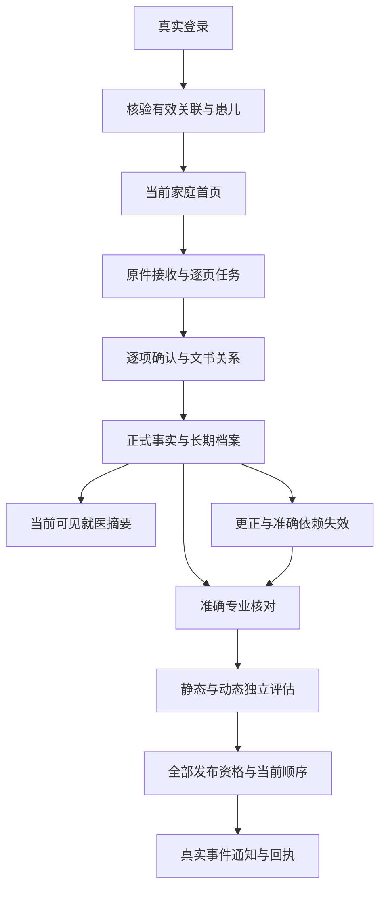

# sJIA 合并 MAS 预警平台页面流程

日期：2026-10-07。版本：FLOW V2.0。有效性：CURRENT。能力：DESIGN。准确依据为 [PRD 2.0](sJIA合并MAS预警平台PRD.md)、[UI2 原稿](ui-delivery/v2/src/main.jsx)、[39 页清单](ui-delivery/v2/screen-design-map.csv)、[完整页面规范](ui-delivery/v2/screens/page-specifications.md)及 [状态规范](ui-delivery/v2/states/state-specifications.md)。正式功能与验收状态唯一来源为 [交付记录](planning/delivery-ledger.json)。

## 1. 页面、设备与准确身份

全部 39 个页面、328 个适用状态由当前设计维护；[正式路由](frontend-design/v2-routes.csv)登记准确地址、容器、父页面、audience、权限、读取及写入 operation_id 和实施任务。全部 FR-01—FR-22 保留，旧 S 标识作为既有文档和接口兼容引用。家庭与六项受控支持页面均使用原稿的布局、文字层级、资产、控件和交互。

目标为监护人手机 H5、受控支持入口、较宽浏览器与横屏。320／360／390／430／580 CSS px、200% 文字、长原文、空内容、部分结果、键盘、安全区域、后台恢复及微信分别验收。具体设备、系统、浏览器与网络版本由实际记录确定，桌面窄屏不表示手机验收通过。

当前 Django、React、真实本地 PostgreSQL、Redis、Ark 与本地语音工程已经存在；新增业务由对应任务实施并复验。自建认证使用当前真实配置，资料提取使用获准原件和真实服务。病例、核对、临床等级及送达状态只有准确业务依据才能显示。

## 2. UI2 风格与资产

完整继承 [设计系统](ui-delivery/v2/design-system.md)、[Token](ui-delivery/v2/tokens.json)、[CSS](ui-delivery/v2/src/styles.css)、[资产](ui-delivery/v2/asset-manifest.csv)及 [页面资产映射](ui-delivery/v2/page-asset-map.csv)。系统字体、深蓝渐变顶部、三维图标、通用儿童、温暖纸面、按钮、弹层与准确状态按源文件最终级联值维护，不擅自更换资产、改变字号或减少内容。

首页、记录、我的仅在 UI2-01／05／15 显示三项主导航；其他页面显示准确父页面返回。家庭包与 `/support` 组件使用独立受众和岗位门禁，支持页面不进入家庭导航。全部页面具有真实 h1、控件 label、触控区域、键盘焦点和当前状态说明。

公共图像保持原比例与准确尺寸。首页儿童使用 child-neutral-front@2x.png，图标沿用三张原始图标表格位及裁切。原件查看取得每页当前授权，缩放、旋转、翻页和来源框只改变查看视图，原字节始终保存。未执行视觉比对部分保持 NOT_RUN，一比一还原继续作为必需验收目标。

## 3. 页面与全部需求

| 页面身份 | 内容与准确操作 | 需求与完成条件 |
| --- | --- | --- |
| UI2-01 首页 | 当前预警优先、儿童记录、观察时段、拍照主操作、体温症状、治疗、长期档案 | FR-01／02／06／07／12；当前授权投影及准确 alert_id，未知不表达低风险 |
| UI2-02 体温与症状 | 语音、原体温、单位、方式、医学时间及八种精度、症状三值、说明与草稿 | FR-02；实际候选逐项本人决定，保存与重读，专业状态独立 |
| UI2-03 拍照报告 | 原件选择、逐页上传、识别、当前候选、本人确认、草稿与批次入口 | FR-02／13；原字节与逐项来源保存，失败保留实际进度 |
| UI2-04 治疗资料 | 原件、原药名、起止时间、实际使用状态与说明 | FR-02；未知结束时间不推断持续，逐项原文与来源完整 |
| UI2-05 记录 | 时间轴、筛选、长期档案、观察时段、摘要与本人草稿 | FR-03／08／11；签名分页、实际医学时间、未知与当前范围 |
| UI2-06 记录详情 | 原值、限定符、单位、时间、来源、确认、专业状态、当前版本 | FR-02／03／08；准确原件、字段和记录版本 |
| UI2-07 历次检验 | 实际独立采样、原值列表、方法单位时间、不可比较原因 | FR-03／19；不插值、不补值，同次采样不增加次数 |
| UI2-08 更正 | 当前可写字段、准确版本、必要原因、本人核对与草稿 | FR-08；expected_version 检查，新版本重读，专业字段只申请 |
| UI2-09 更正历史 | 全部准确版本、原因、作者、来源及资格变化 | FR-08；当前授权下只读历史，不覆盖原始内容 |
| UI2-10 历史版本 | 准确版本详情、时间及原件，返回原历史 | FR-08／09；当前权限持续有效 |
| UI2-11 预警记录 | 全部有效提示、历史、有效性、等级及查看状态 | FR-06／07／12；等级和文字来自准确批准版本 |
| UI2-12 提示详情 | 批准正文、评估时间、来源、专业证明、时效及当前联系 | FR-06／07／12；实际显示后记录阅读，阅读与送达分别保存 |
| UI2-13 准备摘要 | 范围、患儿、当前资料、未知时间选项、任务和历史摘要 | FR-11／12；Task 受理与完成分别显示，准确结果重读 |
| UI2-14 就医摘要 | 原始事实、医学时间、来源、缺少内容及生成时间 | FR-11／12；更正、撤权及资料变化影响当前有效性 |
| UI2-15 我的 | 当前真实账号、患儿、提醒、资料使用、退出及品牌 | FR-01／09／22；退出清除受限内容 |
| UI2-16 资料使用 | 查看范围、外部识别、副本、保存删除、当前联系与处置申请 | FR-09／21；申请与实际处理结果分别呈现 |
| UI2-17 登录 | 当前自建认证、账号恢复、真实失败与当前返回目标 | FR-01／09；成功重读 Session 和 Relation，不产生访问资格 |
| UI2-18 患儿管理 | 本人关联、申请、状态、当前有效访问范围 | FR-01；多人分别核验，本人申请不附带病例 |
| UI2-19 申请关联 | 准确身份、证明、说明、申请与待核验结果 | FR-01／09；实际申请重读，核验另有岗位授权 |
| UI2-20 关联详情 | 本人权限、有效期、核验与撤销状态 | FR-01／09；撤销后阻止后续资料读取与接收 |
| UI2-21 我的草稿 | 本人、患儿、表单、实际保存时间、恢复与放弃 | FR-02／08／09；来源及配置版本检查，草稿不进入临床集合 |
| UI2-22 访问受限 | 当前拒绝与重新核验入口 | FR-01／09；无残余病例或原图 |
| UI2-23 服务不可用 | 当前读取失败及可访问返回 | FR-01／02／03／07／11；失败不转换为空内容 |
| UI2-24 页面不存在 | 无匹配链接及准确返回 | FR-09；不猜测资源或身份 |
| UI2-25 长期档案 | 医院、就诊、文书类型、已确认原文、未知归属、来源片段 | FR-14／15／17；完整签名分页及准确原件 |
| UI2-26 批次进度 | 原件、逐页识别、确认、归档、计数、尝试、预算、重试与取消 | FR-14；成功页面保留，受理未知查询原请求 |
| UI2-27 逐项确认 | 原项目、原值单位、比较符、各自时间、语境否定、就诊与原文 | FR-13／15；完整本人决定及准确页来源，专业资格不改变 |
| UI2-28 文书归组 | 准确页面顺序、文书类型、医院、形成时间、多个就诊及原因 | FR-15；保存新版本，原件和逐事实时间保持 |
| UI2-29 重复核对 | 五类关系、准确两端版本、依据、未决及解除 | FR-16；原件和历史保留，临床独立性需要专业证明 |
| UI2-30 新增内容 | 准确基准、当前批次、新增、更正、重复、待核对与来源 | FR-18；逐项可追溯，依赖变化返回失效 |
| UI2-31 观察时段 | 自报标签、范围、时区、真实采样间隔和时间未知 | FR-19；目标频率来自准确批准配置，标签不判定病情 |
| UI2-32 资料提醒 | 本人真实目标、时间、时区、安静时段、启用暂停延后关闭 | FR-22；默认关闭，提醒不产生检查安排或临床等级 |
| UI2-33 原始资料 | 原件、页、医院、版本、取得时间、用途副本与复核 | FR-13／21；当前每页鉴权，准确引用可重新读取 |
| UI2-34 专业核对 | 指定患儿、字段、版本、用途、原件与三类结论 | FR-10／13／16；准确岗位与资料范围，逐字段证明重读 |
| UI2-35 评估依据 | 静态、MS、动态、排除原因、当前与历史模式、准确依赖 | FR-04／05／06／19；不足保持，replay 禁止家庭发布 |
| UI2-36 内容启用 | 保存、批准、独立验证、文字、联系、渠道、release 与停用 | FR-06／12；全部当前前提成立才允许启用 |
| UI2-37 评价集合 | 用途、真实来源、独立分组答案、冻结版本、完整分母及限制 | FR-20；未知标签不计阴性，文件数不代替患儿数 |
| UI2-38 用途副本 | 原件与副本版本、准确处理、人工逐范围复核、撤销 | FR-09／21；证明及临床字段完整成立才允许外发 |
| UI2-39 通知记录 | 真实任务、受理、送达、阅读、回执、未知查询与撤权 | FR-07／22；各状态分别保留真实证据 |

## 4. 弹层、表单与明确恢复

| 操作 | 校验、状态与后续结果 |
| --- | --- |
| 患儿选择 | 检查本人有效关联和未保存内容，清除旧资料和读取，输入不转移患儿 |
| 离开编辑 | 继续编辑、保存草稿后离开、明确放弃；保存等待真实回执，失败保留当前输入 |
| 单位与医学时间 | 原值、原单位、限定符及精度独立；未知不添加默认单位，医学时间不设置当前时刻 |
| 项目增加移除 | 稳定 candidate／field ID 和来源，已有输入移除需要确认，草稿不进入正式记录 |
| 提交 | 校验真实患儿、范围、字段、来源和 expected_version；意图绑定准确内容；完成后读取资源 |
| 未知保存 | 原 request／intent 查询，未知期间禁止新建相同动作，查询没有找到不证明未提交 |
| 草稿恢复 | 实际保存时间、本人、患儿、配置、来源及版本；已提交／放弃／到期拒绝恢复，冲突由本人核对 |
| 筛选与分页 | 当前准确条件和 snapshot_version；清除筛选；过期 cursor 重读相同过滤第一页 |
| 更正与历史 | 专业字段申请；新记录及事实版本、原因和准确来源；旧核对不继承，依赖准确失效 |
| 摘要生成 | 合法范围与可见资料，Task 完成并重读；原版本和来源一致，资料变化提示重新生成 |
| 提示与联系 | 当前事件、接收关系、文字、有效期及联系；实际阅读首次时间稳定，不表达就医完成 |
| 退出与资料处置 | 清除页面资料与凭证，确认服务 Session 失效；处置申请及逐对象处理回执分别读取 |
| 说明与原件 | 保留原稿说明弹层、查看页、缩放旋转与区域；真实标题、Escape、焦点限制、关闭恢复 |

## 5. 核心流程与准确完成

本人确认、专业证明、计算完成、当前采用、家庭发布、渠道送达和本人阅读分别保存。任何一个状态不自动产生下一状态。资料不足只限制准确依赖，其他具备全部前提的能力独立执行；缺少批准不能新增医学默认阈值。

当前／历史记录、事实、文书、关系、规则、窗口、核对、用途和结果均通过准确 identifier 与版本追溯。历史评价使用当时已可得并具当时资格的来源，不能提前使用后来出院结论；无法重建保留不足，历史模式禁止家庭事件、发送及修改周期。

## 6. 后台、刷新与输入

全部受限读取绑定主体、受众、患儿、权限代次、对象与请求顺序。账号或患儿变化取消读取并拒绝迟到结果。隐藏停止任务查询和语音，原图释放；前台、pageshow 和 BFCache 恢复重新核验 Session、关系、用途、配置和当前资源后才显示内容。

未保存输入仅在当前隔离内存。失焦、连续编辑每 10 秒和离开使用同一串行草稿队列，实际 saved_at 与保存的 inputRevision 分别采用；较早回执不能覆盖新输入。刷新恢复本人服务端有效草稿，病例、原图、转写和凭证不存浏览器持久存储或 URL。

中文 IME composition 期间 Enter 不提交；字典查询按当前完整文字防抖。语音由用户开始，真实声音同源转写与 Ark 结构化后逐项本人确认；取消、后台、权限拒绝和旧结果分别处理，不自动填充医学值。网络中断、协议错误、字段校验、版本冲突及权限失效分别显示准确反馈。

## 7. 验证与当前证据

[FRONT V2.0](frontend-design/v2-interaction.md)维护完整类型、接口采用、组件、运行预算、性能和可执行验证。T38 检查完整路由、状态、类型、接口引用、Token、CSS 与资产摘要；T40—T53 验证实际功能，T54 正式界面，T55 真实模型，T56 全业务权限追溯，T57 容量恢复，T58 手机微信，T59 独立临床，T60 官方参赛要求。

业务验证使用获准真实账号、资料、原件、专业证明、规则及独立答案，保存准确操作、当前环境、代码摘要、持久结果、重新读取和原始输出。不生成病例、替代模型响应或模拟回执。仅 HTTP、Toast、DOM、构建或页面数量不能证明业务完成。

当前主动视觉限制持续有效；未执行视觉比对、手机、临床或真实通知的范围分别保留 NOT_RUN，不宣称一比一还原、临床评价或完整业务验收通过。
