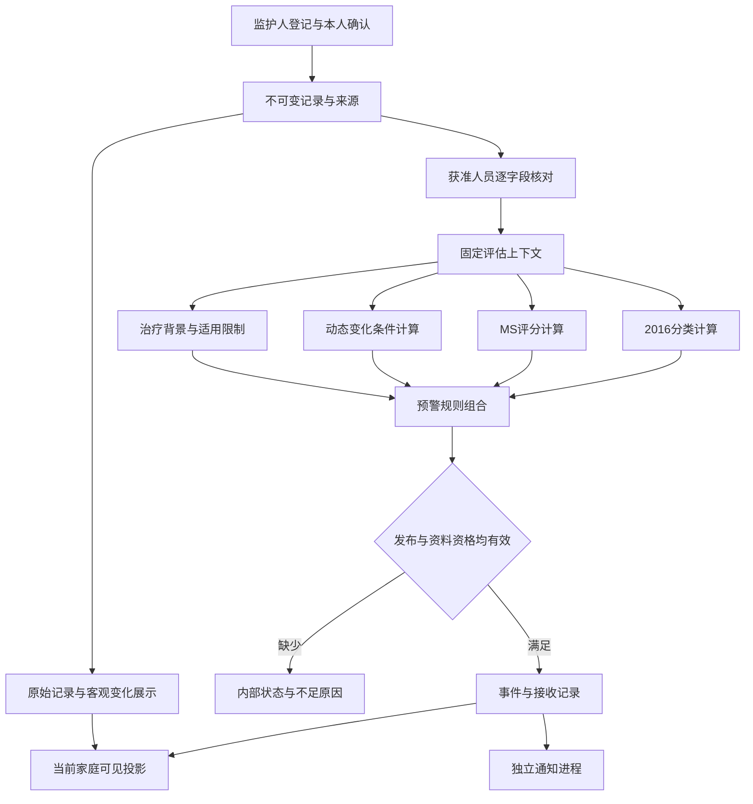
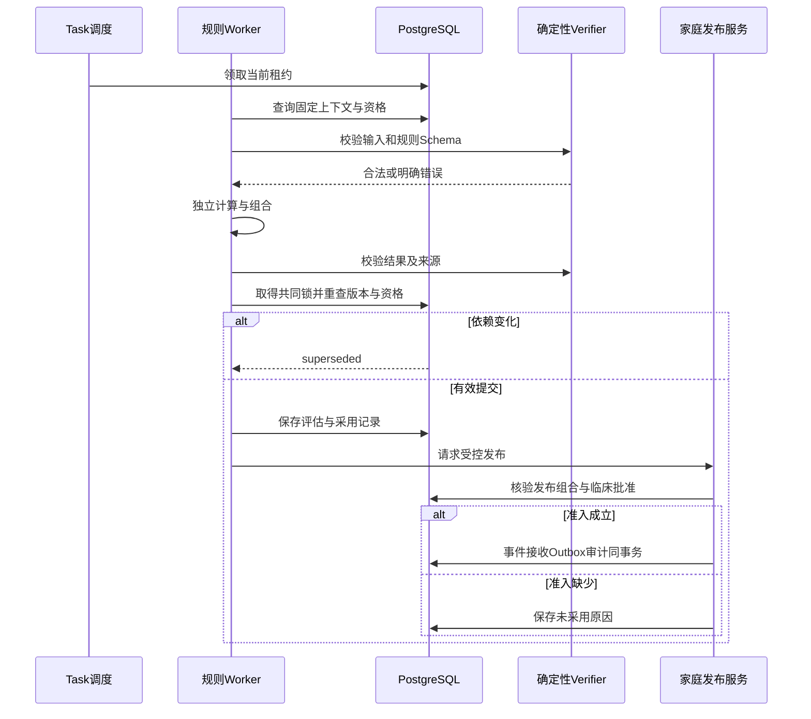

# sJIA 合并 MAS 预警方案与编排详细设计（LLD-AGENT-ORCH）

日期：2026-10-07。版本：ALERT V2.0。模式：`DESIGN / CONTINUOUS_DELIVERY`。能力：`DESIGN`。责任：S005-3 维护预警节点、输入上下文、条件路由及结果采用；S002 维护医学业务规则，S005-1 维护持久结构，S005-2 维护接口、授权、任务与事务。实施状态见 [交付记录](./planning/delivery-ledger.json)。

## 1. 六层治理与预警业务设计

### 1.1 输入、完成条件与能力边界

| 输入 | 当前依据 | 本次承接 |
| --- | --- | --- |
| PRD | [PRD](./sJIA合并MAS预警平台PRD.md) V2.0.0，第 8.4—8.19 节、BR-D01—BR-D10、AC-DYN-01—05、GRAC-01—10 | 分类、MS、动态组合、逐事实出处、采样关系、用途与结果采用 |
| 交互 | [页面流程](./sJIA合并MAS预警平台页面流程.md)、[提示规格](./ui-delivery/alerts/specifications.md) | 首页结果优先；详情查看依据；阅读与事件有效性独立 |
| HLD | [HLD](./sJIA合并MAS预警平台HLD.md) C03—C08、ADR-001—ADR-006 | 确定性规则、独立 Worker、无自主临床 Agent、无 RAG |
| 数据 | [数据 LLD](./sJIA合并MAS预警平台数据LLD.md) DATA V2.0、[新增实体](./data-design/v2-data-specification.md) | ArchiveFactVersion、逐事实可得时间、关系版本、用途副本、观察期与评价分母 |
| 后端 | [后端 LLD](./sJIA合并MAS预警平台后端LLD.md) BACK V2.0、[V2 接口](./backend-design/v2-api-catalog.csv)、[V2 协议](./backend-design/v2-protocol.schema.json) | 沿用当前权限、WriteIntent、Task、恢复、准确发布组合和家庭投影 |
| 本地病例 | [病例](./demo-data/current-patient/case.json)、[临床资料状态](./data-design/clinical-dataset-status.json) | 已授权本地设计核查；临床核对、独立答案及业务导入未完成 |
| 临床证据 | [证据登记](./alert-design/clinical-evidence.md) | 原始分类与评分研究、动态指标研究、EULAR/ACR 和 EULAR/PReS 指南 |

本次完成条件继承 AC-04—AC-12、BQA04—BQA12：形成完整规则执行、来源追溯、发布控制及验收设计，并运行文档、Schema、接口引用与现有病例准入检查。临床效能、真实通知及家庭业务完成条件继续要求获准资料、独立答案、实际服务和人工临床批准。现有标准已经定义，不新增逐阶段确认。

预警判定采用确定性编排，provider/model/prompt_version 为 NOT_APPLICABLE，模型调用与 Token 数量为零。当前照片及语音候选已有 Ark Adapter；新增逐事实输出与出处采用由 T41／T42 验证。识别请求保存实际 Provider、model、Prompt／Schema、原件与用途版本；候选无专业资格。完整新增控制见第 9 节。

### 1.2 六层责任

| 层级 | 职责 | 物理载体与加载 | 可核查行为 |
| --- | --- | --- | --- |
| Context | 患儿、用途、准确输入版本、规则与权限 | PostgreSQL 权威记录；每项任务独立上下文 | 不传递其他患儿资料、不继承旧授权 |
| Action | 固定读取、计算、提交与投影 | C03 领域服务、C06 Worker；登记的工具 Schema | 任意 SQL、网络检索、用药生成均无调用入口 |
| Skill | 分类、评分、趋势、治疗背景与家庭发布规范 | 版本化规则包及证据索引，按 kind 加载 | 规则包与执行制品摘要一致 |
| Control | Schema、资格、版本、预算、采用控制 | API Serializer、领域校验及事务提交函数 | 每个拒绝点有稳定错误及审计 |
| Isolation | 文件、规则、通知、研究上下文隔离 | 独立进程、队列、数据库身份及网络策略 | OCR 无核对与发布写权；规则进程无外部发送密钥 |
| Verification | 软件检查、资料核对、病例验收、发布检查 | 独立验证器、授权核对人、config_validation | 软件成功不能自动产生临床批准 |

分类、评分、动态条件分别执行；某项资料不足只限制依赖该项的规则。发布策略自身缺少必要配置时禁止临床发布。页面数据状态可以显示资料不足，同时保留其他依据仍然有效的已批准提示。

### 1.3 预警路径与证据层次

| 路径 | 判定对象与输入 | 输出及采用 | 依据与启用状态 |
| --- | --- | --- | --- |
| A01 资料状态 | 原值、来源、采样时间、单位、核对覆盖 | 缺项、需补正、未核对；打开对应记录 | PRD FR-02/03/10；不产生临床等级 |
| A02 分类条件 | 已核对适用前提与五项检验 | classification_result 与逐条件状态；内部核查 | PRD BR-C00—BR-C07；D04 待批准 |
| A03 MS 评分 | 已核对前提、三个专业变量及四项检验 | 完整七项贡献、总分、阈值比较；内部核查 | PRD BR-M01；D04 待批准 |
| A04 动态变化 | 可比较的既往与当前检验、核对与时间 | 原始变化；获准规则可进一步判定临床触发 | PRD BR-A01；动态百分比、时间窗与组合均待 D04/D05 |
| A05 治疗背景 | 已核对药物类别、给药事件、使用状态与时间关系 | 为各路径附加适用限制；不能降低等级或改变公式 | PRD FD-33/34；D03/D04 待批准 |
| A06 家庭提示 | 明确成立的触发条件、全部发布依赖 | 批准文字、来源、等级及联系；保存接收与阅读 | PRD BR-A01—BR-A04；D05/D06/D08/D09 待批准 |

2016 分类和 MS 的数值、比较符及系数由 PRD 第 8.14 节唯一维护。执行包绑定该规则版本和摘要，禁止把论文中的识别表现登记为本平台预警效能。分类或评分未满足不能转成低风险，二者不能相加形成新分数，分数不能转成未经验证的概率。

动态预警以铁蛋白、血小板、AST、纤维蛋白原的连续变化为重点，保留其他获准检验和症状的独立事实。研究支持观察变化模式，但没有为本平台提供统一的变化百分比和观察间隔；本项目的组合触发属于需要批准并验证的产品规则。来源及限制见证据登记 CE03、CE04、CE05。

### 1.4 关键设计决定

| decision_id | 来源与当前决定 | 状态、影响及再评估条件 |
| --- | --- | --- |
| ALERT-001 | EXPLICIT：本次用户要求重点设计预警；继续使用 HLD 的确定性计算 | CONFIRMED：设计范围；不授予临床启用权 |
| ALERT-002 | INFERRED：分类、MS、动态条件、治疗背景独立输出，组合规则按版本引用 | PROPOSED；FR-04—FR-06；以获准病例覆盖缺项与相互不一致结果 |
| ALERT-003 | INFERRED：同一规则族的持续触发由持久记录控制，提示重复发送单独控制 | PROPOSED；FR-06/07；D05 确认再次触发与失效要求 |
| ALERT-004 | INFERRED：动态预警采用独立 alert_evaluation，不扩展 classification/ms 的医学含义 | PROPOSED；S005-1/2 接收第 3.5 节；结构完成前该路径不能启用 |
| ALERT-005 | UNKNOWN：D04 的时间参数、D05 的触发与等级、D06 的准确文字 | NEEDS_INPUT；仅阻塞相应患者级规则和家庭发布，完整设计与静态验证继续 |

## 2. 上下文、缓存布局与交接

### 2.1 固定评估上下文

| 字段组 | 取得方式及用途 | 不可接受的替代 |
| --- | --- | --- |
| 身份与用途 | patient_id、environment、原始触发动作、岗位或关联授权、use_authorization | 仅凭 Worker 凭据扩大病例范围 |
| 医学时间 | assessment_at、观测或采样时间、精度、时区、known_at | 用录入时间代替采样时间；把月份转为某一天 |
| 来源与版本 | source_revision_id、record_version_id、field_id、verification_id、normalization_id | OCR confidence 代替核对；新字段继承旧证明 |
| 临床配置 | rule_id、window_policy_id、verification/mapping 版本、治疗适用策略 | “最新版本”这样的运行时浮动引用 |
| 有效性 | data_epoch、verification_epoch、publication_epoch、授权版本、lease_generation | 仅检查数据库 validity 标识 |
| 结果采用 | task_id、结果 Schema、release_id、content/visibility/contact 引用 | 内部计算完成即直接返回家庭 |

classification 和 ms 可以共享准确输入来源，但各自保存 assessment_input；动态条件记录基准、当前及中间时间点，不把一项变量的多个时间点压成单值。缺项保留变量、原因及来源，不保存推断补值。

### 2.2 时间与选值算法

1. `assessment_at` 为此次临床评估的明确时点。`known_at` 为此次允许使用的资料及核对完成时间上限。当前评估与历史回放分别标识；历史回放只使用当时已经取得的资料，不能使用后续报告、核对或诊断答案。
2. `current` 读取当前有效版本；`replay` 根据不可变版本、建立、更正及撤销时间重建 known_at 当时有效的记录、核对、配置与映射，不能使用当前指针代替历史状态。两种模式始终检查执行当时的资料使用依据、当前访问授权和来源可用性。后来撤销的证明可以作为获准历史审计事实表达，但不能重新取得当前临床资格。逐字段检查患儿、核对范围、项目和单位；无资格字段不进入数值比较，其原因进入 missing_items。
3. 依各变量的批准时间范围筛选。边界是否包含、允许时间精度、症状有效区间、跨项目最大采样间隔均由 window 配置明确。日期区间只有完整处于许可范围才可采用；跨界或无法证明先后时返回时间不足。
4. 同一报告的明确更正关系按评估模式选择对应时点有效版本。无更正关系的同时间冲突进入资料核对；禁止用录入顺序、最异常值或数据库排序消除临床冲突。
5. 当前值使用批准的选择策略；基准来自严格早于当前的独立采样。可选策略为前一合格采样或临床指定基准，发布时必须确定一种；缺少基准则无法生成该项动态条件。
6. 核对机构、方法、单位和标本的可比较性；任何不明项返回不可比较。重复拍照或同次采样的多个副本不能增加连续次数。
7. 固定完整输入集合及所有排除原因。`current` 提交时重新核验当前 epoch、配置、证明和租约，变化即 superseded。`replay` 固定历史配置和事实摘要，提交时重新检查当前访问、用途、原件及租约，不要求历史配置目前仍启用，也不允许家庭发布。历史状态无法重建时返回明确不足，不能按当前状态补齐。

时间参数 Schema 见 [规则配置 Schema](./alert-design/policy.schema.json) 的 WindowPolicy。Schema 要求填写正值并不代表任何时长已获临床批准。D04 尚未完成时，不提供默认窗口。

### 2.3 缓存与上下文压缩

| 分区 | 内容 | 生命周期 |
| --- | --- | --- |
| 稳定规则区 | 执行制品、Schema、不可变规则配置及文献定位 | 按 checksum 加载；每次使用核验当前启用资格 |
| 任务上下文区 | 同一患儿的固定引用、节点进度及缺项 | 按 task_id 隔离；重试不能变更原输入 |
| 动态结果区 | 本次计算、冲突、采用和发布检查 | 结果完整存储；家庭仅取得批准投影 |
| Prompt Cache | NOT_APPLICABLE | 无聊天 Prompt、无模型前缀缓存；不填写命中率或节省金额 |

按需加载的规则包在任务创建时固定版本；本次任务内不能动态添加工具或改换执行配置。病例 HTTP 响应继承 `Cache-Control: no-store, private`；浏览器只保存页面内存，不持久保存病例。缓存失效不能依赖异步清理完成，读取仍查当前权威资格。

任务输入超出已批准的记录数或处理预算时明确失败，不截断后继续计算。分页收集完成前不能声明集合完整。调试原始结果留在受限存储，日志只保存标识、状态和证据引用。

项目续接使用 HANDOFF.md 所定义的信息集合：当前任务、准确输入文件摘要、已决定事项、未批准参数、未验收任务、授权范围、失败原因及证据位置。本次唯一任务记录位于第 8 节，不额外建立与其独立修改的任务系统。生产续接读取 Task 与固定输入，不从自然语言摘要恢复临床数值。

## 3. 工具、规则计算与接口设计

### 3.1 固定工具注册表

下表为领域函数与 API 适配设计，当前没有已运行 MCP Server。输入和返回采用现有后端协议；新节点不改变外部 operation_id。

| tool_id / 实现入口 | 输入与输出 | 权限、作用范围与副作用 | 幂等、超时、错误及审计 |
| --- | --- | --- | --- |
| read_assessment_context / C03→C06 | task_id、准确输入引用 → 固定上下文 | 受控 execute_assessment；单患儿只读 | 固定输入；继承任务期限；DEPENDENCY_INVALID；记录选值与排除依据 |
| evaluate_classification / C06 | 合格字段与 PRD 规则版本 → ClassificationOutput | 进程内纯函数；无网络和写权 | 同输入同结果；30 秒任务预算内；INVALID_INPUT；保存逐条件来源 |
| evaluate_ms / C06 | 完整七项与规则版本 → MsOutput | 纯函数；缺项输出 insufficient 状态与 null output | Decimal；内部错误即时抛出；保存各项贡献 |
| evaluate_alert_policy / C06 | SignalResult 集合与 TriggerPolicy → 规则结果 | 纯函数；不批准内容、不发送 | 同输入同结果；缺项为 unknown；保存每项条件与组合结果 |
| assessment_create / 支持 API | AssessmentInput → TaskView | execute_assessment；不可由家庭调用 | 后端提交意图；202 只表示受理；统一 Error |
| assessment_read / 支持 API | assessment_id → AssessmentView | read_assessment；准确病例与字段 | 当前快照；无写入；不向家庭暴露内部输出 |
| alert_evaluation_create / 支持 API | AlertEvaluationInput → TaskView | execute_assessment；当前患儿及获准用途 | 202 受理；current/replay；服务器事件复用同一领域调度 |
| alert_evaluation_read / 支持 API | evaluation_id → AlertEvaluationView | read_assessment；当前患儿及获准用途 | 内部结果只向受控岗位投影；家庭通过 HomeView 读取当前状态 |
| home_read / 家庭 API | HomeQuery → HomeView | read_raw 加当前关联、内容可见范围 | no-store；当前投影；失败不返回空态 |
| alert_read / 家庭 API | alert_id → AlertView | receive_alert；本人接收关系 | 当前投影；RESOURCE_NOT_FOUND/FORBIDDEN；读取审计 |
| alert_mark_read / 家庭 API | Empty → WriteReceipt | receive_alert；只修改本人首次阅读时间 | 原业务键；不改变等级或送达；持久回读 |
| config_create / 支持 API | ConfigInput + 登记 payload Schema → WriteReceipt | manage_configs；创建草稿 | checksum；拒绝未知 Schema；不产生批准 |
| release_enable / 支持 API | GateAction → WriteReceipt | publish_config；全部批准与验证齐全 | expected_gate_version；同事务更新；记录实际启用证据 |
| task_cancel / 家庭或支持 API | StateAction → TaskView | task_scope；仅本人授权范围 | 禁止后续采用；实际外部停止由回执证明 |

POST 写入继承后端 `Idempotency-Key / X-Write-Intent / X-Intent-Generation`，不建立第二套 request_id。函数总预算受后端 runtime 约束，无自行修改参数重试。Schema 错误、权限错误、资料不足均不重试。

必要业务信息由支持入口的配置与批准表单取得；未知配置返回 `CAPABILITY_NOT_CONFIGURED` 或 `CONFIG_SCHEMA_UNAVAILABLE`。`ask_user_question` 在产品运行中 `NOT_APPLICABLE`：家庭采集通过已定义表单完成，临床配置由获准岗位确认，不让模型通过普通对话授予权限。

### 3.2 分类与 MS 执行规范

| 项目 | 执行要求 | 验证要求 |
| --- | --- | --- |
| 分类前提 | 采用 PRD BR-C00 的 sJIA 与发热核对；明确不满足为 not_applicable，未知为 insufficient | AC-04；前提未知不能默认为满足 |
| 单项与组合 | 采用 PRD BR-C01—BR-C06 的比较符及三值表，保留未满足条件中的缺项 | 独立参考答案覆盖等于边界及两侧；未核对数值不参与比较 |
| 限定值 | 当前 PRD 只接受精确值；带比较符的结果保留原文并返回不足 | 不能把检测上限当作测量值；不能自行启用区间判定 |
| MS | 七项完整才执行；专业变量只有确认存在或不存在才赋 1/0 | 任意必需项缺少时 ms_total 和 ms_threshold_result 不输出 |
| 数值 | 系数和输入使用 Decimal；工作精度由输入位数和最大中间结果位数推导；精度不足立即失败 | 原值、贡献和总分可重现；阈值比较先于展示舍入 |
| 相互关系 | 两项输出独立；一项达到条件不填补另一项缺项 | 不生成组合概率；不以平均值消除不同结果 |
| 治疗背景 | 记录 IL-1/IL-6、激素及已知治疗变化；时间关系未知单独标识 | 不用 CRP 正常或无发热自动解除其他有效提示；不修改标准公式 |

治疗下分类前提未满足时，分类仍按其规范输出 not_applicable；动态路径使用自己的已批准适用条件，不能由分类前提失败直接关闭。治疗适用策略未知时保留限制说明并阻止依赖该策略的发布。文献中的临床监测频率不直接转成家庭自行检查安排。

### 3.3 动态信号与组合规则

| signal | 原始事实或运算 | 必要资格与不足行为 |
| --- | --- | --- |
| classification_met | 指定 assessment 的 meets | 引用有效 assessment 与规则；其他状态明确区分 |
| ms_threshold_met | 指定完整 MS 的比较结果 | 不读取部分分数；未知不转换为 false |
| ferritin_change | 当前值与基准值、方向、差值、相对变化、时间间隔 | 同方法、已核对、独立采样；限定值不可计算幅度 |
| platelet_change | 与 ferritin_change 相同的客观计算 | 不要求先低于参考范围才保存变化事实 |
| ast_change / fibrinogen_change / triglycerides_change / ldh_change | 各项目独立计算；项目及单位禁止混用 | 纳入临床触发的方向和幅度需 D05 配置 |
| professional_finding | 已核对专业症状或体征存在/不存在/未知 | 仅已批准代码；家庭文本不能自动映射 |
| therapy_context | 已核对治疗类别、有效时段、变化事件 | 只形成上下文与规则适用结果，不自动加分 |

客观运算：`absolute_delta = current - baseline`；`relative_delta = (current - baseline) / baseline × 100`。baseline 为零或不支持的非正值时 relative_delta 为 null，保留 absolute_delta。采样时间均有准确 instant 时计算 elapsed_seconds；仅日期或其他允许精度用时间区间表达，并保存 elapsed_min_seconds、elapsed_max_seconds，不生成唯一经过秒数。时间区间不重叠且最大间隔完整满足批准范围才允许严格排序比较。时间无法严格排序时变化值不进入趋势临床判定。涉及除法的比较采用等价乘法并检查分母合法性，显示比值独立舍入。

连续变化使用按医学时间排序的独立合格采样，`n` 个采样对应 `n-1` 次相邻变化。`n`、允许间隔、方向、最少幅度、等值是否中断由规则配置决定；没有配置时只能显示原始方向，不能使用“持续恶化”等临床解释。同次采样副本、重复上传和报告更正不增加次数。

组合采用登记的 `all / any / at_least`，每个原子条件返回 `met / not_met / unknown`。`all` 有明确 not_met 即 not_met，全部 met 才 met；`any` 有 met 即 met，全部 not_met 才 not_met；`at_least(k)` 在 S≥k 时 met，在 S+U<k 时 not_met，其余 unknown。组合允许嵌套 groups，每个子组形成一个三值操作数；父组计数包括其直接 signal_refs 和 groups。各层不得重复引用同一信号增加计数，最深层数及操作数上限由运行配置控制，超限拒绝配置。条件求值仍逐项完成以保存缺项和证据。未知资料不作为触发条件，unknown 不能生成临床等级。

TriggerPolicy 用 signal_id 引用原子条件；每项临床参数绑定证据和 D05 批准，最终等级由准确规则直接映射到已批准 attention/warning/urgent。多条有效规则按批准 priority 选择首页主提示，其他有效提示保留可查看；同优先级采用稳定 rule_key 排序。等级 priority 只控制展示，不能掩盖其他触发依据。没有达到触发条件只表达当前没有有效事件。

规则配置完整结构在 [policy.schema.json](./alert-design/policy.schema.json)，无临床默认值、无任意表达式、无脚本执行。Schema 校验之后继续执行第 4 节的临床与引用校验。该文件是配置设计格式，当前没有配置实例、批准记录或启用记录。

### 3.4 预警执行节点

| node_id | 输入、守卫与动作 | 输出、失败去向与采用 |
| --- | --- | --- |
| N00 | 核对 Task、用途、患者与触发事件 | 不满足即 blocked/failed；不能取得病例正文 |
| N01 | 固定启用规则、窗口、核对、映射与评估模式 | 未配置为 configuration_pending；不建立患者结论 |
| N02 | 查询、筛选、检查可比较性并固定全部输入 | missing_items 与输入引用；技术查询失败为 failed |
| N03 | 检查药物事实及临床规则适用范围 | 适用状态与治疗限制；未知不推断未用药 |
| N04 | 独立执行分类与 MS | 各自结果或不足；不得相互替代 |
| N05 | 计算已登记动态信号与专业条件 | SignalResult 集合；不补值，不任意增加信号 |
| N06 | 执行 TriggerPolicy 并记录全部结果 | met/not_met/unknown；只有 met 可进入事件创建候选 |
| N07 | 提交前重查全部 epoch、输入、租约、规则及用途 | 不一致为 superseded；成功保存内部评估，不自动发布 |
| N08 | 检查 release、临床批准、验证、可见文字、联系、持续触发状态 | 未满足只记录发布未采用原因；不创建临床事件 |
| N09 | 同事务写入事件、防重、接收记录、依赖与 Outbox | 唯一业务事件；数据库失败不产生成功回执 |
| N10 | 家庭查询执行当前投影；外部渠道取得发送许可 | UI 获准内容与实际渠道状态分别记录 |
| N11 | 更正、撤销、过期或停用使依赖失效 | 当前读取立即停止采用；受控重新评估建立新任务 |

报告保存只触发资料状态更新；已核对字段变化和批准配置变化才使对应评估进入调度资格。批准的定时评估使用服务端到期事件。读取页面、打开历史、查看提示均不触发新临床事件。迟到报告分为历史重算和当前评估：历史模式 `replay` 不发送；当前模式需要 D04 的时效策略和新输入资格。

### 3.5 数据与后端的评估接口

动态评估使用 alert_evaluation 及相关输入、结果、周期和决议结构；专业量表保持 assessment.kind=classification/ms，并通过 alert_evaluation_assessment 关联。S005-1/2 已在正式 SQL、TaskView、runtime 和 HomeView 中接收本节设计。准确事务、字段映射及迁移要求见 [跨层接口接收规范](./backend-design/handshake.md) 第 6—7 节；真实服务运行独立验收。

| 对象 | 必需字段、关系及约束 | 接收责任 |
| --- | --- | --- |
| alert_evaluation | id、patient_id、task_id、policy_id、window_policy_id、assessment_at、known_at、context_sequence、mode=current/replay、status、decision=met/not_met/unknown、全部 epoch、computed_at、validity | S005-1：同患儿复合键；task_id 唯一；completed 必有准确配置与结果 |
| alert_evaluation_input | evaluation_id、signal_id、position、field_id、record_version_id、verification_id、normalization_id、医学时间引用、input_role=baseline/current/series/context | S005-1：逐字段复合外键；同一信号多时间点可追溯；不跨患儿 |
| alert_evaluation_assessment | evaluation_id、assessment_id、patient_id、role | S005-1：支持引用零个或多个 classification/ms；引用有效性递归检查 |
| alert_signal_result | evaluation_id、signal_id、state、reason_codes、算法版本、计算输入引用、pair_results 中每对有序采样、十进制差值与时间区间 | S005-1：有版本 Schema；unknown 的临床比较结果不填布尔值；逐对可重现 |
| alert_episode | id、patient_id、rule_family_key、status、opened_at、last_evaluation_id、last_event_id、state_version、reset_evaluation_id、last_assessment_at、last_context_sequence | S005-1：同患儿与规则族至多一个持续触发周期；状态变更使用患者锁、版本与评估顺序 |
| alert_decision | evaluation_id、rule_key、state、采用动作、阻止原因、episode_id、sequence、previous_decision_id | S005-1：所有触发和未触发均可追溯；重复消费不能增加 sequence |
| alert_event | evaluation_id 为必需同患儿引用；assessment 通过 alert_evaluation_assessment 取得 | S005-1/2：有数据环境需显式迁移及完整回读；无法映射的历史事件禁止当前采用 |
| alert_evaluation Task | 新 task_type=alert_evaluation，继承既有 Task 生命周期、租约与错误 | S005-2：同时维护登记枚举、runtime 与服务能力；不能只修改 Worker |
| 当前完成状态 | HomeView.assessment_state=not_evaluated/configuration_pending/insufficient/current/stale、获准 assessed_at 与 current_alert_id | S005-2/4：只有 current 才能把 none 映射为 clear；当前事件按准确 ID 读取 |
| 配置登记 | kind=window 对应 WindowPolicy；kind=rule 对应 TriggerPolicy；schema_version 精确绑定 | S005-2：ConfigInput 继续作为外层；payload 必须通过专用 Schema 和语义检查 |

数据库复合外键、事件防重唯一约束及级联失效查询必须同步维护。不得把临床连续状态只保存在 Redis、Worker 内存或家庭阅读字段中。

### 3.6 内部消息与配置引用

[node.schema.json](./alert-design/node.schema.json) 定义 EvaluationContext、SignalResult 和 TriggerEvent。TriggerEvent 为数据库事件投影；event_id 对应 outbox_event.id，patient_id 保存于受约束的 resource_refs。Broker 继续只传 event_id、task_id、schema_version。消费者重新授权读取持久事件，不接受消息载荷直接提供临床数值。

| event_type | 发布事务与消费者 | 处理范围 |
| --- | --- | --- |
| clinical_input.verified | 逐字段核对提交；评估调度器 | 重新检查相关规则所需字段，固定新输入 |
| clinical_input.corrected | 新版本与旧依赖失效事务；失效服务及调度器 | 新字段未核对，先更新不足状态；不采用旧证明 |
| clinical_verification.revoked | 证明撤销及 epoch 更新；失效服务 | 立即影响当前读取，记录受影响评估与事件 |
| clinical_policy.enabled / clinical_policy.disabled | 配置或发布切换事务；规则调度器及失效服务 | 全局事件不包含病例；受控分页定位已登记依赖，逐患儿校验用途后创建任务 |
| clinical_evaluation.due | 批准的到期调度；评估 Worker | 时间到期、有效期和定时评估；到期依据引用准确规则 |
| alert_evaluation.completed | 结果提交事务；发布服务 | 使用准确 evaluation_id，重复消费不重复创建周期或事件 |
| alert_event.created | 事件、接收、Outbox 同事务；通知 Worker | 仅处理已批准渠道与当前接收关系 |
| alert_dependency.invalidated | 依赖失效事务；通知与当前投影 | 阻止后续采用和发送，不修改已经发生的回执 |

消费者以 `(consumer,event_id)` 和领域唯一键共同防重。计算完成事件由发布消费者处理，不能再次创建同输入评估形成循环。失效通知只推进后续依赖；重新评估由原始更正、核对或配置事件负责一次登记。

配置引用必须指向准确的不可变版本，不接受任意文字作为已批准策略。D04/D05 配套内容由以下责任维护：

| 引用 | 需要完整登记的内容 | kind 与责任 |
| --- | --- | --- |
| population_config_id | sJIA 适用状态、需要核对的前提、目标年龄范围、排除或限制条件、未知状态行为 | verification；S002/S005-2 |
| therapy_policy_id | 核对药物类别、暴露状态、评估时段关系、未知时间处理、允许的规则与解释限制 | verification；S002/S005-2 |
| comparison_policy_id | 项目、来源机构、方法、标本、原单位及 mapping_id；批准的跨来源可比较关系 | mapping；S005-1/2 |
| clinical_finding_validity_policy_id | 专业字段、存在或不存在证明、医学有效区间、采样与症状允许间隔 | verification；S002/S005-2 |
| late_result_policy_id | 可回放范围、当前结果的时效要求、迟到更正影响与新评估时点 | window；S002/S005-2 |
| reset_policy_id | 需要哪些确定不满足条件、持续时段、最少独立采样次数、资料中断行为 | rule；S002/S005-2 |
| retrigger_policy_id | 新周期准入、升级、再次提醒、最低间隔及规则更换后的周期延续 | rule；S002/S005-2 |

本次 Schema 覆盖主窗口和触发配置；这些配套 payload 的登记与服务端执行仍由 ALERT-BACK-01 承接。任何所引用 Schema 或准确配置缺失时，不能创建可启用的规则。常量格式、正整数约束和证据网址均不构成临床批准。

## 4. Hooks、状态与发布控制

### 4.1 确定性 Hook 挂载点

| Hook | 真实承载位置 | 检查与行为 | 证据 |
| --- | --- | --- | --- |
| InputValidate | DRF Serializer + JSON Schema | 额外字段、非法值、缺少引用就地拒绝 | Error、trace_id、审计 |
| ContextAuthorize | C03 授权查询与 Worker 启动 | 病例、用途、岗位、字段、有效期 | 输入引用与授权版本 |
| PolicyValidate | 配置提交及启用领域动作 | 全部引用存在；信号代码唯一；组合 k 合法；时间与方法配置完整 | 配置 checksum 与逐项校验结果 |
| PreCompute | N02/N03 | 原件、核对、时间、单位及治疗适用性 | missing_items 和排除原因 |
| PostCompute | N04—N06 后立即执行 | 结果 Schema、输入引用、Decimal 有限值、七项贡献及组合一致性 | verifier ID、制品摘要 |
| PreAdopt | N07 事务内 | 当前资格、准确版本、epoch、租约代次 | 条件更新行数与最终状态 |
| PrePublish | N08/N09 | 临床批准、真实验证、release、内容、联系、防重及全部依赖 | release_id、采用原因与事件 ID |
| PreSend / PreRead | C07/C03 | 当前接收关系、许可、可见字段与事件有效性 | 实际回执／阅读记录 |

临床配置语义检查包括：基准与当前窗口不得产生未来取值；缺少映射不能启用数值条件；仅相对变化的条件要求合法分母；连续次数不得多于输入预算；professional_finding 只能引用核对政策允许的代码；combination.signal_refs 及嵌套 groups 中的引用必须唯一且存在；同一 rule_key 只能有一个最终等级。临床参数的批准另由指定负责人完成。

### 4.2 持续触发、防重与再次提示

传输去重、同次评估去重和持续临床条件的再次提醒分别执行。`trigger_key` 由版本化规范生成，覆盖 patient_id、rule_family_key、episode_id、sequence 和事件用途。已有唯一约束继续阻止同一事件重复创建；alert_recipient 的三项唯一键继续阻止同一关系及渠道重复接收。

| 当前状态及新评估 | 事件动作 | 后续状态 |
| --- | --- | --- |
| 无持续周期，条件 met，发布有效 | 创建周期与首次事件，sequence=1 | open |
| open，同一评估或同一事件重放 | 返回原采用记录 | open；不增加发送 |
| open，条件持续 met，未达到再次提示条件 | 保存本次评估与 suppressed 原因 | open；当前事件仍须检查时效 |
| open，新到期评估为 met，approved_interval 已到且全部资格有效 | 即使原始检验未变，也按批准策略创建新的 sequence；过期资料不能用于再次提醒 | open；到期事件本身按准确周期和计划时点防重 |
| open，新获准等级优先级提高 | 按批准升级规则创建新 sequence | open；同事务更新当前事件关联 |
| open，新评估 unknown | 记录资料不足；不得标恢复或创建低风险 | open；既有事件按其依赖和有效期判断 |
| open，条件 not_met | 执行批准的恢复条件、持续时段或连续次数检查 | 未满足则 open；满足后 closed |
| open，依据更正或撤销 | 当前依赖事件失效，记录 invalidated 原因 | invalidated；不把此状态解释为病情恢复 |
| closed，新条件 met | 按批准再次触发规则创建新周期 | open |
| invalidated，取得新有效依据且条件 met | 原周期保留失效状态；按 retrigger_policy_id 创建新周期，sequence 从 1 开始 | 新周期 open；新事件引用新的准确依据 |
| invalidated，新条件 not_met 或 unknown | 保存新评估与具体结果，不恢复原事件 | 原周期保持 invalidated；无当前新周期 |
| 任意，规则停用、联系失效、用途失效 | 禁止新发布和发送，当前内容按依赖失效 | 原审计及已发生回执保留 |

冷却时长、再次触发间隔、恢复条件及升级是否突破冷却均需 D05 明确配置。技术限流不能丢弃本应发布的事件：事件已成立时记录发送受限及运行告警，不能显示已送达。未阅读不自动升级临床等级，阅读不关闭周期，监护人不承担线上复核责任。

调度器在患者锁内分配递增 context_sequence，绑定准确输入、assessment_at 和规则族。当前周期只采用 `(assessment_at,context_sequence)` 大于最近已采用顺序的 current 评估，同一评估重放返回原结果；较早评估迟到提交只保存内部历史及未采用原因，不覆盖当前事件、周期或首页。相同 assessment_at 使用已分配 sequence 仲裁，不能用计算结束时间决定先后。epoch 校验继续适用；序号不能绕过新的核对或配置。replay 永不推进当前周期。规则变更时按明确 retrigger_policy_id 和新的发布资格处理，不因更换 policy_id 自动重发。

### 4.3 外层任务与内部状态映射

| 内部过程 | 后端 Task 状态 | 完成或终止条件 |
| --- | --- | --- |
| 等待调度 | accepted / queued | 持久任务及 Outbox 已提交 |
| 固定上下文、规则计算、结果提交 | running | 持有有效租约；未超预算 |
| 配置或用途前置缺少 | blocked | 明确原因；补齐后创建新任务 |
| 资料不足已完成求值 | completed | 已保存 insufficient/unknown 和具体原因；不表示临床判断完整 |
| 结果提交 | completed | 当前结果、依赖与采用记录可回读 |
| 输入或资格变化 | superseded | 旧输入不能被采用；新任务取得新上下文 |
| 技术错误 | failed | 原因可查；没有临床成功结果 |
| 取消 | cancel_requested → cancelled | 禁止后续采用；记录实际资源清理 |
| 外部发送结果未知 | uncertain → awaiting_resolution | 依后端预算查询；不得重复提交未知操作 |

`PLANNING / WAITING_APPROVAL / RETRYING` 不另建 Task 枚举。确定性准备由 running 内节点表达；临床批准在配置生命周期表达；获准额外尝试写入 task_attempt。失败的外层任务终态不改写。

### 4.4 首页投影及操作

| 条件 | 家庭结果 | 操作与限制 |
| --- | --- | --- |
| 未登录或关联无效 | 访问状态 | 登录／查看关联；不返回病例 |
| service_state=disabled | disabled：预警服务未启用 | 服务说明；原始资料按权限可见 |
| 服务或读取失败 | failed：暂时无法更新 | 重新请求；不显示无预警 |
| 有有效且获准的 clinical | attention/warning/urgent 按批准映射 | 详情、依据和有效联系；评估时间与缺项可同时展示 |
| 无有效 clinical，正在计算 | pending/evaluating | 查看已保存资料或任务状态 |
| 无有效 clinical，未评估或资料不足 | not_evaluated/incomplete 的准确文字 | 打开有权限补充的字段；专业字段不能由家庭补成已核对 |
| 当前评估完整且无有效事件 | clear：当前没有有效预警 | 查看评估资料；不表示安全、排除疾病或无需就医 |
| 历史事件已失效 | expired | 查看更新资料；历史链接重新执行当前可见策略 |

多维状态保持独立。新资料处理中不自动删除仍然有效的提示，也不能延长旧提示有效期。多个规则的有效性逐项计算；部分资料不足不覆盖其他有效事件。UI urgent 的触发与准确文字属于 D05/D06 待批准内容，不能直接采用设计预览中的情景。家庭自报症状不绕过现有 PRD 的核对要求生成临床等级。

## 5. 物理隔离、预算与模型身份

### 5.1 执行身份注册表

| agent_id / 执行单元 | goal、non_goals 与输入输出 | allowed_tools / data_scope | budget、termination、owner |
| --- | --- | --- | --- |
| assessment_worker | 固定分类与 MS；不生成诊疗。AssessmentInput → 内部结果 | 当前病例固定字段；仅领域读取与受控结果提交 | 后端 30 秒执行建议；完成/失败/过期；后端负责人 |
| alert_policy_worker | 动态条件、组合与采用候选；不批准内容。上下文 → AlertEvaluation | 当前病例固定引用；无网络研究、无通知密钥 | 同一内部计算预算；新 task_type 需登记；规则负责人 |
| notification_worker | 发送已经获准的接收事件；不修改等级 | 当前 recipient 与 send_permit；指定渠道 | 沿用后端许可与查询预算；真实回执或待处理；运行负责人 |
| evidence_research | 公共文献与规范核查；不读取完整病例、不修改生产配置 | 公共来源和项目规范；只读研究上下文 | 当前研究任务终止即释放；结果由主设计者审查 |
| design_verifier | 检查 Schema、引用与设计一致性；不授予临床资格 | 文档和本地获准结构；无外部发送 | 有限检查命令；非零即失败；验证负责人 |

生产前三项均为确定性 Worker，model、Prompt 和自主工具循环不适用。研究与验证的隔离上下文不进入生产病例会话。实际模型服务未配置时不填写目标模型已成功调用。

### 5.2 运行预算与资源回收

内部计算预算沿用 BACK 第 5.2 节的建议：执行 30 秒、租约 45 秒、心跳 10 秒、队列等待 300 秒。最多两次额外尝试仅适用于已证明前次未提交、输入未变且没有外部副作用的技术失败，间隔 5/15 秒。全部参数仍为工程建议，启用时从批准 runtime 读取并记录实际 loaded_config_version。

`max_turns=1` 表达一次固定工作流，`max_tool_calls` 由 N00—N11 的登记调用图及分页上限约束；没有模型探索轮次。并发由真实规模和数据库连接预算确定，当前不填写并发容量。费用预算对确定性规则为计算资源观测，模型 Token 为零；OCR 和渠道费用使用真实回执，未知金额保持未知。

超时或取消立即禁止结果采用；Worker 租约代次必须校验。孤立进程由进程管理器终止，Reconciler 核对租约、原事务与外部状态；不能仅因进程退出把任务登记成功。清理释放连接和任务内存，持久输入、审计和原件按 D09 保存。

文件识别使用独立容器和受限出口；规则进程只访问指定数据库能力；通知进程持有专用渠道凭据。发布操作只在受控 API 身份下进行。进程名称或模块目录不能代替数据库授权、网络规则和独立凭据验证。

## 6. Skills 与知识版本管理

### 6.1 按需加载的规则包

| 包 | 触发、内容及来源 | 版本与使用限制 |
| --- | --- | --- |
| classification_2016 | assessment.kind=classification；PRD BR-C00—BR-C07 与证据 CE01 | rule_id + checksum；保持原始适用前提 |
| ms_2019 | assessment.kind=ms；PRD BR-M01 与证据 CE02 | 七项输入及独立答案；不混用 SJADAS/SMS |
| dynamic_alert | alert_evaluation；SignalResult、WindowPolicy、TriggerPolicy | D04/D05 批准版本；不从文献文字自动生成阈值 |
| therapy_context | 启用规则声明使用治疗背景 | 原药名、核对类别、时间关系及证据 CE04/CE05/CE06 |
| family_publication | 规则 met 之后及每次读取/发送 | release、visibility、content、contact 与当前批准 |

Skill 目录按 `SKILL.md` 保存触发、输入、输出与边界，`supporting_files/` 保存允许使用的证据索引和验证说明。本文定义产品内部规则包的加载责任；无需为确定性服务安装 Agent SDK 或新增自主调用能力。MCP、向量库、医学知识图谱推理与模型长期记忆当前均不适用。

### 6.2 文献更新与配置迁移

每条证据保存 source_id、标题、发布年份、DOI/PMID、访问日期、读取范围、关键定位、适用人群、支持的判断和限制。公开网址只构成证据来源；未建立全文保存或再分发依据时只登记引用和简短释义。研究不能上传本地病例到外部检索服务。

新文献进入待审证据登记，临床负责人判断对具体规则的影响。需要更改时创建新的规则、窗口、内容或映射版本，运行独立病例验证，重新批准准确 checksum，建立新的 release。旧评估固定原版本用于受控追溯；当前家庭读取仍使用当前可见与有效性策略。撤销证据、配置或批准会影响关联规则，不能由定时文献搜索自动启用或替换临床规则。

## 7. Verifier、临床效能与业务采用

### 7.1 验证层次

| 层次 | 验证内容 | 通过依据与当前状态 |
| --- | --- | --- |
| 静态设计 | 八节结构、JSON Schema、已有 API 引用、完整来源路径、现有病例准入限制 | 本次运行 [validate.py](./alert-design/validate.py)，结果见 [报告](./alert-design/validation-report.json) |
| 确定性功能 | 固定输入重现、分类三值表、完整 MS、动态计算、组合逻辑、时序、防重与失效 | 实际执行器及获准输入；当前 NOT_RUN |
| 资料与人工核对 | 原件、数值、比较符、时间、单位、专业变量及治疗背景 | 指定人员对准确字段版本确认；当前 BLOCKED |
| 真实集成 | 实际 API、数据库、Worker、渠道、当前家庭投影与回读 | BQA04—BQA12、BQA17/18；当前 BLOCKED |
| 临床效能 | 按预设终点的独立病例回放与目标人群验证 | 临床负责人确认参考答案、样本方案与阈值；当前 BLOCKED |

Syntax 成功只证明文件和规则结构可解析。结构化输出成功、临床计算资格、家庭采用、实际接收和真实阅读分别验证，不互相替代。人工批准记录必须来自明确岗位及有效证据，不能由软件测试生成。

### 7.2 现有病例能提供的证据

当前病例的 use_basis.clinical_verification 为 unverified，clinical_rule_eligible 为 false。多项医学时间只到月份、相对描述或未知；铁蛋白存在限定值；部分 TG/纤维蛋白原只有文字变化，图片来源的 TG 单位映射仍需批准。不能跨不同阶段拼接五项检验，也不能把 SJADAS/SMS 当作 MAS 的 MS。

本次检查只验证既有来源引用、时间引用、值类型、限定值和明确的禁止计算标识。报告不输出患者风险、分类结果或 MS；不新建临床核对、批准配置或提示事件。全部计数来自当前病例实际内容，当前病例不能承担完整边界测试或临床效能评价。

### 7.3 临床评价设计

| eval_id | 风险、研究单位及场景 | 指标、参考答案与发布要求 |
| --- | --- | --- |
| EVAL-01 | 分类与评分正确性；每个合格评估时点 | 与独立答案逐项一致；数值边界真实资料缺少时保持未覆盖 |
| EVAL-02 | 早期提示能力；每名患儿的独立 MAS 事件 | 事件级敏感度、漏报、首次有效提示时间相对独立临床识别时点；观察窗口预先批准 |
| EVAL-03 | 不必要提示与家庭负担；连续观察人时 | PPV、每患儿观察时间内的首次与重复提示次数；无事件时间窗定义预先确定 |
| EVAL-04 | 治疗与资料差异 | 按 IL-1/IL-6、激素、年龄、感染背景、资料完整度分别报告；不足组不宣称效果成立 |
| EVAL-05 | 家庭理解与采用 | 获准监护人能否理解来源、资料不足、下一步和联系；阅读不能替代就医结局 |

以患儿为单位划分开发和验证资料，同一患儿的不同住院或时间点不能跨集合泄漏。规则参数在验证前冻结。独立临床参考结论不使用平台输出反向生成；存在分歧由预定临床评审流程处理。

回放按 known_at 重建当时可得信息，保留核对延迟、报告迟到和方法差异。未来资料及最终诊断不得提前进入评估。报告包括分母、无法评估比例、缺失机制、置信区间及每个规则版本；准确率单一指标不能代替漏报和家庭提示负担。若不存在明确的未来预测时间窗，仅表述为异常识别或变化提示，不能声称预测未来发生概率。

效能目标、容许漏报、提示负担和所需样本数量均待 D08 的研究方案与临床负责人确定，本次不填无依据的目标数字。AI Evals 对临床规则为 NOT_APPLICABLE；如 OCR 使用模型，逐字段提取质量由 BACK-FILES 独立验证。

## 8. QA、设计交付与开发任务

### 8.1 验收清单

| ID | 入口、真实输入与动作 | 必须断言的结果 | 当前状态 |
| --- | --- | --- | --- |
| AQA01 | 本地文档、Schema、API 目录及当前病例执行设计检查 | 引用可解析；病例仍无计算资格；不写临床结果 | 本次证据见 validation-report.json |
| AQA02 | 合格资料与独立答案运行分类和 MS | 比较符、三值、七项贡献正确；缺项无完整分数 | BLOCKED：D03/D04/D08 与执行器 |
| AQA03 | 获准连续资料执行基准、当前与趋势计算 | 不混用采样、单位、方法；限定值不代入精确计算 | BLOCKED：D04/D07/D08 |
| AQA04 | 实际治疗资料与明确的时间关系 | IL-1/IL-6 与未知背景正确保留；分类失败不关闭独立动态规则 | BLOCKED：批准规则与资料 |
| AQA05 | 实际发布服务逐项撤销批准、联系及验证依赖 | 新临床事件和外部发送为零，其他允许记录仍可读 | BLOCKED：领域服务 |
| AQA06 | 重复事件、持续触发、升级、恢复与再次触发 | 唯一事件、防重与周期符合 D05；未知不当作恢复 | BLOCKED：D05 与持久执行 |
| AQA07 | 并发更正、撤销、停用、租约过期及提交 | 当前资格重新核验，旧结果不能采用 | BLOCKED：实际并发环境 |
| AQA08 | 家庭首页、详情、历史、摘要与通知 | 未批准字段不存在；有效提示不被无关缺项覆盖；clear 有当前完整评估依据 | BLOCKED：API 与目标手机 |
| AQA09 | 实际渠道受理未知、重复投递、回执及阅读 | 未确认不重复发送；accepted/delivered/read 独立 | BLOCKED：渠道与接收对象 |
| AQA10 | 实际账号请求跨患儿及管理员读取 | 服务端拒绝，审计可回读，响应无病例内容 | BLOCKED：账号与服务 |
| AQA11 | 真实进程执行准确配置并触发超时和取消 | loaded_config_version 一致；租约与资源清理有记录；无旧结果提交 | BLOCKED：Worker 环境 |
| AQA12 | 独立病例按 known_at 回放并观察家庭任务 | EVAL-01—EVAL-05 有完整分母和证据；不足状态明确 | BLOCKED：D08 与目标家庭 |

全部验收记录输入、代码、配置和数据摘要，角色、操作、预期、实际断言、时间、命令与原始结果。无获准资料时不创建合成病例、模拟 Provider 或替代临床答案。视觉检查未运行。

### 8.2 工具结果与治理检查

- 原始来源和固定评估输入完整保存；分页或工具输出不完整时不能登记全部通过。
- 控制层拒绝未授权动作，真实服务验收同时核对允许路径与拒绝路径。
- Prompt Cache 不适用；规则缓存记录准确 checksum 和当前启用资格，缓存命中不代表临床正确。
- 超时、取消和孤立 Worker 检查租约代次、连接释放与最终结果禁止采用。
- 自动通知只使用已批准接收关系与渠道，不能转发给未指定人员。
- 资料核对延迟纳入任务和临床效能观测；未配置核对责任时不能承诺实时临床响应。

### 8.3 当前任务与交接

| task_id | 承诺、范围与产物 | 状态、验收和接收方 |
| --- | --- | --- |
| ALERT-DESIGN-01 | 本次预警八节设计、证据、配置 Schema、接口与病例准入检查 | IMPLEMENTED / DESIGN；AQA01 结果见报告 |
| ALERT-DATA-01 | 第 3.5 节结构、外键、依赖图、持续周期与数据迁移设计 | SATISFIED：S005-1 设计接收；真实迁移及 AQA06/07 运行验收待执行 |
| ALERT-BACK-01 | Task、配置登记、领域函数、事务、HomeView 当前评估状态 | SATISFIED：S005-2 设计接收；S008 服务实现及 AQA02—AQA11 待执行 |
| ALERT-CLINICAL-01 | D03/D04/D05/D06/D07/D08/D09 的准确规则、文字、联系与参考答案 | BLOCKED；临床及项目负责人；AQA02—AQA06/AQA12 |
| ALERT-FRONT-01 | 首页及详情多维状态、有效事件与资料不足并存、当前评估语义 | SATISFIED：S005-4 类型与状态接收；S008 接入及 AQA08 待执行 |
| ALERT-VERIFY-01 | 实际服务、并发、渠道、手机及独立病例验证 | BLOCKED；S009/S010；AQA02—AQA12 |

本次没有创建临床规则实例或启用家庭提示。下一实施依赖为 ALERT-DATA-01 和 ALERT-BACK-01；临床参数继续使用原 D 编号管理。设计范围、医学解释、数据接口和页面状态交由 S006 检查，S007 引用本表建立开发任务。

### 8.4 检查入口与产物

执行命令：`PYTHONPATH=.data-work/deps python3 alert-design/validate.py`。依赖沿用项目已有 jsonschema、referencing 与 markdown-it-py；精确运行版本及输入 SHA-256 写入 [validation-report.json](./alert-design/validation-report.json)。检查产物只含设计状态、数量、引用和摘要，不复制病例正文。

[规则配置 Schema](./alert-design/policy.schema.json) 定义必须完整填写的运行格式；[设计登记](./alert-design/design-manifest.json) 登记当前能力和待完成接口；[证据登记](./alert-design/clinical-evidence.md) 记录研究依据与读取范围。文档结构与 Schema 通过不代表临床配置已获批准、服务已经运行或临床效能已经验证。

## 9. PRD 2.0 逐事实识别与评估采用

当前新增规范为 [v2-orchestration.md](./alert-design/v2-orchestration.md)、[逐事实识别 Schema](./alert-design/v2-recognition.schema.json)、[准确输入 Schema](./alert-design/v2-context.schema.json)及 [节点登记](./alert-design/v2-nodes.csv)。这些文件完整继承前八节的六层治理、工具范围、隔离、预算、Verifier 与临床准入要求，固定引用 BACK V2.0 和 DATA V2.0。

T37 的检查与当前源码读取见 [开发记录](./docs/development/T37.md)。T41／T42 维护真实候选与逐页采用，T49 维护专业资格和静态选值，T50 维护动态组合、周期和顺序，T55／T59 使用准确用途与独立答案。视觉、临床效能与真实通知分别保留对应验收状态。
