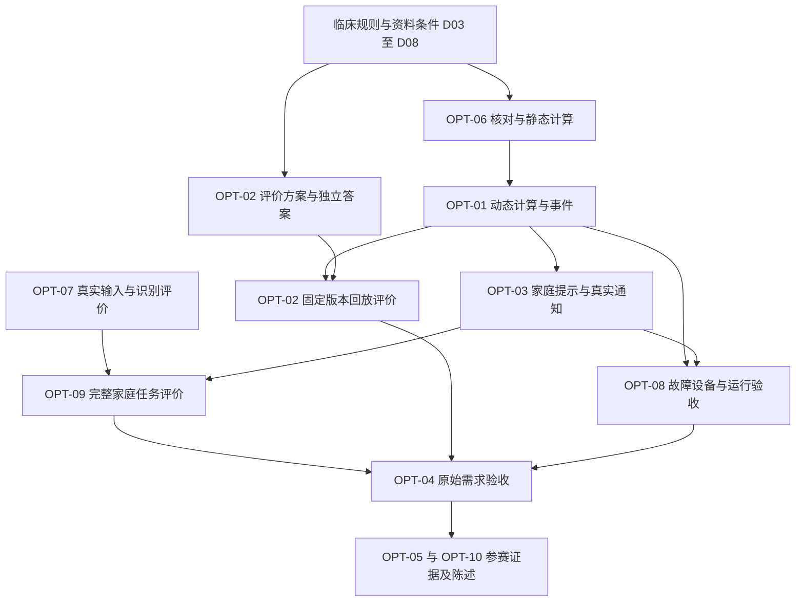

# sJIA 合并 MAS 预警平台参赛优化迭代方案

日期：2026-10-07。模式：REPLAN。能力类型：PLAN。依据：当前对话的十项评分、原始需求、赛事群资料问题、现有设计、当前代码及 QA04 证据。

本次交付为优化迭代方案。表中目标分表示取得相应证据后的复评目标，属于产品判断，不属于官方评分、临床性能指标或获奖概率。临床效果由实际评价决定；完成开发不能自动获得目标分。比赛规则、截止时间、团队可用时间尚未确认，日历排期保留待定。

当前完整业务要求与验收以 [PRD 2.0](sJIA合并MAS预警平台PRD.md) 为准；[实施计划](implementation-tasks.md)维护既有 T 工单，实施状态以 [交付记录](planning/delivery-ledger.json) 为准。本文 OPT-01—OPT-10 为优化工作组编号，每组关联既有 T 任务；不建立第二套任务完成状态。本文新增验收动作全部为 TODO／NOT_RUN。T30—T33 的开发记录路径已在现有索引登记，正文由对应任务开始时创建。

## 1. 按当前评分从低到高安排优化

| 工作组 | 评价项目 | 当前分 | 复评目标 | 必须取得的结果 | 责任任务 |
| --- | --- | ---: | ---: | --- | --- |
| OPT-01 | 动态预警核心能力 | 2 | 8 | 获准连续资料经过实际计算，产生可追溯提示；重复、未知、失效及历史回放行为正确 | T06、T17—T22、T24、T29、T32 |
| OPT-02 | 临床效果证据 | 2 | 6 | 独立参考答案、按当时可得资料回放、完整报告有效性与局限 | T17—T20、T27、T32 |
| OPT-03 | 提醒送达与后续处理 | 3 | 8 | 获准接收人通过真实渠道收到当前有效提示，受理、送达、阅读可区分 | T21—T23、T29、T30 |
| OPT-04 | 原始需求完成度 | 5 | 9 | F01—F12、G01—G06 均有对应的用户操作与验收证据 | T09—T29、T32、T33 |
| OPT-05 | 创新性与竞争差异 | 5 | 8 | 证明连续资料、来源核对与家庭行动结合所带来的具体增益 | T20、T22、T25、T30、T32、T33 |
| OPT-06 | 静态分类与 MS 评分 | 6 | 9 | 输入资格、适用前提、时间、单位、逐项计算及独立答案一致 | T04、T17—T19、T24、T32 |
| OPT-07 | AI 应用价值 | 7 | 8 | 真实报告和录音的字段提取、确认、保存与下游采用经过评价 | T12—T15、T29、T30、T32 |
| OPT-08 | 工程完成度与可靠性 | 7 | 9 | 真实手机、重复与并发、故障恢复及指定环境运行均有证据 | T03、T05、T06、T28—T33 |
| OPT-09 | 监护人使用体验 | 8 | 9 | 家庭用户能独立完成记录、理解提示、查找依据和准备就医摘要 | T07—T16、T22、T25、T30 |
| OPT-10 | 问题价值与选题意义 | 9 | 9 | 使用需求访谈、现行流程和实际结果支持参赛价值陈述 | T30、T32、T33 |

低分决定投入优先级；实现顺序服从资料、接口和验证的实际依赖。OPT-06 中的资料资格与静态计算是 OPT-01 需要的前置能力。OPT-02 的评价方案、资料获取和独立答案准备可以与工程工作分别推进；正式评价必须使用固定版本。

### 1.1 赛事资料整理优化需求

完整需求与验收见 [PRD 2.0](sJIA合并MAS预警平台PRD.md) 第 8.19 节；来源与代码自查见 [赛事群资料问题自查与优化需求](赛事群资料问题自查与优化需求.md)。FR-13—FR-22 与 GR-01—GR-10 一一对应，GRAC 编号继续使用。当前分数沿用既有评分，新增文档不提高产品分数。P0 为资料正确性、用途及临床评价所需前置；P1 为大量资料整理能力；P2 为家庭记录体验。

| 优先级 | 需求 ID 与工作内容 | 所属优化组 | 验收责任 |
| --- | --- | --- | --- |
| P0 | GR-01：不同事实保留各自医学时间、文书形成时间和实际可得时间 | OPT-01／OPT-06／OPT-07 | T13、T17—T20；GRAC-01 |
| P0 | GR-07：观察时段、院内多次采样及院外资料间隔与时效 | OPT-01／OPT-09 | T20、T22；GRAC-07 |
| P0 | GR-08：格式与流程测试、临床评价分别建立真实清单；核实患儿数与观察范围 | OPT-02 | T32；GRAC-08 |
| P0 | GR-09：原件、脱敏副本及外部处理／测试／展示用途检查 | OPT-07／OPT-08 | T12、T26、T27；GRAC-09 |
| P1 | GR-02：长期资料批次、页级结果、恢复、失败与预算管理 | OPT-07／OPT-08／OPT-09 | T12、T13、T31；GRAC-02 |
| P1 | GR-03：住院／门诊文书分类、就诊归组与事实候选核对 | OPT-04／OPT-07／OPT-09 | T27、T13；GRAC-03 |
| P1 | GR-04：文件重复、病史引用、独立采样和更正分别关联 | OPT-01／OPT-07／OPT-08 | T13、T20、T24；GRAC-04 |
| P1 | GR-05：医院与就诊目录、文书查找、匹配片段及原件入口 | OPT-04／OPT-09 | T16、T27；GRAC-05 |
| P1 | GR-06：新增内容、重复资料、事实变化与待核对摘要 | OPT-05／OPT-07／OPT-09 | T25、T24；GRAC-06 |
| P2 | GR-10：可关闭的资料补充提醒，独立于临床预警 | OPT-03／OPT-09 | T23、T11、T22；GRAC-10 |

GR-01／GR-03 的文书、就诊和逐事实时间设计是混合住院资料进入动态预警的前置。GR-09 约束外部处理前的资料资格；GR-02 不能仅通过提高单次上传张数完成。GR-08 保留临床观察时间序列，同种检查的多次独立采样不能因为格式相同而删除。群聊中约 5000—6000 页、36 份和 50—100 张分别属于规模场景、单位待核实的收集量和流程资料建议，均不登记为本项目已验收证据。

## 2. 共同上下文、责任与检查要求

### 2.1 执行前必读资料

| 标识 | 资料与使用范围 |
| --- | --- |
| C0 | `sJIA合并MAS预警平台需求输入.md`：F01—F12、原图四；`sJIA合并MAS预警平台产品目标.md`：G01—G06；`sJIA合并MAS预警平台PRD.md`：FR／AC／BR／NFR |
| C1 | `sJIA合并MAS预警平台HLD.md`：专业核对、计算发布、任务、权限与部署责任 |
| C2 | `sJIA合并MAS预警平台数据LLD.md`：字段、时间、核对、依赖、TX01—TX08、病例与评价资料 |
| C3 | `sJIA合并MAS预警平台后端LLD.md`、`backend-design/handshake.md`：接口、任务、Outbox、发送许可与回执 |
| C4 | `sJIA合并MAS预警平台预警编排LLD.md`、`alert-design/policy.schema.json`、`alert-design/node.schema.json`：N00—N11、动态信号、周期、known_at、EVAL-01—EVAL-05 |
| C5 | `sJIA合并MAS预警平台前端LLD.md`、`sJIA合并MAS预警平台页面流程.md`、`ui-delivery/screens/page-specifications.md`、`ui-delivery/alerts/specifications.md`、`ui-delivery/tokens.json`、`frontend-design/token-map.json` |
| C6 | `docs/development/index.md`、对应 T 任务主记录、`planning/delivery-ledger.json`、`docs/testing/QA03-report.md`、`docs/testing/QA04-report.md` 及其原始证据 |
| C7 | `demo-data/README.md`、`data-design/clinical-dataset-status.json`、实际获准病例来源与专业核对证明；文件登记不代表临床资格 |
| C8 | `赛事群资料问题自查与优化需求.md`：群聊来源、代码自查和资料输入范围；当前 GR／GRAC 业务规范见 PRD 2.0 第 8.19 节，完整实施追溯见第 13.4 节 |

前端参考资产目录为 `ui-delivery/screens/png/`。本计划使用文字规格、Token、DOM 和交互证据，不主动执行视觉功能。实施期间每项 T 任务继续维护唯一的 `docs/development/Txx.md` 主记录，更新 `docs/development/index.md`、受影响设计与知识文件；验收状态仍回写既有交付记录。

### 2.2 五类实施节点

| 节点 | 当前可用依据 | 待完成内容与接收方 |
| --- | --- | --- |
| Data | C2 已有相关实体、医学时间、版本、输入和信号结果设计 | 按当前模型核查必要约束、迁移及来源传播；T17—T20、T23 读取并回查 |
| Backend | C3 已有接口、任务和事务定义 | 完成实际业务编排、授权与失效检查；供 Worker、家庭接口及通知使用 |
| Algo／AI | C4 已定义确定性规则；现有识别服务已经接入 | 规则执行、连续资料选择与模型字段评价；动态阈值使用临床批准配置 |
| Frontend | C5 已有页面与状态设计 | 接入当前有效结果、资料不足、核对进度和实际通知状态；已有样式继续复用 |
| Integration | C6 提供部分本地功能证据 | 获准真实资料、真实服务、真实设备、独立参考答案和后续使用证据 |

节点设计已有依据不等于实现或验收通过。涉及具体临床参数的运行依赖 D04／D05，临床评价依赖 D08。规则计算维持确定性执行；AI 承担既定的资料识别与结构化职责。

### 2.3 验收证据与运行约束

每个验收动作记录：入口、角色、真实输入来源、操作、预期结果、实际结果、原始证据、代码与配置版本、数据版本、运行命令及检查人。持久化后重新读取，并验证后续页面或服务采用了正确版本。由临床人员提供的独立答案不能由同一计算函数生成。

新增验证遵循当前用户要求：使用获准真实资料和真实服务；不创建合成病例、替代模型响应或模拟通知回执。缺少边界资料的项目标记未覆盖。既有 QA03／QA04 证据按原有数据性质引用，不能充当本轮真实临床评价。

所有运行中间结果存入项目内已忽略的专用目录。当前规划只创建方案文档。后续实施的共享文件、数据库、进程和端口由执行者统一管理；没有委派授权时顺序操作共享资源。

业务测试在对应功能实现前确定输入与独立预期。适用的后端回归入口为 `backend/.venv/bin/python backend/manage.py test --settings=config.settings.qa --keepdb --noinput`；运行前审查选定用例的数据来源和写入范围，符合当前真实资料要求的用例才能执行。前端在 `guardian-h5/` 运行 `npm run typecheck` 和 `npm run build`。现有脚本不自动成为本轮验收入口，涉及合成输入的脚本需要按真实资料要求设计适用用例。

接口变更同步更新 Schema、调用方、前端类型及文档。迁移使用现有依赖和成熟工具，在获准数据库验证，保持不可变历史记录。启用失败时停用相关配置并保留审计；服务恢复使用经过验证的发布包和数据恢复流程。代码恢复通过文件编辑工具完成。

## 3. OPT-01：动态预警核心能力，2 → 8

**用户结果：**监护人提交报告并完成必要专业核对后，系统依据获准连续资料执行评估，展示当前有效提示及对应依据。

**任务与记录：**T20 为主，`docs/development/T20.md`；关联 T06、T17—T19、T21、T22、T24、T29、T32。需求为 F05—F08、F10—F12／FR-06；验收为 AC-06、V20、CHECK-T20、EVAL-T20。必读 C0—C6。

**实施内容：**

1. Data：逐项保存 `assessment_at`、`known_at`、规则与窗口版本、输入记录版本、专业核对依据、`baseline/current/series/context` 引用和排除原因。
2. Backend：由已核对字段变化、批准配置变化及获准定时事件调度评估；报告保存反馈与专业核对后的评估反馈分别表达。任务按实际执行进度和结果保存状态。
3. Algo：完整连接 N00—N11；执行可比较性筛选、动态差值、相对变化、连续采样、嵌套组合、持续周期、恢复与再次提醒。分类与 MS 结果按各自资格独立计算。
4. Frontend：首页与详情读取当前评估和获准提示；展示具体变化、时间、来源、缺项及联系方式。内部原因通过批准映射转换为家庭文字。
5. Integration：完成输入、核对、计算、事件、家庭读取、更正失效和受控重算全过程，保存实际版本及业务结果。

**验收动作：**使用获准连续病例覆盖静态与动态的四种组合，以及资料不足、重复采样、未知单位、零基准、迟到报告、更正、撤销、重复消费和乱序执行；没有真实资料的情形保持未覆盖。`replay` 只使用当时可得资料，不能发布到家庭或发送通知。当前有效事件必须可以追溯到实际计算输入；错误或缺少配置时保存对应明确状态。

**依赖与修改范围：**实现依赖 T06、T17、T18、T19、T21 的适用输入；配置运行依赖 D04／D05／D07，验证依赖 D08。修改 `backend/alerting/`、`backend/tasks/`、`backend/api/`、`backend/dependencies/`、家庭首页与提示组件及对应设计；核查实际模块路径后编辑。共享接口由 T20 统一维护，T22 接收。

## 4. OPT-02：临床效果证据，2 → 6

**用户结果：**参赛材料能够准确说明系统在什么资料、什么条件下具有怎样的表现，并给出局限。

**任务与记录：**T32 为主，预登记 `docs/development/T32.md`；关联 T17—T20、T27。需求 G05／G06；验收 V32、EVAL-01—EVAL-05。必读 C0、C2、C4、C6、C7。

**实施内容：**

1. 在运行评价前确定研究单位、病例纳入条件、观察窗口、独立参考答案、参数固定时间、统计口径、缺失处理和评价目标；由临床负责人决定样本量与可接受表现。
2. 建立真实连续病例清单，登记可用时间、报告出具与核对延迟、资料用途及参考结论来源。按患儿划分开发与验证资料，保留独立验证集合。
3. 用 `known_at` 回放当时可得事实，固定规则、资料及配置版本。对照同一输入下的静态判断与完整动态判断，报告两者可评估范围。
4. 报告逐项正确性、事件级敏感度、漏报、阳性预测值、每患儿观察时间内提示次数、首次有效提示相对独立临床识别时点的时间差、无法评估比例及置信区间。
5. 家庭使用评价与回顾性病例评价分别记录。回顾性提前提示时间不能直接证明改善了实际就医行为或患儿结局。

**验收动作：**每条评价结果可追溯到病例、输入版本、独立答案和运行输出；能检查验证资料未用于规则调整，未来资料没有提前参与计算。所有指标包含实际分母，结果不理想时同样完整报告。少量病例只能支持其覆盖范围，不能据此登记普遍有效性。

**依赖与修改范围：**方案及资料准备可以立即组织；正式评价依赖 OPT-01／OPT-06 的固定实现与 D03／D04／D05／D07／D08。范围为 `data-design/`、`tests/clinical/` 或现有实际评价目录、`docs/testing/` 和 T32 记录；新目录在执行时按现有工程结构确定。临床负责人承担答案与解释责任，工程执行者承担回放及证据完整性。

## 5. OPT-03：提醒送达与后续处理，3 → 8

**用户结果：**获准监护人收到当前有效的提示，理解下一步联系路径；系统准确区分受理、送达与阅读。

**任务与记录：**T23 为主，`docs/development/T23.md`；关联 T21、T22、T29、T30。需求 F07—F09／FR-07、FR-12；验收 AC-07、V23、EXT-T23。必读 C0—C6。

**实施内容：**确定本次比赛使用的真实通知渠道、接收范围和维护责任；按已有许可、版本及 Outbox 机制连接实际 Provider。检查开始发送前的当前权限、事件有效性、发布版本和许可时限；验证回执签名、重复回执、未知受理状态查询、失败与显式重试。提示详情提供获准文字、依据、有效联系和就医摘要入口；未阅读处置严格采用已确认策略。

**验收动作：**获准真实账号收到真实通知并打开对应事件；受理回执不能记为送达，阅读不能记为已经就医。重复消费不重复通知，撤销提交后不开始新发送，过期联系方式不用于新提示。实际未触发的 Provider 异常保持未覆盖。

**依赖与修改范围：**真实发送依赖 OPT-01、T21、D05／D06／D09、渠道凭据及本轮明确的外部发送授权。缺少这些输入仅限制相关运行；内部接口与签名验证实现可按已知协议完成。范围为 `backend/notifications/`、回调接口、家庭提示页面、通知运行配置及对应记录。真实发送属于后续实施动作，本次规划不执行。

## 6. OPT-04：原始需求完成度，5 → 9

**用户结果：**原始需求中的每项承诺都能通过实际操作和证据查验。

**任务与记录：**T29 为主，`docs/development/T29.md`；T33 管理最终材料。需求 F01—F12、G01—G06；验收 AC-01—AC-12、AC-H5-01—AC-H5-06、V29／V33。必读 C0—C7 与各责任记录。

| 原始承诺 | 责任任务 | 必须完成的用户结果 |
| --- | --- | --- |
| F01／G01 | T03、T08、T09、T29 | 获准登录、关联、切换与撤销；跨患儿访问拒绝 |
| F02—F04／G02 | T10、T12—T15、T17、T27、T30 | 症状、报告和治疗资料保存，来源及核对状态准确 |
| F05／G03 | T16、T20、T22 | 历史与可比较变化可查看，不可比较时说明原因 |
| F06、F12／G06 | T17—T20、T32 | 分类与 MS 按合格输入计算并独立核查 |
| F07—F08／G05 | T20—T23、T32 | 经批准的动态提示产生、解释、送达及失效 |
| F09／G04 | T21、T25、T30 | 当前授权范围内的就医摘要和有效联系信息 |
| F10 | T17—T22、T32 | 配置待确认、资料不足、不适用及未触发分别表达 |
| F11 | T03、T17、T24、T26、T29 | 记录、核对、结果与更正历史可追溯 |

**实施与验收：**为每行记录入口、角色、输入、操作、预期、证据和未完成条件；既有账号、草稿、治疗、处置与权限要求继续保留。演示使用一条贯穿报告、核对、评估、提示、摘要的真实流程，并检查全部原始承诺；单条演示不能代替完整矩阵。展示时准确标明公开展示范围和能力边界。

**依赖与修改范围：**矩阵整理立即执行；完整验收依赖各责任任务及 OPT-01—OPT-03、OPT-06—OPT-09 的适用证据。范围为已有验收矩阵、T29／T33 记录与参赛说明；每项功能代码由对应 T 任务维护。

## 7. OPT-05：创新性与竞争差异，5 → 8

**用户结果：**评审能够看到相同资料下，连续变化分析和家庭流程提供的具体增益。

**任务与记录：**T33 维护参赛材料，预登记 `docs/development/T33.md`；T20、T25、T30、T32 提供证据。来源为原方案第 3 节、图示四、G03—G06；验收关联 AC-03／AC-06／AC-11、EVAL-02／EVAL-03／EVAL-05、V33。必读 C0、C4、C6、C7。

**实施内容：**使用获准真实病例展示各次采样、当时可得资料、静态结果、动态结果、首次提示及其来源；病例回放沿用受控评价工具并保持与家庭实时模式隔离。使用同一资料比较静态规则与完整动态规则的提示时点和提示负担。以实际家庭任务结果说明报告整理、理解资料和就医摘要的价值。

**验收动作：**每条优势陈述关联可复查证据；无差异或效果不足时如实表达。演示使用实际计算结果，能够从展示结果返回原始记录与规则版本。比赛评分表取得后建立官方评分项与证据映射；不预设冠军概率、独创性或竞品领先结论。

**依赖与修改范围：**依赖 OPT-01、OPT-02、OPT-04、OPT-09 的实际结果。范围为评价输出、参赛说明与已有受控演示入口；新增交互必须经过 C5 与对应需求审查。该工作组不以增加菜单数量作为完成条件。

## 8. OPT-06：静态分类与 MS 评分，6 → 9

**用户结果：**每次内部计算都能说明资料资格、适用前提、选值依据和完整结果。

**任务与记录：**T18、T19 分别维护 `docs/development/T18.md`、`docs/development/T19.md`；T17 维护资格。需求 F06／F10／F12、FR-04／FR-05／FR-10；验收 AC-04／AC-05／AC-10、EVAL-01。必读 C0—C4、C6、C7。

**实施内容：**支持接口以获准记录及版本构建评估集合；患儿、字段、核对证明、临床前提、单位映射、医学时间和治疗适用条件逐项验证。分类与 MS 各自保存输入引用、缺项与结果；使用 Decimal，阈值比较先于展示舍入。规范允许的限定值行为以 PRD 的当前有效规则为准。更正或核对撤销后，相关计算与家庭采用同步失效。

**验收动作：**获准资料与独立答案逐项一致；未知前提不自动变成满足，未知专业变量不自动按零值参加评分。未经核对或跨患儿的输入被拒绝，缺项说明能够回查到具体字段。真实边界资料缺少时记录范围，不构造病例填补验收。

**依赖与修改范围：**T04 映射、T17 核对、D03／D04／D07 提供运行条件；D08 提供独立验证。修改 `backend/assessment/`、`backend/verification/`、支持评估接口、输入关联和对应测试、设计与主记录。T18／T19 共同修改的接口按顺序维护。

## 9. OPT-07：AI 应用价值，7 → 8

**用户结果：**家庭提供照片或语音后，能准确核对候选并保存；后续业务使用可追溯资料。

**任务与记录：**T13、T15 为主，分别维护现有主记录；关联 T12、T14、T29、T30、T32。需求 FR-02／FR-10；验收 AC-02／AC-10、EV01、V13／V15。必读 C0—C3、C5—C7 及 QA04。

**实施内容：**建立真实报告和授权录音评价集，覆盖当前已有格式、比较符、单位、时间、否定语义、药物原文及逐页来源。分别评价模型候选、本人确认后保存值和专业核对状态；保留取消、失败、重新识别与人工输入行为。记录实际模型版本、字段级结果、耗时与成本。

**验收动作：**关键字段逐项对照独立原文答案，登记错误及无法识别数量；候选未经本人采用不能写入，保存后重新读取与确认内容一致。识别成功不自动授予临床资格。录音在获准真实手机上采集和转写；未涵盖的口音与报告格式保持未验证。

**依赖与修改范围：**依赖真实输入、外部处理用途和现有服务凭据；候选采用仍依赖 T12／T17 的资料与核对流程。修改 `backend/recognition/`、报告、治疗、语音组件及对应证据。模型输出检查失败时明确返回错误，不自动换用另一 Provider 生成成功结果。

## 10. OPT-08：工程完成度与可靠性，7 → 9

**用户结果：**在比赛指定设备和运行环境中完成全流程，断网、重复操作及服务故障不会产生错误结果。

**任务与记录：**T28、T29、T30、T31、T33；预登记记录按现有索引创建。验收 NFR、AC-H5-01—AC-H5-06、V28—V33。必读 C1—C6、运行配置和现有锁定依赖。

**实施内容：**使用获准环境验证输入提交、幂等、Worker 租约、并发更正、权限撤销、配置停用、任务恢复和读取当前结果；检查真实 iOS、Android、微信及比赛要求的浏览器。容量目标由预期账户、并发、报告规模和可接受等待时间确定，再开展实际负载验证。记录端到端耗时、P95／P99、任务失败率、资源与恢复结果。检查备份恢复及附件、记录、配置、依赖的一致性。

**验收动作：**发生断网或超时后，用户能够知道提交状态；重复提交不会生成重复业务结果；撤权与停用后不继续采用失效结果；恢复后关键记录和来源一致。所有比赛必需步骤在指定环境有实际记录。恢复结果、容量数字和设备兼容性分别报告，不能仅以构建成功作为通过条件。

**依赖与修改范围：**依赖相关功能完成，运行依赖 D01、真实设备、容量目标、获准测试环境与资料。修改现有 `deploy/`、`backend/observability/`、任务与请求模块、适用前端状态及证据；具体目录按当前代码确认。影响业务的故障验证在获准隔离环境执行，使用恢复检查保护现有资料。

## 11. OPT-09：监护人使用体验，8 → 9

**用户结果：**家庭用户可以独立完成添加报告、核对候选、查看变化、理解提示和准备摘要。

**任务与记录：**T30 为主，预登记 `docs/development/T30.md`；关联 T07—T16、T22、T25。需求 G02—G05；验收 AC-H5、EVAL-05、V30。必读 C0、C5—C7。

**实施内容：**使用获准监护人、真实设备及其可访问资料进行完整任务观察。重点检查资料已经保存与评估正在处理的区分、待专业核对的责任说明、资料不足的下一步、提示依据和联系入口。保留原有导航、来源与更正功能；仅依据实际任务障碍调整操作和文字。

**验收动作：**记录任务完成比例、耗时、需要协助次数、误解与中断原因；观察用户能否说明当前提示、资料不足和下一步联系方法。目标值与参与者范围在观察前确定，涉及临床文字由责任人确认；少量观察不代表全部家庭。界面验证采用 DOM、输入、焦点及业务结果，不主动执行截图或视觉比较。

**依赖与修改范围：**观察方案可以准备；完整提示任务依赖 OPT-01／OPT-03 和 D06 的获准文字。修改相关家庭页面、组件和 C5 文档；复用现有 Token、素材与页面结构。新的操作必须保留资料来源和本人确认责任。

## 12. OPT-10：问题价值与选题意义，9 → 9

**用户结果：**参赛陈述明确服务人群、具体困难、实际使用条件及可证明的改善。

**任务与记录：**T33 为主，T30／T32 提供使用与评价资料；需求 G01—G06；验收 V33 及 EVAL-05。必读 C0、C6、C7。

**实施内容：**整理经允许使用的监护人访谈和临床流程信息，描述资料如何取得、由谁核对、提醒如何接收及如何用于就医沟通。将每条参赛主张连接到原始需求、真实观察或实际评价；取得赛事规则后映射交付形式、演示时长、评分权重和材料要求。

**验收动作：**事实、已验证结果和未来目标具有明确标识；社会价值陈述不使用无依据的改善比例。未确认的商业购买方、医院合作和公开展示许可保留未知。题目价值保持 9 分目标，不依靠夸大临床效果提高评分。

**依赖与修改范围：**既有需求可直接使用；新增事实依赖授权访谈、赛事原文及 OPT-02／OPT-09 证据。范围为参赛说明、T33 记录和相关需求引用；本次规划不联系外部人员或提交参赛材料。

## 13. 执行依赖与验收节点

| 验收节点 | 完成条件 | 未满足时的实际影响 |
| --- | --- | --- |
| M1 评估可以追溯 | T17—T20 实际运行，固定输入、规则、时间和结果可回查；技术失败与资料不足明确区分；混合文书输入满足 GRAC-01／GRAC-04／GRAC-07 | 动态预警保持未通过，不以页面展示代替 |
| M2 提示可以采用 | T21—T23 在获准范围产生、展示、送达、阅读；重复与失效行为正确；资料提醒按 GRAC-10 独立验收 | 真实通知与家庭提示效果保持未通过 |
| M3 证据可以复查 | T30／T32 完成独立评价并准确报告覆盖、表现和局限；GRAC-08／GRAC-09 核查资料单位、观察范围与用途 | 不宣称提前识别增益或家庭使用效果成立 |
| M4 比赛流程可以演示 | T29／T31／T33 覆盖原始承诺和指定环境，GRAC-02／GRAC-03／GRAC-05／GRAC-06 验证真实资料整理、查找及摘要；参赛陈述逐条关联证据 | 不登记整体比赛交付完成 |

实施顺序为：资料资格和静态计算、动态编排、提示与通知、完整集成验收。评价方案及资料获取、真实输入质量评价、赛事规则核对可以在各自依据满足后推进；家庭全流程评价和正式效果评价等待对应功能稳定及版本固定。共享代码由当前执行者顺序维护。

## 14. 决策依赖与责任

| 决定 | 已有或缺少的输入 | 责任角色 | 限制范围与解除条件 |
| --- | --- | --- | --- |
| D01 | 比赛名称、官方要求、截止时间、演示环境、后续运行范围待确认 | 项目负责人 | 限制日历排期、现场运行和最终交付；提供赛事原文与环境 |
| D02／D03 | 真实监护人关联、专业核对人、核对资料和执行方式 | 项目及临床负责人 | 限制真实病例资格与家庭使用；提供获准账号、责任人与证明 |
| D04 | 评估窗口、重复选值、适用前提与边界答案 | 临床负责人 | 限制规则运行；逐项形成批准配置和独立答案 |
| D05／D06 | 动态条件、等级、恢复、再次提示、家庭文字及可见范围 | 临床与项目负责人 | 限制临床提示启用；取得有版本的确认内容 |
| D07／D08 | 实际来源映射、连续病例、独立评价资料、样本及评价方案 | 数据与临床负责人 | 限制真实输入验收及效果评价；提供来源、用途、参考结论和统计方案 |
| D09 | 通知渠道、有效联系、资料保存与外部处理范围 | 项目及数据负责人 | 限制真实发送、外部处理与运行；明确凭据、对象、用途和责任 |

这些输入可以记录为具体待办，不阻止依据充分的内部实现。专业批准、真实病例和用户观察不能由工程人员自行填写为完成。联系人姓名、日期与承诺尚未提供时保持待定。

## 15. 方案检查记录

本方案覆盖前次全部十项评分，按 2、2、3、5、5、6、7、7、8、9 排序；F01—F12 和 G01—G06 均关联责任任务。实现、验证、外部发送和比赛交付依赖分别登记。每个优化工作组具备需求、任务主记录、必读上下文、修改范围、可观察验收及阻塞条件。

方案依据包括当前评估接口、T18—T23 记录、现有设计、QA04 证据及赛事资料自查。十项评分对应工作组继续有效；GR-01—GR-10 进入相应工作组并分别具有验收条件。当前交付仅证明规划文档与资料需求自查已完成；新增开发、临床评价、外部发送和比赛交付的验收均未运行。
